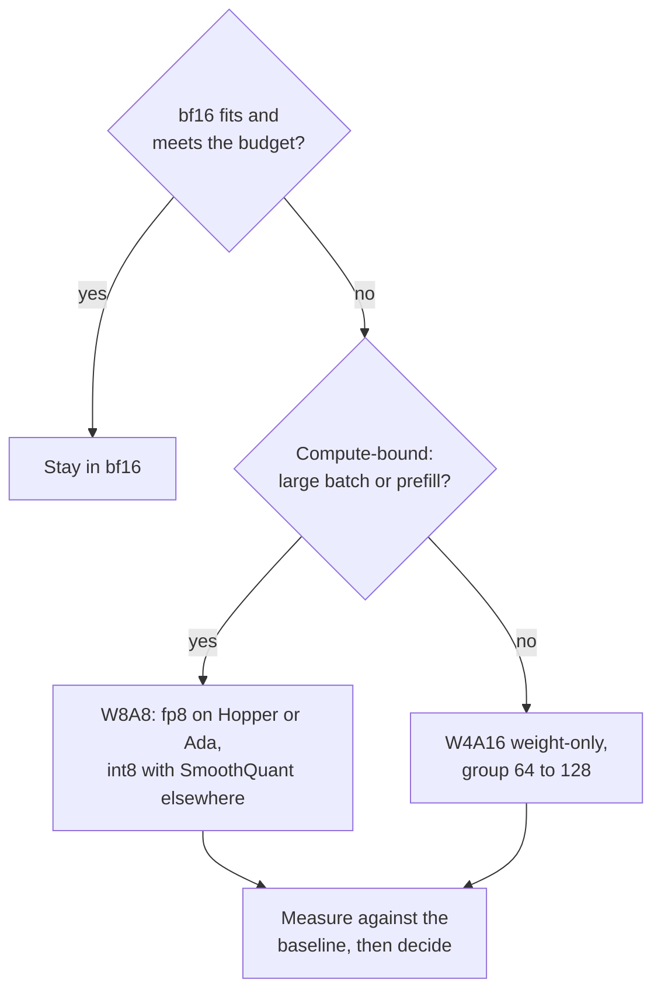

# Quantization Review Checklist: चुनना, समीक्षा करना और शक करना

चरण 10 का संक्षेप, देखने के लिए। [पाठ 25](../lessons/0025-choosing-a-scheme.md) scheme चुनना बताता है, [पाठ 26](../lessons/0026-reviewing-a-quantization-claim.md) दावे की समीक्षा और quantized model का rollout, और [पाठ 27](../lessons/0027-when-the-usual-answer-is-wrong.md) जब आम जवाब ग़लत हो और विवाद को स्रोत से सुलझाना।

## Scheme चुनना

इसी क्रम में पूछें। हर सवाल अगले से पहले विकल्प घटाता है।

| # | सवाल | अगर हाँ | अगर नहीं |
|---|---|---|---|
| 1 | क्या bf16 KV cache के साथ फिट होता है और latency budget पूरा करता है? | bf16 में रहें (serving budget: [Quantization at Serve Time](../../inference/reference/quantization-at-serve-time.md)) | आगे बढ़ें |
| 2 | क्या GPU fp8 natively compute करता है (Hopper, Ada Lovelace)? | W8A8 fp8 पहली कोशिश है | Ampere और पुराने पर int8 W8A8, या W4A16 |
| 3 | बड़े batches या prefill-heavy (compute-bound)? | W8A8 | W4A16 weight-only, group 64 से 128 |
| 4 | क्या quality का स्तर आपके tasks पर संख्या में लिखा है? | जो बचा है उस पर लागू करें | पहले लिखें |
| 5 | क्या calibration data उपलब्ध है? | GPTQ या AWQ | Round-to-nearest, बड़े नुक़सान की उम्मीद रखें |

## प्रमाण क्या कहते हैं, और उनकी सीमाएँ

| निष्कर्ष | स्रोत | सीमा |
|---|---|---|
| W8A8-FP हर आकार पर व्यावहारिक रूप से lossless | Kurtic et al., Llama 3.1 | एक परिवार, tune की हुई recipes |
| अच्छी तरह tune किया W8A8-INT 1 से 3 प्रतिशत खोता है, 70B पर SmoothQuant चाहिए था | Kurtic et al. | बड़े आकारों पर बेहतर calibration data चाहिए |
| W4A16, Leaderboard V1 पर bf16 औसत का 99.36 प्रतिशत वापस लाता है | Kurtic et al. | सबसे छोटे models ज़्यादा खोते हैं |
| Synchronous serving के लिए W4A16 किफ़ायती, asynchronous के लिए W8A8 | Kurtic et al. | Crossover आकार, hardware और task पर निर्भर |
| कुल model bits के लिए 4-bit लगभग सार्वभौम रूप से इष्टतम, छोटा block size | Dettmers और Zettlemoyer | 2022 के परिवार, zero-shot accuracy, throughput नहीं |
| 4-bit kernel batch 16 से 32 तक लगभग 4 गुना तेज़, 128 पर लगभग 1.5 गुना | MARLIN | एक kernel, एक GPU वर्ग |

## किसी और के दावे के लिए सवाल

| दावे का हिस्सा | पूछें |
|---|---|
| "कोई नुक़सान नहीं" | किस baseline के मुक़ाबले, क्या वही model उसी harness पर bf16 में? |
| "Quality" | कौन-से tasks? आपके जैसे open-ended, या सिर्फ़ multiple choice? |
| "Quality" | सिर्फ़ perplexity? किस text और window पर? |
| "Quality" | Flips? KL divergence? Accuracy बराबर रह सकती है जबकि 13.6 प्रतिशत तक उत्तर पलट जाएँ (Dutta et al.) |
| "4-bit" | कौन-सा group size, यानी प्रति weight कितने effective bits? |
| "4-bit" | कौन-सा calibration set, कितना बड़ा, आपके traffic से कितना क़रीब? |
| Speed | कौन-सा hardware, batch size, kernel और baseline stack? |

यह भी कहें कि क्या ठीक है और रहना चाहिए। जो समीक्षा सिर्फ़ ख़ामियाँ गिनाए वह आधी है।

## Quantized model का rollout

| चरण | क्या करें |
|---|---|
| Baseline को पिन करें | bf16 checkpoint और harness version का नाम लें, उसे serve करते रहें |
| Offline eval | Baseline के मुक़ाबले accuracy, flips और KL |
| Production जैसा traffic | असली prompts दोनों से गुज़ारें; labels न हों तो KL या output similarity |
| Shadow, फिर canary | Baseline के बग़ल में चलाएँ, फिर users के छोटे हिस्से पर, गेट पहले से तय रखकर |
| Version | Checkpoint, quantization config, group size, calibration set, serving stack version साथ में |
| Rollback | Baseline तब तक deploy करने लायक़ रहे जब तक canary ने वह traffic न देख लिया हो जिसकी आपको परवाह है |

## जब आम जवाब ग़लत हो

| आम जवाब | कब ग़लत है | स्रोत |
|---|---|---|
| 4-bit weights | Model बहुत ज़्यादा trained है: PTQ की गिरावट प्रति parameter training tokens के साथ बढ़ती है | Kumar et al. (1.7B तक के models पर fit किया गया) |
| 4-bit weights | Model छोटा है: Qwen-1.5B के लिए 93.5 प्रतिशत recovery, बड़े models के लिए 98 से 99 प्रतिशत | Kurtic et al. |
| 4-bit weights | Serving compute-bound है: batch size बढ़ने पर weight-only फ़ायदे घटते हैं | MARLIN, QServe, Kurtic et al. |
| Memory के लिए 4-bit | fp8 native है और memory फिट होती है: W8A8-FP कम जोखिम वाली पहली कोशिश है | Kurtic et al. |
| Long context टूटता है | RULER recovery सभी formats के लिए कम से कम 98 प्रतिशत थी, 405B नहीं चलाया गया, KV cache का अध्ययन नहीं हुआ | Kurtic et al. |
| AWQ, GPTQ को हराता है | असली tasks पर, tune किया GPTQ: 8B पर GPTQ 2.9 अंक आगे, academic पर AWQ अधिकतम 0.35 आगे | Kurtic et al. |

## विवाद को स्रोत से सुलझाना

1. पेपर खोजें, उसका हवाला देने वाली post नहीं।
2. Models, आकार और साल जाँचें।
3. जाँचें कि क्या मापा गया था और क्या दावा किया गया।
4. Table के पीछे का setup पढ़ें: group size, clipping, calibration set, tasks।
5. फ़र्क़ की तुलना run-to-run noise से करें।
6. अपने tasks पर चलाएँ।
