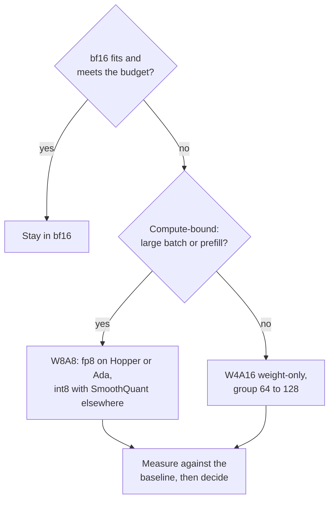

# Quantization Review Checklist: Choosing, Reviewing and Doubting

Stage 10 compressed for lookup. [Lesson 25](../lessons/0025-choosing-a-scheme.md) covers choosing a scheme, [lesson 26](../lessons/0026-reviewing-a-quantization-claim.md) covers reviewing a claim and rolling out a quantized model, and [lesson 27](../lessons/0027-when-the-usual-answer-is-wrong.md) covers when the usual answer is wrong and settling a dispute from the source.

## Choosing a scheme

Ask in this order. Each question removes options before the next.

| # | Question | If yes | If no |
|---|---|---|---|
| 1 | bf16 fits with the KV cache and meets the latency budget? | Stay in bf16 (serving budget: [Quantization at Serve Time](../../inference/reference/quantization-at-serve-time.md)) | Continue |
| 2 | GPU computes fp8 natively (Hopper, Ada Lovelace)? | W8A8 fp8 is the first try | int8 W8A8 on Ampere and older, or W4A16 |
| 3 | Large batches or prefill-heavy (compute-bound)? | W8A8 | W4A16 weight-only, group 64 to 128 |
| 4 | Quality bar written as a number on your tasks? | Apply it to what is left | Write it first |
| 5 | Calibration data available? | GPTQ or AWQ | Round-to-nearest, expect a bigger loss |

## What the evidence says, and its limits

| Finding | Source | Limit |
|---|---|---|
| W8A8-FP effectively lossless at every size | Kurtic et al., Llama 3.1 | One family, tuned recipes |
| Well-tuned W8A8-INT loses 1 to 3 percent, needed SmoothQuant at 70B | Kurtic et al. | Needs better calibration data at larger sizes |
| W4A16 recovers 99.36 percent of the bf16 average on Leaderboard V1 | Kurtic et al. | Smallest models lose more |
| W4A16 cost-efficient for synchronous serving, W8A8 for asynchronous | Kurtic et al. | Crossover depends on size, hardware, task |
| 4-bit almost universally optimal for total model bits, small block size | Dettmers and Zettlemoyer | 2022 families, zero-shot accuracy, not throughput |
| 4-bit kernel near 4 times faster to batch 16 to 32, about 1.5 times at 128 | MARLIN | One kernel, one GPU class |

## Questions for someone else's claim

| Part of the claim | Ask |
|---|---|
| "No loss" | Against which baseline, same model in bf16 on the same harness? |
| "Quality" | Which tasks? Open-ended like yours, or multiple choice only? |
| "Quality" | Perplexity only? On which text and window? |
| "Quality" | Flips? KL divergence? Accuracy can match while up to 13.6 percent of answers flip (Dutta et al.) |
| "4-bit" | Which group size, so how many effective bits per weight? |
| "4-bit" | Which calibration set, how large, how close to your traffic? |
| Speed | Which hardware, batch size, kernel and baseline stack? |

Also say what is fine and should stay. A review that only lists faults is half done.

## Rolling out a quantized model

| Step | What to do |
|---|---|
| Pin the baseline | Name the bf16 checkpoint and harness version, keep serving it |
| Offline eval | Accuracy, flips and KL against the baseline |
| Production-like traffic | Replay real prompts through both; KL or output similarity if there are no labels |
| Shadow, then canary | Run beside the baseline, then a small share of users, with the gate set beforehand |
| Version | Checkpoint, quantization config, group size, calibration set, serving stack version together |
| Rollback | Baseline stays deployable until the canary has seen the traffic you care about |

## When the usual answer is wrong

| Usual answer | Wrong when | Source |
|---|---|---|
| 4-bit weights | The model is heavily trained: PTQ degradation grows with training tokens per parameter | Kumar et al. (fitted on models up to 1.7B) |
| 4-bit weights | The model is small: 93.5 percent recovery for Qwen-1.5B against 98 to 99 percent for larger ones | Kurtic et al. |
| 4-bit weights | Serving is compute-bound: weight-only gains shrink as batch size grows | MARLIN, QServe, Kurtic et al. |
| 4-bit for memory | fp8 is native and memory fits: W8A8-FP is the lower-risk first try | Kurtic et al. |
| Long context breaks | RULER recovery was at least 98 percent for all formats, 405B not run, KV cache not studied | Kurtic et al. |
| AWQ beats GPTQ | Real-world tasks, tuned GPTQ: GPTQ led by 2.9 points at 8B, AWQ led by at most 0.35 on academic | Kurtic et al. |

## Settling a dispute from the source

1. Find the paper, not the post that cites it.
2. Check the models, sizes and year.
3. Check what was measured against what was claimed.
4. Read the setup behind the table: group size, clipping, calibration set, tasks.
5. Compare the gap with the run-to-run noise.
6. Run it on your own tasks.
