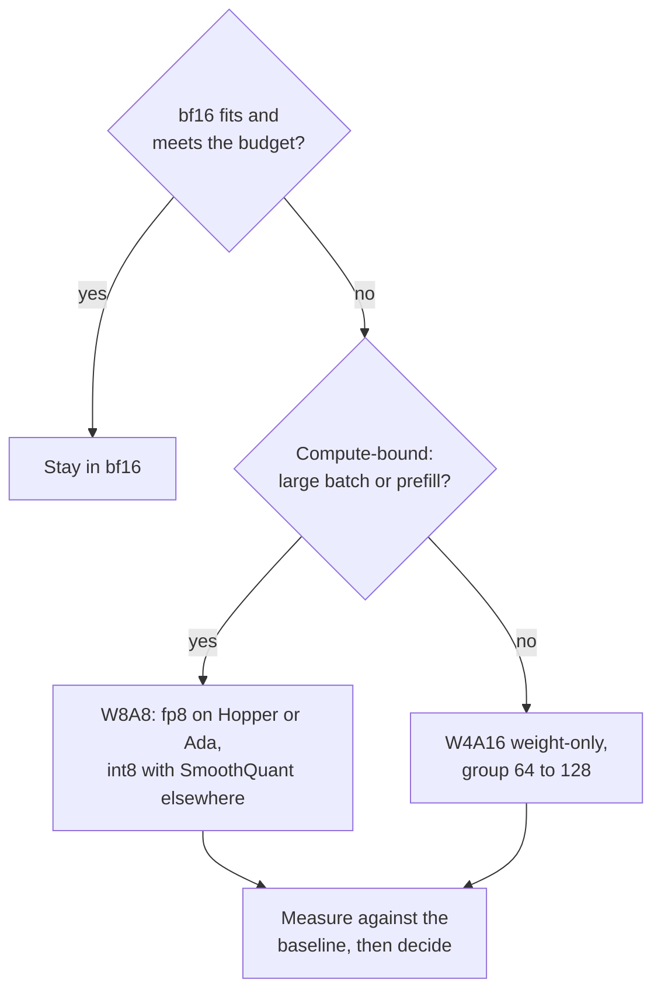

# Checklist de Revisão de Quantização: Escolher, Revisar e Duvidar

A etapa 10 comprimida para consulta. A [lição 25](../lessons/0025-choosing-a-scheme.md) cobre a escolha de um esquema, a [lição 26](../lessons/0026-reviewing-a-quantization-claim.md) cobre a revisão de uma alegação e o rollout de um modelo quantizado, e a [lição 27](../lessons/0027-when-the-usual-answer-is-wrong.md) cobre quando a resposta de sempre está errada e como resolver uma disputa a partir da fonte.

## Escolhendo um esquema

Pergunte nesta ordem. Cada pergunta elimina opções antes da próxima.

| # | Pergunta | Se sim | Se não |
|---|---|---|---|
| 1 | O bf16 cabe com o KV cache e atende ao orçamento de latência? | Fique no bf16 (orçamento de serving: [Quantização no Serving](../../inference/reference/quantization-at-serve-time.md)) | Continue |
| 2 | A GPU calcula fp8 nativamente (Hopper, Ada Lovelace)? | W8A8 fp8 é a primeira tentativa | int8 W8A8 na Ampere e anteriores, ou W4A16 |
| 3 | Batches grandes ou carga dominada por prefill (limitada por compute)? | W8A8 | W4A16 somente de pesos, grupo 64 a 128 |
| 4 | O nível de qualidade está escrito como um número nas suas tarefas? | Aplique-o ao que sobrou | Escreva-o primeiro |
| 5 | Há dados de calibração disponíveis? | GPTQ ou AWQ | Round-to-nearest, espere uma perda maior |

## O que a evidência diz, e os seus limites

| Achado | Fonte | Limite |
|---|---|---|
| W8A8-FP efetivamente sem perdas em todos os tamanhos | Kurtic et al., Llama 3.1 | Uma família, receitas ajustadas |
| W8A8-INT bem ajustado perde de 1 a 3 por cento, precisou de SmoothQuant em 70B | Kurtic et al. | Precisa de dados de calibração melhores em tamanhos maiores |
| W4A16 recupera 99.36 por cento da média do bf16 no Leaderboard V1 | Kurtic et al. | Os modelos menores perdem mais |
| W4A16 econômico para serving síncrono, W8A8 para assíncrono | Kurtic et al. | O ponto de cruzamento depende de tamanho, hardware e tarefa |
| 4 bits quase universalmente ótimo para o total de bits do modelo, tamanho de bloco pequeno | Dettmers e Zettlemoyer | Famílias de 2022, acurácia zero-shot, não throughput |
| Kernel de 4 bits quase 4 vezes mais rápido até batch 16 a 32, cerca de 1.5 vez em 128 | MARLIN | Um kernel, uma classe de GPU |

## Perguntas para a alegação de outra pessoa

| Parte da alegação | Pergunte |
|---|---|
| "Sem perda" | Contra qual baseline, o mesmo modelo em bf16 no mesmo harness? |
| "Qualidade" | Quais tarefas? Abertas como as suas, ou apenas múltipla escolha? |
| "Qualidade" | Apenas perplexity? Em qual texto e janela? |
| "Qualidade" | Flips? Divergência KL? A acurácia pode coincidir enquanto até 13.6 por cento das respostas viram (Dutta et al.) |
| "4 bits" | Qual tamanho de grupo, ou seja, quantos bits efetivos por peso? |
| "4 bits" | Qual calibration set, de que tamanho, e quão próximo do seu tráfego? |
| Velocidade | Qual hardware, batch size, kernel e stack de baseline? |

Diga também o que está bom e deve ficar. Uma revisão que só lista falhas está pela metade.

## Fazendo o rollout de um modelo quantizado

| Passo | O que fazer |
|---|---|
| Fixar o baseline | Nomeie o checkpoint em bf16 e a versão do harness, continue a servi-lo |
| Eval offline | Acurácia, flips e KL contra o baseline |
| Tráfego parecido com produção | Reproduza prompts reais pelos dois; KL ou similaridade de saída se não houver rótulos |
| Shadow, depois canary | Rode ao lado do baseline, depois para uma pequena fatia dos usuários, com o gate definido de antemão |
| Versão | Checkpoint, configuração de quantização, tamanho de grupo, calibration set e versão da stack de serving juntos |
| Rollback | O baseline continua implantável até o canary ter visto o tráfego que importa para você |

## Quando a resposta de sempre está errada

| Resposta de sempre | Errada quando | Fonte |
|---|---|---|
| Pesos de 4 bits | O modelo é muito treinado: a degradação da PTQ cresce com os tokens de treinamento por parâmetro | Kumar et al. (ajustado em modelos de até 1.7B) |
| Pesos de 4 bits | O modelo é pequeno: 93.5 por cento de recuperação para o Qwen-1.5B contra 98 a 99 por cento para os maiores | Kurtic et al. |
| Pesos de 4 bits | O serving é limitado por compute: os ganhos de somente pesos diminuem com o batch size | MARLIN, QServe, Kurtic et al. |
| 4 bits para memória | O fp8 é nativo e a memória cabe: W8A8-FP é a primeira tentativa de menor risco | Kurtic et al. |
| Contexto longo quebra | A recuperação no RULER foi de pelo menos 98 por cento para todos os formatos, 405B não foi executado, KV cache não foi estudado | Kurtic et al. |
| AWQ supera GPTQ | Tarefas do mundo real, GPTQ ajustado: o GPTQ liderou por 2.9 pontos no 8B, o AWQ liderou por no máximo 0.35 nas acadêmicas | Kurtic et al. |

## Resolvendo uma disputa a partir da fonte

1. Encontre o artigo, não o post que o cita.
2. Confira os modelos, os tamanhos e o ano.
3. Confira o que foi medido contra o que foi alegado.
4. Leia a configuração por trás da tabela: tamanho de grupo, clipping, calibration set, tarefas.
5. Compare a diferença com o ruído entre execuções.
6. Rode nas suas próprias tarefas.
