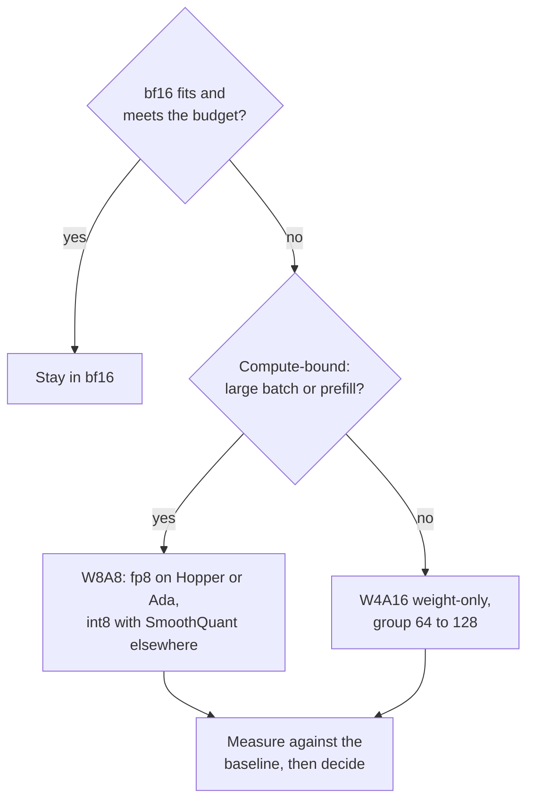

# Чек-лист ревью квантизации: выбор, проверка и сомнение

Этап 10 в сжатом виде для быстрого поиска. [Урок 25](../lessons/0025-choosing-a-scheme.md) охватывает выбор схемы, [урок 26](../lessons/0026-reviewing-a-quantization-claim.md) охватывает проверку заявления и выкатку квантизованной модели, а [урок 27](../lessons/0027-when-the-usual-answer-is-wrong.md) охватывает случаи, когда обычный ответ неверен, и разрешение спора по первоисточнику.

## Выбор схемы

Задавайте в этом порядке. Каждый вопрос убирает варианты до следующего.

| # | Вопрос | Если да | Если нет |
|---|---|---|---|
| 1 | bf16 помещается вместе с KV-кешем и укладывается в бюджет задержки? | Остаться в bf16 (бюджет обслуживания: [Квантизация при обслуживании](../../inference/reference/quantization-at-serve-time.md)) | Продолжить |
| 2 | GPU вычисляет fp8 нативно (Hopper, Ada Lovelace)? | W8A8 fp8 это первая проба | int8 W8A8 на Ampere и старше или W4A16 |
| 3 | Большие батчи или упор на prefill (ограничение вычислениями)? | W8A8 | W4A16 только для весов, группа 64-128 |
| 4 | Планка качества записана числом на ваших задачах? | Применить её к оставшемуся | Сначала записать |
| 5 | Есть калибровочные данные? | GPTQ или AWQ | Округление к ближайшему, ожидать большей потери |

## Что говорит свидетельство и его границы

| Результат | Источник | Граница |
|---|---|---|
| W8A8-FP фактически без потерь на каждом размере | Kurtic et al., Llama 3.1 | Одно семейство, настроенные рецепты |
| Хорошо настроенный W8A8-INT теряет 1-3%, на 70 млрд потребовался SmoothQuant | Kurtic et al. | На больших размерах нужны лучшие калибровочные данные |
| W4A16 возвращает 99,36% среднего bf16 на Leaderboard V1 | Kurtic et al. | Самые малые модели теряют больше |
| W4A16 экономичен для синхронного обслуживания, W8A8 для асинхронного | Kurtic et al. | Точка пересечения зависит от размера, оборудования, задачи |
| 4 бита почти универсально оптимальны по общему числу бит модели, малый размер блока | Dettmers and Zettlemoyer | Семейства 2022 года, zero-shot-точность, не пропускная способность |
| 4-битное ядро почти в 4 раза быстрее до батча 16-32, около 1,5 раза при 128 | MARLIN | Одно ядро, один класс GPU |

## Вопросы к чужому заявлению

| Часть заявления | Спросить |
|---|---|
| «Без потерь» | Относительно какой базовой модели, той же модели в bf16 на той же обвязке? |
| «Качество» | Какие задачи? Открытые, как у вас, или только с выбором ответа? |
| «Качество» | Только перплексия? На каком тексте и окне? |
| «Качество» | Флипы? KL-дивергенция? Точность может совпадать, пока до 13,6% ответов флипается (Dutta et al.) |
| «4 бита» | Какой размер группы, а значит сколько эффективных бит на вес? |
| «4 бита» | Какой калибровочный набор, насколько большой, насколько близкий к вашему трафику? |
| Скорость | Какое оборудование, размер батча, ядро и стек базовой модели? |

Также скажите, что в порядке и должно остаться. Ревью, которое только перечисляет недостатки, сделано наполовину.

## Выкатка квантизованной модели

| Шаг | Что делать |
|---|---|
| Закрепить базовую модель | Назвать чекпоинт bf16 и версию обвязки, продолжать его обслуживать |
| Офлайн-оценка | Точность, флипы и KL относительно базовой |
| Трафик, похожий на производственный | Прогнать реальные промпты через обе; KL или сходство выходов, если нет разметки |
| Shadow, затем canary | Запустить рядом с базовой, затем небольшая доля пользователей, с шлюзом, заданным заранее |
| Версионирование | Чекпоинт, конфигурация квантизации, размер группы, калибровочный набор, версия стека обслуживания вместе |
| Откат | Базовая остаётся пригодной к развёртыванию, пока canary не увидит интересующий вас трафик |

## Когда обычный ответ неверен

| Обычный ответ | Неверен, когда | Источник |
|---|---|---|
| 4-битные веса | Модель сильно обучена: деградация от PTQ растёт с числом обучающих токенов на параметр | Kumar et al. (подобрано на моделях до 1,7 млрд) |
| 4-битные веса | Модель малая: восстановление 93,5% для Qwen-1.5B против 98-99% для больших | Kurtic et al. |
| 4-битные веса | Обслуживание ограничено вычислениями: выигрыш только для весов сокращается с ростом батча | MARLIN, QServe, Kurtic et al. |
| 4 бита ради памяти | fp8 нативен, а память помещается: W8A8-FP это первая проба с меньшим риском | Kurtic et al. |
| Длинный контекст ломается | Восстановление RULER было не менее 98% для всех форматов, 405 млрд не запускалась, KV-кеш не изучался | Kurtic et al. |
| AWQ лучше GPTQ | Реальные задачи, настроенный GPTQ: GPTQ впереди на 2,9 пункта на 8 млрд, AWQ впереди не более чем на 0,35 на академических | Kurtic et al. |

## Разрешение спора по первоисточнику

1. Найдите статью, а не пост, который на неё ссылается.
2. Проверьте модели, размеры и год.
3. Сопоставьте то, что было измерено, с тем, что заявлено.
4. Прочитайте постановку за таблицей: размер группы, отсечение, калибровочный набор, задачи.
5. Сравните разрыв с шумом между запусками.
6. Прогоните на своих задачах.
