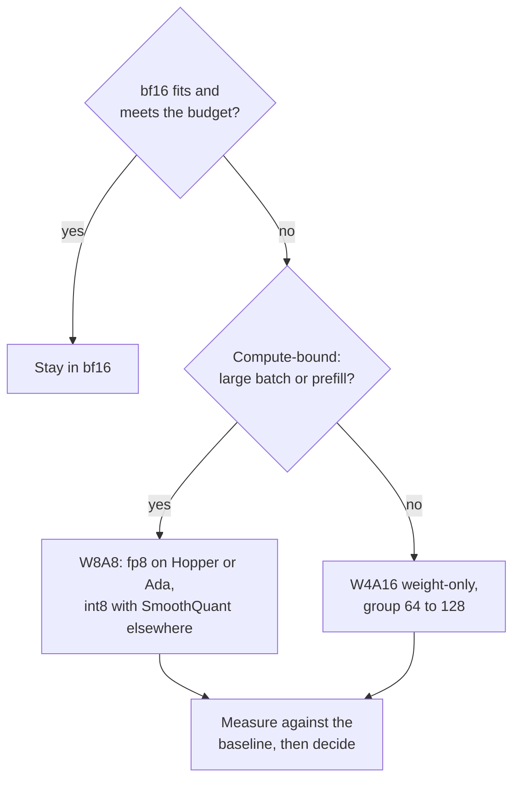

# 量化评审检查清单：选择、评审与质疑

把第 10 阶段压缩成便于查阅的形式。[第 25 课](../lessons/0025-choosing-a-scheme.md)讲选择方案，[第 26 课](../lessons/0026-reviewing-a-quantization-claim.md)讲评审一项声明和上线量化模型，[第 27 课](../lessons/0027-when-the-usual-answer-is-wrong.md)讲惯常答案何时出错，以及从来源裁定争议。

## 选择方案

按这个顺序提问。每个问题都在问下一个之前先去掉一些选项。

| # | 问题 | 如果是 | 如果否 |
|---|---|---|---|
| 1 | bf16 连同 KV 缓存放得下，并且满足延迟预算吗？ | 留在 bf16（服务预算：[服务时量化](../../inference/reference/quantization-at-serve-time.md)） | 继续 |
| 2 | GPU 原生计算 fp8 吗（Hopper、Ada Lovelace）？ | 先试 W8A8 fp8 | Ampere 及更早用 int8 W8A8，或者 W4A16 |
| 3 | 大批量或预填充为主（受算力限制）吗？ | W8A8 | W4A16 仅权重，分组 64 到 128 |
| 4 | 质量要求写成了你的任务上的一个数字吗？ | 把它用到剩下的选项上 | 先把它写出来 |
| 5 | 有校准数据吗？ | GPTQ 或 AWQ | 就近舍入，预期损失更大 |

## 证据说了什么，以及它的局限

| 发现 | 来源 | 局限 |
|---|---|---|
| W8A8-FP 在每个规模上实际上无损 | Kurtic 等，Llama 3.1 | 一个系列，调好的配方 |
| 调得好的 W8A8-INT 损失 1% 到 3%，在 70B 时需要 SmoothQuant | Kurtic 等 | 更大的规模需要更好的校准数据 |
| W4A16 在 Leaderboard V1 上恢复了 bf16 平均值的 99.36% | Kurtic 等 | 最小的模型损失更多 |
| W4A16 对同步服务最具成本效益，W8A8 对异步服务 | Kurtic 等 | 交叉点取决于规模、硬件和任务 |
| 就模型总位数而言，4 位几乎普遍是最优的，小的块大小 | Dettmers 与 Zettlemoyer | 2022 年代的系列，零样本精度，不是吞吐量 |
| 4 位内核在批大小 16 到 32 时接近快 4 倍，在 128 时约 1.5 倍 | MARLIN | 一个内核，一类 GPU |

## 对别人的声明该问的问题

| 声明的部分 | 问 |
|---|---|
| “无损失” | 对照哪个基线，是同一个模型的 bf16，在同一个测评框架上吗？ |
| “质量” | 哪些任务？是像你这样的开放式任务，还是只有选择题？ |
| “质量” | 只有困惑度吗？在什么文本和窗口上？ |
| “质量” | 翻转呢？KL 散度呢？准确率可以相当，而多达 13.6% 的答案发生翻转（Dutta 等） |
| “4 位” | 哪种分组大小，所以每个权重有多少有效位数？ |
| “4 位” | 哪个校准集，多大，与你的流量有多接近？ |
| 速度 | 哪种硬件、批大小、内核和基线技术栈？ |

还要说出什么是好的、应该保留的。一项只列出缺陷的评审只做了一半。

## 上线量化模型

| 步骤 | 做什么 |
|---|---|
| 固定基线 | 写明 bf16 检查点和测评框架版本，继续用它提供服务 |
| 离线评测 | 对照基线的准确率、翻转和 KL |
| 接近生产的流量 | 让真实的提示词在两个模型上重放；没有标签时用 KL 或输出相似度 |
| 先影子，再金丝雀 | 与基线并行运行，然后让一小部分用户用上，关卡事先设定 |
| 版本 | 检查点、量化配置、分组大小、校准集、服务栈版本放在一起 |
| 回滚 | 基线保持可部署，直到金丝雀看到了你所关心的流量 |

## 惯常答案何时出错

| 惯常答案 | 出错的时候 | 来源 |
|---|---|---|
| 4 位权重 | 模型训练了大量数据：训练后量化的下降随每个参数的训练 token 增多而加剧 | Kumar 等（在最大 1.7B 的模型上拟合） |
| 4 位权重 | 模型很小：Qwen-1.5B 的恢复率是 93.5%，更大的模型是 98% 到 99% | Kurtic 等 |
| 4 位权重 | 服务受算力限制：仅权重的收益随批大小增大而缩小 | MARLIN、QServe、Kurtic 等 |
| 为内存用 4 位 | fp8 是原生的，并且内存放得下：W8A8-FP 是风险更低的第一个尝试 | Kurtic 等 |
| 长上下文会垮 | RULER 的恢复率对所有格式都至少为 98%，没有运行 405B，没有研究 KV 缓存 | Kurtic 等 |
| AWQ 胜过 GPTQ | 真实任务，调好的 GPTQ：GPTQ 在 8B 上领先 2.9 个点，AWQ 在学术任务上最多领先 0.35 | Kurtic 等 |

## 从来源裁定争议

1. 找到论文，而不是引用它的帖子。
2. 核对模型、规模和年份。
3. 核对度量了什么，与所声称的是否相符。
4. 读表背后的设置：分组大小、截断、校准集、任务。
5. 把差距与多次运行之间的噪声比较。
6. 在你自己的任务上运行它。
