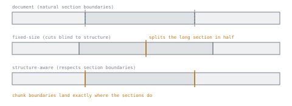

# 第 1 课：分块

**使命关联:** 分块是本工作区所教流水线中的第一个决定，之后的每个阶段（嵌入、混合检索、重排序）用的都是分块留给它的东西。糟糕的分块选择，是无法靠重排序补救的。
**主要来源:** [文章：“Chunking Strategies for LLM Applications”，Pinecone](https://www.pinecone.io/learn/chunking-strategies/)
**前置知识:** 无

## 要点

### 为什么文档要被切分

检索流水线不会对整篇文档做嵌入和搜索，而是先把每篇文档切分成**文本块**，再对这些文本块做嵌入和索引。有两个现实原因迫使它这样做：

- 嵌入模型的上下文窗口有限，所以一篇长文档可能根本放不进去。
- 即使放得进去，把一段很长、主题混杂的内容嵌入成单个向量，也会把它模糊掉。这个向量表示的是该段落涉及的所有内容的平均，所以对于只问其中某一件具体事情的查询，它就成了更差的匹配。

所以分块的目的，是让每个被嵌入的单元保持足够聚焦，使它的向量真正代表查询可能要找的东西。

### 核心权衡

文本块的大小，是在两种失败模式之间取舍：

- **文本块太大：** 嵌入把多个主题混在一起，损害精确度，针对长文本块里某个细节的查询，可能无法把它作为近似匹配浮现出来。检索时还会把更多无关的上下文文字和相关部分一起返回。
- **文本块太小：** 每个文本块可能丢掉让它得以被理解的周边上下文，或者丢掉回答那些跨越多个小片段的问题所需的内容。从段落里单拎出来的一句话，单独看可能有歧义或不完整。

没有放之四海而皆准的文本块大小。正确的选择取决于语料库（法律合同的条款与聊天记录读起来很不一样），也取决于系统要应对的查询模式（只需一个事实的查询，与需要多步解释的查询，表现并不相同）。

### 常见的分块策略

- **固定大小。** 每隔 N 个 token 或字符切一刀，通常让相邻文本块之间有一些重叠。简单、可预测，但对文档的实际结构视而不见：它可能把一个句子或一张表格从中间切开。
- **递归 / 结构感知。** 先按文档的自然边界切分（先章节，再段落，再句子），只有当某个由边界划出的片段仍然太大时，才退回固定大小的切分。这样尊重的是作者自己的组织方式，而不是强加一种任意的方式。
- **语义分块。** 对相邻的句子做嵌入，并在相邻句子之间的相似度骤降处切分，理由是主题转换的地方正是文本块边界该在的地方。计算成本更高，但它直接针对真正的失败模式（一个文本块里混杂多个主题），而不是通过间接手段。
- **文档结构感知。** 把格式本身已经提供的结构单元，比如某个标题下的章节、一张表格或一个代码块，视为不可再分：绝不跨文本块边界把它们切开，因为这样做通常会毁掉它们的含义。

### 重叠

相邻文本块通常会重叠若干 token。如果没有重叠，恰好跨在两个文本块切分处的一个事实或一句话，可能会被拆碎，单靠其中任何一个文本块都无法完整还原。重叠要付出一些冗余的存储和嵌入计算作为代价，换来的是不在文本块边界丢失信息。

## 练习

1. ▢ 用一句话说明，检索流水线为什么要对文档分块，而不是整篇嵌入？

检查

因为一段很长、主题混杂的内容嵌入成的是一个模糊的向量，表示的是它涉及的所有内容的平均，对于只问其中某一件具体事情的查询，检索效果很差（而且它甚至可能放不进嵌入模型的上下文窗口）。

2. ▢ 一个由很长的法律合同组成的语料库，被切成固定大小的 512 token 片段，且没有重叠。用户询问具体条款的问题，而检索总是漏掉那些被切在文本块边界上的条款。请说出对分块策略的两处改动会有帮助，以及每一处解决了什么。

提示

一处改动针对边界切分本身，另一处针对切分无法避免时会发生什么。

检查

改用结构感知（或文档结构感知）的策略，按条款或章节边界来切分，而不是按原始的 token 数，这样条款从一开始就不会被拦腰切断。另外，在文本块之间加入重叠，这样即使某个切分点确实落在条款边界附近，条款的完整文字仍然会完好地出现在至少一个文本块里。

3. ▢ 某团队为了最大限度地提高精确度，把语料库切成非常短的、单句的片段。可能的缺点是什么，会在什么时候出现？

检查

单个文本块可能会丢掉让它得以被理解或保持完整的周边上下文：单独拎出来的一句话可能有歧义，而答案跨越多个句子的问题，无法从任何一个检索到的文本块中得到解答。这会表现为：检索在技术上找到了“正确的那句话”，而系统仍然无法据此给出正确或完整的答案。

4. ▢ 相邻文本块为什么通常要重叠？

    - a) 让向量索引更大、更周全
    - b) 让跨在文本块边界上的事实或句子不被拆碎，也不至于在任何一个文本块中都无法还原
    - c) 因为嵌入模型要求有最小的输入长度
    - d) 让重排序器可以把相邻的文本块相互比较

检查

**b)** 让跨在文本块边界上的事实或句子不被拆碎，也不至于在任何一个文本块中都无法还原。（a）描述的是重叠的一项代价，而不是它的目的。（c）和（d）都不是重叠存在的原因。

## 实战练习

- [ ] 从你要做检索的语料库里挑一篇真实的文档。手工用两种方式给它分块（固定大小，以及利用它实际的标题或章节做结构感知），比较每种策略在哪些地方把一个完整的意思切断了。
- [ ] 对同一篇文档，挑一个用户可能真会问的查询，检查哪种分块策略的输出里，真正包含这个问题完整且可检索的答案。
- [ ] 明天：通读下面链接的分块策略文章，并写下你会为自己的语料库默认选择哪种策略，以及为什么。

## 延伸阅读

- [文章：“Chunking Strategies for LLM Applications”，Pinecone](https://www.pinecone.io/learn/chunking-strategies/)
- [资源](../RESOURCES.md)

---

没学明白？请重读顶部的主要来源，因为本课是对它的压缩，而理解正是在压缩中流失的。如果有哪个术语觉得含糊，可以查看[术语表](../GLOSSARY.md)。

如果问题出在课程本身，而不是学习材料，那就是一个缺陷：[提交 issue](https://github.com/TokenCemetery/teach/issues)。
