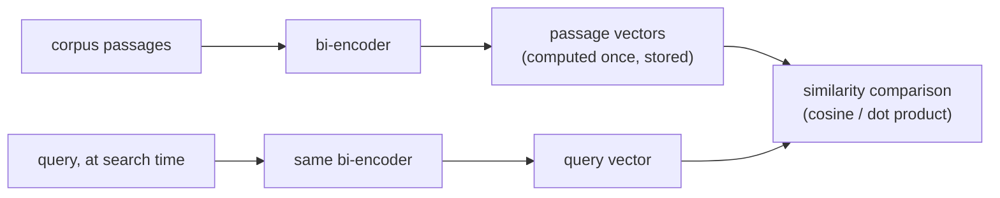

# Lección 2. Modelos de embeddings y similitud

**Vínculo con la misión:** El chunking decidió de qué se genera el embedding; esta lección decide cómo se convierte en algo en lo que se pueda buscar, y un desajuste aquí degrada en silencio todas las etapas posteriores sin parecer un error evidente.
**Fuente principal:** [Paper: "Sentence-BERT: Sentence Embeddings using Siamese BERT-Networks", Reimers and Gurevych, 2019](https://arxiv.org/abs/1908.10084)
**Requisitos previos:** [Lección 1](0001-chunking.md), [Chunk](../GLOSSARY.md)

## Calentamiento

1. ▢ ¿Cuál es el compromiso central que hace el tamaño del chunk?

Comprobación

Los chunks demasiado grandes mezclan varios temas en un único vector promediado y dañan la precisión. Los chunks demasiado pequeños pierden el contexto circundante que hace a un chunk interpretable o completo, así que una pregunta que abarca más de un fragmento pequeño puede no ser respondible desde ningún chunk por separado.

2. ▢ ¿Por qué los chunks consecutivos suelen solaparse?

Comprobación

Para que un dato o una oración que cae en el límite de un chunk no quede fragmentado e irrecuperable desde cualquiera de los dos chunks por separado.

## Qué debes saber

### Un bi-encoder genera el embedding de cada texto por separado

Un modelo de embeddings del tipo que usa este espacio de trabajo es un **bi-encoder**: asigna un texto a un vector denso de tamaño fijo, de forma independiente de cualquier otro texto, de modo que los textos de significado similar queden cerca entre sí en ese espacio vectorial. Lo decisivo es que una consulta y un pasaje se convierten cada uno en embedding por su cuenta, no de forma conjunta como un par. Esto es lo que hace rápida la recuperación a gran escala: cada chunk de un corpus recibe su embedding una sola vez, de antemano, y se almacena; en el momento de la búsqueda, solo hace falta el embedding de la consulta, que se compara con los vectores de chunks ya calculados. Comparar dos vectores producidos de forma independiente es barato; ejecutar un modelo sobre cada par consulta-pasaje, que es lo que hace un cross-encoder (lección 8), no lo es, y no escala para buscar en un corpus grande en el momento de la consulta.

### Tres métricas de similitud, y por qué no son intercambiables

Dados dos vectores, hay tres formas comunes de medir cuán similares son: la **similitud coseno** (el ángulo entre ellos, ignorando la magnitud), el **producto punto** (la similitud coseno sin normalizar por la magnitud) y la **distancia euclidiana** (la distancia en línea recta entre los dos puntos). Cuando ambos vectores se normalizan a longitud unitaria, la similitud coseno y el producto punto producen el mismo ranking, ya que el término de magnitud que los distingue queda fijo en 1 para ambos. Cuando los vectores no están normalizados, el producto punto premia implícitamente a los vectores de mayor magnitud, lo que puede introducir un sesgo ajeno a la relevancia semántica real si la magnitud varía de forma sistemática en el corpus (por ejemplo, con la longitud del pasaje).

La métrica que se use no es una elección libre: un modelo de embeddings se entrena con una función de similitud concreta en su pérdida (los modelos al estilo Sentence-BERT suelen entrenarse para que la similitud coseno, o un producto punto normalizado equivalente, refleje la cercanía semántica). Usar una métrica distinta de aquella para la que se optimizó el modelo no solo funciona algo peor; puede ordenar de formas que el modelo nunca llegó a ajustarse para producir, ya que la señal de entrenamiento nunca dio forma al espacio para esa métrica.

### Elegir un modelo es hacer coincidir el objetivo de entrenamiento con la tarea, no solo escoger la mejor puntuación de benchmark

Los modelos de embeddings difieren en lo que se entrenó para hacer bien. Algunos están ajustados para **búsqueda simétrica** (comparar dos textos similares en tipo y longitud, como dos oraciones que se revisan para ver si son paráfrasis). La recuperación suele ser en cambio **búsqueda asimétrica**: una consulta corta comparada con pasajes largos, que es una configuración de entrenamiento distinta. Un modelo que puntúa bien en un benchmark general (como MTEB, el Massive Text Embedding Benchmark) puede rendir igualmente por debajo de un modelo ajustado al dominio o a la tarea en un corpus concreto, sobre todo en uno especializado como el texto legal o médico, del que un modelo entrenado con la web general vio poco. La pregunta correcta no es solo "qué modelo puntúa más alto en general", sino "qué modelo se entrenó con algo lo bastante cercano a este corpus y a esta forma de consulta".

## Práctica

1. ▢ ¿Por qué un bi-encoder genera el embedding de una consulta y de un pasaje por separado y no de forma conjunta, y qué aporta eso a la recuperación sobre un corpus grande?

Comprobación

Generarlos por separado significa que cada pasaje del corpus puede recibir su embedding una sola vez, de antemano, y almacenarse. En el momento de la consulta, solo hace falta el embedding de la consulta, y compararlo con vectores de pasajes precalculados es barato. Generarlos de forma conjunta (un cross-encoder) exigiría ejecutar el modelo sobre cada par consulta-pasaje en el momento de la búsqueda, lo que no escala a un corpus grande.

2. ▢ Dos vectores de embedding están normalizados a longitud unitaria. ¿Por qué la similitud coseno y el producto punto dan el mismo ranking para ellos?

Comprobación

El producto punto es la similitud coseno escalada por las magnitudes de los dos vectores. Cuando ambas magnitudes están fijas en 1 (longitud unitaria), ese factor de escala es el mismo para cada par que se compara, así que el ranking que produce es idéntico al de la similitud coseno.

3. ▢ Un equipo cambia a un modelo de embeddings nuevo pero sigue usando producto punto sin normalizar como similitud, sin comprobar si los vectores del nuevo modelo están normalizados. La calidad de la recuperación cae, y parece que los pasajes más largos se recuperan con más frecuencia sin importar su relevancia real. ¿Cuál es la causa probable?

Pista

Piensa en lo que premia el producto punto cuando las magnitudes de los vectores no están fijas.

Comprobación

Si los vectores del nuevo modelo no están normalizados a longitud unitaria, el producto punto favorece implícitamente a los vectores de mayor magnitud. Si la magnitud se correlaciona con la longitud del pasaje (lo que suele ocurrir, ya que los pasajes más largos pueden acumular normas de embedding mayores), esto produce exactamente el sesgo de longitud observado, con independencia de que los pasajes más largos sean realmente más relevantes.

4. ▢ Un equipo elige un modelo de embeddings para un corpus de contratos legales, y un modelo candidato tiene la puntuación más alta en un benchmark general como MTEB. ¿Qué más debería comprobar antes de elegirlo, y por qué?

Comprobación

Si el modelo se entrenó con algo parecido al dominio de este corpus y a la forma de consulta de esta tarea (consulta corta contra pasaje largo, búsqueda asimétrica), no solo su puntuación general en el benchmark. Un modelo que lidera un benchmark general puede rendir igualmente por debajo de un modelo ajustado al dominio o a la tarea en un corpus especializado como el texto legal, del que un modelo entrenado con la web general puede haber visto poco.

5. ▢ ¿Qué afirmación es cierta sobre elegir una métrica de similitud para un modelo de embeddings?

    - a) Cualquiera entre similitud coseno, producto punto o distancia euclidiana funciona igual de bien sin importar cómo se entrenó el modelo
    - b) La métrica debe coincidir con lo que el objetivo de entrenamiento del modelo optimizó realmente, ya que un desajuste puede degradar la calidad del ranking
    - c) El producto punto siempre es estrictamente mejor que la similitud coseno, sin importar la normalización de los vectores
    - d) La distancia euclidiana y la similitud coseno siempre producen rankings idénticos, estén normalizados o no

Comprobación

**b)** El modelo se optimizó para una función de similitud concreta; usar otra no es una elección neutral. (a) es falsa: el ejemplo del producto punto de esta lección muestra un desajuste que causa un fallo real y medible. (c) es falsa: la ventaja del producto punto sobre la similitud coseno solo se da bajo supuestos de normalización concretos, y de lo contrario puede introducir un sesgo de magnitud. (d) es falsa: coinciden solo bajo normalización; de lo contrario pueden ordenar de forma distinta.

## Prácticas en el mundo real

- [ ] Busca el modelo de embeddings que usas (o piensas usar), encuentra la métrica de similitud que indica su documentación y comprueba si tu código de recuperación usa realmente esa misma métrica.
- [ ] Comprueba si tus vectores de embedding están normalizados a longitud unitaria y si la métrica en uso lo asume.
- [ ] Mañana: mira la ficha o la entrada de benchmark de un modelo de embeddings y anota si indica para qué tipo de búsqueda (simétrica o asimétrica) se entrenó.

## Para profundizar

- [Paper: "Sentence-BERT: Sentence Embeddings using Siamese BERT-Networks", Reimers and Gurevych, 2019](https://arxiv.org/abs/1908.10084)
- [Article: "Chunking Strategies for LLM Applications", Pinecone](https://www.pinecone.io/learn/chunking-strategies/)
- [Recursos](../RESOURCES.md)

---

¿No termina de quedar claro? Vuelve a leer la fuente principal de arriba, ya que esta lección la comprime y en la compresión es donde se escapa la comprensión. Consulta el [glosario](../GLOSSARY.md) por si algún término te resultó resbaladizo.

Si lo poco claro es la propia lección y no el material, eso es un defecto: [abre un issue](https://github.com/TokenCemetery/teach/issues).
