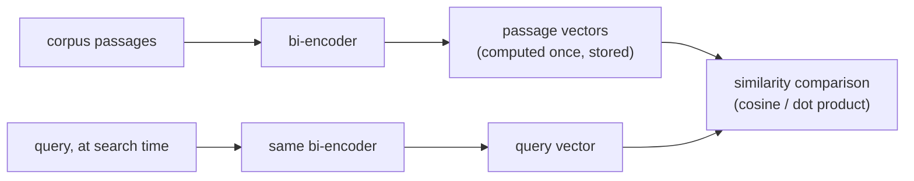

# Leçon 2. Modèles d'embedding et similarité

**Lien avec la mission :** Le chunking a décidé ce dont on calcule l'embedding ; cette leçon décide comment cela est transformé en quelque chose de recherchable, et un décalage ici dégrade silencieusement chaque étape suivante sans ressembler à un bug évident.
**Source primaire :** [Article : "Sentence-BERT: Sentence Embeddings using Siamese BERT-Networks", Reimers and Gurevych, 2019](https://arxiv.org/abs/1908.10084)
**Prérequis :** [Leçon 1](0001-chunking.md), [Chunk](../GLOSSARY.md)

## Échauffement

1. ▢ Quel est le compromis central que fait la taille des chunks ?

Vérifier

Des chunks trop grands mélangent plusieurs sujets dans un seul vecteur moyen, ce qui nuit à la précision. Des chunks trop petits perdent le contexte environnant qui rend un chunk interprétable ou complet, donc une question à cheval sur plusieurs petits morceaux peut ne pas trouver de réponse dans un seul chunk.

2. ▢ Pourquoi les chunks consécutifs se chevauchent-ils couramment ?

Vérifier

Pour qu'un fait ou une phrase à cheval sur une frontière de chunk ne soit pas fragmenté et irrécupérable à partir de l'un ou l'autre chunk seul.

## À savoir

### Un bi-encoder calcule l'embedding de chaque texte indépendamment

Un modèle d'embedding du type que cet espace de travail utilise est un **bi-encoder** : il associe un texte à un vecteur dense de taille fixe, indépendamment de tout autre texte, de sorte que les textes de sens proche se retrouvent proches dans cet espace vectoriel. Point crucial : une requête et un passage ont chacun leur embedding calculé séparément, et non conjointement comme une paire. C'est ce qui rend la récupération à grande échelle rapide : chaque chunk d'un corpus voit son embedding calculé une seule fois, à l'avance, et stocké ; au moment de la recherche, seule la requête demande un embedding, qui est comparé aux vecteurs de chunks déjà calculés. Comparer deux vecteurs produits indépendamment est peu coûteux ; exécuter un modèle sur chaque paire requête-passage, ce que fait un cross-encoder (leçon 8), ne l'est pas, et ne passe pas à l'échelle pour chercher dans un grand corpus au moment de la requête.

### Trois métriques de similarité, et pourquoi elles ne sont pas interchangeables

Étant donné deux vecteurs, il y a trois façons courantes de mesurer leur similarité : la **similarité cosinus** (l'angle entre eux, sans tenir compte de la norme), le **produit scalaire** (la similarité cosinus sans normalisation par la norme) et la **distance euclidienne** (la distance en ligne droite entre les deux points). Quand les deux vecteurs sont normalisés à une longueur unité, la similarité cosinus et le produit scalaire donnent le même classement, puisque le terme de norme qui les distingue vaut 1 pour les deux. Quand les vecteurs ne sont pas normalisés, le produit scalaire récompense implicitement les vecteurs de plus grande norme, ce qui peut introduire un biais sans rapport avec la pertinence sémantique réelle si la norme varie systématiquement dans le corpus (par exemple avec la longueur des passages).

La métrique à utiliser n'est pas un choix libre : un modèle d'embedding est entraîné avec une fonction de similarité précise dans sa fonction de perte (les modèles de type Sentence-BERT sont typiquement entraînés pour que la similarité cosinus, ou un produit scalaire normalisé équivalent, reflète la proximité sémantique). Utiliser une autre métrique que celle pour laquelle le modèle a été optimisé ne fonctionne pas seulement un peu moins bien ; cela peut classer d'une façon que le modèle n'a jamais été réellement réglé pour produire, puisque le signal d'entraînement n'a jamais façonné l'espace pour cette métrique.

### Choisir un modèle, c'est faire correspondre l'objectif d'entraînement à la tâche, pas seulement prendre le meilleur score de benchmark

Les modèles d'embedding diffèrent par ce qu'ils ont été entraînés à bien faire. Certains sont réglés pour la **recherche symétrique** (comparer deux textes de même nature et de même longueur, comme deux phrases dont on vérifie qu'elles sont des paraphrases). La récupération est le plus souvent une **recherche asymétrique** : une requête courte comparée à de longs passages, ce qui correspond à une autre configuration d'entraînement. Un modèle qui obtient un bon score sur un benchmark général (comme MTEB, le Massive Text Embedding Benchmark) peut quand même être moins bon qu'un modèle adapté au domaine ou à la tâche sur un corpus précis, surtout un corpus spécialisé comme des textes juridiques ou médicaux dont un modèle généraliste entraîné sur le web a vu peu d'exemples. La bonne question n'est pas seulement « quel modèle obtient le meilleur score global », mais « quel modèle a été entraîné sur quelque chose d'assez proche de ce corpus et de cette forme de requête ».

## Pratique

1. ▢ Pourquoi un bi-encoder calcule-t-il l'embedding d'une requête et d'un passage séparément plutôt que conjointement, et qu'est-ce que cela apporte à la récupération sur un grand corpus ?

Vérifier

Calculer les embeddings séparément signifie que chaque passage du corpus peut être traité une seule fois, à l'avance, et stocké. Au moment de la requête, seule la requête demande un embedding, et la comparer à des vecteurs de passages précalculés est peu coûteux. Un calcul conjoint (un cross-encoder) exigerait d'exécuter le modèle sur chaque paire requête-passage au moment de la recherche, ce qui ne passe pas à l'échelle pour un grand corpus.

2. ▢ Deux vecteurs d'embedding sont tous deux normalisés à une longueur unité. Pourquoi la similarité cosinus et le produit scalaire leur donnent-ils le même classement ?

Vérifier

Le produit scalaire est la similarité cosinus multipliée par les normes des deux vecteurs. Quand les deux normes valent 1 (longueur unité), ce facteur d'échelle est le même pour chaque paire comparée, donc le classement qu'il produit est identique à celui de la similarité cosinus.

3. ▢ Une équipe passe à un nouveau modèle d'embedding mais continue d'utiliser le produit scalaire brut pour la similarité, sans vérifier si les vecteurs du nouveau modèle sont normalisés. La qualité de la récupération baisse, et les passages plus longs semblent récupérés plus souvent indépendamment de leur pertinence réelle. Quelle est la cause probable ?

Indice

Réfléchissez à ce que récompense le produit scalaire quand les normes des vecteurs ne sont pas fixées.

Vérifier

Si les vecteurs du nouveau modèle ne sont pas normalisés à une longueur unité, le produit scalaire favorise implicitement les vecteurs de plus grande norme. Si la norme est corrélée à la longueur du passage (ce qui arrive souvent, puisque les passages plus longs peuvent accumuler des normes d'embedding plus grandes), cela produit exactement le biais de longueur observé, indépendamment du fait que les passages plus longs soient réellement plus pertinents.

4. ▢ Une équipe choisit un modèle d'embedding pour un corpus de contrats juridiques, et un modèle candidat a le meilleur score sur un benchmark général comme MTEB. Que doit-elle vérifier d'autre avant de le choisir, et pourquoi ?

Vérifier

Si le modèle a été entraîné sur quelque chose qui ressemble au domaine de ce corpus et à la forme des requêtes de cette tâche (requête courte face à un long passage, recherche asymétrique), et pas seulement son score global de benchmark. Un modèle qui domine un benchmark général peut quand même être moins bon qu'un modèle adapté au domaine ou à la tâche sur un corpus spécialisé comme des textes juridiques, dont un modèle généraliste entraîné sur le web a pu voir peu d'exemples.

5. ▢ Laquelle de ces affirmations est vraie à propos du choix d'une métrique de similarité pour un modèle d'embedding ?

    - a) N'importe laquelle de la similarité cosinus, du produit scalaire ou de la distance euclidienne fonctionne aussi bien, quelle que soit la façon dont le modèle a été entraîné
    - b) La métrique doit correspondre à ce que l'objectif d'entraînement du modèle a réellement optimisé, puisqu'un décalage peut dégrader la qualité du classement
    - c) Le produit scalaire est toujours strictement meilleur que la similarité cosinus, quelle que soit la normalisation des vecteurs
    - d) La distance euclidienne et la similarité cosinus produisent toujours des classements identiques, normalisés ou non

Vérifier

**b)** Le modèle a été optimisé pour une fonction de similarité précise ; en utiliser une autre n'est pas un choix neutre. (a) est fausse : l'exemple du produit scalaire de cette leçon montre qu'un décalage provoque une défaillance réelle et mesurable. (c) est fausse : l'avantage du produit scalaire sur la similarité cosinus ne tient que sous des hypothèses de normalisation précises, et peut sinon introduire un biais de norme. (d) est fausse : elles ne coïncident que sous normalisation ; sinon elles peuvent classer différemment.

## Exercices en situation réelle

- [ ] Cherchez le modèle d'embedding que vous utilisez (ou prévoyez d'utiliser), trouvez la métrique de similarité indiquée dans sa documentation, et vérifiez que votre code de récupération utilise bien cette même métrique.
- [ ] Vérifiez si vos vecteurs d'embedding sont normalisés à une longueur unité, et si la métrique utilisée suppose cette normalisation.
- [ ] Demain : regardez la fiche d'un modèle d'embedding ou son entrée de benchmark et notez si elle indique pour quel type de recherche (symétrique ou asymétrique) il a été entraîné.

## Pour aller plus loin

- [Article : "Sentence-BERT: Sentence Embeddings using Siamese BERT-Networks", Reimers and Gurevych, 2019](https://arxiv.org/abs/1908.10084)
- [Billet : "Chunking Strategies for LLM Applications", Pinecone](https://www.pinecone.io/learn/chunking-strategies/)
- [Ressources](../RESOURCES.md)

---

Ça ne passe pas ? Relisez la source primaire en haut de page, car cette leçon la condense et c'est dans la condensation que la compréhension s'échappe. Consultez le [glossaire](../GLOSSARY.md) pour tout terme qui vous a paru glissant.

Si c'est la leçon elle-même qui n'est pas claire plutôt que la matière, c'est un défaut : [ouvrez une issue](https://github.com/TokenCemetery/teach/issues).
