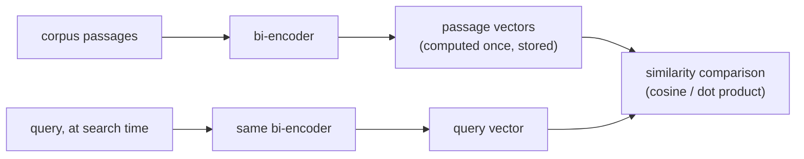

# पाठ 2. Embedding Models और Similarity

**मिशन से संबंध:** Chunking ने तय किया कि क्या embed होगा; यह पाठ तय करता है कि उसे searchable चीज़ में कैसे बदला जाए, और यहाँ की बेमेल चुपचाप हर बाद के चरण को बिगाड़ देती है, बिना किसी साफ़ bug जैसी दिखे।
**मुख्य स्रोत:** [पेपर: "Sentence-BERT: Sentence Embeddings using Siamese BERT-Networks", Reimers and Gurevych, 2019](https://arxiv.org/abs/1908.10084)
**पूर्व-आवश्यकताएँ:** [पाठ 1](0001-chunking.md), [Chunk](../GLOSSARY.md)

## वार्म-अप

1. ▢ Chunk का आकार कौन-सा मूल trade-off करता है?

जाँचें

बहुत बड़े chunks कई विषयों को एक औसत vector में धुँधला कर देते हैं, जिससे precision घटती है। बहुत छोटे chunks वह आसपास का context खो देते हैं जो chunk को समझने लायक या पूरा बनाता है, इसलिए जो सवाल एक से ज़्यादा छोटे टुकड़ों में फैला हो उसका उत्तर किसी एक chunk से नहीं मिल सकता।

2. ▢ लगातार chunks आम तौर पर overlap क्यों करते हैं?

जाँचें

ताकि जो तथ्य या वाक्य chunk की सीमा के आर-पार पड़ता है वह टूटकर अकेले किसी भी chunk से वापस न मिल पाने वाला न रहे।

## यह जानें

### Bi-encoder text के हर टुकड़े को अलग से embed करता है

इस workspace में इस्तेमाल होने वाली तरह का embedding model एक **bi-encoder** है: वह text के टुकड़े को एक तय आकार के dense vector में map करता है, किसी और text से स्वतंत्र रूप से, इस तरह कि मिलते-जुलते अर्थ वाले texts उस vector space में पास-पास आएँ। अहम बात यह है कि query और passage हर एक अलग से embed होता है, जोड़ी के रूप में साथ मिलाकर नहीं। यही बड़े पैमाने के retrieval को तेज़ बनाता है: corpus का हर chunk पहले से, एक बार embed होकर store हो जाता है; search के समय सिर्फ़ query को embed करना पड़ता है, और उसकी तुलना पहले से निकले chunk vectors से होती है। दो स्वतंत्र रूप से बने vectors की तुलना सस्ती है; हर query-passage जोड़ी पर model चलाना, जो cross-encoder करता है (पाठ 8), सस्ता नहीं है, और query के समय बड़े corpus में खोजने के लिए scale नहीं करता।

### तीन similarity metrics, और वे आपस में बदली क्यों नहीं जा सकतीं

दो vectors दिए हों तो यह नापने के तीन आम तरीक़े हैं कि वे कितने मिलते-जुलते हैं: **cosine similarity** (उनके बीच का कोण, magnitude को अनदेखा करके), **dot product** (cosine similarity, बिना magnitude से normalize किए), और **Euclidean distance** (दोनों बिंदुओं के बीच की सीधी दूरी)। जब दोनों vectors unit length तक normalize हों, तो cosine similarity और dot product एक ही ranking देते हैं, क्योंकि उन्हें अलग करने वाला magnitude का पद दोनों के लिए 1 पर तय है। जब vectors normalize न हों, तो dot product परोक्ष रूप से बड़े-magnitude वाले vectors को इनाम देता है, जो असली semantic प्रासंगिकता से असंबंधित bias ला सकता है अगर magnitude पूरे corpus में व्यवस्थित रूप से बदलता हो (जैसे passage की लंबाई के साथ)।

कौन-सी metric इस्तेमाल करें, यह खुला चुनाव नहीं है: embedding model अपने loss में एक ख़ास similarity function के साथ train होता है (Sentence-BERT जैसे models आम तौर पर इस तरह train होते हैं कि cosine similarity, या उसके बराबर का normalized dot product, semantic निकटता को दर्शाए)। जिस metric के लिए model को optimize किया गया उससे अलग metric इस्तेमाल करना सिर्फ़ थोड़ा कम अच्छा नहीं चलता; वह ऐसे ranking दे सकता है जिन्हें बनाने के लिए model को कभी tune ही नहीं किया गया, क्योंकि training signal ने उस metric के लिए space को कभी आकार दिया ही नहीं।

### Model चुनने का मतलब training objective को task से मिलाना है, सिर्फ़ सबसे ऊँचा benchmark score उठाना नहीं

Embedding models इसमें अलग होते हैं कि उन्हें क्या अच्छा करने के लिए train किया गया। कुछ **symmetric search** के लिए tune होते हैं (text के दो ऐसे टुकड़ों की तुलना जो प्रकृति और लंबाई में मिलते हों, जैसे दो वाक्य जिन्हें paraphrase के लिए जाँचा जा रहा हो)। Retrieval आम तौर पर इसकी जगह **asymmetric search** होता है: छोटी query की तुलना लंबे passages से, जो अलग training setup है। जो model किसी सामान्य benchmark (जैसे MTEB, Massive Text Embedding Benchmark) पर अच्छा score करता है, वह किसी ख़ास corpus पर domain- या task-मेल वाले model से फिर भी कमज़ोर पड़ सकता है, ख़ासकर कानूनी या चिकित्सा text जैसे विशेष corpus पर जिसे general web पर train हुए model ने कम देखा हो। सही सवाल सिर्फ़ यह नहीं कि "कौन-सा model कुल मिलाकर सबसे ऊँचा score करता है", बल्कि यह कि "कौन-सा model ऐसी चीज़ पर train हुआ जो इस corpus और इस query के रूप के काफ़ी क़रीब है।"

## अभ्यास

1. ▢ Bi-encoder query और passage को साथ मिलाकर embed करने के बजाय अलग-अलग क्यों embed करता है, और बड़े corpus पर retrieval के लिए इससे क्या मिलता है?

जाँचें

अलग-अलग embed करने का मतलब है कि corpus का हर passage पहले से, एक बार embed होकर store हो सकता है। Query के समय सिर्फ़ query को embed करना पड़ता है, और उसकी तुलना पहले से निकले passage vectors से सस्ती है। साथ मिलाकर embed करना (cross-encoder) search के समय हर query-passage जोड़ी पर model चलाने की माँग करता, जो बड़े corpus पर scale नहीं करता।

2. ▢ दो embedding vectors दोनों unit length तक normalize हैं। उनके लिए cosine similarity और dot product एक ही ranking क्यों देते हैं?

जाँचें

Dot product वह cosine similarity है जिसे दोनों vectors के magnitudes से scale किया गया हो। जब दोनों magnitudes 1 (unit length) पर तय हों, तो वह scaling factor तुलना की जा रही हर जोड़ी के लिए एक-सा रहता है, इसलिए उससे बनी ranking cosine similarity की ranking के बराबर होती है।

3. ▢ एक टीम नए embedding model पर चली जाती है पर similarity के लिए raw dot product ही इस्तेमाल करती रहती है, बिना जाँचे कि नए model के vectors normalized हैं या नहीं। Retrieval की गुणवत्ता गिर जाती है, और लंबे passages असली प्रासंगिकता की परवाह किए बिना ज़्यादा बार retrieve होते दिखते हैं। संभावित कारण क्या है?

संकेत

सोचें कि vector magnitudes तय न हों तो dot product किसे इनाम देता है।

जाँचें

अगर नए model के vectors unit length तक normalized नहीं हैं, तो dot product परोक्ष रूप से बड़े magnitude वाले vectors को तरजीह देता है। अगर magnitude passage की लंबाई से जुड़ा है (जो अक्सर होता है, क्योंकि लंबे passages बड़े embedding norms जमा कर सकते हैं), तो ठीक वही लंबाई वाला bias पैदा होता है जो देखा गया, चाहे लंबे passages असल में ज़्यादा प्रासंगिक हों या नहीं।

4. ▢ एक टीम कानूनी अनुबंधों के corpus के लिए embedding model चुन रही है, और एक candidate model का MTEB जैसे सामान्य benchmark पर सबसे ऊँचा score है। उसे चुनने से पहले उन्हें और क्या जाँचना चाहिए, और क्यों?

जाँचें

यह कि model ऐसी चीज़ पर train हुआ था या नहीं जो इस corpus के domain और इस task की query के रूप (लंबे passage के विरुद्ध छोटी query, asymmetric search) से मिलती हो, सिर्फ़ उसका कुल benchmark score नहीं। जो model सामान्य benchmark में अव्वल है, वह कानूनी text जैसे विशेष corpus पर domain- या task-मेल वाले model से फिर भी कमज़ोर पड़ सकता है, जिसे general web पर train हुए model ने कम देखा हो।

5. ▢ Embedding model के लिए similarity metric चुनने के बारे में कौन-सा दावा सही है?

    - a) Cosine similarity, dot product या Euclidean distance में से कोई भी बराबर अच्छा चलता है, चाहे model को कैसे भी train किया गया हो
    - b) Metric को वही होना चाहिए जिसके लिए model के training objective ने असल में optimize किया, क्योंकि बेमेल ranking की गुणवत्ता गिरा सकती है
    - c) Dot product हमेशा cosine similarity से सख़्ती से बेहतर है, vector normalization चाहे जो हो
    - d) Euclidean distance और cosine similarity हमेशा एक-सी ranking देते हैं, normalized हों या नहीं

जाँचें

**b)** Model को एक ख़ास similarity function के लिए optimize किया गया था; अलग function इस्तेमाल करना तटस्थ चुनाव नहीं है। (a) ग़लत है: इस पाठ का dot-product वाला उदाहरण दिखाता है कि बेमेल एक असली, मापने योग्य विफलता पैदा करती है। (c) ग़लत है: cosine similarity के मुक़ाबले dot product का फ़ायदा सिर्फ़ ख़ास normalization मान्यताओं में टिकता है, और अन्यथा magnitude bias ला सकता है। (d) ग़लत है: वे सिर्फ़ normalization की स्थिति में मेल खाते हैं; वरना वे अलग ranking दे सकते हैं।

## असली दुनिया का अभ्यास

- [ ] जो embedding model आप इस्तेमाल करते हैं (या करने की योजना है) उसे खोजें और उसके दस्तावेज़ में बताई similarity metric ढूँढें, और जाँचें कि आपका retrieval code असल में वही metric इस्तेमाल करता है या नहीं।
- [ ] जाँचें कि आपके embedding vectors unit length तक normalized हैं या नहीं, और जो metric इस्तेमाल हो रही है वह इसे मानकर चलती है या नहीं।
- [ ] कल: किसी embedding model का card या benchmark प्रविष्टि देखें और नोट करें कि वह बताता है या नहीं कि उसे किस तरह के search (symmetric या asymmetric) के लिए train किया गया।

## आगे बढ़ने के लिए

- [पेपर: "Sentence-BERT: Sentence Embeddings using Siamese BERT-Networks", Reimers and Gurevych, 2019](https://arxiv.org/abs/1908.10084)
- [लेख: "Chunking Strategies for LLM Applications", Pinecone](https://www.pinecone.io/learn/chunking-strategies/)
- [संसाधन](../RESOURCES.md)

---

बात नहीं बन रही? ऊपर दिए primary source को दोबारा पढ़ें, क्योंकि यह पाठ उसे संक्षिप्त करता है और समझ संक्षेप में ही रिसती है। जो शब्द फिसलन भरा लगे, उसके लिए [शब्दावली](../GLOSSARY.md) देखें।

अगर दिक़्क़त सामग्री की नहीं बल्कि पाठ की ही है, तो वह एक खोट है: [issue खोलें](https://github.com/TokenCemetery/teach/issues)।
