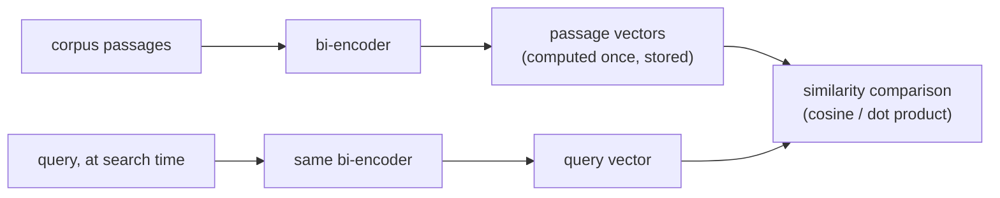

# Lição 2. Modelos de embedding e similaridade

**Ligação com a missão:** O chunking decidiu o que recebe um embedding; esta lição decide como isso é transformado em algo pesquisável, e um descompasso aqui degrada em silêncio toda etapa posterior sem parecer um bug óbvio.
**Fonte principal:** [Artigo científico: "Sentence-BERT: Sentence Embeddings using Siamese BERT-Networks", Reimers e Gurevych, 2019](https://arxiv.org/abs/1908.10084)
**Pré-requisitos:** [Lição 1](0001-chunking.md), [Chunk](../GLOSSARY.md)

## Aquecimento

1. ▢ Qual é o trade-off central que o tamanho do chunk faz?

Verificação

Chunks grandes demais borram vários assuntos em um único vetor médio, prejudicando a precisão. Chunks pequenos demais perdem o contexto ao redor que torna um chunk interpretável ou completo, então uma pergunta que se estende por mais de um pedaço pequeno pode não ser respondível a partir de nenhum chunk isolado.

2. ▢ Por que chunks consecutivos comumente se sobrepõem?

Verificação

Para que um fato ou uma frase que atravessa a fronteira de um chunk não seja fragmentado e irrecuperável a partir de qualquer um dos chunks sozinho.

## Saiba isto

### Um bi-encoder gera o embedding de cada texto por conta própria

Um modelo de embedding do tipo que este workspace usa é um **bi-encoder**: ele mapeia um texto para um vetor denso de tamanho fixo, independentemente de qualquer outro texto, de modo que textos de significado parecido caiam próximos nesse espaço vetorial. O ponto crucial é que uma consulta e uma passagem têm cada uma seu embedding gerado por conta própria, e não em conjunto como um par. É isso que torna rápida a recuperação em larga escala: cada chunk de um corpus tem o embedding gerado uma única vez, com antecedência, e é armazenado; na hora da busca, só a consulta precisa de embedding, e ele é comparado com os vetores de chunk já calculados. Comparar dois vetores produzidos de forma independente é barato; rodar um modelo sobre cada par consulta-passagem, que é o que um cross-encoder faz (lição 8), não é, e não escala para buscar em um corpus grande no momento da consulta.

### Três métricas de similaridade, e por que não são intercambiáveis

Dados dois vetores, há três formas comuns de medir quão similares são: a **similaridade de cosseno** (o ângulo entre eles, ignorando a magnitude), o **produto escalar** (a similaridade de cosseno sem normalizar pela magnitude) e a **distância euclidiana** (a distância em linha reta entre os dois pontos). Quando ambos os vetores são normalizados para comprimento unitário, a similaridade de cosseno e o produto escalar produzem o mesmo ranking, já que o termo de magnitude que os distingue é fixado em 1 para ambos. Quando os vetores não são normalizados, o produto escalar recompensa implicitamente vetores de maior magnitude, o que pode introduzir um viés sem relação com a relevância semântica real se a magnitude variar de forma sistemática no corpus (por exemplo, com o tamanho da passagem).

A métrica a usar não é uma escolha livre: um modelo de embedding é treinado com uma função de similaridade específica em sua loss (modelos no estilo Sentence-BERT costumam ser treinados para que a similaridade de cosseno, ou um produto escalar normalizado equivalente, reflita a proximidade semântica). Usar uma métrica diferente da que o modelo otimizou não funciona apenas um pouco pior; pode ranquear de maneiras que o modelo nunca foi de fato ajustado para produzir, já que o sinal de treinamento nunca moldou o espaço para essa métrica.

### Escolher um modelo é casar o objetivo de treinamento com a tarefa, e não apenas pegar a maior pontuação em um benchmark

Os modelos de embedding diferem naquilo que foram treinados para fazer bem. Alguns são ajustados para **busca simétrica** (comparar dois textos parecidos em tipo e tamanho, como duas frases sendo verificadas quanto a paráfrase). A recuperação costuma ser, em vez disso, **busca assimétrica**: uma consulta curta comparada com passagens longas, que é uma configuração de treinamento diferente. Um modelo que pontua bem em um benchmark geral (como o MTEB, o Massive Text Embedding Benchmark) ainda pode ter desempenho inferior ao de um modelo adequado ao domínio ou à tarefa em um corpus específico, especialmente um especializado como texto jurídico ou médico, que um modelo geral treinado na web viu pouco. A pergunta certa não é apenas "qual modelo pontua mais no geral", e sim "qual modelo foi treinado em algo próximo o bastante deste corpus e deste formato de consulta".

## Prática

1. ▢ Por que um bi-encoder gera o embedding de uma consulta e de uma passagem separadamente em vez de em conjunto, e o que isso traz para a recuperação em um corpus grande?

Verificação

Gerar separadamente significa que cada passagem do corpus pode ter o embedding gerado uma vez, com antecedência, e ser armazenada. Na hora da consulta, só a consulta precisa de embedding, e compará-lo com vetores de passagem pré-calculados é barato. Gerar em conjunto (um cross-encoder) exigiria rodar o modelo sobre cada par consulta-passagem na hora da busca, o que não escala para um corpus grande.

2. ▢ Dois vetores de embedding são ambos normalizados para comprimento unitário. Por que a similaridade de cosseno e o produto escalar dão o mesmo ranking para eles?

Verificação

O produto escalar é a similaridade de cosseno escalada pelas magnitudes dos dois vetores. Quando as duas magnitudes são fixadas em 1 (comprimento unitário), esse fator de escala é o mesmo para todo par comparado, então o ranking que ele produz é idêntico ao da similaridade de cosseno.

3. ▢ Uma equipe troca para um novo modelo de embedding, mas continua usando o produto escalar bruto para a similaridade, sem verificar se os vetores do novo modelo são normalizados. A qualidade da recuperação cai, e passagens mais longas parecem ser recuperadas com mais frequência independentemente da relevância real. Qual é a causa provável?

Dica

Pense no que o produto escalar recompensa quando as magnitudes dos vetores não são fixas.

Verificação

Se os vetores do novo modelo não são normalizados para comprimento unitário, o produto escalar favorece implicitamente vetores de maior magnitude. Se a magnitude se correlaciona com o tamanho da passagem (o que costuma acontecer, já que passagens mais longas podem acumular normas de embedding maiores), isso produz exatamente o viés de tamanho observado, independentemente de as passagens mais longas serem de fato mais relevantes.

4. ▢ Uma equipe está escolhendo um modelo de embedding para um corpus de contratos jurídicos, e um modelo candidato tem a maior pontuação em um benchmark geral como o MTEB. O que mais ela deve verificar antes de escolhê-lo, e por quê?

Verificação

Se o modelo foi treinado em algo que se pareça com o domínio deste corpus e com o formato de consulta desta tarefa (consulta curta contra passagem longa, busca assimétrica), e não apenas sua pontuação geral no benchmark. Um modelo que lidera um benchmark geral ainda pode ter desempenho inferior ao de um modelo adequado ao domínio ou à tarefa em um corpus especializado como texto jurídico, que um modelo geral treinado na web pode ter visto pouco.

5. ▢ Qual afirmação é verdadeira sobre escolher uma métrica de similaridade para um modelo de embedding?

    - a) Qualquer uma entre similaridade de cosseno, produto escalar ou distância euclidiana funciona igualmente bem, independentemente de como o modelo foi treinado
    - b) A métrica deve corresponder ao que o objetivo de treinamento do modelo de fato otimizou, já que um descompasso pode degradar a qualidade do ranking
    - c) O produto escalar é sempre estritamente melhor que a similaridade de cosseno, independentemente da normalização dos vetores
    - d) A distância euclidiana e a similaridade de cosseno sempre produzem rankings idênticos, com ou sem normalização

Verificação

**b)** O modelo foi otimizado para uma função de similaridade específica; usar outra não é uma escolha neutra. (a) é falsa: o exemplo do produto escalar desta lição mostra um descompasso causando uma falha real e mensurável. (c) é falsa: a vantagem do produto escalar sobre a similaridade de cosseno só vale sob suposições específicas de normalização, e pode, de outro modo, introduzir um viés de magnitude. (d) é falsa: elas coincidem apenas sob normalização; fora disso podem ranquear de forma diferente.

## Prática no mundo real

- [ ] Procure o modelo de embedding que você usa (ou pretende usar), encontre a métrica de similaridade declarada em sua documentação e verifique se o seu código de recuperação de fato usa essa mesma métrica.
- [ ] Verifique se seus vetores de embedding são normalizados para comprimento unitário e se a métrica em uso pressupõe isso.
- [ ] Amanhã: olhe o model card ou a entrada de benchmark de um modelo de embedding e anote se ele declara para que tipo de busca (simétrica ou assimétrica) foi treinado.

## Para ir além

- [Artigo científico: "Sentence-BERT: Sentence Embeddings using Siamese BERT-Networks", Reimers e Gurevych, 2019](https://arxiv.org/abs/1908.10084)
- [Artigo: "Chunking Strategies for LLM Applications", Pinecone](https://www.pinecone.io/learn/chunking-strategies/)
- [Recursos](../RESOURCES.md)

---

Não ficou claro? Releia a fonte principal no topo, já que esta lição a comprime e é na compressão que o entendimento escapa. Consulte o [glossário](../GLOSSARY.md) para qualquer termo que pareceu escorregadio.

Se o problema é a lição em si, e não o material, isso é um defeito: [abra uma issue](https://github.com/TokenCemetery/teach/issues).
