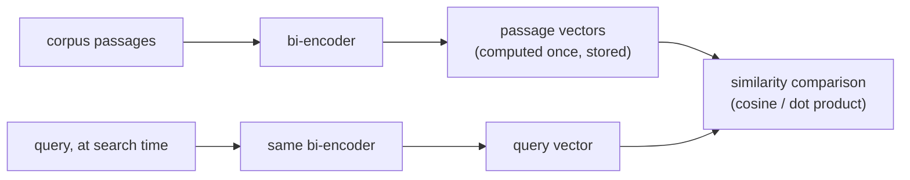

# Урок 2. Модели эмбеддингов и сходство

**Связь с целью курса:** Чанкинг решил, что именно эмбеддится; этот урок решает, как оно вообще превращается во что-то, по чему можно искать, и несоответствие здесь тихо ухудшает каждый следующий этап, не выглядя очевидной ошибкой.
**Первоисточник:** [Научная статья: "Sentence-BERT: Sentence Embeddings using Siamese BERT-Networks", Reimers and Gurevych, 2019](https://arxiv.org/abs/1908.10084)
**Предварительные требования:** [Урок 1](0001-chunking.md), [Чанк](../GLOSSARY.md)

## Разминка

1. ▢ Какой главный компромисс задаёт размер чанка?

Проверка

Слишком большие чанки смешивают несколько тем в один усреднённый вектор, что вредит точности. Слишком маленькие чанки теряют окружающий контекст, который делает чанк понятным или полным, поэтому вопрос, охватывающий больше одного маленького фрагмента, может не получить ответа ни из одного чанка.

2. ▢ Почему соседние чанки обычно перекрываются?

Проверка

Чтобы факт или предложение на границе чанков не оказалось разорванным и не восстанавливаемым ни из одного из чанков в отдельности.

## Что нужно знать

### Би-энкодер эмбеддит каждый фрагмент текста сам по себе

Модель эмбеддингов того вида, который использует эта рабочая область, это **би-энкодер**: она отображает фрагмент текста в плотный вектор фиксированного размера независимо от любого другого текста, так что тексты со схожим смыслом оказываются близко друг к другу в этом векторном пространстве. Принципиально, что запрос и пассаж эмбеддятся по отдельности, а не совместно как пара. Именно это вообще делает крупномасштабный поиск быстрым: каждый чанк корпуса эмбеддится один раз, заранее, и сохраняется; во время поиска эмбеддить нужно только запрос, и его сравнивают с уже вычисленными векторами чанков. Сравнить два независимо полученных вектора дёшево; прогонять модель по каждой паре «запрос и пассаж», как делает кросс-энкодер (урок 8), дорого и не масштабируется на поиск по большому корпусу во время запроса.

### Три метрики сходства и почему они не взаимозаменяемы

Для двух векторов есть три распространённых способа измерить, насколько они похожи: **косинусное сходство** (угол между ними, без учёта длины), **скалярное произведение** (косинусное сходство без нормализации на длину) и **евклидово расстояние** (прямолинейное расстояние между двумя точками). Когда оба вектора нормализованы до единичной длины, косинусное сходство и скалярное произведение дают один и тот же рейтинг, потому что член с длиной, который их различает, для обоих равен 1. Когда векторы не нормализованы, скалярное произведение неявно поощряет векторы большей длины, что может внести смещение, не связанное с настоящей семантической релевантностью, если длина систематически меняется по корпусу (например, с длиной пассажа).

Метрика выбирается не свободно: модель эмбеддингов обучается с конкретной функцией сходства в функции потерь (модели в духе Sentence-BERT обычно обучают так, чтобы косинусное сходство или эквивалентное нормализованное скалярное произведение отражало семантическую близость). Использование метрики, отличной от той, под которую оптимизировалась модель, не просто работает чуть хуже; оно может ранжировать так, как модель никогда не настраивали, ведь обучающий сигнал не формировал пространство под эту метрику.

### Выбор модели означает сопоставление цели обучения с задачей, а не просто выбор лучшего результата в бенчмарке

Модели эмбеддингов различаются тем, что их обучали делать хорошо. Одни настроены на **симметричный поиск** (сравнение двух текстов, схожих по виду и длине, например двух предложений на проверке перефразирования). Поиск обычно, наоборот, **асимметричный**: короткий запрос сравнивается с длинными пассажами, а это другая постановка обучения. Модель, которая хорошо проходит общий бенчмарк (например MTEB, Massive Text Embedding Benchmark), всё равно может уступить модели, подобранной под предметную область или задачу, на конкретном корпусе, особенно специализированном, вроде юридических или медицинских текстов, которых модель, обученная на общем вебе, видела мало. Верный вопрос не только «какая модель получила самый высокий общий балл», но и «какую модель обучали на чём-то достаточно близком к этому корпусу и к форме этих запросов».

## Практика

1. ▢ Почему би-энкодер эмбеддит запрос и пассаж по отдельности, а не совместно, и что это даёт поиску по большому корпусу?

Проверка

Раздельный эмбеддинг означает, что каждый пассаж корпуса можно заэмбеддить один раз, заранее, и сохранить. Во время запроса эмбеддить нужно только запрос, а сравнить его с заранее вычисленными векторами пассажей дёшево. Совместный эмбеддинг (кросс-энкодер) потребовал бы прогонять модель по каждой паре «запрос и пассаж» во время поиска, что не масштабируется на большой корпус.

2. ▢ Два вектора эмбеддингов оба нормализованы до единичной длины. Почему для них косинусное сходство и скалярное произведение дают один и тот же рейтинг?

Проверка

Скалярное произведение это косинусное сходство, умноженное на длины двух векторов. Когда обе длины равны 1 (единичная длина), этот масштабирующий множитель одинаков для каждой сравниваемой пары, поэтому получаемый рейтинг совпадает с рейтингом косинусного сходства.

3. ▢ Команда переходит на новую модель эмбеддингов, но продолжает использовать для сходства обычное скалярное произведение, не проверив, нормализованы ли векторы новой модели. Качество поиска падает, и более длинные пассажи, похоже, находятся чаще независимо от настоящей релевантности. Какова вероятная причина?

Подсказка

Подумайте, что поощряет скалярное произведение, когда длины векторов не зафиксированы.

Проверка

Если векторы новой модели не нормализованы до единичной длины, скалярное произведение неявно отдаёт предпочтение векторам большей длины. Если длина вектора коррелирует с длиной пассажа (а так часто и бывает, ведь у более длинных пассажей нормы эмбеддингов могут накапливаться больше), получается именно наблюдаемое смещение по длине, независимо от того, действительно ли более длинные пассажи релевантнее.

4. ▢ Команда выбирает модель эмбеддингов для корпуса юридических договоров, и у одной из моделей-кандидатов самый высокий результат в общем бенчмарке вроде MTEB. Что ещё им стоит проверить перед выбором и почему?

Проверка

Обучали ли модель на чём-то, похожем на предметную область этого корпуса и на форму запросов этой задачи (короткий запрос против длинного пассажа, асимметричный поиск), а не только смотреть на её общий результат в бенчмарке. Модель, возглавляющая общий бенчмарк, всё равно может уступить модели, подобранной под область или задачу, на специализированном корпусе вроде юридических текстов, которых модель, обученная на общем вебе, могла видеть мало.

5. ▢ Какое утверждение верно про выбор метрики сходства для модели эмбеддингов?

    - a) Любая из метрик (косинусное сходство, скалярное произведение, евклидово расстояние) работает одинаково хорошо независимо от того, как обучали модель
    - b) Метрика должна соответствовать тому, что на самом деле оптимизировала цель обучения модели, поскольку несоответствие может ухудшить качество ранжирования
    - c) Скалярное произведение всегда строго лучше косинусного сходства независимо от нормализации векторов
    - d) Евклидово расстояние и косинусное сходство всегда дают одинаковые рейтинги, с нормализацией или без

Проверка

**b)** Модель оптимизировали под конкретную функцию сходства; использовать другую это не нейтральный выбор. (a) неверно: пример со скалярным произведением в этом уроке показывает, что несоответствие вызывает реальный, измеримый сбой. (c) неверно: преимущество скалярного произведения над косинусным сходством выполняется только при определённых допущениях о нормализации, а иначе оно может внести смещение по длине вектора. (d) неверно: они совпадают только при нормализации; иначе они могут ранжировать по-разному.

## Практика в реальной работе

- [ ] Найдите модель эмбеддингов, которой вы пользуетесь (или собираетесь), найдите заявленную в её документации метрику сходства и проверьте, использует ли ваш код поиска именно её.
- [ ] Проверьте, нормализованы ли ваши векторы эмбеддингов до единичной длины и предполагает ли используемая метрика это.
- [ ] Завтра: откройте карточку модели эмбеддингов или её запись в бенчмарке и отметьте, указано ли, на какой вид поиска (симметричный или асимметричный) её обучали.

## Что почитать дальше

- [Научная статья: "Sentence-BERT: Sentence Embeddings using Siamese BERT-Networks", Reimers and Gurevych, 2019](https://arxiv.org/abs/1908.10084)
- [Статья: "Chunking Strategies for LLM Applications", Pinecone](https://www.pinecone.io/learn/chunking-strategies/)
- [Ресурсы](../RESOURCES.md)

---

Не доходит? Перечитайте первоисточник в начале: этот урок его сжимает, а при сжатии понимание как раз и теряется. Загляните в [глоссарий](../GLOSSARY.md), если какой-то термин показался скользким.

Если неясен сам урок, а не материал, это дефект: [откройте issue](https://github.com/TokenCemetery/teach/issues).
