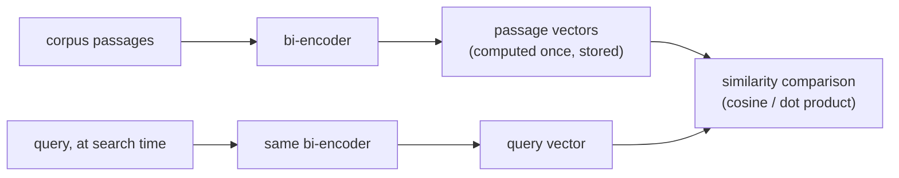

# 第 2 课：嵌入模型与相似度

**使命关联:** 分块决定了什么会被嵌入；本课决定它如何被变成可搜索的东西，而这里的不匹配会悄悄拖垮之后的每个阶段，却看不出是个明显的 bug。
**主要来源:** [论文：“Sentence-BERT: Sentence Embeddings using Siamese BERT-Networks”，Reimers 和 Gurevych，2019](https://arxiv.org/abs/1908.10084)
**前置知识:** [第 1 课](0001-chunking.md)、[文本块](../GLOSSARY.md)

## 热身

1. ▢ 文本块大小所做的核心权衡是什么？

检查

文本块太大，会把多个主题模糊成一个平均的向量，损害精确度。文本块太小，会丢掉让它得以被理解或保持完整的周边上下文，所以跨越多个小片段的问题，可能无法从任何一个文本块中得到解答。

2. ▢ 相邻文本块为什么通常要重叠？

检查

让跨在文本块边界上的事实或句子不被拆碎，也不至于单靠其中任何一个文本块都无法还原。

## 要点

### 双编码器对每段文本单独做嵌入

本工作区使用的这类嵌入模型是**双编码器**：它把一段文本映射成固定大小的稠密向量，与其他任何文本无关，并且让含义相近的文本在这个向量空间里彼此靠近。关键在于，查询和段落是各自单独嵌入的，而不是作为一对一起嵌入。正是这一点让大规模检索得以做到快速：语料库里的每个文本块都提前嵌入一次并存储起来；搜索时只需要嵌入查询，再与已经算好的文本块向量比较。比较两个各自独立产生的向量很便宜；而对每一对查询与段落都运行一遍模型（这是交叉编码器的做法，见第 8 课）就不便宜了，也无法在查询时扩展到搜索大型语料库。

### 三种相似度度量，以及它们为什么不能互换

给定两个向量，常见的衡量相似程度的方法有三种：**余弦相似度**（两者之间的夹角，忽略长度）、**点积**（不按长度做归一化的余弦相似度）和**欧氏距离**（两点之间的直线距离）。当两个向量都被归一化为单位长度时，余弦相似度和点积产生相同的排名，因为区分二者的长度项对两个向量来说都固定为 1。当向量没有归一化时，点积会隐含地偏爱长度更大的向量，如果长度在语料库中系统性地变化（比如随段落长度变化），就可能引入一种与真实语义相关性无关的偏差。

该用哪种度量并不能随意选：嵌入模型是在损失函数里用某个特定的相似度函数训练出来的（Sentence-BERT 类的模型通常这样训练：让余弦相似度，或与之等价的归一化点积，反映语义上的接近程度）。使用与模型优化目标不同的度量，不只是效果稍差一点，它排出的顺序可能是模型从未真正调教过的，因为训练信号从来没有针对那种度量去塑造这个空间。

### 选模型，是要让训练目标与任务相匹配，而不是只挑基准测试分数最高的

不同的嵌入模型，擅长的东西不同。有些针对**对称搜索**调优（比较两段种类和长度相近的文本，比如检查两个句子是否互为转述）。而检索通常是**非对称搜索**：用一个简短的查询去比较很长的段落，这是另一种训练设置。在通用基准（比如 MTEB，即 Massive Text Embedding Benchmark）上得分很高的模型，在某个具体语料库上仍可能不如与领域或任务相匹配的模型，尤其是法律或医疗文本这类专业语料，在网络通用数据上训练的模型对它们见得很少。正确的问题不只是“哪个模型总分最高”，而是“哪个模型训练时接触的东西，与这个语料库和这种查询形态足够接近”。

## 练习

1. ▢ 双编码器为什么把查询和段落分开嵌入，而不是一起嵌入？这对大型语料库的检索有什么好处？

检查

分开嵌入意味着语料库里的每个段落都可以提前嵌入一次并存储起来。查询时只需要嵌入查询，再与预先算好的段落向量比较，开销很小。一起嵌入（交叉编码器）则需要在搜索时对每一对查询与段落都运行一遍模型，这无法扩展到大型语料库。

2. ▢ 两个嵌入向量都被归一化为单位长度。为什么余弦相似度和点积对它们给出相同的排名？

检查

点积就是按两个向量的长度缩放之后的余弦相似度。当两个长度都固定为 1（单位长度）时，这个缩放因子对每一对被比较的向量都相同，所以它产生的排名与余弦相似度完全一致。

3. ▢ 某团队换用了一个新的嵌入模型，却仍然用原始点积来计算相似度，没有检查新模型的向量是否归一化。检索质量下降了，而且较长的段落似乎更常被检索到，不管它们实际上是否相关。可能的原因是什么？

提示

想一想，当向量长度不固定时，点积偏爱的是什么。

检查

如果新模型的向量没有归一化为单位长度，点积就会隐含地偏向长度更大的向量。如果长度与段落长度相关（这种情况很常见，因为较长的段落可能累积出更大的嵌入范数），就会产生所观察到的这种长度偏差，而与较长的段落是否真的更相关无关。

4. ▢ 某团队要为一批法律合同语料选择嵌入模型，其中一个候选模型在 MTEB 这类通用基准上得分最高。在选它之前，他们还应该检查什么，为什么？

检查

要检查该模型训练时接触的内容，是否与这个语料库的领域和这项任务的查询形态（用短查询搜长段落，即非对称搜索）相近，而不只是看它的总体基准分数。在通用基准上拔得头筹的模型，在法律文本这类专业语料上，仍可能不如与领域或任务相匹配的模型，因为在网络通用数据上训练的模型对这类文本可能见得很少。

5. ▢ 关于为嵌入模型选择相似度度量，下列哪项说法正确？

    - a) 无论模型如何训练，余弦相似度、点积和欧氏距离中的任何一种效果都一样好
    - b) 度量应当与模型的训练目标实际优化的对象相匹配，因为不匹配会降低排序质量
    - c) 无论向量是否归一化，点积总是严格优于余弦相似度
    - d) 无论是否归一化，欧氏距离和余弦相似度总是产生相同的排名

检查

**b)** 模型是针对某个特定的相似度函数优化的；换用别的度量并不是一个中性的选择。（a）错误：本课的点积示例表明，不匹配会导致真实、可度量的失败。（c）错误：点积相对余弦相似度的优势，只在特定的归一化假设下才成立，否则可能引入长度偏差。（d）错误：二者只有在归一化时才一致；否则它们的排序可能不同。

## 实战练习

- [ ] 查一下你正在用（或打算用）的嵌入模型，找到其文档中指明的相似度度量，并检查你的检索代码实际用的是不是同一种度量。
- [ ] 检查你的嵌入向量是否被归一化为单位长度，以及所用的度量是否以此为前提。
- [ ] 明天：看一个嵌入模型的模型卡或基准测试条目，记下它是否说明了自己是针对哪种搜索（对称还是非对称）训练的。

## 延伸阅读

- [论文：“Sentence-BERT: Sentence Embeddings using Siamese BERT-Networks”，Reimers 和 Gurevych，2019](https://arxiv.org/abs/1908.10084)
- [文章：“Chunking Strategies for LLM Applications”，Pinecone](https://www.pinecone.io/learn/chunking-strategies/)
- [资源](../RESOURCES.md)

---

没学明白？请重读顶部的主要来源，因为本课是对它的压缩，而理解正是在压缩中流失的。如果有哪个术语觉得含糊，可以查看[术语表](../GLOSSARY.md)。

如果问题出在课程本身，而不是学习材料，那就是一个缺陷：[提交 issue](https://github.com/TokenCemetery/teach/issues)。
