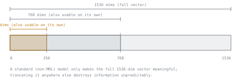

# 第 3 课：嵌入维度的权衡

**使命关联:** 这是第 2 阶段的收尾：选择嵌入模型（第 2 课）要等到把它的输出大小，与语料库的存储和延迟预算真正负担得起的程度一起权衡过，才算完成。
**主要来源:** [论文：“Matryoshka Representation Learning”，Kusupati 等，2022](https://arxiv.org/abs/2205.13147)
**前置知识:** [第 2 课](0002-embedding-models-and-similarity.md)、[文本块](../GLOSSARY.md)

## 热身

1. ▢ 双编码器为什么把查询和段落分开嵌入，而不是一起嵌入？

检查

这样每个段落都可以提前嵌入一次并存储起来；搜索时只需要嵌入查询，就能与预先算好的段落向量低成本地比较。一起嵌入（交叉编码器）需要对每一对都运行一遍模型，这无法扩展到大型语料库。

2. ▢ 为什么只有当向量被归一化为单位长度时，余弦相似度和点积才会产生相同的排名？

检查

点积就是按两个向量的长度缩放之后的余弦相似度。当两者都固定为单位长度时，这个缩放因子对每一对都相同，所以两种度量的排名一致；当长度不一时，点积会隐含地偏爱更大的向量。

## 要点

### 维度是一种成本，不是免费的质量旋钮

维度更高的嵌入可以编码更多细微差别，但它的每一个维度都有实实在在的代价：存储随维度线性增长（一个 1536 维的 float32 向量占 `1536 × 4 bytes = 6,144 bytes`，约 6 KB，而 256 维向量只占 `256 × 4 = 1,024 bytes`，约 1 KB，少了六倍），索引内存和对每个候选的距离计算也按同样的方式增长。对一百万个文本块来说，光是向量本身，这个差距就是 6 GB 对 1 GB，还没算索引自身的开销。更大的嵌入并不自动是更好的选择；它是一个必须拿代价来论证的选择，就像在其他服务场景里，更大的 KV 缓存或更大的批大小也必须对照工作负载的实际预算来论证一样。

### Matryoshka Representation Learning：把截断做成设计好的特性，而不是取巧

通常情况下，把嵌入向量截断成更少的维度是不安全的：标准嵌入模型的训练方式里，没有任何东西按重要性给它的各个维度排序，所以把一个普通的 768 维向量砍到 256 维，可能会不可预测地丢掉信息，质量的下降远超维度数量本身所暗示的程度。**Matryoshka Representation Learning**（MRL）用不同的方式训练模型：它的损失函数明确地优化完整向量的前缀（比如 1536 维嵌入的前 256 个维度），使这些前缀本身也是可用的、有意义的嵌入，嵌套在完整向量之中，就像套娃里面一个个更小的娃娃。这意味着，用 MRL 训练的模型可以在事后截断，质量代价有界且可预测，让维度可以与存储和延迟做权衡，而不必重新训练，也不必按另一种大小对整个语料库重新做嵌入。这只对确实以这种方式训练的模型成立；截断一个不是这样训练的模型，就回到了不安全、不可预测的情形。

### 确定合适的维度，要靠测量，而不是假设

某个语料库合适的维度不是一个靠猜的数字，而是一个要靠测量的数字。使用 MRL 模型（或者比较几种候选的模型规格），可以针对眼前这个实际的语料库和查询模式，在每个候选维度上测量检索质量，最直接的是针对带标注的或合成的查询集测量 recall@k（第 6 阶段的主题）。值得上线的维度，是仍然达到工作负载所需质量线的最小那一个，既不是可用的最大那一个，也不是不看它的代价与收益就随手选的默认值。

## 练习

1. ▢ 某个语料库有 200 万个文本块。计算按 1536 维和按 256 维做嵌入（都用 float32）时，存储空间相差多少 GB。

提示

每个向量的字节数是 `dimensions × 4 bytes`。乘以 200 万，再换算成 GB。

检查

1536 维：每个向量 `1536 × 4 = 6,144 bytes`，`× 2,000,000 ≈ 12.3 GB`。256 维：每个向量 `256 × 4 = 1,024 bytes`，`× 2,000,000 ≈ 2.0 GB`。差距约为 10.3 GB，256 维时的存储空间约少六倍。

2. ▢ 某团队为了节省存储，把一个标准（非 MRL）768 维嵌入模型的向量截断到 256 维，结果检索质量的崩溃，远超维度减少本身所暗示的程度。可能的错误是什么？

检查

这个模型不是用 Matryoshka Representation Learning 训练的，所以没有任何东西按重要性给它的维度排序，也没有让向量的任何前缀本身成为有意义的嵌入。截断它会不可预测地丢失信息，而不是像用 MRL 训练的模型被截断时那样，以有界的、设计好的方式丢失。

3. ▢ 用 MRL 训练的嵌入模型，能让团队做到标准嵌入模型做不到的什么事？

检查

事后把完整的嵌入向量截断到更小的维度，质量代价有界且可预测，让存储和延迟与质量做权衡，而不必重新训练模型，也不必按另一种固定大小重新嵌入语料库。

4. ▢ 团队应该如何决定自己的语料库实际使用什么嵌入维度，而不是直接沿用模型的完整输出大小？

检查

针对能代表实际语料库和查询模式的、带标注的或合成的查询集，在几个候选维度上测量检索质量，最直接的是 recall@k 之类的指标，然后选择仍然达到工作负载所需质量线的最小维度，而不是假定非用可用的最大维度不可，也不是假定更小的维度自然“够用”。

5. ▢ 关于嵌入维度，下列哪项说法正确？

    - a) 更大的嵌入维度总能把检索质量提高到足以抵得上它的成本
    - b) 无论模型如何训练，截断任何嵌入模型的向量都同样安全
    - c) 维度是一种成本（存储、索引内存、对每个候选的计算），应当定为满足已测得质量线的最小值
    - d) 用 MRL 训练的模型不能被截断，它们只提供单一固定的输出大小

检查

**c)** 存储和计算成本随维度增长，所以合适的大小，就是已测得的质量线实际需要的最小值。（a）错误：成本必须与测得的收益一起权衡，不能想当然。（b）错误：截断非 MRL 模型不可预测，丢掉的信号可能远超维度数量所暗示的。（d）错误：这种灵活的截断，正是 MRL 训练要实现的。

## 实战练习

- [ ] 检查你正在用（或打算用）的嵌入模型是否用 Matryoshka Representation Learning 训练，如果是，它支持截断到哪些维度。
- [ ] 针对你的实际语料库规模，计算在模型的完整维度和一个更小的候选维度下，每个向量所需的字节数和总的存储成本。
- [ ] 明天：如果你有带标注的或合成的查询集，在两个不同的嵌入维度下测量召回率，并把质量差异与存储差异做比较。

## 延伸阅读

- [论文：“Matryoshka Representation Learning”，Kusupati 等，2022](https://arxiv.org/abs/2205.13147)
- [论文：“Sentence-BERT: Sentence Embeddings using Siamese BERT-Networks”，Reimers 和 Gurevych，2019](https://arxiv.org/abs/1908.10084)
- [资源](../RESOURCES.md)

---

没学明白？请重读顶部的主要来源，因为本课是对它的压缩，而理解正是在压缩中流失的。如果有哪个术语觉得含糊，可以查看[术语表](../GLOSSARY.md)。

如果问题出在课程本身，而不是学习材料，那就是一个缺陷：[提交 issue](https://github.com/TokenCemetery/teach/issues)。
