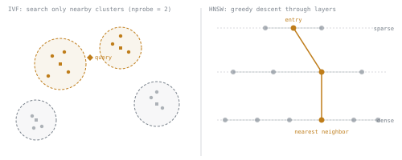

# 第 4 课：ANN 索引：HNSW 与 IVF

**使命关联:** 第 3 阶段开启了使命中“靶子在移动”的部分，也就是在真实语料库上搭建搜索：索引让向量搜索快到真正能跑起来，代价是一种召回率与延迟之间的权衡，本课先把它点明，再由第 5 课在 pgvector 中把它落到具体。
**主要来源:** [论文：“Efficient and Robust Approximate Nearest Neighbor Search Using Hierarchical Navigable Small World Graphs”，Malkov 和 Yashunin，2018](https://arxiv.org/abs/1603.09320)
**前置知识:** [第 3 课](0003-embedding-dimensionality.md)、[文本块](../GLOSSARY.md)

## 热身

1. ▢ 某个语料库有 200 万个文本块。用 float32 按 1536 维做嵌入，与按 256 维相比，大约各占多少存储空间？

检查

1536 维时约 12.3 GB，256 维时约 2.0 GB，因为每个向量的字节数随维度数线性增长（`dimensions × 4 bytes`）。

2. ▢ Matryoshka Representation Learning 能让你对嵌入向量做什么，而标准嵌入模型无法安全地做到？

检查

训练之后把它截断到更少的维度，质量代价有界且可预测，因为用 MRL 训练的模型，其前缀本身就是有意义的嵌入。标准模型的各个维度没有按重要性排序，所以截断它的结果不可预测。

## 要点

### 为什么精确搜索无法扩展

要精确地找到查询真正的最近邻，就得把它与语料库中的每个向量逐一比较。这与语料库的大小成线性关系：语料库翻倍，搜索时间也翻倍，到了几百万个文本块的规模，暴力比较在查询时就慢到跑不动了。**近似最近邻**（ANN）索引接受少量、可控的不精确：它返回的向量很可能接近真正的最近邻，但不保证恰好就是它们，换来的是不随语料库大小线性增长的搜索时间。

### IVF：只搜索附近的簇

**IVF**（倒排文件索引）提前把向量空间划分成若干簇（通常用 k-means），把每个向量分配给离它最近的簇中心。查询时，IVF 不扫描每一个向量，只搜索离查询最近的 `nprobe` 个簇，`nprobe` 是一个可调的数量。`nprobe` 低（只搜最近的那一个簇）时速度快，但可能漏掉恰好位于边界附近相邻簇中的真正近邻。`nprobe` 高（搜索很多簇甚至全部簇）时，召回率接近精确搜索，代价也接近精确搜索。IVF 还有一次性的构建成本：聚类这一步需要语料库向量中有代表性的样本，才能把簇中心放好。

### HNSW：可导航的图，自上而下搜索

**HNSW**（分层可导航小世界）构建的是多层图，而不是簇：每个向量是一个节点，通过边与附近的其他向量相连，上面较稀疏的层可以在向量空间中做长距离跳跃，最底下较稠密的一层可以做精确的局部搜索。查询从稀疏的顶层开始，贪心地跳向与其相连的最近节点，然后逐层下降，不断修正自己的位置，直到到达稠密的底层。这里可调的旋钮是 `ef_search`，也就是搜索在每一步跟踪多少个候选：`ef_search` 低，很快就能找到答案，但可能满足于一个局部不错、却不是真正最近的节点；`ef_search` 高，会探索更多候选，用速度换召回率，这与 `nprobe` 对 IVF 所做的权衡是同一种形态。

### 总体形态：一条召回率与延迟的曲线，而不是唯一正确的答案

两种索引都提供一个旋钮（IVF 的 `nprobe`，HNSW 的 `ef_search`），针对给定的语料库和索引，在召回率对延迟的曲线上拨到某个具体的点。HNSW 通常落在这条曲线上比 IVF 更好的位置，同样的延迟下召回率更高，代价是更多内存（图结构本身）和更慢的索引构建。没有哪种索引有一个放之四海而皆准的设置：合适的点取决于工作负载的延迟预算，以及后面的阶段（比如重排序）能吸收多少召回损失而不影响最终结果，而这正是第 6 阶段的检索指标要去度量、而不是想当然的事。

## 练习

1. ▢ 为什么暴力的精确最近邻搜索无法扩展到有几百万个向量的语料库？ANN 索引为了解决这个问题放弃了什么？

检查

精确搜索要把查询与每个向量比较，所以它的成本随语料库大小线性增长，到了几百万个向量时就慢得不可接受。ANN 索引放弃了“一定能精确找到真正最近邻”的保证，接受有少量、可控的概率漏掉某个近邻，换来不按同样方式增长的搜索时间。

2. ▢ 对于 IVF 索引，描述 `nprobe` 参数在两个极端上分别会怎样：`nprobe = 1` 与 `nprobe` 设为搜索每一个簇。

检查

`nprobe = 1` 只搜索最近的那一个簇：最快，但可能漏掉位于边界附近相邻簇中的真正最近邻，尤其是当查询落在靠近簇边缘的位置时。`nprobe` 设为搜索每一个簇，则接近精确搜索：召回率最高，但成本也和精确搜索一样，因为它不再跳过语料库的大部分。

3. ▢ HNSW 的 `ef_search` 参数，是怎样对 HNSW 起到与 `nprobe` 对 IVF 相同的作用的？

提示

想一想每个参数控制的是什么：在返回答案之前，索引有多大一部分被检查。

检查

`ef_search` 控制图搜索在 HNSW 的各层中下降时，每一步跟踪多少个候选。值低，探索的候选少，很快找到答案，但有可能满足于一个并非真正最近的节点。值高，探索的候选多，用搜索速度换取更高的召回率，与 `nprobe` 给 IVF 带来的召回率对延迟的形态相同。

4. ▢ 对给定的语料库，选 HNSW 还是选 IVF，总体上的权衡是什么？

检查

HNSW 通常能在给定延迟下达到比 IVF 更好的召回率，但内存开销更大（图的边在存储向量本身之外带来了实实在在的额外开销），而且一开始构建索引也更耗时。IVF 构建和存储都更便宜，但通常需要搜索语料库中更大的一部分，才能在相同延迟下追平 HNSW 的召回率。

5. ▢ 关于调节 ANN 索引的搜索时参数（`nprobe` 或 `ef_search`），下列哪项说法正确？

    - a) 存在一个对任何语料库和工作负载都适用的唯一正确设置
    - b) 合适的设置是召回率与延迟曲线上的一个点，必须对照工作负载实际的延迟预算和对召回损失的容忍度来选
    - c) 把参数设得越高总是对的，因为索引一旦建好，延迟就不重要了
    - d) 该参数只影响索引的构建时间，不影响查询时的行为

检查

**b)** 两个参数都是在查询时拿召回率换延迟，合适的点取决于工作负载实际需要什么，这是第 6 阶段要度量的，而不是想当然的。（a）错误：召回率与延迟曲线恰恰排除了这一点。（c）错误：设置越高，查询时延迟越大，只要有延迟预算要满足，这就很重要。（d）错误：`nprobe` 和 `ef_search` 都是搜索时的参数，不是构建时的参数。

## 实战练习

- [ ] 找出你的向量存储使用（或默认使用）的索引类型（IVF 或 HNSW），并在它的文档中找到对应的搜索时召回率与延迟参数。
- [ ] 如果你能对一个索引运行查询，试试两个不同的 `nprobe` 或 `ef_search` 值，观察查询延迟有何不同。
- [ ] 明天：读一段 HNSW 论文对其分层结构的描述，并用你自己的话写下，为什么顶层必须稀疏，长距离跳跃才行得通。

## 延伸阅读

- [论文：“Efficient and Robust Approximate Nearest Neighbor Search Using Hierarchical Navigable Small World Graphs”，Malkov 和 Yashunin，2018](https://arxiv.org/abs/1603.09320)
- [仓库：pgvector，pgvector](https://github.com/pgvector/pgvector)
- [资源](../RESOURCES.md)

---

没学明白？请重读顶部的主要来源，因为本课是对它的压缩，而理解正是在压缩中流失的。如果有哪个术语觉得含糊，可以查看[术语表](../GLOSSARY.md)。

如果问题出在课程本身，而不是学习材料，那就是一个缺陷：[提交 issue](https://github.com/TokenCemetery/teach/issues)。
