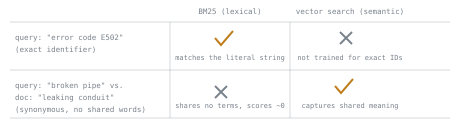

# 第 6 课：BM25 与词法检索

**使命关联:** 第 4 阶段开启混合检索：在把词法排名与向量搜索合并之前，本课先确立词法检索真正擅长什么，以及为什么一个强大的嵌入模型也不会让它过时。
**主要来源:** [论文：“The Probabilistic Relevance Framework: BM25 and Beyond”，Robertson 和 Zaragoza，2009](https://www.staff.city.ac.uk/~sbrp622/papers/foundations_bm25_review.pdf)
**前置知识:** [第 5 课](0005-pgvector-specifics.md)、[文本块](../GLOSSARY.md)

## 热身

1. ▢ 双编码器为什么把查询和段落分开嵌入，而不是一起嵌入？

检查

这样每个段落都可以提前嵌入一次并存储起来；搜索时只需要嵌入查询，就能与预先算好的段落向量低成本地比较。

2. ▢ 为什么用 `vector_l2_ops` 建的索引，无法加速按 `<=>`（余弦距离）排序的查询？

检查

索引是针对某一个特定的距离函数构建的；运算符类和查询的运算符必须一致，否则索引不会被用上，查询会退回到全表顺序扫描。

## 要点

### BM25 给词项重叠打分，而不是给含义打分

**BM25** 是一种词法排序函数：它完全根据查询中的哪些词项在文档中字面出现、出现得多频繁、每个词项的信息量有多大，来给文档与查询的相关程度打分，不涉及嵌入，也完全没有“含义”的概念。三个要素合成了它的分数：**逆文档频率（IDF）**，按查询词项在整个语料库中有多罕见来加权（像“the”这样的常见词几乎没有贡献，因为它到处都有，什么也区分不了；罕见而具体的词项贡献很大，因为它的出现很有信息量）；**词频**，即查询词项在这篇具体文档中出现的次数，但它是**饱和**的，而不是线性增长，所以一个词项出现 10 次，得分并不是出现 1 次的 10 倍，这就避免了关键词堆砌主导分数；以及**长度归一化**，它会削弱文档仅仅因为比平均水平更长而获得的原始词频优势，因为更长的文档仅凭篇幅就有更多机会包含任何给定的词项，并不一定是因为它更相关。

### 有了好的嵌入模型，词法检索为什么仍然重要

嵌入模型是为捕捉语义相似性而训练的，对于同义的不同说法，它们做得很好：查询“how to fix a broken pipe”，可以检索到一段讲“resolving a leaking conduit”的内容，尽管二者没有任何共同的词，因为两者的意思相近。但同样的训练也让嵌入在精确、具体的词项匹配上相对较弱：产品代码、错误标识符、罕见的专有名词、用户原样引用的一个确切短语。查询“error code E502”需要一篇字面上包含“E502”的文档；嵌入模型是针对通用语义相似性、而不是精确标识符匹配训练的，它可能检索出主题上讲错误处理的文档，却没有把真正包含用户所输入具体代码的那一篇浮现出来。BM25 的盲点正好相反：完全相反的情形，即“broken pipe”对“leaking conduit”，在 BM25 下得分接近零，因为两者没有任何共同的词项，尽管意思相同。每种方法都能抓住另一种漏掉的东西，这正是应当把两者结合起来，而不是只选其一的理由。

## 练习

1. ▢ 用户搜索精确的错误代码“E502”。为什么即使语料库里有好几篇主题上讲错误处理的文档，单靠向量搜索也可能漏检那篇真正包含这个字符串的文档？

检查

嵌入模型是为捕捉语义相似性训练的，而不是为精确标识符匹配，所以“E502”在嵌入空间里可能并没有被表示成一个有区分度的点；主题上泛泛讲错误处理的文档，离查询的嵌入反而可能比那篇碰巧包含字面字符串“E502”的文档更近。

2. ▢ 一个查询是“how to fix a broken pipe”，而最匹配的文档措辞是“resolving a leaking conduit”，与查询没有任何共同的词。BM25 会给这一对打高分吗？为什么会或不会？

检查

不会，BM25 给它打的分会接近零，因为它只根据查询中的哪些词项在文档中字面出现来打分，而这一对没有任何共同的词项。BM25 没有办法认出这两种说法的意思相同；这正是向量搜索的语义相似性要填补的空缺。

3. ▢ BM25 为什么让词频饱和（词项重复出现带来的得分增幅递减），而不是线性计分？

提示

想一想，文档可以怎样钻线性词频分数的空子。

检查

线性的词频分数会让文档仅靠多次重复某个查询词项（关键词堆砌）就主导排名，而不管这篇文档是否真的更相关。让词频饱和，意味着每多出现一次，贡献就比上一次更少，所以相关性仍然得到奖励，却不会让单纯的重复主导分数。

4. ▢ BM25 为什么要对文档长度做归一化？没有这种归一化会出什么问题？

检查

更长的文档仅仅因为词更多，就有更多机会包含任何给定的查询词项，这与它是否真的与查询更相关无关。没有长度归一化，长文档就会系统性地胜过同样相关甚至更相关的短文档，原因纯粹是篇幅，而不是实际的相关性。

5. ▢ 与向量搜索相比，关于 BM25，下列哪项说法正确？

    - a) BM25 和向量搜索在完全相同的查询类型上失败，所以把它们结合起来没有任何好处
    - b) BM25 擅长精确的词项匹配，却会漏掉没有共同词的同义说法，而向量搜索正好相反
    - c) BM25 需要嵌入模型来计算词项的相关性
    - d) 对任何查询，向量搜索总是胜过 BM25，因为它捕捉的是含义，而不只是词

检查

**b)** 每种方法的盲点，都是另一种方法的强项，这正是混合检索的全部依据。（a）错误：它们的失败模式是相反的，而不是相同的。（c）错误：BM25 纯粹是一种词项统计方法，完全不涉及嵌入。（d）错误：精确的标识符或代码匹配，恰恰是 BM25 可以胜过语义嵌入的情形。

## 实战练习

- [ ] 为你的语料库找到或写出一个包含具体标识符、代码或确切短语的查询，检查你当前的检索配置（如果只用向量）是否真的能把包含它的那篇文档浮现出来。
- [ ] 在你的语料库中找一个查询和一篇与之匹配的文档，它们几乎没有或完全没有共同的确切词，但意思相同，并预测只用 BM25 搜索会怎样给这一对打分。
- [ ] 明天：查一查你的搜索栈（Postgres 全文搜索、Elasticsearch 或类似工具）是否已经提供了 BM25 风格的排序函数，可以拿来与你的向量搜索结果做比较。

## 延伸阅读

- [论文：“The Probabilistic Relevance Framework: BM25 and Beyond”，Robertson 和 Zaragoza，2009](https://www.staff.city.ac.uk/~sbrp622/papers/foundations_bm25_review.pdf)
- [文档：“Reciprocal rank fusion (RRF)”，Elasticsearch](https://www.elastic.co/guide/en/elasticsearch/reference/current/rrf.html)
- [资源](../RESOURCES.md)

---

没学明白？请重读顶部的主要来源，因为本课是对它的压缩，而理解正是在压缩中流失的。如果有哪个术语觉得含糊，可以查看[术语表](../GLOSSARY.md)。

如果问题出在课程本身，而不是学习材料，那就是一个缺陷：[提交 issue](https://github.com/TokenCemetery/teach/issues)。
