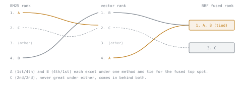

# 第 7 课：倒数排名融合

**使命关联:** 这是第 4 阶段的收尾：BM25 和向量搜索（第 4 到 6 课）各自产生一个排名，本课讲的就是这两个排名如何变成一个混合结果，并对照测得的数字来调节，而不是凭猜测定一个混合比例。
**主要来源:** [文档：“Reciprocal rank fusion (RRF)”，Elasticsearch](https://www.elastic.co/guide/en/elasticsearch/reference/current/rrf.html)
**前置知识:** [第 6 课](0006-bm25-and-lexical-search.md)、[文本块](../GLOSSARY.md)

## 热身

1. ▢ 各举一个例子：BM25 会成功而向量搜索可能失败的查询，以及相反的情形。

<details markdown="1"><summary>检查</summary>

像“error code E502”这样的精确标识符，有利于 BM25，因为向量搜索的嵌入模型并没有被训练成精确匹配具体代码。没有共同词的同义说法，比如“broken pipe”对“leaking conduit”，有利于向量搜索，因为对于与查询没有任何共同词项的文档，BM25 会打零分。

</details>

2. ▢ 为什么对 pgvector 索引使用错误的距离运算符，会导致查询退回到顺序扫描？

<details markdown="1"><summary>检查</summary>

索引是针对某一个特定的距离函数（一个运算符类）构建的；使用不同运算符的查询，与索引构建时针对的对象不匹配，所以索引无法使用，查询转而直接扫描整张表。

</details>

## 要点

### 问题：两个排名的分数尺度不可比

BM25 产生的是无界的、依赖语料库的分数；余弦相似度产生的分数界于 -1 和 1 之间。直接把它们取平均，哪怕先做一些归一化，也意味着要决定如何让两种本质不同的尺度变得可比，而这个决定很脆弱：它取决于语料库、查询和选用了哪种归一化方案，却没有任何有原则的办法知道它是否公平。

### RRF：用排名位置，而不用分数本身

**倒数排名融合（RRF）**完全绕开了尺度问题，办法是忽略底层的分数，只使用每篇文档在各个排名中的**排名位置**。对于在排名 *r* 中位于 `rank_r(d)` 的文档 *d*，它的 RRF 分数是它出现的每个排名里的倒数排名项之和：

```text
RRF(d) = sum over rankings r of 1 / (k + rank_r(d))
```

`k` 是一个常数，用来削弱最靠前几名的影响；原始论文中常用的默认值是 `k = 60`。由于只有排名位置起作用，分数的大小不起作用，所以 RRF 在合并 BM25 排名和向量搜索排名时，两者都无需归一化：排名位置本身就是一种通用的货币，对任何排序方法都能自行归一化。

### 一个算例

为了让算术简洁，这里用简化的 `k = 1`（生产系统更常默认使用 `k = 60`，它比 `k = 1` 更大幅度地削弱最靠前几名之间的差异）：对某个查询，BM25 把文档 A 排第 1，文档 B 排第 4，文档 C 排第 2；向量搜索把 A 排第 4，B 排第 1，C 排第 2。

```text
RRF(A) = 1/(1+1) + 1/(1+4) = 0.500 + 0.200 = 0.700
RRF(B) = 1/(1+4) + 1/(1+1) = 0.200 + 0.500 = 0.700
RRF(C) = 1/(1+2) + 1/(1+2) = 0.333 + 0.333 = 0.667
```

A 和 B 并列第一，各自在一种方法下表现出色，在另一种方法下表现不佳；而 C 在两种方法下都只是中等，输给了前两者。RRF 奖励的是任何一种方法强烈看好的文档，而不只是两种方法都勉强认同的文档。



### 对照测得的指标来调节混合比例

RRF 可以扩展为给每个排名加权重，即 `sum of w_r / (k + rank_r(d))`，让向量搜索在最终融合中的分量比 BM25 更重或更轻。合适的权重和合适的 `k`，都不是靠猜的，而是要靠测量，就像第 3 课对候选维度测量嵌入质量，而不是假定某一个维度那样。利用第 6 阶段的检索指标（recall@k、MRR），针对能代表语料库实际流量的、带标注的或合成的查询集，可以直接比较不同的权重设置，而真正在这个语料库上更常检索到正确文档的混合比例，而不是默认的 50/50 分配，才是值得上线的那个。

## 练习

1. ▢ 对某个查询，BM25 把文档 X 排第 2、文档 Y 排第 1；向量搜索把 X 排第 1、Y 排第 3。取 `k = 1`，计算每篇文档的 RRF 分数，并说出哪篇排名更高。

<details markdown="1"><summary>提示</summary>

`RRF(d) = 1/(k + rank_in_bm25) + 1/(k + rank_in_vector)`。

</details>

<details markdown="1"><summary>检查</summary>

`RRF(X) = 1/(1+2) + 1/(1+1) = 0.333 + 0.500 = 0.833`。`RRF(Y) = 1/(1+1) + 1/(1+3) = 0.500 + 0.250 = 0.750`。X 排名更高，因为它在向量搜索下是很强的（第 1 名）结果，在 BM25 下也只是略好，略胜于在 BM25 下很强、在向量搜索下较弱的 Y。

</details>

2. ▢ RRF 为什么使用每篇文档的排名位置，而不是直接使用它的原始 BM25 分数或余弦相似度分数？

<details markdown="1"><summary>检查</summary>

BM25 分数和余弦相似度处在不可比的尺度上（一个无界且依赖语料库，另一个界于 -1 和 1 之间），而且没有任何有原则的、与语料库无关的办法把它们相互归一化。排名位置本身就是对任何排序方法都通用的货币，所以使用它就完全绕开了归一化问题。

</details>

3. ▢ 就文档的确切排名位置有多重要而言，较小的 `k`（比如 1）与较大的 `k`（比如 60）相比，对 RRF 公式有什么影响？

<details markdown="1"><summary>检查</summary>

较小的 `k` 使倒数排名项对列表靠前位置上排名的细小差异敏感得多（第 1 名与第 2 名之间的差距按比例更大），而较大的 `k` 则削弱这种敏感度，使比如第 1 名与第 5 名之间的差异相对更小。`k` 越大，融合越平缓，对排名位置越不敏感。

</details>

4. ▢ 团队应该如何决定，在他们的混合比例中要不要让向量搜索的权重高于 BM25，而不是默认平分？

<details markdown="1"><summary>检查</summary>

针对能代表语料库真实查询模式的、带标注的或合成的查询集，在几种候选权重下测量检索质量（recall@k 或 MRR，即第 6 阶段的指标），选择在这个语料库上最常检索到正确文档的那一种，而不是不加检查就假定平分或任何别的默认值是对的。

</details>

5. ▢ 关于倒数排名融合，下列哪项说法正确？

    - a) 在合并之前，需要把 BM25 和余弦相似度的分数归一化到同一尺度上
    - b) 它只用排名位置来合并排名，从而绕开了比较不可比分数尺度的需要
    - c) 在一个排名中排第 1、在另一个排名中排最后的文档，总是胜过在两个排名中都排中间的文档
    - d) 常数 `k` 对融合后的排名没有影响，只影响数值分数的大小

<details markdown="1"><summary>检查</summary>

**b)** 使用排名位置而不是原始分数，恰恰避免了归一化问题。（a）错误：那是 RRF 特意避开的原始分数融合方式。（c）错误：算例表明，一篇始终中等的文档仍可能输给两篇各自在一种方法下表现出色的文档，但结果取决于实际的排名数值，而不存在“极端胜过中等”的普遍规律。（d）错误：`k` 改变排名位置差异的重要程度，这可能改变融合后排名的顺序，而不只是改变它的尺度。

</details>

## 实战练习

- [ ] 针对你语料库中的一个查询，取少数几篇候选文档，得到它们的 BM25 排名和向量搜索排名，并用 `k = 60` 手工计算它们的 RRF 分数。
- [ ] 如果你有带标注的或合成的查询集，在相同的查询上，比较只用 BM25 的排名、只用向量的排名和经 RRF 融合的排名的 recall@k。
- [ ] 明天：在加权 RRF 公式中，试两个不同的向量搜索权重值，看看其中是否有哪个能比平分更可测地提高 recall@k。

## 延伸阅读

- [文档：“Reciprocal rank fusion (RRF)”，Elasticsearch](https://www.elastic.co/guide/en/elasticsearch/reference/current/rrf.html)
- [论文：“The Probabilistic Relevance Framework: BM25 and Beyond”，Robertson 和 Zaragoza，2009](https://www.staff.city.ac.uk/~sbrp622/papers/foundations_bm25_review.pdf)
- [资源](../RESOURCES.md)

---

没学明白？请重读顶部的主要来源，因为本课是对它的压缩，而理解正是在压缩中流失的。如果有哪个术语觉得含糊，可以查看[术语表](../GLOSSARY.md)。

如果问题出在课程本身，而不是学习材料，那就是一个缺陷：[提交 issue](https://github.com/TokenCemetery/teach/issues)。
