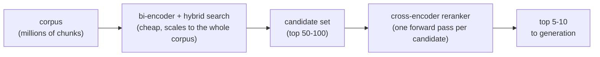

# Lección 8. Rerankers cross-encoder

**Vínculo con la misión:** Hasta ahora la recuperación (etapas 1 a 4) ha usado toda comparación al estilo bi-encoder, barata y escalable pero ciega a la interacción fina entre consulta y pasaje; la etapa 5 añade una segunda pasada que cambia escala por precisión sobre un conjunto de candidatos mucho más pequeño.
**Fuente principal:** [Paper: "Passage Re-ranking with BERT", Nogueira and Cho, 2019](https://arxiv.org/abs/1901.04085)
**Requisitos previos:** [Lección 7](0007-reciprocal-rank-fusion.md), [Chunk](../GLOSSARY.md)

## Calentamiento

1. ▢ ¿Qué problema resuelve reciprocal rank fusion y cómo lo resuelve?

Comprobación

Las puntuaciones de BM25 y de la similitud coseno viven en escalas incomparables, así que promediarlas directamente es frágil. RRF lo resuelve combinando rankings usando solo la posición de cada documento en el ranking, no su puntuación bruta, que es una moneda común para cualquier método de ranking.

2. ▢ ¿Por qué un bi-encoder genera el embedding de una consulta y de un pasaje de forma independiente y no conjunta?

Comprobación

Para que cada pasaje reciba su embedding una sola vez, de antemano, y se almacene; comparar vectores precalculados en el momento de la búsqueda es barato, mientras que ejecutar un modelo sobre cada par consulta-pasaje no lo es.

## Qué debes saber

### Un cross-encoder ve la consulta y el pasaje juntos

El bi-encoder de la lección 2 genera el embedding de una consulta y de un pasaje en completo aislamiento entre sí; los dos vectores nunca interactúan hasta que un cálculo de distancia barato los compara después. Un **cross-encoder** hace lo contrario: toma la consulta y un único pasaje candidato juntos, como una sola entrada combinada, y los ejecuta de forma conjunta por un modelo que puede atender a ambos textos a la vez, y produce una única puntuación de relevancia para ese par concreto. Como el modelo ve ambos textos simultáneamente, puede captar interacciones finas, esta palabra concreta de la consulta que coincide con esta cláusula concreta del pasaje, que los embeddings calculados de forma independiente de un bi-encoder no tienen forma de capturar, ya que ninguno de los dos embeddings se calculó nunca con conocimiento del otro texto.

### Lo que cuesta esa precisión

El procesamiento conjunto de un cross-encoder es también exactamente lo que lo hace demasiado costoso para buscar directamente en un corpus entero: puntuar un candidato requiere una pasada completa hacia delante (forward pass) del modelo, así que puntuar 1,000 candidatos significa 1,000 forward passes, calculados desde cero para cada consulta, sin nada precalculable de antemano como sí lo son los embeddings de pasajes de un bi-encoder. Un corpus de un millón de chunks necesitaría un millón de forward passes por consulta, lo que ni se acerca a escalar como lo hace un índice de embeddings.

### Recuperar barato, hacer reranking con precisión

El patrón estándar usa cada enfoque donde es asequible: la recuperación con bi-encoder, más la búsqueda híbrida (etapas 3 y 4), reduce de forma barata un corpus entero a un conjunto modesto de candidatos, normalmente en torno a los 50 a 100 mejores resultados. Un reranker cross-encoder corre entonces solo sobre ese conjunto mucho más pequeño, puntúa cada par consulta-candidato por separado y los reordena con la precisión que un bi-encoder por sí solo no podía dar, y hace aflorar el puñado verdaderamente mejor, a menudo los 5 a 10 primeros, para entregarlo a la siguiente etapa. Este diseño de dos etapas consigue a la vez la escala del bi-encoder y la precisión del cross-encoder, aplicando el paso costoso solo donde el corpus ya se ha reducido lo suficiente para que sea asequible.

## Práctica

1. ▢ ¿Por qué un cross-encoder puede capturar señales de relevancia más sutiles que un bi-encoder, aunque ambos se construyan sobre arquitecturas transformer subyacentes similares?

Comprobación

Un cross-encoder procesa la consulta y el pasaje candidato juntos, en una única forward pass conjunta, de modo que el modelo puede atender a ambos textos y captar interacciones específicas entre ellos. Un bi-encoder genera el embedding de cada uno por separado; cuando se comparan sus embeddings, ninguno se calculó con conocimiento del contenido específico del otro.

2. ▢ ¿Por qué un cross-encoder no puede usarse para buscar directamente en un corpus de un millón de chunks, como sí puede un índice de embeddings de bi-encoder?

Comprobación

Un cross-encoder necesita una forward pass completa del modelo por cada par consulta-candidato, calculada desde cero para cada consulta, ya que nada de la entrada conjunta consulta-pasaje puede precalcularse de antemano. Puntuar un millón de candidatos significaría un millón de forward passes por consulta, lo que no escala como lo hace comparar el embedding de una consulta con un índice precalculado.

3. ▢ Describe el patrón de dos etapas de recuperar y luego hacer reranking, y explica por qué existe en lugar de usar cualquiera de las dos etapas por sí sola.

Comprobación

La recuperación con bi-encoder (más la búsqueda híbrida) reduce de forma barata un corpus entero a un conjunto modesto de candidatos, y luego un cross-encoder hace reranking solo de ese conjunto más pequeño con mayor precisión. Existe porque un cross-encoder por sí solo no puede escalar a un corpus completo, y un bi-encoder por sí solo pasa por alto las interacciones finas entre consulta y pasaje que un cross-encoder sí puede capturar; combinarlos consigue tanto la escala como la precisión, cada una aplicada donde es asequible.

4. ▢ Un equipo propone hacer reranking de todo su corpus con un cross-encoder para cada consulta, saltándose por completo la recuperación con bi-encoder, para "obtener los mejores resultados posibles". ¿Qué falla en este plan?

Pista

Piensa en cuántas forward passes exigiría esto por consulta.

Comprobación

Exige una forward pass completa del modelo por cada documento de todo el corpus, para cada consulta, que es exactamente el problema de escala que tiene un cross-encoder y que un índice de bi-encoder existe para evitar. Con cualquier tamaño real de corpus, esto sería demasiado lento para servir una consulta en vivo, y anularía la razón misma de que existan un índice de embeddings y la búsqueda híbrida.

5. ▢ ¿Qué afirmación es cierta sobre la relación entre la recuperación con bi-encoder y el reranking con cross-encoder?

    - a) Resuelven el mismo problema, así que usar ambos juntos es redundante
    - b) La recuperación con bi-encoder reduce de forma barata un corpus grande a un conjunto de candidatos, y un cross-encoder hace reranking solo de ese conjunto más pequeño con mayor precisión
    - c) Un cross-encoder escala a buscar en un corpus completo igual de bien que un índice de bi-encoder
    - d) El reranking elimina por completo la necesidad de chunking, embeddings o búsqueda híbrida

Comprobación

**b)** Ese es exactamente el patrón de dos etapas que describe esta lección. (a) es falsa: cambian escala por precisión de formas distintas, y por eso combinarlos es útil y no redundante. (c) es falsa: un cross-encoder necesita una forward pass por candidato, lo que no escala a un corpus completo como lo hace un índice de embeddings. (d) es falsa: el reranking opera sobre el conjunto de candidatos que esas etapas anteriores ya produjeron; no las reemplaza.

## Prácticas en el mundo real

- [ ] Encuentra un reranker cross-encoder alojado o de código abierto (como el de Cohere) y lee qué entrada espera (una consulta más una lista de textos candidatos) y qué devuelve.
- [ ] Para una consulta y un conjunto pequeño de pasajes candidatos de tu corpus, predice qué candidato pondría más arriba un cross-encoder y luego compruébalo con una llamada real a un reranker si tienes acceso a uno.
- [ ] Mañana: anota cuántos candidatos devuelve tu etapa de recuperación actual antes de cualquier reranking y si ese número es una decisión deliberada o un valor por defecto sin examinar.

## Para profundizar

- [Paper: "Passage Re-ranking with BERT", Nogueira and Cho, 2019](https://arxiv.org/abs/1901.04085)
- [Docs: "Reranking", Cohere](https://docs.cohere.com/docs/reranking)
- [Recursos](../RESOURCES.md)

---

¿No termina de quedar claro? Vuelve a leer la fuente principal de arriba, ya que esta lección la comprime y en la compresión es donde se escapa la comprensión. Consulta el [glosario](../GLOSSARY.md) por si algún término te resultó resbaladizo.

Si lo poco claro es la propia lección y no el material, eso es un defecto: [abre un issue](https://github.com/TokenCemetery/teach/issues).
