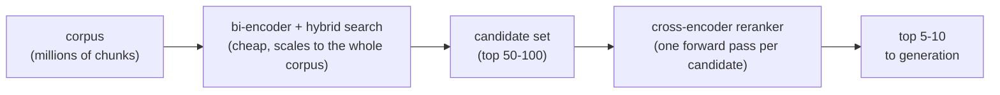

# Leçon 8. Rerankers cross-encoder

**Lien avec la mission :** La récupération jusqu'ici (étapes 1 à 4) a toujours reposé sur une comparaison de type bi-encoder, peu coûteuse et scalable mais aveugle à l'interaction fine entre la requête et le passage ; l'étape 5 ajoute une seconde passe qui échange de l'échelle contre de la précision sur un ensemble de candidats bien plus petit.
**Source primaire :** [Article : "Passage Re-ranking with BERT", Nogueira and Cho, 2019](https://arxiv.org/abs/1901.04085)
**Prérequis :** [Leçon 7](0007-reciprocal-rank-fusion.md), [Chunk](../GLOSSARY.md)

## Échauffement

1. ▢ Quel problème la reciprocal rank fusion résout-elle, et comment le résout-elle ?

Vérifier

Les scores BM25 et de similarité cosinus vivent sur des échelles incomparables, donc les moyenner directement est fragile. RRF résout cela en combinant les classements avec uniquement la position dans le classement de chaque document, pas son score brut, qui est une monnaie commune à toute méthode de classement.

2. ▢ Pourquoi un bi-encoder calcule-t-il l'embedding d'une requête et d'un passage indépendamment plutôt que conjointement ?

Vérifier

Pour que chaque passage puisse être traité une seule fois, à l'avance, et stocké ; comparer des vecteurs précalculés au moment de la recherche est peu coûteux, alors qu'exécuter un modèle sur chaque paire requête-passage ne l'est pas.

## À savoir

### Un cross-encoder voit la requête et le passage ensemble

Le bi-encoder de la leçon 2 calcule l'embedding d'une requête et d'un passage en complète isolation l'un de l'autre ; les deux vecteurs n'interagissent jamais avant qu'un calcul de distance peu coûteux les compare ensuite. Un **cross-encoder** fait l'inverse : il prend la requête et un unique passage candidat ensemble, comme une seule entrée combinée, et les fait passer conjointement dans un modèle qui peut porter son attention sur les deux textes à la fois, en produisant un unique score de pertinence pour cette paire précise. Parce que le modèle voit les deux textes simultanément, il peut repérer des interactions fines, tel mot de la requête qui correspond à telle clause du passage, que les embeddings calculés indépendamment par un bi-encoder n'ont aucun moyen de capturer, puisqu'aucun des deux embeddings n'a jamais été calculé en connaissant l'autre texte.

### Ce que coûte cette précision

Le traitement conjoint d'un cross-encoder est aussi exactement ce qui le rend trop coûteux pour chercher directement dans tout un corpus : noter un candidat exige une passe avant complète du modèle, donc noter 1 000 candidats signifie 1 000 passes avant, recalculées à neuf pour chaque requête, sans rien de précalculable à l'avance comme le sont les embeddings de passages d'un bi-encoder. Un corpus d'un million de chunks demanderait un million de passes avant par requête, ce qui est très loin de passer à l'échelle comme le fait un index d'embeddings.

### Récupérer à bas coût, reclasser avec précision

Le schéma standard utilise chaque approche là où elle est abordable : la récupération par bi-encoder, plus la recherche hybride (étapes 3 et 4), réduit à bas coût tout un corpus à un ensemble de candidats modeste, couramment autour des 50 à 100 premiers résultats. Un reranker cross-encoder ne s'exécute alors que sur cet ensemble bien plus petit, en notant chaque paire requête-candidat individuellement et en les réordonnant avec la précision qu'un bi-encoder seul ne pouvait pas offrir, en faisant remonter les quelques meilleurs vraiment bons, souvent les 5 à 10 premiers, à transmettre en aval. Cette conception en deux étapes obtient ensemble l'échelle du bi-encoder et la précision du cross-encoder, en n'appliquant l'étape coûteuse que là où le corpus a déjà été assez réduit pour qu'elle soit abordable.

## Pratique

1. ▢ Pourquoi un cross-encoder peut-il capturer des signaux de pertinence plus subtils qu'un bi-encoder, même quand les deux reposent sur des architectures de transformer sous-jacentes similaires ?

Vérifier

Un cross-encoder traite la requête et le passage candidat ensemble, en une seule passe avant conjointe, donc le modèle peut porter son attention sur les deux textes et repérer des interactions précises entre eux. Un bi-encoder calcule chacun en isolation ; au moment où leurs embeddings sont comparés, aucun des deux n'a été calculé en connaissant le contenu précis de l'autre.

2. ▢ Pourquoi un cross-encoder ne peut-il pas servir à chercher directement dans un corpus d'un million de chunks, comme le peut un index d'embeddings de bi-encoder ?

Vérifier

Un cross-encoder a besoin d'une passe avant complète du modèle par paire requête-candidat, recalculée à neuf pour chaque requête, puisque rien dans l'entrée conjointe requête-passage ne peut être précalculé à l'avance. Noter un million de candidats signifierait un million de passes avant par requête, ce qui ne passe pas à l'échelle comme la comparaison d'un embedding de requête à un index précalculé.

3. ▢ Décrivez le schéma en deux étapes récupérer puis reclasser, et expliquez pourquoi il existe plutôt que d'utiliser l'une ou l'autre étape seule.

Vérifier

La récupération par bi-encoder (plus la recherche hybride) réduit à bas coût tout un corpus à un ensemble de candidats modeste, puis un cross-encoder reclasse uniquement ce petit ensemble avec une meilleure précision. Il existe parce qu'un cross-encoder seul ne peut pas passer à l'échelle d'un corpus entier, et qu'un bi-encoder seul rate les interactions fines requête-passage qu'un cross-encoder peut capturer ; les combiner donne à la fois l'échelle et la précision, chacune appliquée là où elle est abordable.

4. ▢ Une équipe propose de reclasser tout son corpus avec un cross-encoder pour chaque requête, en sautant entièrement la récupération par bi-encoder, pour « obtenir les meilleurs résultats possibles ». Qu'est-ce qui ne va pas dans ce plan ?

Indice

Réfléchissez au nombre de passes avant que cela exigerait par requête.

Vérifier

Cela exige une passe avant complète du modèle par document de tout le corpus, pour chaque requête, ce qui est exactement le problème d'échelle qu'a un cross-encoder et que l'index d'un bi-encoder existe pour éviter. À n'importe quelle taille de corpus réelle, ce serait bien trop lent pour servir une requête en direct, ce qui annule la raison d'être même d'un index d'embeddings et de la recherche hybride.

5. ▢ Laquelle de ces affirmations est vraie à propos de la relation entre la récupération par bi-encoder et le reranking par cross-encoder ?

    - a) Ils résolvent le même problème, donc les utiliser ensemble est redondant
    - b) La récupération par bi-encoder réduit à bas coût un grand corpus à un ensemble de candidats, et un cross-encoder reclasse uniquement ce petit ensemble avec une meilleure précision
    - c) Un cross-encoder passe à l'échelle d'une recherche dans un corpus entier aussi bien qu'un index de bi-encoder
    - d) Le reranking supprime entièrement le besoin de chunking, d'embeddings ou de recherche hybride

Vérifier

**b)** C'est exactement le schéma en deux étapes que décrit cette leçon. (a) est fausse : ils arbitrent différemment l'échelle contre la précision, ce qui est la raison pour laquelle les combiner est utile et non redondant. (c) est fausse : un cross-encoder a besoin d'une passe avant par candidat, ce qui ne passe pas à l'échelle d'un corpus entier comme le fait un index d'embeddings. (d) est fausse : le reranking opère sur l'ensemble de candidats que ces étapes antérieures ont déjà produit ; il ne les remplace pas.

## Exercices en situation réelle

- [ ] Trouvez un reranker cross-encoder hébergé ou open source (comme celui de Cohere) et lisez quelle entrée il attend (une requête plus une liste de textes candidats) et ce qu'il renvoie.
- [ ] Pour une requête et un petit ensemble de passages candidats de votre corpus, prédisez quel candidat un cross-encoder classerait en premier, puis vérifiez avec un vrai appel à un reranker si vous y avez accès.
- [ ] Demain : notez combien de candidats votre étape de récupération actuelle renvoie avant tout reranking, et si ce nombre est un choix délibéré ou une valeur par défaut jamais examinée.

## Pour aller plus loin

- [Article : "Passage Re-ranking with BERT", Nogueira and Cho, 2019](https://arxiv.org/abs/1901.04085)
- [Doc : "Reranking", Cohere](https://docs.cohere.com/docs/reranking)
- [Ressources](../RESOURCES.md)

---

Ça ne passe pas ? Relisez la source primaire en haut de page, car cette leçon la condense et c'est dans la condensation que la compréhension s'échappe. Consultez le [glossaire](../GLOSSARY.md) pour tout terme qui vous a paru glissant.

Si c'est la leçon elle-même qui n'est pas claire plutôt que la matière, c'est un défaut : [ouvrez une issue](https://github.com/TokenCemetery/teach/issues).
