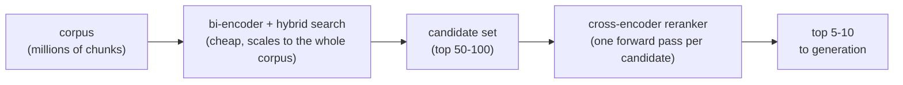

# पाठ 8. Cross-Encoder Rerankers

**मिशन से संबंध:** अब तक का retrieval (चरण 1 से 4) सब bi-encoder-शैली की तुलना पर चला है, जो सस्ती और scalable है पर query-passage के बारीक आपसी असर के प्रति अंधी; चरण 5 एक दूसरा पास जोड़ता है जो बहुत छोटे candidates के सेट पर scale के बदले सटीकता लेता है।
**मुख्य स्रोत:** [पेपर: "Passage Re-ranking with BERT", Nogueira and Cho, 2019](https://arxiv.org/abs/1901.04085)
**पूर्व-आवश्यकताएँ:** [पाठ 7](0007-reciprocal-rank-fusion.md), [Chunk](../GLOSSARY.md)

## वार्म-अप

1. ▢ Reciprocal rank fusion कौन-सी समस्या सुलझाता है, और कैसे?

जाँचें

BM25 और cosine similarity scores बेमेल पैमानों पर रहते हैं, इसलिए उन्हें सीधे औसत करना नाज़ुक है। RRF इसे इस तरह सुलझाता है कि वह rankings को सिर्फ़ हर document की rank की स्थिति से मिलाता है, उसके कच्चे score से नहीं, जो किसी भी ranking तरीक़े पर साझा मुद्रा है।

2. ▢ Bi-encoder query और passage को साथ मिलाकर नहीं, स्वतंत्र रूप से क्यों embed करता है?

जाँचें

ताकि हर passage पहले से, एक बार embed होकर store हो सके; search के समय पहले से निकले vectors की तुलना सस्ती है, जबकि हर query-passage जोड़ी पर model चलाना सस्ता नहीं।

## यह जानें

### Cross-encoder query और passage को साथ-साथ देखता है

पाठ 2 का bi-encoder query और passage को एक-दूसरे से बिल्कुल अलग-थलग embed करता है; दोनों vectors तब तक आपस में कुछ नहीं करते जब तक बाद में सस्ती distance गणना उनकी तुलना न करे। **Cross-encoder** उलटा करता है: वह query और एक अकेले candidate passage को साथ मिलाकर, एक संयुक्त input के रूप में लेता है, और उन्हें एक ऐसे model से साथ गुज़ारता है जो दोनों texts के आर-पार एक साथ ध्यान दे सकता है, और उस ख़ास जोड़ी के लिए एक अकेला relevance score देता है। चूँकि model दोनों texts को एक साथ देखता है, वह बारीक आपसी असर पकड़ सकता है, query का यह ख़ास शब्द passage के इस ख़ास उपवाक्य से मेल खाता है, जिसे bi-encoder की स्वतंत्र रूप से निकाली embeddings पकड़ने का कोई तरीक़ा नहीं रखतीं, क्योंकि कोई भी embedding दूसरे text की जानकारी के साथ कभी नहीं निकाली गई।

### उस सटीकता की क़ीमत

Cross-encoder की संयुक्त प्रोसेसिंग ही उसे पूरे corpus को सीधे खोजने के लिए बहुत महँगा बनाती है: एक candidate को score करने के लिए एक पूरा model forward pass चाहिए, इसलिए 1,000 candidates को score करने का मतलब 1,000 forward passes, हर query के लिए नए सिरे से, बिना कुछ पहले से निकाले जा सकने के, जैसे bi-encoder के passage embeddings निकल जाते हैं। दस लाख chunks के corpus को हर query पर दस लाख forward passes चाहिए, जो embedding index की तरह scale करने के आस-पास भी नहीं पहुँचता।

### सस्ते में retrieve करें, सटीकता से rerank करें

मानक पैटर्न हर तरीक़े को वहाँ इस्तेमाल करता है जहाँ वह वहन करने लायक है: bi-encoder retrieval और hybrid search (चरण 3 और 4) सस्ते में पूरे corpus को एक मामूली candidate सेट तक सिकोड़ते हैं, आम तौर पर कहीं शीर्ष 50 से 100 नतीजों के आसपास। फिर cross-encoder reranker सिर्फ़ उस कहीं छोटे सेट पर चलता है, हर query-candidate जोड़ी को अलग से score करता है और उन्हें उस सटीकता से दोबारा क्रम देता है जो अकेला bi-encoder नहीं दे सकता, और आगे सौंपने के लिए सचमुच सबसे अच्छे मुट्ठी भर, अक्सर शीर्ष 5 से 10, सामने लाता है। यह दो-चरण का डिज़ाइन bi-encoder का scale और cross-encoder की सटीकता एक साथ पाता है, महँगे चरण को वहीं लगाकर जहाँ corpus पहले ही इतना सिकुड़ चुका है कि वह वहन करने लायक है।

## अभ्यास

1. ▢ Cross-encoder bi-encoder से बारीक relevance संकेत क्यों पकड़ सकता है, तब भी जब दोनों मिलते-जुलते transformer architectures पर बने हों?

जाँचें

Cross-encoder query और candidate passage को साथ मिलाकर, एक संयुक्त forward pass में प्रोसेस करता है, इसलिए model दोनों texts के आर-पार ध्यान दे सकता है और उनके बीच के ख़ास आपसी असर पकड़ सकता है। Bi-encoder हर एक को अलग-थलग embed करता है; जब तक उनकी embeddings की तुलना होती है, तब तक कोई भी एक दूसरे की ख़ास सामग्री की जानकारी के साथ नहीं निकाली गई।

2. ▢ Cross-encoder को दस लाख chunks के corpus को सीधे खोजने के लिए वैसे क्यों इस्तेमाल नहीं किया जा सकता जैसे bi-encoder embedding index किया जा सकता है?

जाँचें

Cross-encoder को हर query-candidate जोड़ी के लिए एक पूरा model forward pass चाहिए, हर query पर नए सिरे से, क्योंकि संयुक्त query-passage input का कुछ भी पहले से नहीं निकाला जा सकता। दस लाख candidates को score करने का मतलब हर query पर दस लाख forward passes होता, जो उस तरह scale नहीं करता जैसे query embedding की पहले से बने index से तुलना करना।

3. ▢ दो-चरण वाले retrieve-फिर-rerank पैटर्न का वर्णन करें, और समझाएँ कि वह किसी एक चरण को अकेले इस्तेमाल करने के बजाय क्यों मौजूद है।

जाँचें

Bi-encoder retrieval (और hybrid search) सस्ते में पूरे corpus को एक मामूली candidate सेट तक सिकोड़ते हैं, फिर cross-encoder सिर्फ़ उस छोटे सेट को ज़्यादा सटीकता से rerank करता है। यह इसलिए मौजूद है कि अकेला cross-encoder पूरे corpus तक scale नहीं कर सकता, और अकेला bi-encoder उन बारीक query-passage आपसी असरों को चूक जाता है जिन्हें cross-encoder पकड़ सकता है; दोनों को मिलाने से scale और सटीकता दोनों मिलते हैं, हर एक वहाँ लगाया जाता है जहाँ वह वहन करने लायक है।

4. ▢ एक टीम "सबसे अच्छे संभव नतीजे पाने" के लिए हर query पर अपने पूरे corpus को cross-encoder से rerank करने का प्रस्ताव रखती है, bi-encoder retrieval पूरी तरह छोड़कर। इस योजना में क्या ग़लत है?

संकेत

सोचें कि इसमें हर query पर कितने forward passes लगेंगे।

जाँचें

इसमें हर एक query पर पूरे corpus के हर document के लिए एक पूरा model forward pass चाहिए, जो ठीक वही scaling समस्या है जो cross-encoder में है और जिससे बचने के लिए bi-encoder index मौजूद है। किसी भी असली corpus आकार पर यह live query के रूप में परोसने के लिए बहुत धीमा होता, और embedding index और hybrid search के मौजूद होने का कारण ही व्यर्थ कर देता।

5. ▢ Bi-encoder retrieval और cross-encoder reranking के रिश्ते के बारे में कौन-सा दावा सही है?

    - a) वे एक ही समस्या सुलझाते हैं, इसलिए दोनों को साथ इस्तेमाल करना फ़ालतू है
    - b) Bi-encoder retrieval सस्ते में बड़े corpus को candidate सेट तक सिकोड़ता है, और cross-encoder सिर्फ़ उस छोटे सेट को ज़्यादा सटीकता से rerank करता है
    - c) Cross-encoder पूरे corpus में खोजने तक उतनी ही अच्छी तरह scale करता है जितना bi-encoder index
    - d) Reranking chunking, embeddings या hybrid search की ज़रूरत को पूरी तरह ख़त्म कर देता है

जाँचें

**b)** यही वह दो-चरण पैटर्न है जिसका यह पाठ वर्णन करता है। (a) ग़लत है: वे scale और सटीकता को अलग-अलग ढंग से तौलते हैं, इसीलिए उन्हें मिलाना फ़ालतू नहीं बल्कि उपयोगी है। (c) ग़लत है: cross-encoder को हर candidate पर एक forward pass चाहिए, जो embedding index की तरह पूरे corpus तक scale नहीं करता। (d) ग़लत है: reranking उस candidate सेट पर काम करता है जो वे पहले के चरण पहले ही बना चुके; वह उनकी जगह नहीं लेता।

## असली दुनिया का अभ्यास

- [ ] कोई hosted या open-source cross-encoder reranker (जैसे Cohere का) खोजें और पढ़ें कि वह कौन-सा input माँगता है (query और candidate texts की सूची) और क्या लौटाता है।
- [ ] अपने corpus की किसी query और candidate passages के छोटे सेट के लिए अनुमान लगाएँ कि cross-encoder किस candidate को सबसे ऊपर रखेगा, फिर अगर पहुँच हो तो असली reranker call से जाँचें।
- [ ] कल: नोट करें कि आपका मौजूदा retrieval चरण किसी भी reranking से पहले कितने candidates लौटाता है, और वह संख्या सोच-समझकर चुनी गई है या बिना परखा default है।

## आगे बढ़ने के लिए

- [पेपर: "Passage Re-ranking with BERT", Nogueira and Cho, 2019](https://arxiv.org/abs/1901.04085)
- [दस्तावेज़: "Reranking", Cohere](https://docs.cohere.com/docs/reranking)
- [संसाधन](../RESOURCES.md)

---

बात नहीं बन रही? ऊपर दिए primary source को दोबारा पढ़ें, क्योंकि यह पाठ उसे संक्षिप्त करता है और समझ संक्षेप में ही रिसती है। जो शब्द फिसलन भरा लगे, उसके लिए [शब्दावली](../GLOSSARY.md) देखें।

अगर दिक़्क़त सामग्री की नहीं बल्कि पाठ की ही है, तो वह एक खोट है: [issue खोलें](https://github.com/TokenCemetery/teach/issues)।
