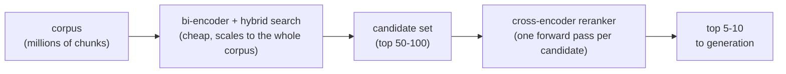

# Lição 8. Rerankers cross-encoder

**Ligação com a missão:** A recuperação até aqui (etapas 1 a 4) usou toda ela comparação no estilo bi-encoder, barata e escalável mas cega à interação refinada entre consulta e passagem; a etapa 5 adiciona uma segunda passada que troca escala por acurácia sobre um conjunto de candidatos muito menor.
**Fonte principal:** [Artigo científico: "Passage Re-ranking with BERT", Nogueira e Cho, 2019](https://arxiv.org/abs/1901.04085)
**Pré-requisitos:** [Lição 7](0007-reciprocal-rank-fusion.md), [Chunk](../GLOSSARY.md)

## Aquecimento

1. ▢ Que problema a reciprocal rank fusion resolve, e como ela o resolve?

Verificação

As pontuações do BM25 e da similaridade de cosseno vivem em escalas incomparáveis, então tirar a média delas diretamente é frágil. A RRF resolve isso combinando rankings usando apenas a posição de cada documento, e não sua pontuação bruta, que é uma moeda comum a qualquer método de ranking.

2. ▢ Por que um bi-encoder gera o embedding de uma consulta e de uma passagem de forma independente em vez de em conjunto?

Verificação

Para que cada passagem possa ter o embedding gerado uma vez, com antecedência, e ser armazenada; comparar vetores pré-calculados na hora da busca é barato, enquanto rodar um modelo sobre cada par consulta-passagem não é.

## Saiba isto

### Um cross-encoder enxerga a consulta e a passagem juntas

O bi-encoder da lição 2 gera o embedding de uma consulta e de uma passagem em completo isolamento uma da outra; os dois vetores nunca interagem até que um cálculo barato de distância os compare depois. Um **cross-encoder** faz o oposto: recebe a consulta e uma única passagem candidata juntas, como uma entrada combinada, e as executa em conjunto por um modelo que consegue atentar aos dois textos ao mesmo tempo, produzindo uma única pontuação de relevância para aquele par específico. Como o modelo vê os dois textos simultaneamente, ele consegue captar interações refinadas, esta palavra específica da consulta correspondendo a esta oração específica da passagem, que os embeddings calculados de forma independente por um bi-encoder não têm como capturar, já que nenhum dos embeddings foi calculado com qualquer conhecimento do outro texto.

### O que essa acurácia custa

O processamento conjunto de um cross-encoder é também exatamente o que o torna caro demais para buscar diretamente em um corpus inteiro: pontuar um candidato exige uma passada completa do modelo (forward pass), então pontuar 1.000 candidatos significa 1.000 forward passes, calculados do zero a cada consulta, sem nada pré-calculável com antecedência como são os embeddings de passagem de um bi-encoder. Um corpus de um milhão de chunks precisaria de um milhão de forward passes por consulta, o que não chega nem perto de escalar como um índice de embeddings.

### Recupere barato, rerankeie com precisão

O padrão usual emprega cada abordagem onde ela é acessível: a recuperação com bi-encoder, mais a busca híbrida (etapas 3 e 4), reduz de forma barata um corpus inteiro a um conjunto modesto de candidatos, comumente algo em torno dos 50 a 100 primeiros resultados. Um reranker cross-encoder roda então apenas sobre esse conjunto muito menor, pontuando cada par consulta-candidato individualmente e reordenando-os com a acurácia que um bi-encoder sozinho não conseguiria oferecer, trazendo à tona o punhado verdadeiramente melhor, geralmente os 5 a 10 primeiros, para entregar adiante. Esse design de duas etapas obtém juntos a escala do bi-encoder e a acurácia do cross-encoder, aplicando a etapa cara apenas onde o corpus já foi reduzido o bastante para que ela seja acessível.

## Prática

1. ▢ Por que um cross-encoder consegue capturar sinais de relevância mais sutis que um bi-encoder, mesmo quando ambos são construídos sobre arquiteturas de transformer parecidas?

Verificação

Um cross-encoder processa a consulta e a passagem candidata juntas, em um único forward pass conjunto, de modo que o modelo consegue atentar aos dois textos e captar interações específicas entre eles. Um bi-encoder gera o embedding de cada um em isolamento; quando seus embeddings são comparados, nenhum dos dois foi calculado com qualquer conhecimento do conteúdo específico do outro.

2. ▢ Por que um cross-encoder não pode ser usado para buscar diretamente em um corpus de um milhão de chunks, como um índice de embeddings de bi-encoder pode?

Verificação

Um cross-encoder precisa de um forward pass completo do modelo por par consulta-candidato, calculado do zero a cada consulta, já que nada da entrada conjunta consulta-passagem pode ser pré-calculado com antecedência. Pontuar um milhão de candidatos significaria um milhão de forward passes por consulta, o que não escala como comparar o embedding de uma consulta contra um índice pré-calculado.

3. ▢ Descreva o padrão de duas etapas de recuperar e depois rerankear, e explique por que ele existe em vez de usar qualquer uma das etapas sozinha.

Verificação

A recuperação com bi-encoder (mais a busca híbrida) reduz de forma barata um corpus inteiro a um conjunto modesto de candidatos, e então um cross-encoder rerankeia apenas esse conjunto menor com maior acurácia. Ele existe porque um cross-encoder sozinho não escala para um corpus completo, e um bi-encoder sozinho perde as interações refinadas entre consulta e passagem que um cross-encoder consegue captar; combiná-los dá tanto a escala quanto a acurácia, cada uma aplicada onde é acessível.

4. ▢ Uma equipe propõe rerankear todo o seu corpus com um cross-encoder a cada consulta, pulando totalmente a recuperação com bi-encoder, para "obter os melhores resultados possíveis". O que há de errado com esse plano?

Dica

Pense em quantos forward passes isso exigiria por consulta.

Verificação

Ele exige um forward pass completo do modelo por documento do corpus inteiro, a cada consulta, que é exatamente o problema de escala que um cross-encoder tem e que um índice de bi-encoder existe para evitar. Em qualquer tamanho real de corpus, isso seria lento demais para servir como consulta ao vivo, anulando o motivo pelo qual um índice de embeddings e a busca híbrida existem.

5. ▢ Qual afirmação é verdadeira sobre a relação entre a recuperação com bi-encoder e o reranking com cross-encoder?

    - a) Eles resolvem o mesmo problema, então usar os dois juntos é redundante
    - b) A recuperação com bi-encoder reduz de forma barata um corpus grande a um conjunto de candidatos, e um cross-encoder rerankeia apenas esse conjunto menor com maior acurácia
    - c) Um cross-encoder escala para buscar em um corpus completo tão bem quanto um índice de bi-encoder
    - d) O reranking substitui totalmente a necessidade de chunking, embeddings ou busca híbrida

Verificação

**b)** Esse é exatamente o padrão de duas etapas que esta lição descreve. (a) é falsa: eles trocam escala por acurácia de maneiras diferentes, e é por isso que combiná-los é útil e não redundante. (c) é falsa: um cross-encoder precisa de um forward pass por candidato, o que não escala para um corpus completo como um índice de embeddings escala. (d) é falsa: o reranking opera sobre o conjunto de candidatos que essas etapas anteriores já produziram; ele não as substitui.

## Prática no mundo real

- [ ] Encontre um reranker cross-encoder hospedado ou de código aberto (como o da Cohere) e leia qual entrada ele espera (uma consulta mais uma lista de textos candidatos) e o que ele devolve.
- [ ] Para uma consulta e um pequeno conjunto de passagens candidatas do seu corpus, preveja qual candidato um cross-encoder ranquearia mais alto e depois confira com uma chamada real a um reranker, se você tiver acesso a um.
- [ ] Amanhã: anote quantos candidatos a sua etapa atual de recuperação devolve antes de qualquer reranking e se esse número é uma escolha deliberada ou um padrão não examinado.

## Para ir além

- [Artigo científico: "Passage Re-ranking with BERT", Nogueira e Cho, 2019](https://arxiv.org/abs/1901.04085)
- [Docs: "Reranking", Cohere](https://docs.cohere.com/docs/reranking)
- [Recursos](../RESOURCES.md)

---

Não ficou claro? Releia a fonte principal no topo, já que esta lição a comprime e é na compressão que o entendimento escapa. Consulte o [glossário](../GLOSSARY.md) para qualquer termo que pareceu escorregadio.

Se o problema é a lição em si, e não o material, isso é um defeito: [abra uma issue](https://github.com/TokenCemetery/teach/issues).
