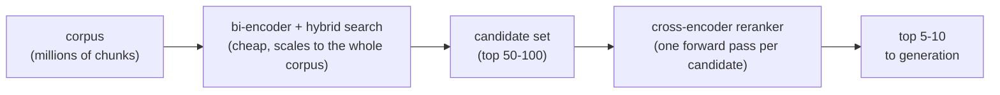

# Урок 8. Реранкеры на кросс-энкодерах

**Связь с целью курса:** Весь поиск до сих пор (этапы с 1 по 4) использовал сравнение в стиле би-энкодера, дешёвое и масштабируемое, но слепое к тонкому взаимодействию запроса и пассажа; этап 5 добавляет второй проход, который меняет масштаб на точность на гораздо меньшем наборе кандидатов.
**Первоисточник:** [Научная статья: "Passage Re-ranking with BERT", Nogueira and Cho, 2019](https://arxiv.org/abs/1901.04085)
**Предварительные требования:** [Урок 7](0007-reciprocal-rank-fusion.md), [Чанк](../GLOSSARY.md)

## Разминка

1. ▢ Какую проблему решает слияние по взаимным рангам и как оно её решает?

Проверка

Оценки BM25 и косинусного сходства лежат на несравнимых шкалах, поэтому усреднять их напрямую хрупко. RRF решает это, объединяя рейтинги только по позиции каждого документа в рейтинге, а не по его сырой оценке, а позиция это общая валюта для любого метода ранжирования.

2. ▢ Почему би-энкодер эмбеддит запрос и пассаж независимо, а не совместно?

Проверка

Чтобы каждый пассаж можно было заэмбеддить один раз, заранее, и сохранить; сравнение заранее вычисленных векторов во время поиска дёшево, а прогон модели по каждой паре «запрос и пассаж» нет.

## Что нужно знать

### Кросс-энкодер видит запрос и пассаж вместе

Би-энкодер из урока 2 эмбеддит запрос и пассаж в полной изоляции друг от друга; два вектора никогда не взаимодействуют, пока дешёвое вычисление расстояния не сравнит их потом. **Кросс-энкодер** делает обратное: он берёт запрос и один пассаж-кандидат вместе, как единый составной вход, и прогоняет их совместно через модель, которая может обращать внимание сразу на оба текста, выдавая одну оценку релевантности для этой конкретной пары. Поскольку модель видит оба текста одновременно, она может уловить тонкие взаимодействия, например что это конкретное слово запроса совпадает с этим конкретным предложением пассажа, чего независимо вычисленные эмбеддинги би-энкодера уловить никак не могут, ведь ни один из эмбеддингов никогда не вычислялся со знанием другого текста.

### Во что обходится эта точность

Совместная обработка кросс-энкодера это ровно то, что делает его слишком дорогим для прямого поиска по всему корпусу: оценка одного кандидата требует одного полного прямого прохода модели, поэтому оценка 1000 кандидатов означает 1000 прямых проходов, вычисляемых заново на каждый запрос, и ничего нельзя вычислить заранее, как эмбеддинги пассажей у би-энкодера. Корпусу из миллиона чанков потребовался бы миллион прямых проходов на запрос, что и близко не масштабируется так, как индекс эмбеддингов.

### Искать дёшево, ранжировать точно

Стандартный шаблон использует каждый подход там, где он по карману: поиск на основе би-энкодера плюс гибридный поиск (этапы 3 и 4) дёшево сужает весь корпус до скромного набора кандидатов, обычно где-то до 50–100 лучших результатов. Затем реранкер на кросс-энкодере работает только по этому гораздо меньшему набору, оценивая каждую пару «запрос и кандидат» отдельно и переупорядочивая их с точностью, которой одному би-энкодеру не добиться, и выводит наверх по-настоящему лучшую горстку, часто 5–10 лучших, чтобы передать дальше. Эта двухэтапная схема даёт масштаб би-энкодера и точность кросс-энкодера вместе, применяя дорогой шаг только там, где корпус уже сужен настолько, что это по карману.

## Практика

1. ▢ Почему кросс-энкодер может улавливать более тонкие сигналы релевантности, чем би-энкодер, даже если обе модели построены на схожих архитектурах трансформеров?

Проверка

Кросс-энкодер обрабатывает запрос и пассаж-кандидат вместе, за один совместный прямой проход, так что модель может обращать внимание на оба текста и улавливать конкретные взаимодействия между ними. Би-энкодер эмбеддит каждый по отдельности; к моменту сравнения их эмбеддингов ни один не вычислялся со знанием конкретного содержимого другого.

2. ▢ Почему кросс-энкодер нельзя использовать для прямого поиска по корпусу из миллиона чанков, как индекс эмбеддингов би-энкодера?

Проверка

Кросс-энкодеру нужен один полный прямой проход модели на каждую пару «запрос и кандидат», вычисляемый заново на каждый запрос, поскольку ничего в совместном входе «запрос и пассаж» нельзя вычислить заранее. Оценка миллиона кандидатов означала бы миллион прямых проходов на запрос, а это не масштабируется так, как сравнение эмбеддинга запроса с заранее вычисленным индексом.

3. ▢ Опишите двухэтапный шаблон «найти, затем переранжировать» и объясните, почему он существует, а не используется какой-то один этап.

Проверка

Поиск на основе би-энкодера (плюс гибридный поиск) дёшево сужает весь корпус до скромного набора кандидатов, затем кросс-энкодер переранжирует только этот меньший набор с более высокой точностью. Он существует потому, что один кросс-энкодер не масштабируется на весь корпус, а один би-энкодер упускает тонкие взаимодействия запроса и пассажа, которые кросс-энкодер может уловить; объединение даёт и масштаб, и точность, каждое применённое там, где оно по карману.

4. ▢ Команда предлагает переранжировать весь свой корпус кросс-энкодером на каждый запрос, вовсе пропустив поиск на основе би-энкодера, чтобы «получить наилучшие возможные результаты». Что не так с этим планом?

Подсказка

Подумайте, сколько прямых проходов потребовалось бы на запрос.

Проверка

Он требует одного полного прямого прохода модели на каждый документ всего корпуса, на каждый отдельный запрос, а это ровно та проблема масштабирования, которая есть у кросс-энкодера и которой индекс на основе би-энкодера призван избежать. При любом реальном размере корпуса это было бы слишком медленно для живого запроса, и сводило бы на нет причину, по которой индекс эмбеддингов и гибридный поиск вообще существуют.

5. ▢ Какое утверждение верно про отношение между поиском на основе би-энкодера и реранкингом на кросс-энкодере?

    - a) Они решают одну и ту же задачу, поэтому использовать оба вместе избыточно
    - b) Поиск на основе би-энкодера дёшево сужает большой корпус до набора кандидатов, а кросс-энкодер переранжирует только этот меньший набор с более высокой точностью
    - c) Кросс-энкодер масштабируется на поиск по всему корпусу так же хорошо, как индекс на основе би-энкодера
    - d) Реранкинг полностью устраняет необходимость в чанкинге, эмбеддингах или гибридном поиске

Проверка

**b)** Это ровно двухэтапный шаблон, который описывает этот урок. (a) неверно: они по-разному меняют масштаб на точность, и поэтому объединение полезно, а не избыточно. (c) неверно: кросс-энкодеру нужен один прямой проход на кандидата, а это не масштабируется на весь корпус так, как индекс эмбеддингов. (d) неверно: реранкинг работает с набором кандидатов, который эти более ранние этапы уже выдали; он их не заменяет.

## Практика в реальной работе

- [ ] Найдите размещённый или открытый реранкер на кросс-энкодере (например, Cohere) и прочитайте, какой вход он ожидает (запрос плюс список текстов-кандидатов) и что возвращает.
- [ ] Для запроса и небольшого набора пассажей-кандидатов из вашего корпуса предскажите, какого кандидата кросс-энкодер поставил бы выше всех, а затем проверьте настоящим вызовом реранкера, если у вас есть доступ.
- [ ] Завтра: отметьте, сколько кандидатов возвращает ваш текущий этап поиска до любого реранкинга и является ли это число осознанным выбором или непроверенным значением по умолчанию.

## Что почитать дальше

- [Научная статья: "Passage Re-ranking with BERT", Nogueira and Cho, 2019](https://arxiv.org/abs/1901.04085)
- [Документация: "Reranking", Cohere](https://docs.cohere.com/docs/reranking)
- [Ресурсы](../RESOURCES.md)

---

Не доходит? Перечитайте первоисточник в начале: этот урок его сжимает, а при сжатии понимание как раз и теряется. Загляните в [глоссарий](../GLOSSARY.md), если какой-то термин показался скользким.

Если неясен сам урок, а не материал, это дефект: [откройте issue](https://github.com/TokenCemetery/teach/issues).
