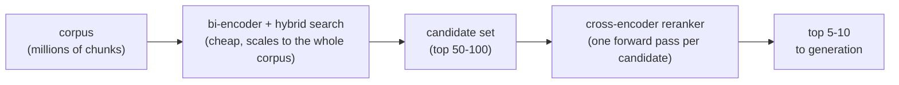

# 第 8 课：交叉编码器重排序器

**使命关联:** 到目前为止的检索（第 1 到 4 阶段）用的都是双编码器式的比较，便宜且可扩展，却看不到查询与段落之间细粒度的交互；第 5 阶段加入第二遍处理，用规模换取在小得多的候选集上的准确度。
**主要来源:** [论文：“Passage Re-ranking with BERT”，Nogueira 和 Cho，2019](https://arxiv.org/abs/1901.04085)
**前置知识:** [第 7 课](0007-reciprocal-rank-fusion.md)、[文本块](../GLOSSARY.md)

## 热身

1. ▢ 倒数排名融合解决了什么问题？它是怎么解决的？

检查

BM25 和余弦相似度的分数处在不可比的尺度上，所以直接取平均很脆弱。RRF 的解决办法是只用每篇文档的排名位置，而不用它的原始分数来合并排名，排名位置是对任何排序方法都通用的货币。

2. ▢ 双编码器为什么把查询和段落独立嵌入，而不是一起嵌入？

检查

这样每个段落都可以提前嵌入一次并存储起来；搜索时比较预先算好的向量开销很小，而对每一对查询与段落都运行一遍模型就不然了。

## 要点

### 交叉编码器同时看到查询和段落

第 2 课的双编码器，对查询和段落的嵌入是完全相互隔离的；两个向量在事后用一次廉价的距离计算来比较之前，从不发生任何交互。**交叉编码器**则相反：它把查询和单个候选段落一起作为一个合并的输入，联合送入一个能同时跨越两段文本做注意力计算的模型，为这一对具体的组合产生一个相关性分数。由于模型同时看到两段文本，它就能捕捉到双编码器各自独立算出的嵌入无从捕捉的细粒度交互，比如查询中的这个词与段落中的这个从句相匹配，因为两个嵌入在计算时，都不知道对方文本的任何内容。

### 这种准确度的代价

交叉编码器的联合处理，也恰恰是让它贵到无法直接用来搜索整个语料库的原因：给一个候选打分需要一次完整的模型前向传播，所以给 1000 个候选打分就是 1000 次前向传播，而且每个查询都要重新计算，没有任何东西能像双编码器的段落嵌入那样提前算好。一个有一百万个文本块的语料库，每个查询需要一百万次前向传播，这离嵌入索引那样的可扩展性差得远。

### 廉价地检索，精确地重排序

标准的做法是让每种方法用在它负担得起的地方：双编码器检索加上混合检索（第 3 和第 4 阶段），以很低的成本把整个语料库收窄成规模适中的候选集，通常是前 50 到 100 个结果左右。然后，交叉编码器重排序器只在这个小得多的集合上运行，对每个查询与候选的组合单独打分并重新排序，达到仅靠双编码器无法提供的准确度，把真正最好的少数几个结果，通常是前 5 到 10 个，浮现出来交给下游。这种两阶段设计同时获得了双编码器的规模和交叉编码器的准确度，办法是只把昂贵的那一步，用在语料库已经被收窄到足以负担得起的地方。

## 练习

1. ▢ 即使两者建立在相似的底层 Transformer 架构之上，为什么交叉编码器能捕捉到比双编码器更细微的相关性信号？

检查

交叉编码器把查询和候选段落放在一次联合前向传播中一起处理，所以模型可以跨越两段文本做注意力计算，捕捉到它们之间的具体交互。双编码器则把每一段单独隔离地嵌入；到它们的嵌入被比较时，两者在计算时都不知道对方的具体内容。

2. ▢ 为什么不能像双编码器的嵌入索引那样，直接用交叉编码器去搜索一个有一百万个文本块的语料库？

检查

交叉编码器每个查询与候选的组合都需要一次完整的模型前向传播，而且每个查询都要重新计算，因为联合的查询与段落输入，没有任何部分能够提前算好。给一百万个候选打分，就意味着每个查询要一百万次前向传播，这无法像把查询嵌入与预先算好的索引比较那样扩展。

3. ▢ 描述先检索后重排序的两阶段模式，并解释它为什么存在，而不是只用其中任何一个阶段。

检查

双编码器检索（加上混合检索）低成本地把整个语料库收窄成规模适中的候选集，然后交叉编码器只对这个较小的集合以更高的准确度重排序。它之所以存在，是因为单靠交叉编码器无法扩展到整个语料库，而单靠双编码器又会漏掉交叉编码器能够捕捉的细粒度查询与段落交互；把二者结合，既得到规模又得到准确度，各自用在自己负担得起的地方。

4. ▢ 某团队提议对每个查询都用交叉编码器对整个语料库重排序，完全跳过双编码器检索，以便“得到尽可能好的结果”。这个计划有什么问题？

提示

想一想，这样每个查询需要多少次前向传播。

检查

每个查询都要对整个语料库里的每一篇文档做一次完整的模型前向传播，这正是交叉编码器自身的扩展性问题，也是双编码器索引要去避免的问题。在任何真实的语料库规模下，这都慢得无法用于实时查询，违背了嵌入索引和混合检索存在的初衷。

5. ▢ 关于双编码器检索与交叉编码器重排序之间的关系，下列哪项说法正确？

    - a) 它们解决的是同一个问题，所以两者一起用是多余的
    - b) 双编码器检索低成本地把大型语料库收窄成候选集，而交叉编码器只对这个较小的集合以更高的准确度重排序
    - c) 交叉编码器扩展到搜索整个语料库的能力，和双编码器索引一样好
    - d) 重排序完全取代了对分块、嵌入或混合检索的需要

检查

**b)** 这正是本课描述的两阶段模式。（a）错误：它们在规模与准确度之间的取舍方式不同，所以把它们结合起来是有用的，而不是多余的。（c）错误：交叉编码器每个候选需要一次前向传播，无法像嵌入索引那样扩展到整个语料库。（d）错误：重排序作用于前面那些阶段已经产出的候选集，并不取代它们。

## 实战练习

- [ ] 找一个托管的或开源的交叉编码器重排序器（比如 Cohere 的），读一读它期望什么输入（一个查询加一个候选文本列表）以及返回什么。
- [ ] 针对一个查询和你语料库中的一小批候选段落，预测交叉编码器会把哪个候选排在最前，如果你能调用真正的重排序器，就实际验证一下。
- [ ] 明天：记下你当前的检索阶段在任何重排序之前返回多少个候选，这个数字是经过考虑的选择，还是没有审视过的默认值。

## 延伸阅读

- [论文：“Passage Re-ranking with BERT”，Nogueira 和 Cho，2019](https://arxiv.org/abs/1901.04085)
- [文档：“Reranking”，Cohere](https://docs.cohere.com/docs/reranking)
- [资源](../RESOURCES.md)

---

没学明白？请重读顶部的主要来源，因为本课是对它的压缩，而理解正是在压缩中流失的。如果有哪个术语觉得含糊，可以查看[术语表](../GLOSSARY.md)。

如果问题出在课程本身，而不是学习材料，那就是一个缺陷：[提交 issue](https://github.com/TokenCemetery/teach/issues)。
