# Lección 9. Cuándo un reranking justifica su costo

**Vínculo con la misión:** Esta es la lección que cierra la etapa 5: el reranking (lección 8) no es un paso que todo pipeline deba añadir por defecto, y decidir si se gana su lugar significa medir lo que cuesta y lo que aporta realmente para esta carga de trabajo, sin suponer ninguna de las dos respuestas.
**Fuente principal:** [Docs: "Reranking", Cohere](https://docs.cohere.com/docs/reranking)
**Requisitos previos:** [Lección 8](0008-cross-encoder-rerankers.md), [Chunk](../GLOSSARY.md)

## Calentamiento

1. ▢ ¿Por qué un cross-encoder no puede usarse para buscar directamente en un corpus completo, como sí puede un índice de embeddings de bi-encoder?

Comprobación

Un cross-encoder necesita una forward pass completa del modelo por cada par consulta-candidato, calculada desde cero para cada consulta, sin nada precalculable de antemano. Puntuar un corpus grande de este modo no escala como lo hace comparar el embedding de una consulta con un índice precalculado.

2. ▢ Describe el patrón de dos etapas de recuperar y luego hacer reranking.

Comprobación

La recuperación con bi-encoder, más la búsqueda híbrida, reduce de forma barata un corpus entero a un conjunto modesto de candidatos. Un cross-encoder hace entonces reranking solo de ese conjunto más pequeño, puntuando cada par consulta-candidato por separado para reordenarlos con mayor precisión de la que podría dar la recuperación inicial por sí sola.

## Qué debes saber

### El costo del reranking es concreto, no abstracto

Añadir una etapa de reranking suma una cantidad medible de latencia: una forward pass por cada candidato del conjunto sobre el que se hace reranking, así que hacer reranking de 100 candidatos cuesta aproximadamente 100 veces el costo por candidato de una sola forward pass, ya se ejecute localmente o mediante una API alojada. Es un costo aditivo que se apila sobre lo que ya tardó la etapa de recuperación inicial, y tiene que caber dentro del presupuesto de latencia de extremo a extremo que el sistema tenga realmente. Nada del reranking es gratis solo porque mejore la precisión; la mejora de precisión hay que sopesarla contra un número real de milisegundos añadidos.

### La mejora que compra el reranking también hay que medirla

La pregunta que vale la pena hacer no es "¿mejora el reranking la calidad en general?" (normalmente sí, ya que eso es para lo que la lección 8 estableció que se construye un cross-encoder), sino "¿la mejora lo suficiente, para este corpus y este patrón de consultas, como para justificar lo que cuesta aquí?". Eso significa medir la calidad de la recuperación (recall@k, MRR o precisión en la posición que realmente importa aguas abajo, las herramientas de la etapa 6) tanto sin reranking como con él añadido, sobre el mismo conjunto de consultas. Si la búsqueda híbrida ya coloca de forma fiable al mejor candidato cerca de la cabeza, el reranking puede mover muy poco y aun así costar latencia real. Si la búsqueda híbrida entierra a menudo al mejor candidato en lo profundo de la lista inicial de candidatos, el reordenamiento del reranking puede importar enormemente, sobre todo cuando solo el primer resultado o los dos primeros llegan realmente al paso de generación.

### La respuesta correcta depende de la carga de trabajo

Un sistema de chat en tiempo real con un presupuesto de latencia de extremo a extremo ajustado puede no poder permitirse el reranking en absoluto, sin importar cuánto mejoraría la calidad, si la sola latencia añadida reventara el presupuesto. Una carga de trabajo offline de investigación o de preguntas y respuestas sobre documentos, con una tolerancia de latencia mucho más generosa, a menudo puede permitirse el reranking con facilidad, ya que la mejora de precisión le importa más que ahorrar unos cientos de milisegundos. Ni "siempre hacer reranking" ni "nunca hacer reranking" es el valor por defecto correcto; la decisión consiste en medir la mejora real de calidad, medir la latencia añadida real y comprobar ambas contra lo que el presupuesto y el listón de calidad de esta carga de trabajo concreta exigen realmente.

```mermaid
flowchart TD
    A["measure quality gain (with vs without rerank)<br>and added latency at this candidate-set size"] --> B{"does reranking fit the<br>remaining latency budget?"}
    B -->|"no: chat, 100ms + 150ms > 200ms budget"| C["skip reranking"]
    B -->|"yes"| D{"is the measured quality gain<br>worth it for this workload?"}
    D -->|"yes: research, rank 12&#8594;1 for 300ms<br>inside a 5s budget"| E["add reranking"]
    D -->|"marginal: hybrid search<br>already ranks well"| C
```

## Práctica

1. ▢ ¿Qué cuesta concretamente añadir una etapa de reranking, y con qué escala ese costo?

Comprobación

Cuesta una forward pass del modelo por cada candidato del conjunto sobre el que se hace reranking, así que la latencia total añadida crece con cuántos candidatos se reordenan; hacer reranking de 100 candidatos cuesta aproximadamente 100 veces el costo por candidato de una sola forward pass, además de lo que ya tardó la etapa de recuperación inicial.

2. ▢ Un sistema de chat en tiempo real tiene un presupuesto de latencia total de 200 ms. La recuperación ya tarda unos 100 ms, y el reranking añadiría aproximadamente 150 ms más. ¿Qué debería concluir el equipo?

Comprobación

El reranking, tal como se midió, no cabe en el presupuesto: 100 ms de recuperación más 150 ms de reranking son 250 ms, que ya superan el presupuesto de 200 ms incluso antes de que empiece la generación. A menos que el conjunto de candidatos sobre el que se hace reranking pueda reducirse lo suficiente para bajar ese costo, o que el presupuesto pueda relajarse, el reranking no es asequible para esta carga de trabajo tal como está medida.

3. ▢ Un asistente de investigación offline tolera hasta 5 segundos de latencia. La medición muestra que el reranking sube el documento realmente relevante de una posición media de 12 a la posición 1 dentro de los 20 candidatos principales, a un costo de 300 ms. ¿Qué debería concluir el equipo?

Comprobación

Es muy probable que valga la pena añadir el reranking aquí: un costo de 300 ms es una fracción pequeña de un presupuesto de 5 segundos, y la mejora de calidad medida es grande, pues pasa el documento relevante de estar enterrado en la posición 12 a ser el primer resultado, lo que importa mucho si solo los primeros resultados llegan a la generación.

4. ▢ ¿Cómo debería decidir un equipo si el reranking justifica su costo para su carga de trabajo concreta, en lugar de suponer que siempre ayuda o que nunca ayuda?

Comprobación

Medir la calidad de la recuperación (recall@k, MRR o precisión en la posición que importa aguas abajo) tanto sin reranking como con él, sobre el mismo conjunto de consultas representativo, y medir por separado la latencia añadida real que cuesta el reranking con el tamaño de conjunto de candidatos en uso. Comparar la mejora de calidad medida y el costo de latencia medido con el presupuesto de latencia y el listón de calidad reales de esta carga de trabajo, en lugar de suponer que el reranking siempre vale la pena o que nunca compensa su costo.

5. ▢ ¿Qué afirmación es cierta sobre decidir si añadir una etapa de reranking?

    - a) El reranking siempre debería añadirse, ya que un cross-encoder es más preciso que un bi-encoder por construcción
    - b) El reranking nunca debería añadirse, ya que cuesta más latencia que la recuperación inicial por sí sola
    - c) La decisión depende de medir tanto la mejora de calidad como la latencia añadida frente al presupuesto y las necesidades de calidad de la carga de trabajo concreta
    - d) El costo del reranking es fijo y no depende de cuántos candidatos se reordenan

Comprobación

**c)** Los dos escenarios de esta lección mostraron que la respuesta correcta depende de los números realmente medidos y de las propias restricciones de la carga de trabajo, no de una regla universal. (a) es falsa: ser más preciso no hace gratis un paso; igualmente tiene que caber en el presupuesto de latencia. (b) es falsa: el escenario del asistente de investigación mostró una carga de trabajo en la que el costo valía claramente la pena. (d) es falsa: el costo crece directamente con cuántos candidatos se reordenan.

## Prácticas en el mundo real

- [ ] Para un pipeline de recuperación que ejecutes o pienses ejecutar, mide cuánta latencia añadiría una etapa de reranking con tu tamaño típico de conjunto de candidatos.
- [ ] Si puedes comparar la calidad de la recuperación con y sin reranking sobre el mismo conjunto de consultas, mide la diferencia en recall@k o MRR en la posición que importa para tu uso aguas abajo.
- [ ] Mañana: decide, por escrito, si vale la pena añadir reranking para tu carga de trabajo concreta, citando la mejora de calidad medida y el costo de latencia medido frente a tu presupuesto real.

## Para profundizar

- [Docs: "Reranking", Cohere](https://docs.cohere.com/docs/reranking)
- [Paper: "Passage Re-ranking with BERT", Nogueira and Cho, 2019](https://arxiv.org/abs/1901.04085)
- [Recursos](../RESOURCES.md)

---

¿No termina de quedar claro? Vuelve a leer la fuente principal de arriba, ya que esta lección la comprime y en la compresión es donde se escapa la comprensión. Consulta el [glosario](../GLOSSARY.md) por si algún término te resultó resbaladizo.

Si lo poco claro es la propia lección y no el material, eso es un defecto: [abre un issue](https://github.com/TokenCemetery/teach/issues).
