# Leçon 9. Quand le reranking justifie son coût

**Lien avec la mission :** C'est le point d'orgue de l'étape 5 : le reranking (leçon 8) n'est pas une étape que tout pipeline devrait ajouter par défaut, et décider s'il mérite sa place suppose de mesurer ce qu'il coûte et ce qu'il apporte réellement pour cette charge de travail, sans supposer l'une ou l'autre réponse.
**Source primaire :** [Doc : "Reranking", Cohere](https://docs.cohere.com/docs/reranking)
**Prérequis :** [Leçon 8](0008-cross-encoder-rerankers.md), [Chunk](../GLOSSARY.md)

## Échauffement

1. ▢ Pourquoi un cross-encoder ne peut-il pas servir à chercher directement dans un corpus entier, comme le peut un index d'embeddings de bi-encoder ?

Vérifier

Un cross-encoder a besoin d'une passe avant complète du modèle par paire requête-candidat, recalculée à neuf pour chaque requête, sans rien de précalculable à l'avance. Noter ainsi un grand corpus ne passe pas à l'échelle comme la comparaison d'un embedding de requête à un index précalculé.

2. ▢ Décrivez le schéma en deux étapes récupérer puis reclasser.

Vérifier

La récupération par bi-encoder, plus la recherche hybride, réduit à bas coût tout un corpus à un ensemble de candidats modeste. Un cross-encoder reclasse alors uniquement ce petit ensemble, en notant chaque paire requête-candidat individuellement pour les réordonner avec une précision supérieure à celle que la récupération initiale seule pouvait offrir.

## À savoir

### Le coût du reranking est concret, pas abstrait

Ajouter une étape de reranking ajoute une quantité mesurable de latence : une passe avant par candidat de l'ensemble reclassé, donc reclasser 100 candidats coûte environ 100 fois le coût par candidat d'une seule passe avant, que cette passe s'exécute en local ou via une API hébergée. C'est un coût additif qui s'empile sur ce que l'étape de récupération initiale a déjà pris, et il doit tenir dans le budget de latence de bout en bout dont le système dispose réellement. Rien dans le reranking n'est gratuit du seul fait qu'il améliore la précision ; le gain de précision doit être pesé face à un nombre réel de millisecondes ajoutées.

### Le gain qu'apporte le reranking doit aussi être mesuré

La question à se poser n'est pas « le reranking améliore-t-il la qualité en général » (c'est généralement le cas, puisque c'est ce pour quoi la leçon 8 a établi qu'un cross-encoder est conçu), mais « l'améliore-t-il assez, pour ce corpus et ce type de requêtes, pour justifier ce qu'il coûte ici ». Cela suppose de mesurer la qualité de la récupération (recall@k, MRR, ou précision à la position qui compte réellement en aval, les outils de l'étape 6) sans reranking puis avec, sur le même jeu de requêtes. Si la recherche hybride place déjà de façon fiable le meilleur candidat près du sommet, le reranking peut bouger très peu de choses tout en coûtant de la vraie latence. Si la recherche hybride enfouit souvent le meilleur candidat loin dans la liste initiale, le réordonnancement du reranking peut compter énormément, surtout quand seuls le tout premier résultat ou les deux premiers atteignent réellement l'étape de génération.

### La bonne réponse dépend de la charge de travail

Un système de chat en temps réel avec un budget de latence de bout en bout serré peut ne pas pouvoir se permettre le reranking du tout, quel que soit le gain de qualité, si la seule latence ajoutée faisait exploser le budget. Une charge de travail hors ligne de recherche ou de questions-réponses sur documents, avec une tolérance de latence bien plus généreuse, peut souvent s'offrir le reranking sans difficulté, puisque le gain de précision compte davantage pour elle que de gagner quelques centaines de millisecondes. Ni « toujours reclasser » ni « ne jamais reclasser » n'est la bonne valeur par défaut ; la décision consiste à mesurer le gain de qualité réel, à mesurer la latence ajoutée réelle, et à vérifier les deux face à ce que le budget et le seuil de qualité de cette charge de travail précise exigent réellement.

```mermaid
flowchart TD
    A["measure quality gain (with vs without rerank)<br>and added latency at this candidate-set size"] --> B{"does reranking fit the<br>remaining latency budget?"}
    B -->|"no: chat, 100ms + 150ms > 200ms budget"| C["skip reranking"]
    B -->|"yes"| D{"is the measured quality gain<br>worth it for this workload?"}
    D -->|"yes: research, rank 12&#8594;1 for 300ms<br>inside a 5s budget"| E["add reranking"]
    D -->|"marginal: hybrid search<br>already ranks well"| C
```

## Pratique

1. ▢ Que coûte concrètement l'ajout d'une étape de reranking, et à quoi ce coût est-il proportionnel ?

Vérifier

Il coûte une passe avant du modèle par candidat de l'ensemble reclassé, donc la latence totale ajoutée est proportionnelle au nombre de candidats reclassés ; reclasser 100 candidats coûte environ 100 fois le coût par candidat d'une seule passe avant, en plus de ce que l'étape de récupération initiale a déjà pris.

2. ▢ Un système de chat en temps réel a un budget de latence total de 200 ms. La récupération prend déjà environ 100 ms, et le reranking ajouterait environ 150 ms par-dessus. Que doit conclure l'équipe ?

Vérifier

Le reranking, tel que mesuré, ne tient pas dans le budget : 100 ms de récupération plus 150 ms de reranking font 250 ms, déjà au-delà du budget de 200 ms avant même que la génération ne commence. À moins que l'ensemble de candidats reclassés puisse être réduit assez pour faire baisser ce coût, ou que le budget puisse être assoupli, le reranking n'est pas abordable pour cette charge de travail telle que mesurée actuellement.

3. ▢ Un assistant de recherche hors ligne tolère jusqu'à 5 secondes de latence. La mesure montre que le reranking fait passer le document réellement pertinent d'un rang moyen de 12 au rang 1 parmi les 20 premiers candidats, pour un coût de 300 ms. Que doit conclure l'équipe ?

Vérifier

Le reranking vaut très probablement la peine d'être ajouté ici : un coût de 300 ms est une petite fraction d'un budget de 5 secondes, et le gain de qualité mesuré est important, puisqu'il fait passer le document pertinent du rang 12, où il était enfoui, au premier résultat, ce qui compte beaucoup si seuls les premiers résultats atteignent la génération.

4. ▢ Comment une équipe doit-elle décider si le reranking justifie son coût pour sa charge de travail précise, plutôt que de supposer qu'il aide toujours ou jamais ?

Vérifier

Mesurer la qualité de la récupération (recall@k, MRR, ou précision à la position qui compte en aval) sans puis avec reranking, sur le même jeu de requêtes représentatif, et mesurer séparément la latence ajoutée réelle que coûte le reranking à la taille d'ensemble de candidats utilisée. Comparer le gain de qualité mesuré et le coût de latence mesuré au budget de latence et au seuil de qualité réels de cette charge de travail, plutôt que de supposer que le reranking vaut toujours la peine ou n'en vaut jamais le coût.

5. ▢ Laquelle de ces affirmations est vraie à propos de la décision d'ajouter une étape de reranking ?

    - a) Le reranking doit toujours être ajouté, puisqu'un cross-encoder est par construction plus précis qu'un bi-encoder
    - b) Le reranking ne doit jamais être ajouté, puisqu'il coûte plus de latence que la seule récupération initiale
    - c) La décision dépend de la mesure à la fois du gain de qualité et de la latence ajoutée, face au budget et aux besoins de qualité de la charge de travail précise
    - d) Le coût du reranking est fixe et ne dépend pas du nombre de candidats reclassés

Vérifier

**c)** Les deux scénarios de cette leçon ont montré que la bonne réponse dépend des chiffres réellement mesurés et des contraintes propres à la charge de travail, pas d'une règle universelle. (a) est fausse : être plus précis ne rend pas une étape gratuite ; elle doit quand même tenir dans le budget de latence. (b) est fausse : le scénario de l'assistant de recherche a montré une charge de travail où le coût valait sans mal la peine d'être payé. (d) est fausse : le coût est directement proportionnel au nombre de candidats reclassés.

## Exercices en situation réelle

- [ ] Pour un pipeline de récupération que vous exploitez ou prévoyez d'exploiter, mesurez la latence qu'une étape de reranking ajouterait à votre taille d'ensemble de candidats habituelle.
- [ ] Si vous pouvez comparer la qualité de la récupération avec et sans reranking sur le même jeu de requêtes, mesurez l'écart de recall@k ou de MRR à la position qui compte pour votre usage en aval.
- [ ] Demain : décidez, par écrit, si le reranking vaut la peine d'être ajouté pour votre charge de travail précise, en citant le gain de qualité mesuré et le coût de latence mesuré face à votre budget réel.

## Pour aller plus loin

- [Doc : "Reranking", Cohere](https://docs.cohere.com/docs/reranking)
- [Article : "Passage Re-ranking with BERT", Nogueira and Cho, 2019](https://arxiv.org/abs/1901.04085)
- [Ressources](../RESOURCES.md)

---

Ça ne passe pas ? Relisez la source primaire en haut de page, car cette leçon la condense et c'est dans la condensation que la compréhension s'échappe. Consultez le [glossaire](../GLOSSARY.md) pour tout terme qui vous a paru glissant.

Si c'est la leçon elle-même qui n'est pas claire plutôt que la matière, c'est un défaut : [ouvrez une issue](https://github.com/TokenCemetery/teach/issues).
