# पाठ 9. Reranking की क़ीमत कब वसूल होती है

**मिशन से संबंध:** यह चरण 5 का समापन है: reranking (पाठ 8) ऐसा क़दम नहीं जिसे हर pipeline को default में जोड़ना चाहिए, और यह तय करना कि वह अपनी जगह कमाता है या नहीं, इसका मतलब है यह मापना कि इस workload के लिए वह असल में क्या लेता और क्या देता है, किसी भी जवाब को मान लेना नहीं।
**मुख्य स्रोत:** [दस्तावेज़: "Reranking", Cohere](https://docs.cohere.com/docs/reranking)
**पूर्व-आवश्यकताएँ:** [पाठ 8](0008-cross-encoder-rerankers.md), [Chunk](../GLOSSARY.md)

## वार्म-अप

1. ▢ Cross-encoder को पूरे corpus को सीधे खोजने के लिए वैसे क्यों इस्तेमाल नहीं किया जा सकता जैसे bi-encoder embedding index किया जा सकता है?

जाँचें

Cross-encoder को हर query-candidate जोड़ी के लिए एक पूरा model forward pass चाहिए, हर query पर नए सिरे से, बिना कुछ पहले से निकाले जा सकने के। बड़े corpus को इस तरह score करना उस तरह scale नहीं करता जैसे query embedding की पहले से बने index से तुलना करना।

2. ▢ दो-चरण वाले retrieve-फिर-rerank पैटर्न का वर्णन करें।

जाँचें

Bi-encoder retrieval और hybrid search सस्ते में पूरे corpus को एक मामूली candidate सेट तक सिकोड़ते हैं। फिर cross-encoder सिर्फ़ उस छोटे सेट को rerank करता है, हर query-candidate जोड़ी को अलग से score करके उन्हें उस सटीकता से दोबारा क्रम देता है जो अकेला शुरुआती retrieval नहीं दे सकता था।

## यह जानें

### Reranking की लागत ठोस है, अमूर्त नहीं

Reranking चरण जोड़ने से मापने योग्य latency जुड़ती है: rerank किए गए सेट में हर candidate के लिए एक forward pass, इसलिए 100 candidates को rerank करने की लागत एक forward pass की प्रति-candidate लागत की लगभग 100 गुना है, चाहे वह pass स्थानीय रूप से चले या hosted API से। यह जोड़ी जाने वाली लागत है जो शुरुआती retrieval चरण के पहले से लिए समय के ऊपर लदती है, और उसे system के असली end-to-end latency budget के भीतर समाना पड़ता है। Reranking में कुछ भी मुफ़्त नहीं है सिर्फ़ इसलिए कि वह सटीकता सुधारता है; सटीकता के लाभ को जोड़ी गई मिलीसेकंड की असली संख्या के सामने तौलना पड़ता है।

### Reranking जो लाभ देता है उसे भी मापना पड़ता है

पूछने लायक सवाल यह नहीं कि "क्या reranking आम तौर पर गुणवत्ता सुधारता है" (आम तौर पर सुधारता है, क्योंकि पाठ 8 ने यही स्थापित किया कि cross-encoder इसी के लिए बना है), बल्कि यह कि "क्या वह इस corpus और इस query पैटर्न के लिए इतना सुधारता है कि यहाँ उसकी जो लागत है उसे सही ठहराए।" इसका मतलब है retrieval की गुणवत्ता (recall@k, MRR, या आगे के लिए जिस स्थान पर precision असल में मायने रखती है, चरण 6 के औज़ार) को reranking के बिना और उसके साथ, उसी query सेट पर मापना। अगर hybrid search पहले से भरोसे से सबसे अच्छे candidate को शीर्ष के पास रख देता है, तो reranking बहुत थोड़ा हिला सकता है और फिर भी असली latency लेता है। अगर hybrid search अक्सर सबसे अच्छे candidate को शुरुआती candidate सूची में गहरे दबा देता है, तो reranking का दोबारा क्रम देना बहुत मायने रख सकता है, ख़ासकर जब generation चरण तक सिर्फ़ सबसे ऊपर के एक-दो नतीजे ही पहुँचते हों।

### सही उत्तर workload पर निर्भर है

तंग end-to-end latency budget वाला real-time chat system शायद reranking वहन ही न कर सके, चाहे वह गुणवत्ता कितनी भी सुधारता, अगर जुड़ी latency अकेली ही budget को उड़ा दे। कहीं ज़्यादा उदार latency सहनशीलता वाला offline research या document-QA workload अक्सर reranking आसानी से वहन कर सकता है, क्योंकि उस workload के लिए सटीकता का लाभ कुछ सौ मिलीसेकंड बचाने से ज़्यादा मायने रखता है। न "हमेशा rerank करें" न "कभी rerank न करें" सही default है; फ़ैसला है असली गुणवत्ता लाभ मापना, असली जुड़ी latency मापना, और दोनों को इससे जाँचना कि इस ख़ास workload के budget और गुणवत्ता की कसौटी को असल में क्या चाहिए।

```mermaid
flowchart TD
    A["measure quality gain (with vs without rerank)<br>and added latency at this candidate-set size"] --> B{"does reranking fit the<br>remaining latency budget?"}
    B -->|"no: chat, 100ms + 150ms > 200ms budget"| C["skip reranking"]
    B -->|"yes"| D{"is the measured quality gain<br>worth it for this workload?"}
    D -->|"yes: research, rank 12&#8594;1 for 300ms<br>inside a 5s budget"| E["add reranking"]
    D -->|"marginal: hybrid search<br>already ranks well"| C
```

## अभ्यास

1. ▢ Reranking चरण जोड़ने की ठोस लागत क्या है, और वह लागत किसके साथ बढ़ती है?

जाँचें

इसकी लागत rerank किए गए सेट में हर candidate के लिए एक model forward pass है, इसलिए कुल जुड़ी latency इस पर बढ़ती है कि कितने candidates rerank होते हैं; 100 candidates को rerank करने की लागत एक forward pass की प्रति-candidate लागत की लगभग 100 गुना है, शुरुआती retrieval चरण के पहले से लिए समय के ऊपर।

2. ▢ एक real-time chat system का कुल latency budget 200 ms है। Retrieval में पहले से लगभग 100 ms लगता है, और reranking उसके ऊपर लगभग 150 ms जोड़ेगा। टीम को क्या निष्कर्ष निकालना चाहिए?

जाँचें

मापे अनुसार reranking budget में नहीं समाता: retrieval के 100 ms और reranking के 150 ms मिलकर 250 ms होते हैं, जो generation शुरू होने से पहले ही 200 ms budget के पार है। जब तक rerank किए जाने वाले candidate सेट को इतना छोटा न किया जा सके कि वह लागत घटे, या budget ढीला न किया जा सके, मौजूदा मापे अनुसार इस workload के लिए reranking वहन करने लायक नहीं।

3. ▢ एक offline research assistant 5 सेकंड तक की latency सह लेता है। मापन दिखाता है कि reranking असल में प्रासंगिक document को शीर्ष 20 candidates में औसत rank 12 से rank 1 तक ऊपर ले आता है, 300 ms की लागत पर। टीम को क्या निष्कर्ष निकालना चाहिए?

जाँचें

यहाँ reranking जोड़ना बहुत संभावित रूप से सही है: 300 ms की लागत 5 सेकंड के budget का छोटा-सा हिस्सा है, और मापा गया गुणवत्ता लाभ बड़ा है, प्रासंगिक document को rank 12 पर दबे होने से शीर्ष नतीजे तक ले आना, जो तब बहुत मायने रखता है जब generation तक सिर्फ़ शीर्ष कुछ नतीजे ही पहुँचते हों।

4. ▢ टीम को अपने ख़ास workload के लिए कैसे तय करना चाहिए कि reranking अपनी क़ीमत कमाता है या नहीं, बजाय यह मान लेने के कि वह हमेशा या कभी मदद नहीं करता?

जाँचें

Retrieval की गुणवत्ता (recall@k, MRR, या आगे के लिए जिस स्थान पर precision मायने रखती है) reranking के बिना और उसके साथ, उसी प्रतिनिधि query सेट पर मापें, और अलग से इस्तेमाल हो रहे candidate-सेट के आकार पर reranking की असली जुड़ी latency मापें। मापे गए गुणवत्ता लाभ और मापी गई latency लागत की तुलना इस workload के असली latency budget और गुणवत्ता की कसौटी से करें, बजाय यह मान लेने के कि reranking या तो हमेशा फ़ायदेमंद है या कभी क़ीमत के लायक नहीं।

5. ▢ Reranking चरण जोड़ना है या नहीं, यह तय करने के बारे में कौन-सा दावा सही है?

    - a) Reranking हमेशा जोड़ा जाना चाहिए, क्योंकि cross-encoder बनावट से ही bi-encoder से ज़्यादा सटीक है
    - b) Reranking कभी नहीं जोड़ा जाना चाहिए, क्योंकि वह अकेले शुरुआती retrieval से ज़्यादा latency लेता है
    - c) फ़ैसला इस पर निर्भर है कि गुणवत्ता लाभ और जुड़ी latency, दोनों को उस ख़ास workload के budget और गुणवत्ता की ज़रूरतों के विरुद्ध मापा जाए
    - d) Reranking की लागत तय है और इस पर निर्भर नहीं करती कि कितने candidates rerank होते हैं

जाँचें

**c)** इस पाठ के दोनों परिदृश्यों ने दिखाया कि सही उत्तर असली मापी हुई संख्याओं और workload की अपनी बंदिशों पर निर्भर है, किसी सार्वभौमिक नियम पर नहीं। (a) ग़लत है: ज़्यादा सटीक होने से कोई क़दम मुफ़्त नहीं हो जाता; उसे फिर भी latency budget में समाना पड़ता है। (b) ग़लत है: research-assistant परिदृश्य ने ऐसा workload दिखाया जहाँ लागत चुकाना आसानी से सार्थक था। (d) ग़लत है: लागत सीधे इस पर बढ़ती है कि कितने candidates rerank होते हैं।

## असली दुनिया का अभ्यास

- [ ] जो retrieval pipeline आप चलाते हैं या चलाने की योजना है, उसके लिए मापें कि आपके आम candidate-सेट आकार पर reranking चरण कितनी latency जोड़ेगा।
- [ ] अगर आप उसी query सेट पर reranking के बिना और उसके साथ retrieval की गुणवत्ता की तुलना कर सकते हैं, तो अपने आगे के इस्तेमाल के लिए जो स्थान मायने रखता है वहाँ recall@k या MRR का फ़र्क़ मापें।
- [ ] कल: लिखकर तय करें कि आपके ख़ास workload के लिए reranking जोड़ना सार्थक है या नहीं, अपने असली budget के सामने मापे गए गुणवत्ता लाभ और मापी गई latency लागत का हवाला देते हुए।

## आगे बढ़ने के लिए

- [दस्तावेज़: "Reranking", Cohere](https://docs.cohere.com/docs/reranking)
- [पेपर: "Passage Re-ranking with BERT", Nogueira and Cho, 2019](https://arxiv.org/abs/1901.04085)
- [संसाधन](../RESOURCES.md)

---

बात नहीं बन रही? ऊपर दिए primary source को दोबारा पढ़ें, क्योंकि यह पाठ उसे संक्षिप्त करता है और समझ संक्षेप में ही रिसती है। जो शब्द फिसलन भरा लगे, उसके लिए [शब्दावली](../GLOSSARY.md) देखें।

अगर दिक़्क़त सामग्री की नहीं बल्कि पाठ की ही है, तो वह एक खोट है: [issue खोलें](https://github.com/TokenCemetery/teach/issues)।
