# Lição 9. Quando o reranking compensa o custo

**Ligação com a missão:** Esta é a lição final da etapa 5: o reranking (lição 8) não é uma etapa que todo pipeline deva adicionar por padrão, e decidir se ele merece seu lugar significa medir o que ele de fato custa e traz para esta carga de trabalho, sem presumir nenhuma das respostas.
**Fonte principal:** [Docs: "Reranking", Cohere](https://docs.cohere.com/docs/reranking)
**Pré-requisitos:** [Lição 8](0008-cross-encoder-rerankers.md), [Chunk](../GLOSSARY.md)

## Aquecimento

1. ▢ Por que um cross-encoder não pode ser usado para buscar diretamente em um corpus completo, como um índice de embeddings de bi-encoder pode?

Verificação

Um cross-encoder precisa de um forward pass completo do modelo por par consulta-candidato, calculado do zero a cada consulta, sem nada pré-calculável com antecedência. Pontuar um corpus grande desse jeito não escala como comparar o embedding de uma consulta contra um índice pré-calculado.

2. ▢ Descreva o padrão de duas etapas de recuperar e depois rerankear.

Verificação

A recuperação com bi-encoder, mais a busca híbrida, reduz de forma barata um corpus inteiro a um conjunto modesto de candidatos. Um cross-encoder então rerankeia apenas esse conjunto menor, pontuando cada par consulta-candidato individualmente para reordená-los com maior acurácia do que a recuperação inicial sozinha poderia oferecer.

## Saiba isto

### O custo do reranking é concreto, não abstrato

Adicionar uma etapa de reranking adiciona uma quantidade mensurável de latência: um forward pass por candidato no conjunto rerankeado, então rerankear 100 candidatos custa aproximadamente 100 vezes o custo por candidato de um único forward pass, seja ele executado localmente ou por uma API hospedada. É um custo aditivo, empilhado sobre o que a etapa inicial de recuperação já levou, e precisa caber em qualquer orçamento de latência de ponta a ponta que o sistema de fato tenha. Nada no reranking é de graça só porque melhora a acurácia; o ganho de acurácia precisa ser pesado contra um número real de milissegundos adicionais.

### O ganho que o reranking traz também precisa ser medido

A pergunta que vale fazer não é "o reranking melhora a qualidade em geral" (geralmente melhora, já que é para isso que a lição 8 estabeleceu que um cross-encoder é construído), e sim "ele melhora a qualidade o bastante, para este corpus e este padrão de consultas, para justificar o que custa aqui". Isso significa medir a qualidade da recuperação (recall@k, MRR, ou precisão na posição que de fato importa a jusante, as ferramentas da etapa 6) sem o reranking e com ele adicionado, sobre o mesmo conjunto de consultas. Se a busca híbrida já coloca de forma confiável o melhor candidato perto do topo, o reranking pode mover muito pouco e ainda assim custar latência real. Se a busca híbrida costuma enterrar o melhor candidato fundo na lista inicial de candidatos, a reordenação do reranking pode importar enormemente, especialmente quando apenas o resultado do topo, ou os dois primeiros, de fato chegam à etapa de geração.

### A resposta certa depende da carga de trabalho

Um sistema de chat em tempo real com um orçamento de latência de ponta a ponta apertado pode não ter como bancar o reranking, não importa o quanto ele melhoraria a qualidade, se a latência adicional por si só estourar o orçamento. Uma carga de trabalho de pesquisa offline ou de perguntas e respostas sobre documentos, com uma tolerância de latência bem mais generosa, muitas vezes consegue bancar o reranking com facilidade, já que o ganho de acurácia importa mais a essa carga de trabalho do que economizar algumas centenas de milissegundos. Nem "sempre rerankear" nem "nunca rerankear" é o padrão certo; a decisão é medir o ganho real de qualidade, medir a latência adicional real e conferir ambos contra o que o orçamento e o nível de qualidade desta carga de trabalho específica de fato exigem.

```mermaid
flowchart TD
    A["measure quality gain (with vs without rerank)<br>and added latency at this candidate-set size"] --> B{"does reranking fit the<br>remaining latency budget?"}
    B -->|"no: chat, 100ms + 150ms > 200ms budget"| C["skip reranking"]
    B -->|"yes"| D{"is the measured quality gain<br>worth it for this workload?"}
    D -->|"yes: research, rank 12&#8594;1 for 300ms<br>inside a 5s budget"| E["add reranking"]
    D -->|"marginal: hybrid search<br>already ranks well"| C
```

## Prática

1. ▢ O que adicionar uma etapa de reranking custa concretamente, e com o que esse custo escala?

Verificação

Custa um forward pass do modelo por candidato no conjunto rerankeado, então a latência total adicionada escala com quantos candidatos são rerankeados; rerankear 100 candidatos custa aproximadamente 100 vezes o custo por candidato de um único forward pass, somado ao que a etapa inicial de recuperação já levou.

2. ▢ Um sistema de chat em tempo real tem um orçamento de latência total de 200 ms. A recuperação já leva cerca de 100 ms, e o reranking acrescentaria aproximadamente 150 ms. O que a equipe deve concluir?

Verificação

O reranking, como medido, não cabe no orçamento: 100 ms de recuperação mais 150 ms de reranking dão 250 ms, já acima do orçamento de 200 ms antes mesmo de a geração começar. A menos que o conjunto de candidatos rerankeado possa ser reduzido o bastante para baixar esse custo, ou que o orçamento possa ser relaxado, o reranking não é viável para esta carga de trabalho como medida atualmente.

3. ▢ Um assistente de pesquisa offline tolera até 5 segundos de latência. A medição mostra que o reranking move o documento realmente relevante de uma posição média 12 para a posição 1 entre os 20 primeiros candidatos, a um custo de 300 ms. O que a equipe deve concluir?

Verificação

O reranking muito provavelmente vale a pena aqui: um custo de 300 ms é uma pequena fração de um orçamento de 5 segundos, e o ganho de qualidade medido é grande, movendo o documento relevante de enterrado na posição 12 para o resultado do topo, o que importa muito se apenas os primeiros resultados chegam à geração.

4. ▢ Como uma equipe deve decidir se o reranking compensa o custo para a sua carga de trabalho específica, em vez de presumir que ele sempre ou nunca ajuda?

Verificação

Medir a qualidade da recuperação (recall@k, MRR, ou precisão na posição que importa a jusante) sem e com reranking, sobre o mesmo conjunto representativo de consultas, e medir separadamente a latência adicional real que o reranking custa no tamanho de conjunto de candidatos em uso. Comparar o ganho de qualidade medido e o custo de latência medido com o orçamento de latência e o nível de qualidade reais desta carga de trabalho, em vez de presumir que o reranking sempre vale a pena ou nunca compensa o custo.

5. ▢ Qual afirmação é verdadeira sobre decidir se se adiciona uma etapa de reranking?

    - a) O reranking deve sempre ser adicionado, já que um cross-encoder é mais acurado que um bi-encoder por construção
    - b) O reranking nunca deve ser adicionado, já que custa mais latência que a recuperação inicial sozinha
    - c) A decisão depende de medir tanto o ganho de qualidade quanto a latência adicional contra o orçamento e as necessidades de qualidade da carga de trabalho específica
    - d) O custo do reranking é fixo e não depende de quantos candidatos são rerankeados

Verificação

**c)** Os dois cenários desta lição mostraram que a resposta certa depende dos números realmente medidos e das restrições da própria carga de trabalho, e não de uma regra universal. (a) é falsa: ser mais acurado não torna uma etapa gratuita; ela ainda precisa caber no orçamento de latência. (b) é falsa: o cenário do assistente de pesquisa mostrou uma carga de trabalho em que o custo valia facilmente a pena. (d) é falsa: o custo escala diretamente com quantos candidatos são rerankeados.

## Prática no mundo real

- [ ] Para um pipeline de recuperação que você executa ou pretende executar, meça quanta latência uma etapa de reranking acrescentaria no seu tamanho típico de conjunto de candidatos.
- [ ] Se puder comparar a qualidade da recuperação com e sem reranking sobre o mesmo conjunto de consultas, meça a diferença de recall@k ou de MRR na posição que importa para o seu uso a jusante.
- [ ] Amanhã: decida, por escrito, se o reranking vale a pena ser adicionado para a sua carga de trabalho específica, citando o ganho de qualidade medido e o custo de latência medido contra o seu orçamento real.

## Para ir além

- [Docs: "Reranking", Cohere](https://docs.cohere.com/docs/reranking)
- [Artigo científico: "Passage Re-ranking with BERT", Nogueira e Cho, 2019](https://arxiv.org/abs/1901.04085)
- [Recursos](../RESOURCES.md)

---

Não ficou claro? Releia a fonte principal no topo, já que esta lição a comprime e é na compressão que o entendimento escapa. Consulte o [glossário](../GLOSSARY.md) para qualquer termo que pareceu escorregadio.

Se o problema é a lição em si, e não o material, isso é um defeito: [abra uma issue](https://github.com/TokenCemetery/teach/issues).
