# Урок 9. Когда реранкинг окупает свою цену

**Связь с целью курса:** Это завершающий урок этапа 5: реранкинг (урок 8) это не шаг, который каждому конвейеру следует добавлять по умолчанию, а решение, заслуживает ли он своего места, означает измерение того, чего он на самом деле стоит и что даёт для этой нагрузки, а не допущение того или другого ответа.
**Первоисточник:** [Документация: "Reranking", Cohere](https://docs.cohere.com/docs/reranking)
**Предварительные требования:** [Урок 8](0008-cross-encoder-rerankers.md), [Чанк](../GLOSSARY.md)

## Разминка

1. ▢ Почему кросс-энкодер нельзя использовать для прямого поиска по всему корпусу, как индекс эмбеддингов би-энкодера?

Проверка

Кросс-энкодеру нужен один полный прямой проход модели на каждую пару «запрос и кандидат», вычисляемый заново на каждый запрос, и ничего нельзя вычислить заранее. Оценка большого корпуса таким способом не масштабируется так, как сравнение эмбеддинга запроса с заранее вычисленным индексом.

2. ▢ Опишите двухэтапный шаблон «найти, затем переранжировать».

Проверка

Поиск на основе би-энкодера плюс гибридный поиск дёшево сужает весь корпус до скромного набора кандидатов. Затем кросс-энкодер переранжирует только этот меньший набор, оценивая каждую пару «запрос и кандидат» отдельно, чтобы переупорядочить их с более высокой точностью, чем мог бы дать один начальный поиск.

## Что нужно знать

### Цена реранкинга конкретна, а не абстрактна

Добавление этапа реранкинга добавляет измеримое количество задержки: один прямой проход на каждого кандидата переранжируемого набора, поэтому реранкинг 100 кандидатов стоит примерно в 100 раз больше цены одного прямого прохода на кандидата, независимо от того, выполняется ли проход локально или через размещённый API. Это аддитивная цена поверх того, что уже заняло начальный этап поиска, и она должна уместиться в тот сквозной бюджет задержки, который у системы реально есть. Ничто в реранкинге не бесплатно лишь потому, что он повышает точность; выигрыш в точности нужно взвесить против реального числа добавленных миллисекунд.

### Выигрыш от реранкинга тоже нужно измерять

Вопрос, который стоит задавать, не «улучшает ли реранкинг качество вообще» (обычно улучшает, ведь именно для этого, как установил урок 8, построен кросс-энкодер), а «улучшает ли он качество достаточно для этого корпуса и этого шаблона запросов, чтобы оправдать то, чего он стоит здесь». Это значит измерить качество поиска (recall@k, MRR или точность на той позиции, которая действительно важна ниже по конвейеру, инструменты этапа 6) и без реранкинга, и с ним, на одном наборе запросов. Если гибридный поиск уже надёжно ставит лучшего кандидата ближе к началу, реранкинг может сдвинуть очень мало, всё равно стоя реальной задержки. Если гибридный поиск часто хоронит лучшего кандидата глубоко в начальном списке, переупорядочивание реранкингом может значить огромное, особенно когда на шаг генерации попадает только самый верхний результат или два.

### Верный ответ зависит от нагрузки

Чат-система реального времени с жёстким сквозным бюджетом задержки может вообще не позволить себе реранкинг, как бы он ни улучшал качество, если одна лишь добавленная задержка взорвёт бюджет. Офлайн-нагрузка для исследований или вопросов и ответов по документам с гораздо более щедрой терпимостью к задержке часто может позволить реранкинг легко, поскольку выигрыш в точности для такой нагрузки важнее, чем срезание нескольких сотен миллисекунд. Ни «всегда переранжировать», ни «никогда не переранжировать» не верное значение по умолчанию; решение состоит в том, чтобы измерить реальный выигрыш в качестве, измерить реальную добавленную задержку и сверить оба с тем, что на самом деле требуют бюджет и планка качества именно этой нагрузки.

```mermaid
flowchart TD
    A["measure quality gain (with vs without rerank)<br>and added latency at this candidate-set size"] --> B{"does reranking fit the<br>remaining latency budget?"}
    B -->|"no: chat, 100ms + 150ms > 200ms budget"| C["skip reranking"]
    B -->|"yes"| D{"is the measured quality gain<br>worth it for this workload?"}
    D -->|"yes: research, rank 12&#8594;1 for 300ms<br>inside a 5s budget"| E["add reranking"]
    D -->|"marginal: hybrid search<br>already ranks well"| C
```

## Практика

1. ▢ Чего конкретно стоит добавление этапа реранкинга и с чем растёт эта цена?

Проверка

Она стоит одного прямого прохода модели на каждого кандидата переранжируемого набора, поэтому общая добавленная задержка растёт с тем, сколько кандидатов переранжируется; реранкинг 100 кандидатов стоит примерно в 100 раз больше цены одного прямого прохода на кандидата, сверх того, что уже заняло начальный этап поиска.

2. ▢ У чат-системы реального времени общий бюджет задержки 200 мс. Поиск уже занимает около 100 мс, а реранкинг добавил бы примерно 150 мс сверху. Что должна заключить команда?

Проверка

Реранкинг, как он измерен, в бюджет не укладывается: 100 мс поиска плюс 150 мс реранкинга это 250 мс, то есть бюджет в 200 мс превышен ещё до начала генерации. Если нельзя достаточно сократить переранжируемый набор кандидатов, чтобы снизить эту цену, или ослабить бюджет, реранкинг для этой нагрузки по текущим измерениям не по карману.

3. ▢ Офлайн-ассистент для исследований терпит до 5 секунд задержки. Измерение показывает, что реранкинг поднимает действительно релевантный документ со среднего места 12 на место 1 среди 20 лучших кандидатов ценой 300 мс. Что должна заключить команда?

Проверка

Реранкинг здесь очень вероятно стоит добавить: цена в 300 мс это малая доля бюджета в 5 секунд, а измеренный выигрыш в качестве велик, ведь релевантный документ поднимается с погребённого на месте 12 до верхнего результата, что очень важно, если на генерацию попадают только несколько верхних результатов.

4. ▢ Как команде решить, окупает ли реранкинг свою цену для её конкретной нагрузки, вместо допущения, что он всегда или никогда не помогает?

Проверка

Измерить качество поиска (recall@k, MRR или точность на позиции, важной ниже по конвейеру) и без реранкинга, и с ним на одном репрезентативном наборе запросов, а отдельно измерить реальную добавленную задержку реранкинга при используемом размере набора кандидатов. Сверить измеренный выигрыш в качестве и измеренную цену в задержке с реальным бюджетом задержки и планкой качества этой нагрузки, вместо допущения, что реранкинг всегда стоит того или никогда не стоит своей цены.

5. ▢ Какое утверждение верно про решение, добавлять ли этап реранкинга?

    - a) Реранкинг следует добавлять всегда, поскольку кросс-энкодер по построению точнее би-энкодера
    - b) Реранкинг не следует добавлять никогда, поскольку он стоит больше задержки, чем один начальный поиск
    - c) Решение зависит от измерения и выигрыша в качестве, и добавленной задержки относительно бюджета и потребностей в качестве конкретной нагрузки
    - d) Цена реранкинга фиксирована и не зависит от того, сколько кандидатов переранжируется

Проверка

**c)** Оба сценария этого урока показали, что верный ответ зависит от реальных измеренных чисел и собственных ограничений нагрузки, а не от универсального правила. (a) неверно: большая точность не делает шаг бесплатным; он всё равно должен уложиться в бюджет задержки. (b) неверно: сценарий с ассистентом для исследований показал нагрузку, где цену легко стоило заплатить. (d) неверно: цена растёт прямо с тем, сколько кандидатов переранжируется.

## Практика в реальной работе

- [ ] Для конвейера поиска, который вы запускаете или собираетесь запускать, измерьте, сколько задержки добавил бы этап реранкинга при вашем типичном размере набора кандидатов.
- [ ] Если можете сравнить качество поиска без реранкинга и с ним на одном наборе запросов, измерьте разницу в recall@k или MRR на позиции, важной для вашего применения ниже по конвейеру.
- [ ] Завтра: решите письменно, стоит ли добавлять реранкинг для вашей конкретной нагрузки, сославшись на измеренный выигрыш в качестве и измеренную цену в задержке относительно вашего реального бюджета.

## Что почитать дальше

- [Документация: "Reranking", Cohere](https://docs.cohere.com/docs/reranking)
- [Научная статья: "Passage Re-ranking with BERT", Nogueira and Cho, 2019](https://arxiv.org/abs/1901.04085)
- [Ресурсы](../RESOURCES.md)

---

Не доходит? Перечитайте первоисточник в начале: этот урок его сжимает, а при сжатии понимание как раз и теряется. Загляните в [глоссарий](../GLOSSARY.md), если какой-то термин показался скользким.

Если неясен сам урок, а не материал, это дефект: [откройте issue](https://github.com/TokenCemetery/teach/issues).
