# 第 9 课：重排序何时值回成本

**使命关联:** 这是第 5 阶段的收尾：重排序（第 8 课）不是每条流水线都该默认添加的一步，要判断它是否值得保留，就要度量它对这个工作负载实际花费什么、换来什么，而不是想当然地给出任何一种答案。
**主要来源:** [文档：“Reranking”，Cohere](https://docs.cohere.com/docs/reranking)
**前置知识:** [第 8 课](0008-cross-encoder-rerankers.md)、[文本块](../GLOSSARY.md)

## 热身

1. ▢ 为什么不能像双编码器的嵌入索引那样，直接用交叉编码器去搜索整个语料库？

检查

交叉编码器每个查询与候选的组合都需要一次完整的模型前向传播，而且每个查询都要重新计算，没有任何东西能提前算好。用这种方式给大型语料库打分，无法像把查询嵌入与预先算好的索引比较那样扩展。

2. ▢ 描述先检索后重排序的两阶段模式。

检查

双编码器检索加上混合检索，低成本地把整个语料库收窄成规模适中的候选集。然后交叉编码器只对这个较小的集合重排序，对每个查询与候选的组合单独打分，以比初始检索本身更高的准确度重新排列它们。

## 要点

### 重排序的成本是具体的，而不是抽象的

加入重排序阶段，会增加可度量的延迟：被重排序的集合里每个候选需要一次前向传播，所以对 100 个候选重排序，大约要花 100 倍于单次前向传播的单候选成本，无论这次传播是在本地运行还是通过托管 API。这是叠加在初始检索阶段已有耗时之上的额外成本，而且必须放得进系统实际拥有的端到端延迟预算之内。重排序并不会因为提升了准确度就变成免费的；准确度的提升要拿一个真实的、增加了多少毫秒的数字来权衡。

### 重排序换来的收益也必须度量

值得问的问题不是“重排序总体上是否提升质量”（通常会，因为第 8 课已经确立，交叉编码器本来就是为此而造的），而是“对这个语料库和这种查询模式，它提升的质量，是否足以抵得上它在这里的成本”。这就意味着，要在同一个查询集上，分别度量不加重排序和加上重排序时的检索质量（recall@k、MRR，或者在下游真正重要的位置上的精确率，这些是第 6 阶段的工具）。如果混合检索已经能稳定地把最好的候选放在靠前位置，重排序可能几乎改变不了什么，却仍要付出真实的延迟。如果混合检索常常把最好的候选埋在初始候选列表的很深处，重排序的重新排序就可能意义重大，尤其是当真正进入生成步骤的只有最靠前的一两个结果时。

### 正确答案取决于工作负载

实时聊天系统的端到端延迟预算很紧，如果仅仅增加的延迟就会超出预算，那么不管重排序能提升多少质量，它可能根本负担不起。离线的研究或文档问答工作负载，延迟容忍度宽松得多，往往可以轻松负担重排序，因为对这类工作负载来说，准确度的提升比省下几百毫秒重要得多。“总是重排序”和“从不重排序”都不是正确的默认做法；决策的方法是度量实际的质量提升，度量实际增加的延迟，再对照这个具体工作负载的预算和质量线实际要求什么，来检验两者。

```mermaid
flowchart TD
    A["measure quality gain (with vs without rerank)<br>and added latency at this candidate-set size"] --> B{"does reranking fit the<br>remaining latency budget?"}
    B -->|"no: chat, 100ms + 150ms > 200ms budget"| C["skip reranking"]
    B -->|"yes"| D{"is the measured quality gain<br>worth it for this workload?"}
    D -->|"yes: research, rank 12&#8594;1 for 300ms<br>inside a 5s budget"| E["add reranking"]
    D -->|"marginal: hybrid search<br>already ranks well"| C
```

## 练习

1. ▢ 加入重排序阶段具体要花什么成本？这个成本随什么增长？

检查

被重排序的集合里每个候选要花一次模型前向传播，所以增加的总延迟随被重排序的候选数增长；对 100 个候选重排序，大约要花 100 倍于单次前向传播的单候选成本，这还是叠加在初始检索阶段已有耗时之上的。

2. ▢ 某实时聊天系统的总延迟预算是 200 毫秒。检索已经要花约 100 毫秒，而重排序会在此之上再增加大约 150 毫秒。团队应该得出什么结论？

检查

按实测，重排序放不进预算：检索 100 毫秒加重排序 150 毫秒是 250 毫秒，在生成还没开始之前就已经超出了 200 毫秒的预算。除非能把被重排序的候选集缩小到足以压低这项成本，或者能放宽预算，否则按目前的实测，这个工作负载负担不起重排序。

3. ▢ 某离线研究助手能容忍最多 5 秒的延迟。度量显示，重排序能把真正相关的文档，在前 20 个候选中的平均排名从第 12 位提升到第 1 位，成本为 300 毫秒。团队应该得出什么结论？

检查

这里很可能值得加入重排序：300 毫秒的成本只占 5 秒预算的一小部分，而测得的质量提升很大，把相关文档从埋在第 12 位提升到了第一个结果，如果只有最靠前的几个结果会进入生成，这一点就非常重要。

4. ▢ 团队应该如何判断，重排序对他们的具体工作负载是否值回成本，而不是假定它总是有用或从不有用？

检查

在同一个有代表性的查询集上，分别度量不加重排序和加上重排序时的检索质量（recall@k、MRR，或在下游重要位置上的精确率），并另外度量在所用候选集规模下，重排序实际增加的延迟。把测得的质量提升和测得的延迟成本，对照这个工作负载实际的延迟预算和质量线来比较，而不是假定重排序要么总是值得，要么从不值回成本。

5. ▢ 关于是否要加入重排序阶段的决定，下列哪项说法正确？

    - a) 应该总是加入重排序，因为交叉编码器按构造就比双编码器更准确
    - b) 不应该加入重排序，因为它比单独的初始检索多花延迟
    - c) 决定取决于对照具体工作负载的预算和质量需求，度量质量提升和增加的延迟两者
    - d) 重排序的成本是固定的，与被重排序的候选数量无关

检查

**c)** 本课的两个场景都表明，正确答案取决于实际测得的数字和工作负载自身的约束，而不是某条普遍规则。（a）错误：更准确并不让一个步骤变成免费的；它仍然必须放得进延迟预算。（b）错误：研究助手的场景展示了一个成本很容易付得起的工作负载。（d）错误：成本直接随被重排序的候选数量增长。

## 实战练习

- [ ] 针对你运行或打算运行的检索流水线，度量在你通常的候选集规模下，重排序阶段会增加多少延迟。
- [ ] 如果你能在同一个查询集上比较有无重排序时的检索质量，就度量在对你的下游用途重要的位置上，recall@k 或 MRR 的差异。
- [ ] 明天：以书面形式决定，对你的具体工作负载，加入重排序是否值得，并对照你实际的预算，引用测得的质量提升和测得的延迟成本。

## 延伸阅读

- [文档：“Reranking”，Cohere](https://docs.cohere.com/docs/reranking)
- [论文：“Passage Re-ranking with BERT”，Nogueira 和 Cho，2019](https://arxiv.org/abs/1901.04085)
- [资源](../RESOURCES.md)

---

没学明白？请重读顶部的主要来源，因为本课是对它的压缩，而理解正是在压缩中流失的。如果有哪个术语觉得含糊，可以查看[术语表](../GLOSSARY.md)。

如果问题出在课程本身，而不是学习材料，那就是一个缺陷：[提交 issue](https://github.com/TokenCemetery/teach/issues)。
