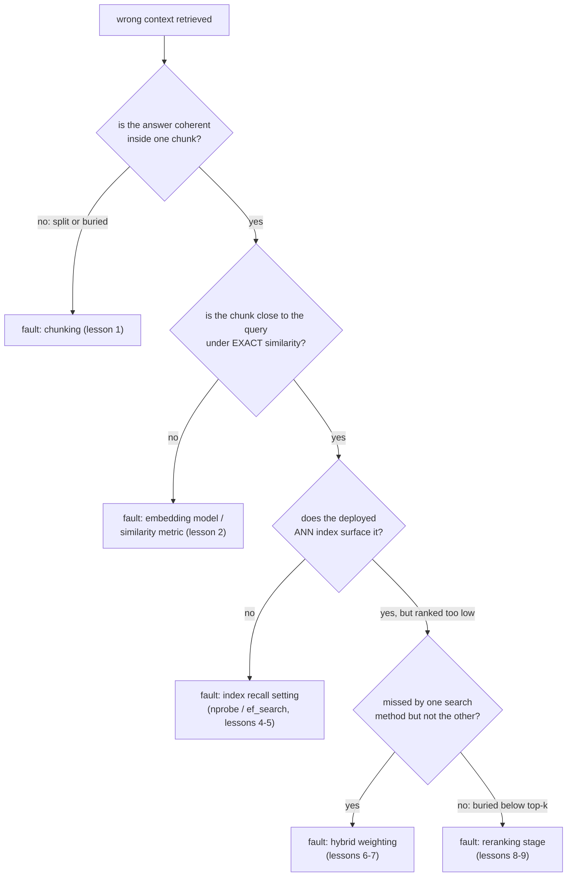

# Lección 11. Diagnosticar el pipeline

**Vínculo con la misión:** Esta es la lección que cierra la etapa 6 y uno de los dos criterios de éxito de la misión: dado un contexto recuperado erróneo, nombrar la etapa culpable en lugar de reajustar parámetros al azar es lo que convierte las etapas anteriores de este espacio de trabajo en un conjunto de herramientas de diagnóstico utilizable.
**Fuente principal:** [Article: "Evaluation Measures for Search and Recommender Systems", Pinecone](https://www.pinecone.io/learn/offline-evaluation/)
**Requisitos previos:** [Lección 10](0010-recall-at-k-and-mrr.md), [Chunk](../GLOSSARY.md)

## Calentamiento

1. ▢ ¿Qué captura MRR que recall@k no puede?

Comprobación

MRR usa la posición exacta del primer resultado relevante y premia la posición 1 mucho más que una inferior. Recall@k solo comprueba si un resultado relevante cae en algún lugar de los k primeros, y trata todas las posiciones de ese rango de forma idéntica.

2. ▢ ¿Qué dos cosas necesita medir un equipo para decidir si el reranking justifica su costo para su carga de trabajo?

Comprobación

La mejora de calidad que aporta el reranking (recall@k o MRR con y sin él, sobre el mismo conjunto de consultas) y la latencia añadida que realmente cuesta con el tamaño de conjunto de candidatos en uso, ambas comprobadas contra el presupuesto y el listón de calidad reales de la carga de trabajo.

## Qué debes saber

### Un síntoma tiene muchas causas posibles; un diagnóstico aísla una

"Se recuperó contexto erróneo" es un síntoma, no un diagnóstico. El fallo podría estar en el chunking (lección 1), en el modelo de embeddings o la métrica de similitud (lección 2), en el ajuste de recall del índice ANN (lecciones 4 y 5), en la mezcla de la búsqueda híbrida (lecciones 6 y 7) o en una etapa de reranking ausente o mal configurada (lecciones 8 y 9). Cambiar varias de estas a la vez y esperar que algo mejore desperdicia esfuerzo y no enseña nada sobre cuál estaba realmente rota; la solución es comprobar cada etapa en un orden que aísle el fallo antes de tocar un parámetro.

### Comprueba primero el chunking: ¿existe siquiera la respuesta en un solo lugar?

Saca el chunk (o los chunks) que debería haber respondido una consulta fallida conocida. Si la información relevante quedó partida en el límite de un chunk, con las dos mitades de la respuesta en chunks separados y desconectados, o quedó enterrada dentro de un chunk grande y de temas mezclados que diluye su embedding (el compromiso central de la lección 1), ninguna etapa posterior del pipeline puede recuperar lo que el chunking nunca llegó a dotar de una representación coherente. Es un problema de estrategia de chunking, y hay que corregirlo en la etapa de chunking, no ajustando nada aguas abajo.

### Comprueba el embedding, con independencia del índice

Si el chunking parece correcto, la siguiente comprobación es si el embedding del chunk correcto está realmente cerca del embedding de la consulta, usando similitud **exacta** (sin pasar por ningún índice ANN) y no la ruta de búsqueda desplegada. Si el chunk correcto queda lejos de la consulta incluso con comparación exacta, el fallo es del modelo de embeddings o de la métrica de similitud (lección 2), no del índice: ningún ajuste del índice puede recuperar un chunk cuyo embedding nunca se colocó cerca del de la consulta.

### Comprueba el índice, solo una vez confirmado que el embedding está cerca

Si la similitud exacta coloca el chunk correcto cerca de la consulta, pero el índice ANN desplegado aun así no lo hace aparecer, lo más probable es que el fallo sea el ajuste de recall del índice (`ivfflat.probes` o `hnsw.ef_search`, lecciones 4 y 5) ajustado de forma demasiado agresiva hacia la velocidad. Subir el parámetro de tiempo de búsqueda y volver a probar aísla si esa era la causa.

### Comprueba la mezcla híbrida y la etapa de reranking al final

Si la búsqueda vectorial por sí sola pasa por alto un chunk que BM25 habría encontrado (o al revés), y la búsqueda híbrida aun así lo pasa por alto, la ponderación híbrida (lecciones 6 y 7) puede estar infraponderando el método que lo habría hecho aparecer. Si la búsqueda híbrida recupera el chunk correcto pero lo ordena demasiado abajo para llegar al top-k final que se entrega a la generación, y no hay una etapa de reranking (o su conjunto de candidatos o su modelo no lo detecta), eso apunta a la etapa 5 (lecciones 8 y 9).

### Diagnostica sobre un conjunto de consultas, no sobre una anécdota

Una sola consulta fallida puede inducir a error: su fallo podría ser un caso aislado causado por una formulación inusual y no un problema sistemático del pipeline. Medir recall@k y MRR (lección 10) en cada etapa, la recuperación inicial por sí sola, tras la fusión híbrida y tras el reranking, sobre un conjunto pequeño de fallos conocidos y representativos revela dónde ocurre la mayor caída agregada, qué etapa pierde información de forma sistemática y no qué etapa falló por casualidad en una consulta que alguien notó.

## Práctica

1. ▢ Una consulta sobre "clause 4.2 termination rights" devuelve los chunks equivocados. La investigación muestra que la cláusula 4.2 se partió en el límite de un chunk sin solapamiento, y dejó su mitad de derechos de terminación huérfana al inicio del chunk siguiente, rodeada de contenido no relacionado. ¿Qué etapa es la culpable y por qué no puede arreglarlo una etapa posterior?

Comprobación

El chunking. La información relevante nunca recibió una representación coherente y recuperable: el embedding de la media cláusula huérfana refleja sobre todo el contenido circundante no relacionado, no el texto de derechos de terminación con el que coincidiría una consulta sobre ello. Ningún modelo de embeddings, ajuste del índice, ponderación híbrida ni etapa de reranking puede recuperar información que el chunking nunca empaquetó en un chunk cuyo embedding la represente de verdad.

2. ▢ Se confirma que el chunk correcto para una consulta fallida está completo y es coherente (no hay problema de chunking), pero con una búsqueda de similitud exacta, sin ANN, su embedding queda lejos del embedding de la consulta. ¿Cuál es el fallo probable y por qué esto descarta el ajuste del índice ANN como solución?

Comprobación

El fallo probable es el modelo de embeddings o la métrica de similitud (lección 2): el embedding del chunk nunca se colocó cerca del de la consulta. Esto descarta el ajuste del índice ANN porque un índice ANN solo aproxima la búsqueda exacta; si ni siquiera la búsqueda exacta logra colocar el chunk correcto cerca de la consulta, una búsqueda más rápida o más exhaustiva en ese mismo espacio de embeddings no puede arreglar un desajuste que existe en el propio nivel del embedding.

3. ▢ La búsqueda de similitud exacta confirma que el embedding del chunk correcto está cerca del de la consulta, pero el índice ANN desplegado no lo devuelve entre los 20 primeros resultados. ¿Cuál es el fallo probable y qué comprobarías primero?

Comprobación

El fallo probable es que el ajuste de recall del índice ANN (`ivfflat.probes` o `hnsw.ef_search`) esté ajustado de forma demasiado agresiva hacia la velocidad. Lo primero que hay que comprobar es subir ese parámetro de tiempo de búsqueda y volver a probar si el chunk correcto aparece ahora; si aparece, la causa fue el compromiso de recall y latencia del índice, no el embedding ni el modelo.

4. ▢ ¿Por qué diagnosticar sobre un conjunto pequeño de consultas fallidas conocidas, midiendo recall@k en cada etapa del pipeline, es más fiable que depurar un único fallo anecdótico?

Comprobación

Una sola consulta fallida puede fallar por una razón inusual y aislada (una formulación rara, un caso límite) que no refleja un problema sistemático del pipeline. Medir recall@k sobre un conjunto representativo de fallos conocidos en cada etapa del pipeline revela dónde ocurre la mayor caída agregada y señala qué etapa pierde información de forma sistemática, en lugar de reaccionar ante el fallo único que alguien notó.

5. ▢ ¿Qué afirmación es cierta sobre diagnosticar el síntoma de recuperación errónea de un pipeline RAG?

    - a) Cualquier etapa del pipeline puede ajustarse primero, ya que todas afectan por igual al resultado final
    - b) Comprobar las etapas en orden, primero el chunking, luego el embedding con independencia del índice, luego el índice, luego la ponderación híbrida y el reranking, aísla qué etapa es realmente la culpable
    - c) Una sola consulta fallida es siempre evidencia suficiente para identificar la etapa culpable
    - d) Si el índice ANN no devuelve el chunk correcto, el modelo de embeddings debe de ser el culpable

Comprobación

**b)** Ese procedimiento ordenado y aislante es exactamente lo que separa el diagnóstico del reajuste al azar. (a) es falsa: el fallo de una etapa anterior (como el chunking) puede volver irrelevante el ajuste de todas las etapas posteriores, y por eso el orden importa. (c) es falsa: una sola consulta puede fallar por razones que no se generalizan; un conjunto de consultas representativo es más fiable. (d) es falsa: primero hay que comprobar la similitud exacta, ya que un índice ANN que falla con un embedding genuinamente cercano apunta al ajuste del índice, no al modelo de embeddings.

## Prácticas en el mundo real

- [ ] Para un pipeline de recuperación que ejecutes o pienses ejecutar, elige una consulta que maneje mal y recorre la comprobación etapa por etapa de esta lección (chunking, similitud exacta de embeddings, recall del índice, ponderación híbrida, reranking) hasta encontrar dónde se rompe realmente.
- [ ] Construye un conjunto pequeño de consultas fallidas conocidas para tu corpus y mide recall@k en más de una etapa del pipeline (la recuperación inicial frente a después de cualquier reranking) para ver dónde ocurre la mayor caída agregada.
- [ ] Mañana: vuelve a la misión de este espacio de trabajo en `README.md` y confirma, con tus propias palabras, que ahora puedes diagnosticar un síntoma de recuperación errónea en lugar de reajustar al azar.

## Para profundizar

- [Article: "Evaluation Measures for Search and Recommender Systems", Pinecone](https://www.pinecone.io/learn/offline-evaluation/)
- [Article: "Chunking Strategies for LLM Applications", Pinecone](https://www.pinecone.io/learn/chunking-strategies/)
- [Recursos](../RESOURCES.md)

---

¿No termina de quedar claro? Vuelve a leer la fuente principal de arriba, ya que esta lección la comprime y en la compresión es donde se escapa la comprensión. Consulta el [glosario](../GLOSSARY.md) por si algún término te resultó resbaladizo.

Si lo poco claro es la propia lección y no el material, eso es un defecto: [abre un issue](https://github.com/TokenCemetery/teach/issues).
