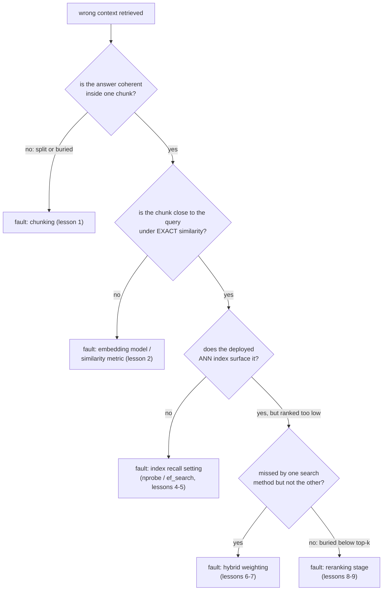

# Leçon 11. Diagnostiquer le pipeline

**Lien avec la mission :** C'est le point d'orgue de l'étape 6 et l'un des deux critères de réussite de la mission : face à un contexte récupéré faux, nommer l'étape en cause plutôt que de dérégler des paramètres au hasard est ce qui transforme les étapes précédentes de cet espace de travail en une boîte à outils de diagnostic utilisable.
**Source primaire :** [Billet : "Evaluation Measures for Search and Recommender Systems", Pinecone](https://www.pinecone.io/learn/offline-evaluation/)
**Prérequis :** [Leçon 10](0010-recall-at-k-and-mrr.md), [Chunk](../GLOSSARY.md)

## Échauffement

1. ▢ Que capture MRR que recall@k ne peut pas capturer ?

Vérifier

MRR utilise la position exacte du premier résultat pertinent, en récompensant le rang 1 bien plus qu'un rang plus bas. Recall@k vérifie seulement si un résultat pertinent tombe quelque part parmi les k premiers, en traitant toutes les positions de cette plage de façon identique.

2. ▢ Quelles deux choses une équipe doit-elle mesurer pour décider si le reranking justifie son coût pour sa charge de travail ?

Vérifier

Le gain de qualité qu'apporte le reranking (recall@k ou MRR avec et sans lui, sur le même jeu de requêtes) et la latence ajoutée qu'il coûte réellement à la taille d'ensemble de candidats utilisée, les deux vérifiés face au budget réel et au seuil de qualité de la charge de travail.

## À savoir

### Un symptôme a de nombreuses causes possibles ; un diagnostic en isole une

« Contexte récupéré faux » est un symptôme, pas un diagnostic. La faute peut se trouver dans le chunking (leçon 1), le modèle d'embedding ou la métrique de similarité (leçon 2), le réglage de recall de l'index ANN (leçons 4 et 5), le mélange de la recherche hybride (leçons 6 et 7), ou une étape de reranking absente ou mal configurée (leçons 8 et 9). Modifier plusieurs de ces éléments à la fois en espérant que quelque chose s'améliore fait perdre du temps et n'apprend rien sur celui qui était réellement en cause ; la solution est de vérifier chaque étape dans un ordre qui isole la faute avant de toucher à un réglage.

### Vérifier d'abord le chunking : la réponse existe-t-elle seulement à un endroit

Sortez le chunk (ou les chunks) qui aurait dû répondre à une requête en échec connue. Si l'information pertinente était coupée à cheval sur une frontière de chunk, les deux moitiés de la réponse se trouvant dans des chunks séparés et déconnectés, ou si elle était enfouie dans un grand chunk thématiquement mélangé qui dilue son embedding (le compromis central de la leçon 1), aucune étape ultérieure du pipeline ne peut récupérer ce à quoi le chunking n'a jamais donné de représentation cohérente. C'est un problème de stratégie de chunking, et il doit être corrigé à l'étape du chunking, pas en réglant quoi que ce soit en aval.

### Vérifier l'embedding, indépendamment de l'index

Si le chunking semble correct, la vérification suivante consiste à savoir si l'embedding du bon chunk est réellement proche de l'embedding de la requête, en utilisant la similarité **exacte** (qui contourne tout index ANN) plutôt que le chemin de recherche déployé. Si le bon chunk reste loin de la requête même en comparaison exacte, la faute vient du modèle d'embedding ou de la métrique de similarité (leçon 2), pas de l'index : aucun réglage d'index ne peut récupérer un chunk dont l'embedding n'a jamais été placé près de celui de la requête.

### Vérifier l'index, seulement une fois l'embedding confirmé proche

Si la similarité exacte place le bon chunk près de la requête, mais que l'index ANN déployé ne le fait toujours pas remonter, la faute est probablement le réglage de recall de l'index (`ivfflat.probes` ou `hnsw.ef_search`, leçons 4 et 5) réglé trop agressivement vers la vitesse. Augmenter le paramètre de recherche et retester permet d'isoler si c'était la cause.

### Vérifier en dernier le mélange hybride et l'étape de reranking

Si la recherche vectorielle seule rate un chunk que BM25 aurait trouvé (ou l'inverse), et que la recherche hybride le rate encore, la pondération hybride (leçons 6 et 7) sous-pondère peut-être la méthode qui l'aurait fait remonter. Si le bon chunk est récupéré par la recherche hybride mais classé trop bas pour atteindre le top-k final transmis à la génération, et qu'aucune étape de reranking n'est en place (ou que son ensemble de candidats ou son modèle ne le détecte pas), cela pointe vers l'étape 5 (leçons 8 et 9).

### Diagnostiquer sur un jeu de requêtes, pas sur une anecdote

Une seule requête en échec peut être trompeuse : son échec peut être un accident ponctuel causé par une formulation inhabituelle plutôt qu'un problème systémique du pipeline. Mesurer recall@k et MRR (leçon 10) à chaque étape, la récupération initiale seule, après la fusion hybride, après le reranking, sur un petit ensemble d'échecs connus et représentatifs révèle où se produit la plus grosse chute globale, c'est-à-dire quelle étape perd systématiquement de l'information plutôt que quelle étape a échoué sur la requête que quelqu'un a remarquée.

## Pratique

1. ▢ Une requête sur « clause 4.2 droits de résiliation » renvoie les mauvais chunks. L'enquête montre que la clause 4.2 a été coupée à cheval sur une frontière de chunk sans chevauchement, laissant sa moitié sur les droits de résiliation orpheline au début du chunk suivant, entourée de contenu sans rapport. Quelle étape est en cause, et pourquoi une étape ultérieure ne peut-elle pas y remédier ?

Vérifier

Le chunking. L'information pertinente n'a jamais reçu de représentation cohérente et récupérable au départ : l'embedding de la demi-clause orpheline reflète surtout le contenu environnant sans rapport, pas le texte sur les droits de résiliation auquel une requête sur ce sujet devrait correspondre. Aucun modèle d'embedding, réglage d'index, pondération hybride ou étape de reranking ne peut récupérer une information que le chunking n'a jamais empaquetée dans un chunk dont l'embedding la représente réellement.

2. ▢ Le bon chunk d'une requête en échec est confirmé complet et cohérent (pas de problème de chunking), mais avec une recherche de similarité exacte, sans ANN, son embedding est loin de celui de la requête. Quelle est la faute probable, et pourquoi cela exclut-il le réglage de l'index ANN comme solution ?

Vérifier

La faute probable est le modèle d'embedding ou la métrique de similarité (leçon 2) : l'embedding du chunk n'a jamais été placé près de celui de la requête au départ. Cela exclut le réglage de l'index ANN parce qu'un index ANN ne fait qu'approximer la recherche exacte ; si même la recherche exacte ne place pas le bon chunk près de la requête, une recherche plus rapide ou plus exhaustive dans ce même espace d'embedding ne peut pas corriger un décalage qui existe au niveau de l'embedding lui-même.

3. ▢ La recherche de similarité exacte confirme que l'embedding du bon chunk est proche de celui de la requête, mais l'index ANN déployé ne le renvoie pas parmi les 20 premiers résultats. Quelle est la faute probable, et que vérifieriez-vous en premier ?

Vérifier

La faute probable est le réglage de recall de l'index ANN (`ivfflat.probes` ou `hnsw.ef_search`) réglé trop agressivement vers la vitesse. La première chose à vérifier est d'augmenter ce paramètre de recherche et de retester si le bon chunk apparaît maintenant ; si c'est le cas, c'est le compromis recall/latence de l'index, et non l'embedding ni le modèle, qui était en cause.

4. ▢ Pourquoi diagnostiquer sur un petit ensemble de requêtes en échec connues, en mesurant recall@k à chaque étape du pipeline, est-il plus fiable que de déboguer un seul échec anecdotique ?

Vérifier

Une seule requête en échec peut échouer pour une raison inhabituelle et ponctuelle (une formulation étrange, un cas limite) qui ne reflète pas un problème systémique du pipeline. Mesurer recall@k sur un ensemble représentatif d'échecs connus à chaque étape du pipeline révèle où se produit la plus grosse chute globale, ce qui désigne l'étape qui perd systématiquement de l'information plutôt que de réagir à l'échec unique qui a été remarqué.

5. ▢ Laquelle de ces affirmations est vraie à propos du diagnostic du symptôme de mauvaise récupération d'un pipeline RAG ?

    - a) N'importe quelle étape du pipeline peut être réglée en premier, puisqu'elles affectent toutes également le résultat final
    - b) Vérifier les étapes dans l'ordre, le chunking d'abord, puis l'embedding indépendamment de l'index, puis l'index, puis la pondération hybride et le reranking, isole l'étape réellement en cause
    - c) Une seule requête en échec est toujours une preuve suffisante pour identifier l'étape en cause
    - d) Si l'index ANN ne renvoie pas le bon chunk, c'est forcément le modèle d'embedding qui est en cause

Vérifier

**b)** Cette procédure ordonnée et isolante est exactement ce qui sépare le diagnostic du réglage aléatoire. (a) est fausse : l'échec d'une étape antérieure (comme le chunking) peut rendre sans objet le réglage de toutes les étapes suivantes, ce qui est la raison pour laquelle l'ordre compte. (c) est fausse : une seule requête peut échouer pour des raisons qui ne se généralisent pas ; un jeu de requêtes représentatif est plus fiable. (d) est fausse : la similarité exacte doit être vérifiée d'abord, puisqu'un index ANN défaillant avec un embedding réellement proche pointe vers le réglage de l'index, pas vers le modèle d'embedding.

## Exercices en situation réelle

- [ ] Pour un pipeline de récupération que vous exploitez ou prévoyez d'exploiter, choisissez une requête qu'il traite mal, et parcourez la vérification étape par étape de cette leçon (chunking, similarité exacte des embeddings, recall de l'index, pondération hybride, reranking) jusqu'à trouver où il casse réellement.
- [ ] Constituez un petit ensemble de requêtes en échec connues pour votre corpus et mesurez recall@k à plus d'une étape du pipeline (récupération initiale contre après tout reranking) pour voir où se produit la plus grosse chute globale.
- [ ] Demain : relisez la mission de cet espace de travail dans `README.md` et confirmez, avec vos propres mots, que vous savez désormais diagnostiquer un symptôme de mauvaise récupération au lieu de dérégler au hasard.

## Pour aller plus loin

- [Billet : "Evaluation Measures for Search and Recommender Systems", Pinecone](https://www.pinecone.io/learn/offline-evaluation/)
- [Billet : "Chunking Strategies for LLM Applications", Pinecone](https://www.pinecone.io/learn/chunking-strategies/)
- [Ressources](../RESOURCES.md)

---

Ça ne passe pas ? Relisez la source primaire en haut de page, car cette leçon la condense et c'est dans la condensation que la compréhension s'échappe. Consultez le [glossaire](../GLOSSARY.md) pour tout terme qui vous a paru glissant.

Si c'est la leçon elle-même qui n'est pas claire plutôt que la matière, c'est un défaut : [ouvrez une issue](https://github.com/TokenCemetery/teach/issues).
