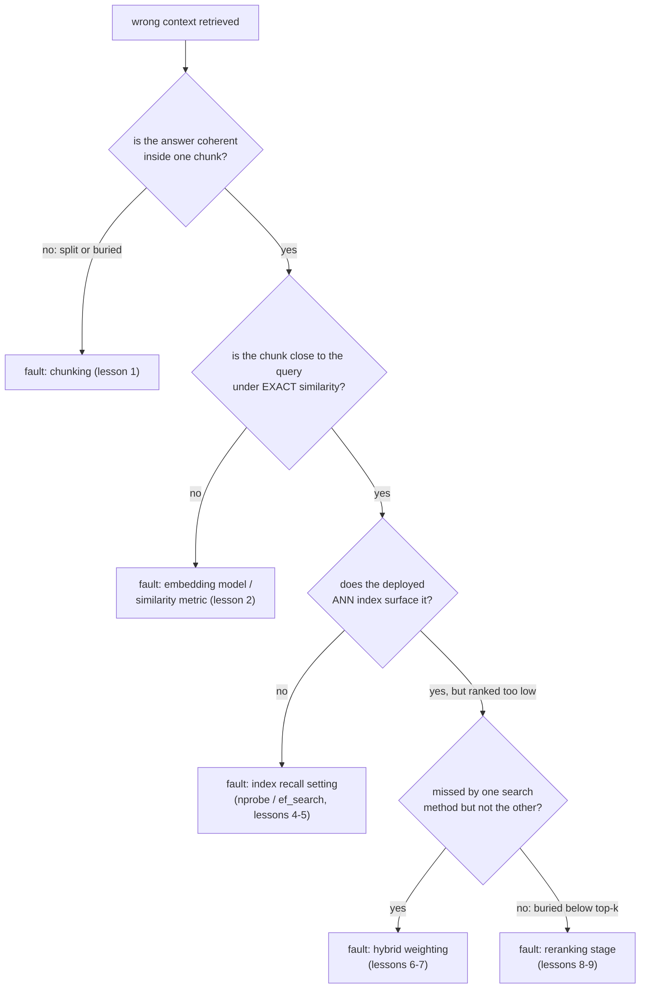

# पाठ 11. Pipeline का Diagnosis

**मिशन से संबंध:** यह चरण 6 का समापन है और मिशन के दो सफलता मानदंडों में से एक: ग़लत retrieved context मिलने पर knobs को बेतरतीब ढंग से दोबारा tune करने के बजाय दोषी चरण का नाम बताना ही इस workspace के पहले के चरणों को इस्तेमाल लायक diagnostic औज़ारों में बदलता है।
**मुख्य स्रोत:** [लेख: "Evaluation Measures for Search and Recommender Systems", Pinecone](https://www.pinecone.io/learn/offline-evaluation/)
**पूर्व-आवश्यकताएँ:** [पाठ 10](0010-recall-at-k-and-mrr.md), [Chunk](../GLOSSARY.md)

## वार्म-अप

1. ▢ MRR क्या पकड़ता है जो recall@k नहीं पकड़ सकता?

जाँचें

MRR पहले प्रासंगिक नतीजे की ठीक rank स्थिति इस्तेमाल करता है, rank 1 को निचली rank से कहीं ज़्यादा इनाम देते हुए। Recall@k सिर्फ़ यह जाँचता है कि प्रासंगिक नतीजा शीर्ष k में कहीं आता है या नहीं, उस दायरे के हर स्थान को एक-सा मानते हुए।

2. ▢ टीम को यह तय करने के लिए कि reranking उसके workload के लिए अपनी क़ीमत कमाता है या नहीं, कौन-सी दो चीज़ें मापनी पड़ती हैं?

जाँचें

Reranking जो गुणवत्ता लाभ देता है (उसी query सेट पर उसके साथ और उसके बिना recall@k या MRR) और इस्तेमाल हो रहे candidate-सेट आकार पर वह असल में जो latency जोड़ता है, दोनों को workload के असली budget और गुणवत्ता की कसौटी के विरुद्ध जाँचकर।

## यह जानें

### एक लक्षण के कई संभावित कारण होते हैं; diagnosis एक को अलग करता है

"ग़लत context retrieve हुआ" एक लक्षण है, diagnosis नहीं। दोष chunking (पाठ 1), embedding model या similarity metric (पाठ 2), ANN index की recall setting (पाठ 4 और 5), hybrid search के मिश्रण (पाठ 6 और 7), या ग़ायब या ग़लत configure किए reranking चरण (पाठ 8 और 9) में हो सकता है। इनमें से कई को एक साथ बदलना और उम्मीद करना कि कुछ सुधरेगा, मेहनत बर्बाद करता है और यह नहीं सिखाता कि असल में कौन-सा टूटा था; इलाज यह है कि हर चरण को ऐसे क्रम में जाँचें जो किसी knob को छूने से पहले दोष को अलग कर दे।

### पहले chunking जाँचें: क्या उत्तर एक जगह मौजूद भी है

किसी ज्ञात विफल query का उत्तर देने वाले असली chunk (या chunks) को निकालें। अगर प्रासंगिक जानकारी chunk की सीमा के आर-पार बँट गई थी, उत्तर के दोनों आधे अलग, कटे हुए chunks में बैठे थे, या वह किसी बड़े, कई विषयों वाले chunk के भीतर दबी थी जो उसकी embedding को पतला कर देता है (पाठ 1 का मूल trade-off), तो कोई भी बाद का pipeline चरण वह retrieve नहीं कर सकता जिसका chunking ने पहली ही जगह कोई सुसंगत प्रतिनिधित्व दिया ही नहीं। यह chunking-रणनीति की समस्या है, और इसे chunking चरण पर ही ठीक करना होगा, आगे कुछ भी tune करके नहीं।

### Embedding को index से स्वतंत्र रूप से जाँचें

अगर chunking ठीक दिखती है, तो अगली जाँच यह है कि सही chunk की embedding query की embedding के असल में पास है भी या नहीं, तैनात search रास्ते की जगह **exact** similarity (किसी भी ANN index को बाईपास करते हुए) इस्तेमाल करके। अगर exact तुलना में भी सही chunk query से दूर बैठा है, तो दोष embedding model या similarity metric (पाठ 2) का है, index का नहीं: index की कितनी भी tuning ऐसा chunk retrieve नहीं कर सकती जिसकी embedding को query के पास कभी रखा ही नहीं गया।

### Index तभी जाँचें जब embedding के पास होने की पुष्टि हो जाए

अगर exact similarity सही chunk को query के पास रखती है, पर तैनात ANN index फिर भी उसे सामने नहीं ला पाता, तो दोष संभवतः index की recall setting (`ivfflat.probes` या `hnsw.ef_search`, पाठ 4 और 5) का है, जो रफ़्तार की ओर ज़रूरत से ज़्यादा tune की गई है। Search-time parameter बढ़ाकर दोबारा परखना अलग कर देता है कि यही कारण था या नहीं।

### Hybrid मिश्रण और reranking चरण आख़िर में जाँचें

अगर अकेला vector search वह chunk चूक जाता है जो BM25 ढूँढ लेता (या उलटा), और hybrid search भी उसे चूकता है, तो hybrid weighting (पाठ 6 और 7) उस तरीक़े को कम weight दे रही हो सकती है जो उसे सामने लाता। अगर सही chunk hybrid search से retrieve होता है पर generation को सौंपे जाने वाले अंतिम शीर्ष-k तक पहुँचने के लिए बहुत नीचे rank होता है, और कोई reranking चरण नहीं है (या उसका candidate सेट या model उसे नहीं पकड़ रहा), तो यह चरण 5 (पाठ 8 और 9) की ओर इशारा करता है।

### एक किस्से पर नहीं, query सेट पर diagnose करें

कोई एक विफल query भ्रामक हो सकती है: उसकी विफलता किसी असामान्य शब्दावली से हुई एक-बारगी बात हो सकती है, व्यवस्थागत pipeline समस्या नहीं। ज्ञात, प्रतिनिधि विफलताओं के छोटे सेट पर हर चरण पर recall@k और MRR (पाठ 10) मापना, अकेला शुरुआती retrieval, hybrid fusion के बाद, reranking के बाद, दिखाता है कि कुल मिलाकर सबसे बड़ी गिरावट कहाँ होती है, यानी कौन-सा चरण व्यवस्थित रूप से जानकारी खो रहा है, न कि कौन-सा चरण किसी एक query पर विफल हुआ जिसे किसी ने नोटिस किया।

## अभ्यास

1. ▢ "clause 4.2 termination rights" के बारे में एक query ग़लत chunks लौटाती है। जाँच दिखाती है कि clause 4.2 बिना overlap के chunk की सीमा के आर-पार बँट गया, जिससे उसका termination-rights वाला आधा हिस्सा अगले chunk की शुरुआत में अनाथ रह गया, असंबंधित सामग्री से घिरा हुआ। कौन-सा चरण दोषी है, और बाद का कोई चरण इसे ठीक क्यों नहीं कर सकता?

जाँचें

Chunking। प्रासंगिक जानकारी को पहली ही जगह कोई सुसंगत, retrieve होने लायक प्रतिनिधित्व दिया ही नहीं गया: अनाथ आधे clause की embedding ज़्यादातर असंबंधित आसपास की सामग्री को दर्शाती है, उस termination-rights text को नहीं जिससे उसके बारे में query मेल खाती। कोई embedding model, index tuning, hybrid weighting या reranking चरण वह जानकारी retrieve नहीं कर सकता जिसे chunking ने कभी ऐसे chunk में पैक किया ही नहीं जिसकी embedding उसे असल में दर्शाए।

2. ▢ किसी विफल query के लिए सही chunk पूरा और सुसंगत पुष्ट है (chunking की कोई समस्या नहीं), पर exact, non-ANN similarity search में उसकी embedding query की embedding से दूर बैठी है। संभावित दोष क्या है, और यह ANN index tuning को इलाज के रूप में क्यों ख़ारिज करता है?

जाँचें

संभावित दोष embedding model या similarity metric (पाठ 2) का है: chunk की embedding को query की embedding के पास कभी रखा ही नहीं गया। यह ANN index tuning को इसलिए ख़ारिज करता है कि ANN index सिर्फ़ exact search का अनुमान है; अगर exact search भी सही chunk को query के पास नहीं रख पाता, तो उसी embedding space की ज़्यादा तेज़ या ज़्यादा गहन search ऐसी बेमेल को ठीक नहीं कर सकती जो embedding के स्तर पर ही मौजूद है।

3. ▢ Exact similarity search पुष्टि करता है कि सही chunk की embedding query की embedding के पास है, पर तैनात ANN index उसे शीर्ष 20 नतीजों में नहीं लौटाता। संभावित दोष क्या है, और आप सबसे पहले क्या जाँचेंगे?

जाँचें

संभावित दोष ANN index की recall setting (`ivfflat.probes` या `hnsw.ef_search`) का है, जो रफ़्तार की ओर ज़रूरत से ज़्यादा tune की गई है। सबसे पहले जाँचने की चीज़ है उस search-time parameter को बढ़ाना और दोबारा परखना कि सही chunk अब आता है या नहीं; अगर आता है, तो कारण index का recall/latency trade-off था, embedding या model नहीं।

4. ▢ हर pipeline चरण पर recall@k मापते हुए, ज्ञात-विफल queries के छोटे सेट पर diagnose करना किसी एक किस्से जैसी विफलता को debug करने से ज़्यादा भरोसेमंद क्यों है?

जाँचें

कोई एक विफल query किसी असामान्य, एक-बारगी कारण (अजीब शब्दावली, कोई अपवाद) से विफल हो सकती है जो व्यवस्थागत pipeline समस्या को नहीं दर्शाता। Pipeline के हर चरण पर ज्ञात विफलताओं के प्रतिनिधि सेट पर recall@k मापना दिखाता है कि कुल मिलाकर सबसे बड़ी गिरावट कहाँ होती है, जो इशारा करती है कि कौन-सा चरण व्यवस्थित रूप से जानकारी खो रहा है, बजाय उस अकेली विफलता पर प्रतिक्रिया करने के जो संयोग से नोटिस हो गई।

5. ▢ RAG pipeline के ग़लत-retrieval लक्षण को diagnose करने के बारे में कौन-सा दावा सही है?

    - a) कोई भी pipeline चरण पहले tune किया जा सकता है, क्योंकि वे सब अंतिम नतीजे को बराबर प्रभावित करते हैं
    - b) चरणों को क्रम में जाँचना, पहले chunking, फिर index से स्वतंत्र embedding, फिर index, फिर hybrid weighting और reranking, अलग कर देता है कि कौन-सा चरण असल में दोषी है
    - c) दोषी चरण पहचानने के लिए एक अकेली विफल query हमेशा काफ़ी सबूत है
    - d) अगर ANN index सही chunk नहीं लौटाता, तो embedding model ही दोषी होगा

जाँचें

**b)** यही क्रमबद्ध, अलग करने वाली प्रक्रिया diagnosis को बेतरतीब दोबारा tuning से अलग करती है। (a) ग़लत है: किसी पहले चरण की विफलता (जैसे chunking) हर बाद के चरण की tuning को अप्रासंगिक बना सकती है, इसीलिए क्रम मायने रखता है। (c) ग़लत है: एक query ऐसे कारणों से विफल हो सकती है जो सामान्य नहीं होते; प्रतिनिधि query सेट ज़्यादा भरोसेमंद है। (d) ग़लत है: exact similarity पहले जाँचनी पड़ती है, क्योंकि सचमुच पास की embedding के साथ विफल होता ANN index index tuning की ओर इशारा करता है, embedding model की ओर नहीं।

## असली दुनिया का अभ्यास

- [ ] जो retrieval pipeline आप चलाते हैं या चलाने की योजना है, उसके लिए कोई एक query चुनें जिसे वह ख़राब ढंग से संभालता है, और इस पाठ की चरण-दर-चरण जाँच (chunking, exact embedding similarity, index recall, hybrid weighting, reranking) तब तक चलाएँ जब तक पता न चले कि वह असल में कहाँ टूटता है।
- [ ] अपने corpus के लिए ज्ञात-विफल queries का छोटा सेट बनाएँ और एक से ज़्यादा pipeline चरणों पर recall@k मापें (शुरुआती retrieval बनाम किसी भी reranking के बाद), यह देखने के लिए कि सबसे बड़ी कुल गिरावट कहाँ होती है।
- [ ] कल: `README.md` में इस workspace के मिशन को दोबारा देखें और अपने शब्दों में पुष्टि करें कि अब आप बेतरतीब दोबारा tuning करने के बजाय ग़लत-retrieval लक्षण को diagnose कर सकते हैं।

## आगे बढ़ने के लिए

- [लेख: "Evaluation Measures for Search and Recommender Systems", Pinecone](https://www.pinecone.io/learn/offline-evaluation/)
- [लेख: "Chunking Strategies for LLM Applications", Pinecone](https://www.pinecone.io/learn/chunking-strategies/)
- [संसाधन](../RESOURCES.md)

---

बात नहीं बन रही? ऊपर दिए primary source को दोबारा पढ़ें, क्योंकि यह पाठ उसे संक्षिप्त करता है और समझ संक्षेप में ही रिसती है। जो शब्द फिसलन भरा लगे, उसके लिए [शब्दावली](../GLOSSARY.md) देखें।

अगर दिक़्क़त सामग्री की नहीं बल्कि पाठ की ही है, तो वह एक खोट है: [issue खोलें](https://github.com/TokenCemetery/teach/issues)।
