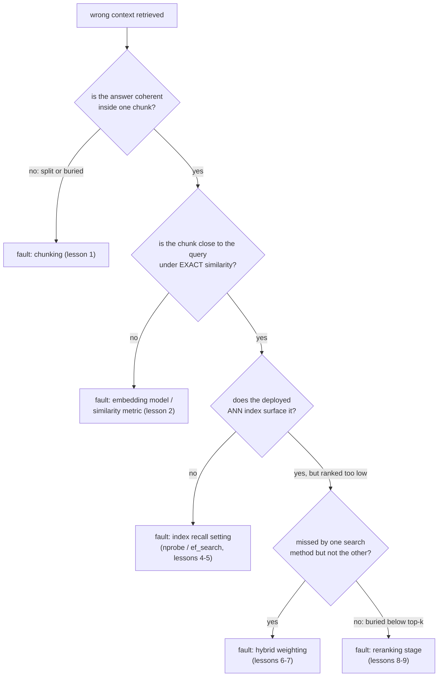

# Lição 11. Diagnosticando o pipeline

**Ligação com a missão:** Esta é a lição final da etapa 6 e um dos dois critérios de sucesso da missão: dado um contexto recuperado errado, nomear a etapa com defeito em vez de reajustar botões ao acaso é o que transforma as etapas anteriores deste workspace em um kit de diagnóstico utilizável.
**Fonte principal:** [Artigo: "Evaluation Measures for Search and Recommender Systems", Pinecone](https://www.pinecone.io/learn/offline-evaluation/)
**Pré-requisitos:** [Lição 10](0010-recall-at-k-and-mrr.md), [Chunk](../GLOSSARY.md)

## Aquecimento

1. ▢ O que o MRR captura que o recall@k não consegue?

Verificação

O MRR usa a posição exata do primeiro resultado relevante, recompensando a posição 1 muito mais que uma posição mais baixa. O recall@k só verifica se um resultado relevante cai em algum lugar dentro do top k, tratando de forma idêntica toda posição nesse intervalo.

2. ▢ Que duas coisas uma equipe precisa medir para decidir se o reranking compensa o custo para a sua carga de trabalho?

Verificação

O ganho de qualidade que o reranking proporciona (recall@k ou MRR com e sem ele, sobre o mesmo conjunto de consultas) e a latência adicional que ele de fato custa no tamanho de conjunto de candidatos em uso, ambos conferidos contra o orçamento e o nível de qualidade reais da carga de trabalho.

## Saiba isto

### Um sintoma tem muitas causas possíveis; um diagnóstico isola uma

"Contexto errado recuperado" é um sintoma, não um diagnóstico. O defeito pode estar no chunking (lição 1), no modelo de embedding ou na métrica de similaridade (lição 2), na configuração de recall do índice ANN (lições 4 e 5), na mistura da busca híbrida (lições 6 e 7) ou em uma etapa de reranking ausente ou mal configurada (lições 8 e 9). Mudar várias dessas coisas ao mesmo tempo e esperar que algo melhore desperdiça esforço e não ensina nada sobre qual delas estava de fato quebrada; a solução é verificar cada etapa em uma ordem que isole o defeito antes de mexer em um botão.

### Verifique o chunking primeiro: a resposta sequer existe em um único lugar?

Busque o chunk (ou chunks) real que deveria ter respondido a uma consulta que sabidamente falha. Se a informação relevante foi dividida por uma fronteira de chunk, com as duas metades da resposta em chunks separados e desconectados, ou se foi enterrada dentro de um chunk grande e de assuntos misturados que dilui seu embedding (o trade-off central da lição 1), nenhuma etapa posterior do pipeline consegue recuperar aquilo a que o chunking nunca deu uma representação coerente. Isso é um problema da estratégia de chunking e precisa ser corrigido na etapa de chunking, e não ajustando algo a jusante.

### Verifique o embedding, independentemente do índice

Se o chunking parece bom, a verificação seguinte é se o embedding do chunk correto de fato está próximo do embedding da consulta, usando a similaridade **exata** (ignorando qualquer índice ANN) em vez do caminho de busca implantado. Se o chunk correto fica longe da consulta mesmo na comparação exata, o defeito é o modelo de embedding ou a métrica de similaridade (lição 2), e não o índice: nenhuma quantidade de ajuste de índice consegue recuperar um chunk cujo embedding nunca foi colocado perto do da consulta desde o início.

### Verifique o índice, só depois de confirmado que o embedding está próximo

Se a similaridade exata coloca o chunk correto perto da consulta, mas o índice ANN implantado ainda não o traz à tona, o defeito provavelmente é a configuração de recall do índice (`ivfflat.probes` ou `hnsw.ef_search`, lições 4 e 5) ajustada agressivamente demais em favor da velocidade. Aumentar o parâmetro de tempo de busca e testar de novo isola se essa foi a causa.

### Verifique a mistura híbrida e a etapa de reranking por último

Se a busca vetorial sozinha perde um chunk que o BM25 teria encontrado (ou o inverso), e a busca híbrida ainda o perde, a ponderação híbrida (lições 6 e 7) pode estar dando peso de menos ao método que o teria trazido à tona. Se o chunk correto é recuperado pela busca híbrida mas ranqueado baixo demais para chegar ao top-k final entregue à geração, e não há uma etapa de reranking (ou o conjunto de candidatos ou o modelo dela não o está pegando), isso aponta para a etapa 5 (lições 8 e 9).

### Diagnostique em um conjunto de consultas, não em uma anedota

Uma única consulta que falha pode enganar: sua falha pode ser um caso pontual causado por uma formulação incomum e não um problema sistêmico do pipeline. Medir recall@k e MRR (lição 10) em cada etapa, na recuperação inicial sozinha, depois da fusão híbrida, depois do reranking, sobre um pequeno conjunto de falhas conhecidas e representativas revela onde ocorre a maior queda agregada, qual etapa está perdendo informação de forma sistemática, e não qual etapa por acaso falhou em uma consulta que alguém notou.

## Prática

1. ▢ Uma consulta sobre "clause 4.2 termination rights" devolve os chunks errados. A investigação mostra que a cláusula 4.2 foi dividida por uma fronteira de chunk sem sobreposição, deixando sua metade sobre direitos de rescisão órfã no começo do chunk seguinte, cercada de conteúdo não relacionado. Qual etapa está com defeito, e por que uma etapa posterior não consegue corrigi-lo?

Verificação

O chunking. A informação relevante nunca recebeu uma representação coerente e recuperável desde o início: o embedding da meia cláusula órfã reflete principalmente o conteúdo ao redor não relacionado, e não o texto sobre direitos de rescisão com o qual uma consulta sobre isso teria correspondência. Nenhum modelo de embedding, ajuste de índice, ponderação híbrida ou etapa de reranking consegue recuperar informação que o chunking nunca empacotou em um chunk cujo embedding de fato a represente.

2. ▢ O chunk correto para uma consulta que falha está confirmado como completo e coerente (sem problema de chunking), mas, em uma busca de similaridade exata, sem ANN, seu embedding fica longe do embedding da consulta. Qual é o provável defeito, e por que isso descarta o ajuste do índice ANN como solução?

Verificação

O provável defeito é o modelo de embedding ou a métrica de similaridade (lição 2): o embedding do chunk nunca foi colocado perto do embedding da consulta desde o início. Isso descarta o ajuste do índice ANN porque um índice ANN apenas aproxima a busca exata; se nem a busca exata coloca o chunk correto perto da consulta, uma busca mais rápida ou mais exaustiva nesse mesmo espaço de embeddings não consegue consertar um descompasso que existe no próprio nível do embedding.

3. ▢ A busca de similaridade exata confirma que o embedding do chunk correto está próximo do da consulta, mas o índice ANN implantado não o devolve entre os 20 primeiros resultados. Qual é o provável defeito, e o que você verificaria primeiro?

Verificação

O provável defeito é a configuração de recall do índice ANN (`ivfflat.probes` ou `hnsw.ef_search`) ajustada agressivamente demais em favor da velocidade. A primeira coisa a verificar é aumentar esse parâmetro de tempo de busca e testar de novo se o chunk correto agora aparece; se aparecer, o trade-off entre recall e latência do índice, e não o embedding nem o modelo, era a causa.

4. ▢ Por que diagnosticar sobre um pequeno conjunto de consultas que sabidamente falham, medindo o recall@k em cada etapa do pipeline, é mais confiável do que depurar uma única falha anedótica?

Verificação

Uma única consulta que falha pode falhar por um motivo incomum e pontual (uma formulação estranha, um caso extremo) que não reflete um problema sistêmico do pipeline. Medir o recall@k sobre um conjunto representativo de falhas conhecidas em cada etapa do pipeline revela onde ocorre a maior queda agregada, apontando qual etapa está perdendo informação de forma sistemática, em vez de reagir a qualquer falha isolada que por acaso foi notada.

5. ▢ Qual afirmação é verdadeira sobre diagnosticar o sintoma de recuperação errada de um pipeline RAG?

    - a) Qualquer etapa do pipeline pode ser ajustada primeiro, já que todas afetam o resultado final igualmente
    - b) Verificar as etapas em ordem, chunking primeiro, depois o embedding independentemente do índice, depois o índice, depois a ponderação híbrida e o reranking, isola qual etapa está de fato com defeito
    - c) Uma única consulta que falha é sempre evidência suficiente para identificar a etapa com defeito
    - d) Se o índice ANN não devolve o chunk correto, o modelo de embedding deve ser o culpado

Verificação

**b)** Esse procedimento ordenado e isolante é exatamente o que separa diagnóstico de reajuste aleatório. (a) é falsa: a falha de uma etapa anterior (como o chunking) pode tornar irrelevante o ajuste de toda etapa posterior, e é por isso que a ordem importa. (c) é falsa: uma única consulta pode falhar por motivos que não se generalizam; um conjunto representativo de consultas é mais confiável. (d) é falsa: a similaridade exata precisa ser verificada primeiro, já que um índice ANN que falha com um embedding genuinamente próximo aponta para o ajuste do índice, e não para o modelo de embedding.

## Prática no mundo real

- [ ] Para um pipeline de recuperação que você executa ou pretende executar, escolha uma consulta que ele trata mal e percorra a verificação etapa por etapa desta lição (chunking, similaridade exata de embedding, recall do índice, ponderação híbrida, reranking) até descobrir onde ele de fato quebra.
- [ ] Monte um pequeno conjunto de consultas que sabidamente falham para o seu corpus e meça o recall@k em mais de uma etapa do pipeline (recuperação inicial contra depois de qualquer reranking) para ver onde ocorre a maior queda agregada.
- [ ] Amanhã: revisite a missão deste workspace em `README.md` e confirme, com suas próprias palavras, que agora você consegue diagnosticar um sintoma de recuperação errada em vez de reajustar ao acaso.

## Para ir além

- [Artigo: "Evaluation Measures for Search and Recommender Systems", Pinecone](https://www.pinecone.io/learn/offline-evaluation/)
- [Artigo: "Chunking Strategies for LLM Applications", Pinecone](https://www.pinecone.io/learn/chunking-strategies/)
- [Recursos](../RESOURCES.md)

---

Não ficou claro? Releia a fonte principal no topo, já que esta lição a comprime e é na compressão que o entendimento escapa. Consulte o [glossário](../GLOSSARY.md) para qualquer termo que pareceu escorregadio.

Se o problema é a lição em si, e não o material, isso é um defeito: [abra uma issue](https://github.com/TokenCemetery/teach/issues).
