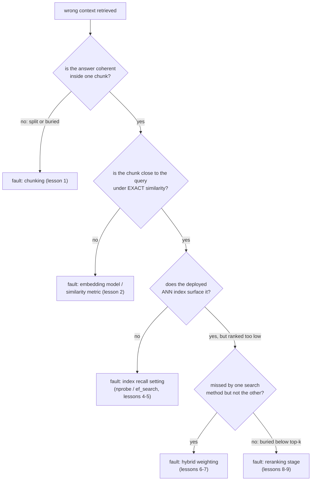

# Урок 11. Диагностика конвейера

**Связь с целью курса:** Это завершающий урок этапа 6 и один из двух критериев успеха курса: получив неверный найденный контекст, назвать виновный этап, а не крутить параметры наугад, это то, что превращает предыдущие этапы этой рабочей области в пригодный диагностический инструментарий.
**Первоисточник:** [Статья: "Evaluation Measures for Search and Recommender Systems", Pinecone](https://www.pinecone.io/learn/offline-evaluation/)
**Предварительные требования:** [Урок 10](0010-recall-at-k-and-mrr.md), [Чанк](../GLOSSARY.md)

## Разминка

1. ▢ Что улавливает MRR такого, чего не может recall@k?

Проверка

MRR использует точную позицию первого релевантного результата, вознаграждая место 1 гораздо сильнее, чем более низкое. Recall@k лишь проверяет, оказался ли релевантный результат где-то среди k лучших, одинаково обращаясь с каждой позицией этого диапазона.

2. ▢ Какие две вещи нужно измерить команде, чтобы решить, окупает ли реранкинг свою цену для её нагрузки?

Проверка

Выигрыш в качестве, который даёт реранкинг (recall@k или MRR с ним и без него на одном наборе запросов), и добавленную задержку, которую он на самом деле стоит при используемом размере набора кандидатов, обе величины сверены с реальным бюджетом и планкой качества нагрузки.

## Что нужно знать

### У симптома много возможных причин; диагноз выделяет одну

«Найден неверный контекст» это симптом, а не диагноз. Неисправность может сидеть в чанкинге (урок 1), в модели эмбеддингов или метрике сходства (урок 2), в настройке полноты ANN-индекса (уроки 4 и 5), в смеси гибридного поиска (уроки 6 и 7) или в отсутствующем либо неверно настроенном этапе реранкинга (уроки 8 и 9). Менять несколько из них сразу в надежде, что что-то улучшится, это пустая трата усилий, которая ничему не учит о том, что именно было сломано; исправление в том, чтобы проверять каждый этап в порядке, изолирующем неисправность, прежде чем трогать параметр.

### Сначала проверьте чанкинг: есть ли ответ вообще в одном месте

Откройте настоящий чанк (или чанки), который должен был ответить на известный сбойный запрос. Если нужная информация была разрезана границей чанка, так что две половины ответа лежат в разных, не связанных чанках, или была погребена внутри большого, тематически смешанного чанка, размывающего его эмбеддинг (главный компромисс урока 1), ни один последующий этап конвейера не может найти то, чему чанкинг изначально не дал связного представления. Это проблема стратегии чанкинга, и её нужно исправлять на этапе чанкинга, а не настройкой чего-либо ниже по конвейеру.

### Проверьте эмбеддинг независимо от индекса

Если с чанкингом всё в порядке, следующая проверка: действительно ли эмбеддинг верного чанка вообще близок к эмбеддингу запроса, по **точному** сходству (в обход любого ANN-индекса), а не по развёрнутому пути поиска. Если верный чанк далёк от запроса даже при точном сравнении, неисправность в модели эмбеддингов или в метрике сходства (урок 2), а не в индексе: никакая настройка индекса не может найти чанк, чей эмбеддинг изначально не был помещён рядом с эмбеддингом запроса.

### Проверяйте индекс, только когда подтверждена близость эмбеддинга

Если точное сходство ставит верный чанк близко к запросу, но развёрнутый ANN-индекс всё равно не выводит его, неисправность, вероятно, в настройке полноты индекса (`ivfflat.probes` или `hnsw.ef_search`, уроки 4 и 5), слишком агрессивно настроенной на скорость. Увеличение параметра этапа поиска и повторная проверка изолирует, была ли это причина.

### Гибридную смесь и этап реранкинга проверяйте последними

Если один векторный поиск пропускает чанк, который нашёл бы BM25 (или наоборот), а гибридный поиск всё равно его пропускает, веса гибридного поиска (уроки 6 и 7) могут занижать тот метод, который вывел бы его. Если верный чанк найден гибридным поиском, но стоит слишком низко, чтобы попасть в итоговые k лучших, передаваемые на генерацию, а этапа реранкинга нет (или его набор кандидатов или модель его не ловят), это указывает на этап 5 (уроки 8 и 9).

### Диагностируйте по набору запросов, а не по одному анекдоту

Один сбойный запрос может ввести в заблуждение: его сбой может быть единичным, вызванным необычной формулировкой, а не системной проблемой конвейера. Измерение recall@k и MRR (урок 10) на каждом этапе (только начальный поиск, после гибридного слияния, после реранкинга) по небольшому набору известных, репрезентативных сбоев показывает, где происходит наибольшее суммарное падение, то есть какой этап систематически теряет информацию, а не какой этап случайно сбойнул на одном запросе, который кто-то заметил.

## Практика

1. ▢ Запрос про «пункт 4.2 о правах на расторжение» возвращает неверные чанки. Расследование показывает, что пункт 4.2 разрезан границей чанка без перекрытия, и его половина о правах на расторжение осиротела в начале следующего чанка, в окружении не связанного содержимого. Какой этап виноват и почему последующий этап не может это исправить?

Проверка

Чанкинг. Нужная информация изначально не получила связного, пригодного для поиска представления: эмбеддинг осиротевшей половины пункта отражает в основном окружающее не связанное содержимое, а не текст о правах на расторжение, с которым совпал бы запрос о нём. Никакая модель эмбеддингов, настройка индекса, веса гибридного поиска или этап реранкинга не может найти информацию, которую чанкинг так и не упаковал в чанк, чей эмбеддинг её действительно представляет.

2. ▢ Верный чанк для сбойного запроса подтверждён как полный и связный (проблемы с чанкингом нет), но при точном поиске по сходству без ANN его эмбеддинг далёк от эмбеддинга запроса. Какова вероятная неисправность и почему это исключает настройку ANN-индекса как исправление?

Проверка

Вероятная неисправность в модели эмбеддингов или метрике сходства (урок 2): эмбеддинг чанка изначально не был помещён рядом с эмбеддингом запроса. Это исключает настройку ANN-индекса, потому что ANN-индекс лишь приближает точный поиск; если даже точный поиск не ставит верный чанк близко к запросу, более быстрый или более исчерпывающий просмотр того же пространства эмбеддингов не исправит несоответствие, существующее на самом уровне эмбеддингов.

3. ▢ Точный поиск по сходству подтверждает, что эмбеддинг верного чанка близок к эмбеддингу запроса, но развёрнутый ANN-индекс не возвращает его среди 20 лучших результатов. Какова вероятная неисправность и что вы проверили бы первым?

Проверка

Вероятная неисправность в настройке полноты ANN-индекса (`ivfflat.probes` или `hnsw.ef_search`), слишком агрессивно настроенной на скорость. Первым делом нужно проверить увеличение этого параметра этапа поиска и повторно проверить, появляется ли теперь верный чанк; если да, причиной был компромисс «полнота и задержка» индекса, а не эмбеддинг или модель.

4. ▢ Почему диагностика по небольшому набору заведомо сбойных запросов с измерением recall@k на каждом этапе конвейера надёжнее отладки одного анекдотического сбоя?

Проверка

Один сбойный запрос может сбоить по необычной, единичной причине (странная формулировка, крайний случай), не отражающей системной проблемы конвейера. Измерение recall@k по репрезентативному набору известных сбоев на каждом этапе конвейера показывает, где происходит наибольшее суммарное падение, указывая, какой этап систематически теряет информацию, вместо реакции на тот единственный сбой, который случайно заметили.

5. ▢ Какое утверждение верно про диагностику симптома неверного поиска в конвейере RAG?

    - a) Любой этап конвейера можно настраивать первым, поскольку все они влияют на итоговый результат одинаково
    - b) Проверка этапов по порядку, сначала чанкинг, затем эмбеддинг независимо от индекса, затем индекс, затем веса гибридного поиска и реранкинг, изолирует, какой этап на самом деле виноват
    - c) Одного сбойного запроса всегда достаточно как свидетельства, чтобы определить виновный этап
    - d) Если ANN-индекс не возвращает верный чанк, значит, виновата модель эмбеддингов

Проверка

**b)** Эта упорядоченная, изолирующая процедура как раз и отличает диагностику от случайной перенастройки. (a) неверно: сбой более раннего этапа (например, чанкинга) может сделать настройку каждого последующего этапа неуместной, поэтому порядок важен. (c) неверно: один запрос может сбоить по причинам, которые не обобщаются; репрезентативный набор запросов надёжнее. (d) неверно: точное сходство нужно проверять первым, поскольку сбой ANN-индекса при действительно близком эмбеддинге указывает на настройку индекса, а не на модель эмбеддингов.

## Практика в реальной работе

- [ ] Для конвейера поиска, который вы запускаете или собираетесь запускать, выберите один запрос, с которым он справляется плохо, и пройдите поэтапную проверку этого урока (чанкинг, точное сходство эмбеддингов, полнота индекса, веса гибридного поиска, реранкинг), пока не найдёте, где он на самом деле ломается.
- [ ] Соберите небольшой набор заведомо сбойных запросов для вашего корпуса и измерьте recall@k больше чем на одном этапе конвейера (начальный поиск против результата после любого реранкинга), чтобы увидеть, где происходит наибольшее суммарное падение.
- [ ] Завтра: вернитесь к цели этой рабочей области в `README.md` и подтвердите своими словами, что теперь умеете диагностировать симптом неверного поиска, а не перенастраивать наугад.

## Что почитать дальше

- [Статья: "Evaluation Measures for Search and Recommender Systems", Pinecone](https://www.pinecone.io/learn/offline-evaluation/)
- [Статья: "Chunking Strategies for LLM Applications", Pinecone](https://www.pinecone.io/learn/chunking-strategies/)
- [Ресурсы](../RESOURCES.md)

---

Не доходит? Перечитайте первоисточник в начале: этот урок его сжимает, а при сжатии понимание как раз и теряется. Загляните в [глоссарий](../GLOSSARY.md), если какой-то термин показался скользким.

Если неясен сам урок, а не материал, это дефект: [откройте issue](https://github.com/TokenCemetery/teach/issues).
