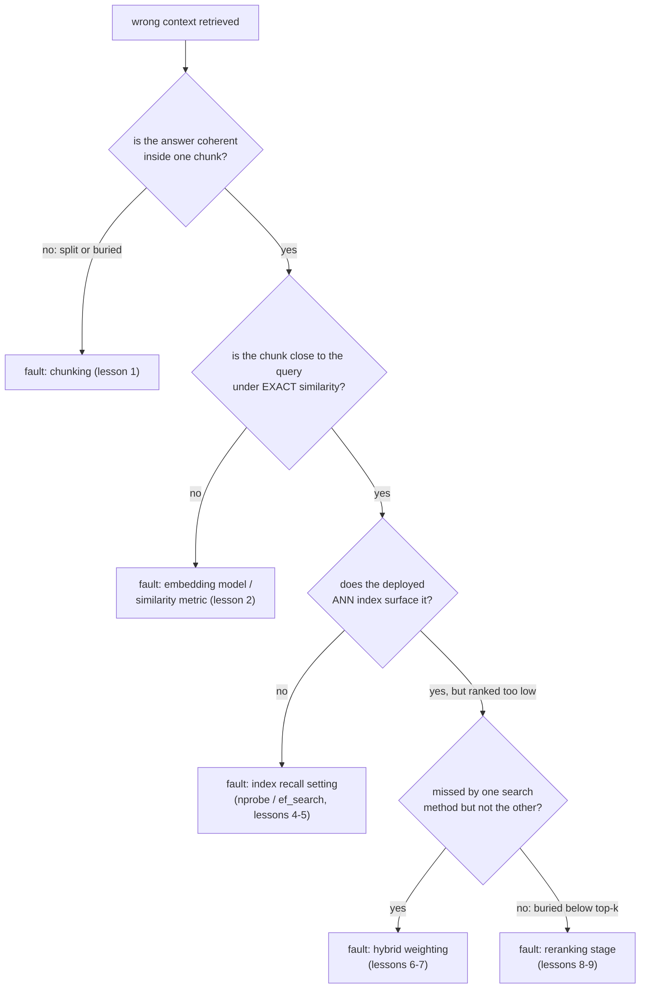

# 第 11 课：诊断流水线

**使命关联:** 这是第 6 阶段的收尾，也是使命的两条成功标准之一：给定错误的检索上下文，指出出问题的阶段，而不是随机地调旋钮，这才把本工作区前面的各个阶段，变成了一套可用的诊断工具。
**主要来源:** [文章：“Evaluation Measures for Search and Recommender Systems”，Pinecone](https://www.pinecone.io/learn/offline-evaluation/)
**前置知识:** [第 10 课](0010-recall-at-k-and-mrr.md)、[文本块](../GLOSSARY.md)

## 热身

1. ▢ MRR 能捕捉到什么是 recall@k 做不到的？

检查

MRR 使用第一个相关结果的确切排名位置，奖励第 1 名远胜于更靠后的名次。Recall@k 只检查相关结果是否落在前 k 名的任何位置，对这个范围内的每个位置一视同仁。

2. ▢ 团队要判断重排序对他们的工作负载是否值回成本，需要度量哪两样东西？

检查

重排序带来的质量提升（在同一个查询集上，有无重排序时的 recall@k 或 MRR），以及在所用候选集规模下它实际增加的延迟，两者都要对照工作负载真实的预算和质量线来检查。

## 要点

### 一个症状有许多可能的原因；诊断要把其中一个隔离出来

“检索到了错误的上下文”是症状，不是诊断。问题可能出在分块（第 1 课）、嵌入模型或相似度度量（第 2 课）、ANN 索引的召回率设置（第 4 和第 5 课）、混合检索的混合比例（第 6 和第 7 课），或者缺失或配置不当的重排序阶段（第 8 和第 9 课）。同时改动其中好几处，然后寄希望于有所改善，既浪费精力，又学不到到底是哪一处坏了；正确的做法是在动任何旋钮之前，按能隔离出故障的顺序逐个阶段检查。

### 先查分块：答案在某一个地方到底存不存在

把本该回答某个已知失败查询的那个（或那几个）实际文本块调出来看。如果相关信息被切在了文本块边界上，答案的两半分处在各自孤立的文本块里，或者被埋在一个主题混杂、稀释了它的嵌入的大文本块里（第 1 课的核心权衡），那么，分块从一开始就没有给出连贯表示的东西，后面任何流水线阶段都检索不出来。这是分块策略的问题，必须在分块阶段修复，而不是靠调整下游的任何东西。

### 再查嵌入，与索引无关

如果分块没问题，下一步要检查的是，正确文本块的嵌入到底是不是真的与查询的嵌入接近，这里要用**精确**相似度（绕过任何 ANN 索引），而不是已部署的搜索路径。如果即使在精确比较下，正确的文本块也离查询很远，那么问题出在嵌入模型或相似度度量（第 2 课），而不是索引：一个嵌入从一开始就没有被放到查询附近的文本块，无论怎么调索引都检索不出来。

### 确认嵌入接近之后，才查索引

如果精确相似度把正确文本块放在了离查询很近的位置，而已部署的 ANN 索引仍然没能把它浮现出来，那么问题很可能出在索引的召回率设置（`ivfflat.probes` 或 `hnsw.ef_search`，第 4 和第 5 课）被调得过于偏向速度。调高这个搜索时参数并重新测试，就能隔离出这是不是原因。

### 最后查混合比例和重排序阶段

如果仅靠向量搜索漏掉了 BM25 本能找到的文本块（或者反过来），而混合检索仍然漏掉了它，那么混合权重（第 6 和第 7 课）可能低估了本来能把它浮现出来的那种方法。如果正确的文本块被混合检索检索到了，但排得太靠后，进不了交给生成的最终前 k 名，而且没有重排序阶段（或者它的候选集或模型没有抓住它），那就指向第 5 阶段（第 8 和第 9 课）。

### 要在一组查询上诊断，而不是靠一个孤例

单个失败的查询可能有误导性：它的失败可能只是由不寻常的措辞引起的偶发情况，而不是系统性的流水线问题。在一小批已知的、有代表性的失败案例上，于每个阶段（仅初始检索、混合融合之后、重排序之后）测量 recall@k 和 MRR（第 10 课），就能看出总体上最大的下降出现在哪里，也就是哪个阶段在系统性地丢失信息，而不是哪个阶段恰好在某个被人注意到的查询上失败了。

## 练习

1. ▢ 一个关于“clause 4.2 termination rights”的查询返回了错误的文本块。调查显示，第 4.2 条被切在了文本块边界上，没有重叠，它讲终止权利的那一半孤零零地留在下一个文本块的开头，周围全是无关内容。是哪个阶段出了问题？为什么后面的阶段无法修复它？

检查

分块。相关信息从一开始就没有得到连贯、可检索的表示：被孤立出来的半条条款，它的嵌入主要反映的是周围的无关内容，而不是针对它的查询所要匹配的终止权利文字。没有任何嵌入模型、索引调优、混合权重或重排序阶段，能检索出分块从未打包进一个其嵌入真正代表它的文本块里的信息。

2. ▢ 一个失败查询的正确文本块，已确认完整且连贯（没有分块问题），但在精确的、非 ANN 的相似度搜索下，它的嵌入离查询的嵌入很远。可能的问题是什么？为什么这就排除了用调整 ANN 索引来修复的可能？

检查

可能的问题是嵌入模型或相似度度量（第 2 课）：该文本块的嵌入从一开始就没有被放到查询的嵌入附近。这就排除了调整 ANN 索引的可能，因为 ANN 索引只是对精确搜索的近似；如果连精确搜索都无法把正确的文本块放到离查询很近的位置，那么对同一个嵌入空间做更快或更彻底的搜索，也修复不了存在于嵌入层面本身的错配。

3. ▢ 精确相似度搜索确认正确文本块的嵌入与查询的接近，但已部署的 ANN 索引没有在前 20 个结果中返回它。可能的问题是什么？你会先检查什么？

检查

可能的问题是 ANN 索引的召回率设置（`ivfflat.probes` 或 `hnsw.ef_search`）被调得过于偏向速度。首先要检查的是调高这个搜索时参数，并重新测试正确的文本块现在是否出现了；如果出现了，原因就是索引在召回率与延迟之间的权衡，而不是嵌入或模型。

4. ▢ 为什么在一小批已知失败的查询上做诊断，并在流水线的每个阶段测量 recall@k，比调试单个孤立的失败更可靠？

检查

单个失败的查询可能因为不寻常的、偶发的原因（古怪的措辞、边界情况）而失败，并不反映系统性的流水线问题。在流水线的每个阶段，针对一批有代表性的已知失败案例测量 recall@k，可以看出总体上最大的落差出现在哪里，指出是哪个阶段在系统性地丢失信息，而不是对恰好被注意到的某一个失败做出反应。

5. ▢ 关于诊断 RAG 流水线的错误检索症状，下列哪项说法正确？

    - a) 可以先调任何一个流水线阶段，因为它们对最终结果的影响相同
    - b) 按顺序检查各个阶段：先查分块，再查与索引无关的嵌入，然后查索引，最后查混合权重和重排序，就能隔离出到底是哪个阶段出了问题
    - c) 单个失败的查询，总是足以作为证据来确定出问题的阶段
    - d) 如果 ANN 索引没有返回正确的文本块，那一定是嵌入模型出了问题

检查

**b)** 这套有序的、能隔离问题的流程，正是诊断与随机调参的区别所在。（a）错误：前面阶段的失败（比如分块）可能让后面每个阶段的调优都变得无关紧要，这就是顺序重要的原因。（c）错误：单个查询失败的原因可能无法推而广之；有代表性的查询集更可靠。（d）错误：必须先检查精确相似度，因为 ANN 索引失败而嵌入确实接近，指向的是索引调优，而不是嵌入模型。

## 实战练习

- [ ] 针对你运行或打算运行的检索流水线，挑一个它处理得不好的查询，沿着本课的逐阶段检查（分块、精确的嵌入相似度、索引召回率、混合权重、重排序）走一遍，直到找到它真正出问题的地方。
- [ ] 为你的语料库建立一小批已知失败的查询，并在不止一个流水线阶段（初始检索，对比任何重排序之后）测量 recall@k，看看总体上最大的落差出现在哪里。
- [ ] 明天：回头看 `README.md` 中本工作区的使命，并用你自己的话确认，你现在能够诊断错误检索的症状，而不是随机调参。

## 延伸阅读

- [文章：“Evaluation Measures for Search and Recommender Systems”，Pinecone](https://www.pinecone.io/learn/offline-evaluation/)
- [文章：“Chunking Strategies for LLM Applications”，Pinecone](https://www.pinecone.io/learn/chunking-strategies/)
- [资源](../RESOURCES.md)

---

没学明白？请重读顶部的主要来源，因为本课是对它的压缩，而理解正是在压缩中流失的。如果有哪个术语觉得含糊，可以查看[术语表](../GLOSSARY.md)。

如果问题出在课程本身，而不是学习材料，那就是一个缺陷：[提交 issue](https://github.com/TokenCemetery/teach/issues)。
