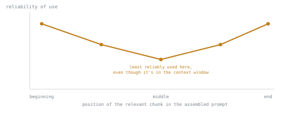

# 第 12 课：提示词构造与上下文窗口预算

**使命关联:** 第 7 阶段开启使命的最后一段：即使检索流水线已经被完美诊断、调优得很好（第 1 到 6 阶段），如果检索到的文本块被糟糕地组装进了提示词，它仍然可能辜负用户，而这是与检索本身不同的一个失败点。
**主要来源:** [论文：“Lost in the Middle: How Language Models Use Long Contexts”，Liu 等，2023](https://arxiv.org/abs/2307.03172)
**前置知识:** [第 11 课](0011-diagnosing-the-pipeline.md)、[文本块](../GLOSSARY.md)

## 热身

1. ▢ 诊断错误的检索上下文时，首先要检查的阶段是哪个？为什么要先于其他一切去检查它？

检查

分块：把本该回答该查询的那个文本块调出来，检查相关信息是否连贯地存在于某一个地方。如果分块把答案切开了或埋起来了，那么后面任何阶段（嵌入、索引、混合权重、重排序）都检索不出一开始就没有得到可用表示的东西。

2. ▢ 为什么在一小批已知失败的查询上做诊断，比调试单个孤立的失败更可靠？

检查

单个失败的查询可能因为不寻常的、偶发的原因而失败，并不反映系统性的问题。在一批有代表性的失败案例上测量 recall@k 和 MRR，可以看出总体上最大的落差出现在哪里，指出是哪个阶段在系统性地丢失信息。

## 要点

### 检索到的文本块只是共享预算中的一项

文本块一旦被检索并排好序（第 1 到 6 阶段），仍然必须成为一份真正的提示词的一部分：通常包括一条系统消息或指令消息、检索到的文本块本身，以及用户自己的问题，这一切都在一个有限的**上下文窗口**之内。这个窗口是一份真实的、共享的预算：检索到的文本块不只是彼此竞争空间，还要与系统提示词、任何对话历史以及问题本身竞争。多检索一些文本块（更大的 *k*），即使每一块都确实相关，也不是免费的，因为每一块都会消耗上下文窗口的预算，而这些预算本来可以给别的东西用，比如更多的对话历史、更长的系统提示词。

### 在提示词里，不等于被用到

模型能否用上一条信息，取决的不只是这条信息在技术上是否出现在上下文窗口里。Liu 等人提出的 **“lost in the middle”（迷失在中间）** 发现表明，模型对放在长上下文最开头或最结尾附近的信息的利用，比埋在中间的信息可靠得多，即使被埋的信息完全在模型所声明的上下文上限之内。一个高度相关的文本块，如果被放在塞满文本块的长提示词的中间，对生成来说可能实际上是看不见的，从而产生一个错误或不完整的答案，看起来像检索失败，其实不是：文本块被正确检索到了，只是没有被放在模型可靠读取的位置。

### 对组装提示词的实际影响

由此直接得出两个结论。第一，为了“保险起见”，把许多边缘的、相关度较低的文本块塞进上下文，代价不止是 token 预算：它可能把一个真正好的文本块埋在提示词中间，让答案变得更差，而不只是更贵。第二，文本块的位置是一个经过考虑的选择，而不是插入顺序的偶然结果：把最相关的文本块（或几个文本块）放在组装好的上下文的开头或结尾附近，而不是拼接之后恰好落在哪里就在哪里，会影响生成是否真正利用了它。

## 练习

1. ▢ 为什么上下文窗口预算是整个请求层面的问题，而不是检索自己就能单独考虑的事？

检查

检索到的文本块与系统提示词、任何对话历史以及用户的问题共用上下文窗口；可供检索文本块使用的预算，取决于请求中其他一切占用了多少，而不只取决于检索质量。

2. ▢ 描述“迷失在中间”现象，以及它对构建 RAG 提示词的一个实际影响。

检查

模型对长上下文开头或结尾的信息的利用，比埋在中间的信息可靠得多，即使它在技术上位于上下文窗口之内。一个实际的影响是：最相关的检索文本块应当放在组装好的提示词的开头或结尾附近，而不是任由拼接顺序恰好把它放在哪里就在哪里，而且往提示词里塞许多边缘的额外文本块，有可能把一个真正有用的文本块埋在中间。

3. ▢ 某团队“为了保险”检索了前 20 个文本块，按相关度顺序排列，但拼接之后，那个最相关的文本块落在了组装好的上下文中间。生成漏掉了一个实际上就在那个文本块里的答案。很可能出了什么问题？有什么办法可以修复？

提示

想一想，这是检索失败，还是发生在检索成功之后的事。

检查

这不是检索失败：正确的文本块被检索到了。这是由迷失在中间效应导致的提示词构造失败，因为最相关的文本块最终被放在了长上下文的中间，而模型在那里利用信息的可靠性最低。一种修复办法：重新排列组装好的提示词，让最相关的文本块位于开头或结尾附近，或者减少包含的文本块数量，让好的那一个不会被埋在许多相关度较低的文本块之中。

4. ▢ 为什么“检索有没有找到正确的文本块”（第 6 阶段的问题）与“组装好的提示词有没有让模型真正用上它”是不同的失败点，尽管两者可能产生相同的症状（最终答案错误）？

检查

第 6 阶段的诊断流程检查的是，正确的文本块是否被检索到，并且排得足够靠前，能够进入生成；它完全是关于到那一步为止的流水线。模型是否真的用上了一个已经进入提示词的文本块，是另一个问题，取决于该文本块在组装好的上下文中的位置，而迷失在中间表明，这与检索质量无关，独立地起作用。错误的答案可能来自任一种失败，但它们需要不同的修复。

5. ▢ 关于 RAG 提示词中的上下文窗口预算和文本块位置，下列哪项说法正确？

    - a) 多检索一些文本块总是更好，因为更多的上下文只会帮到模型
    - b) 技术上位于上下文窗口之内的文本块，无论位置在哪里，都保证会被以同样的方式利用
    - c) 检索到的文本块与请求的其余部分争夺共享的预算，而文本块在组装好的提示词中放在哪里，会影响模型是否真正用上它
    - d) 迷失在中间只影响很长的文档，不影响由若干个单独检索到的文本块组装而成的提示词

检查

**c)** 共享预算和位置这两点，本课都已确立。（a）错误：更多的文本块要花预算，还可能把好的文本块埋在中间，起到的是害处而不是帮助。（b）错误：这正是迷失在中间所推翻的。（d）错误：这种效应针对的是在整个上下文中的位置，无论该上下文来自一篇长文档，还是几个拼接起来的文本块。

## 实战练习

- [ ] 针对你运行或打算运行的 RAG 系统，检查最相关的检索文本块通常落在组装好的提示词的什么位置，这是经过考虑的选择，还是拼接顺序的偶然结果。
- [ ] 针对一个典型的请求，计算你的上下文窗口总预算中，有多少花在了系统提示词和对话历史上，又有多少花在了检索到的文本块上。
- [ ] 明天：对某个生成目前似乎会漏掉相关信息的查询，试着减少你检索的文本块数量，并检查仅此一项是否就改变了答案的质量。

## 延伸阅读

- [论文：“Lost in the Middle: How Language Models Use Long Contexts”，Liu 等，2023](https://arxiv.org/abs/2307.03172)
- [文章：“Evaluation Measures for Search and Recommender Systems”，Pinecone](https://www.pinecone.io/learn/offline-evaluation/)
- [资源](../RESOURCES.md)

---

没学明白？请重读顶部的主要来源，因为本课是对它的压缩，而理解正是在压缩中流失的。如果有哪个术语觉得含糊，可以查看[术语表](../GLOSSARY.md)。

如果问题出在课程本身，而不是学习材料，那就是一个缺陷：[提交 issue](https://github.com/TokenCemetery/teach/issues)。
