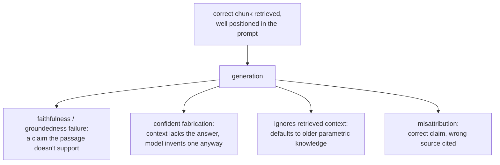

# Lección 13. Lo que la generación todavía hace mal

**Vínculo con la misión:** Esta es la última lección sobre la generación: la recuperación (etapas 1 a 6) y la construcción del prompt (lección 12) pueden tener éxito ambas y la respuesta final seguir siendo errónea, porque la propia generación introduce modos de fallo que ninguna de las etapas anteriores puede corregir ni siquiera detectar.
**Fuente principal:** [Paper: "RAGAS: Automated Evaluation of Retrieval Augmented Generation", Es et al., 2023](https://arxiv.org/abs/2309.15217)
**Requisitos previos:** [Lección 12](0012-prompt-construction-and-context-budget.md), [Chunk](../GLOSSARY.md)

## Calentamiento

1. ▢ ¿Qué muestra el hallazgo "lost in the middle" sobre un chunk que está técnicamente presente en la ventana de contexto?

Comprobación

Estar presente en la ventana de contexto no garantiza que un modelo lo use: la información cercana al principio o al final de un contexto largo se usa con mucha más fiabilidad que la enterrada en el medio, incluso cuando todo está dentro del límite de contexto declarado.

2. ▢ ¿Cuál es la primera etapa que hay que comprobar al diagnosticar un contexto recuperado erróneo, y por qué?

Comprobación

El chunking, que se comprueba primero porque si la información relevante nunca recibió una representación coherente (partida en un límite, enterrada en un chunk de temas mezclados), ninguna etapa posterior, ni embedding, ni índice, ni ponderación híbrida, ni reranking, puede recuperar lo que nunca fue utilizable desde el principio.

## Qué debes saber

### Una recuperación correcta no garantiza una respuesta fiel

Incluso con el pasaje exactamente correcto recuperado y colocado al inicio del prompt (las etapas 1 a 7 funcionando bien), el modelo puede aun así generar una afirmación que el pasaje recuperado no respalda realmente, que lo contradice de plano o que añade un detalle verosímil que no aparece en absoluto en el texto recuperado. Es un fallo de la etapa de generación, a veces llamado falta de **fidelidad** (faithfulness) o de **anclaje** (groundedness): la evidencia estaba presente y bien colocada, pero la respuesta del modelo no se mantuvo atada a ella.

### Responder con seguridad cuando el contexto no cubre la pregunta

Cuando el contexto recuperado carece genuinamente de la respuesta, un resultado legítimo sería que el modelo lo dijera. En cambio, un modelo puede producir igualmente una respuesta segura y verosímil, fabricada y no recuperada. Es posiblemente el fallo de generación más costoso que puede tener un sistema RAG, precisamente porque se ve exactamente como una buena respuesta: nada en su fluidez superficial indica que no esté realmente anclada en nada de lo que el sistema recuperó.

### Ignorar el contexto recuperado a favor de lo que el modelo ya "sabe"

Por lo general, el contexto recuperado está pensado para tratarse como más actual o más específico que lo que el modelo absorbió durante el entrenamiento, que es toda la premisa de la generación aumentada con recuperación en primer lugar. Aun así, un modelo puede recurrir por defecto a su propio conocimiento paramétrico, sobre todo cuando la información recuperada contradice algo que el modelo vio con mucha más frecuencia durante el entrenamiento. Un documento recuperado que dice que una política cambió a 60 días, respondido con la cifra antigua y más vista de 30 días del preentrenamiento, es exactamente este fallo: la información correcta y actual se recuperó y estaba disponible, y el modelo respondió de memoria.

### Atribuir una afirmación a la fuente equivocada

Cuando se proporcionan juntos varios pasajes recuperados, un modelo puede usar la información correcta pero citar la equivocada como su fuente, y confundir qué chunk respalda realmente qué afirmación. Esto importa directamente siempre que el sistema deba mostrar citas: una cita de apariencia verosímil que apunta al pasaje equivocado es un tipo de fallo propio, distinto de si la afirmación subyacente era siquiera correcta.

### Comprobar esto es evaluación de la generación, no evaluación de la recuperación

La etapa 6 diagnosticó si la recuperación encontró y ordenó el chunk correcto. Nada de esa maquinaria comprueba si la respuesta generada se mantuvo realmente fiel a lo recuperado; esa es una pregunta distinta, que se comprueba comparando cada afirmación de la respuesta generada con el contexto recuperado en el que se supone que se apoya, normalmente con un prompt de LLM-as-judge construido específicamente para esa comparación (el diseño de LLM-as-judge y la disciplina de calibración que cubre `llm/evals`, aplicados aquí a una pregunta distinta de si la recuperación tuvo éxito). Construir y defender esa evaluación es territorio de `llm/evals`, enlazado en lugar de repetido aquí; lo que esta lección establece es que la pregunta existe, aparte de todo lo que las etapas 1 a 7 ya comprobaron.

## Práctica

1. ▢ El chunk correcto se recuperó y se colocó cerca del inicio del prompt, pero la respuesta generada incluye un detalle concreto que no aparece en absoluto en el texto recuperado. ¿Es un fallo de recuperación? ¿Qué es en cambio?

Comprobación

No es un fallo de recuperación: el chunk correcto se recuperó y estaba bien colocado. Es un fallo de fidelidad (anclaje) en la etapa de generación, en el que el modelo añadió una afirmación que la evidencia recuperada no respalda realmente.

2. ▢ El contexto recuperado genuinamente no contiene la respuesta a la pregunta, pero el modelo produce igualmente una respuesta segura y verosímil. ¿Por qué se considera el tipo de fallo de generación más costoso en un sistema RAG?

Comprobación

Porque en la superficie es indistinguible de una respuesta genuinamente buena. Una respuesta fabricada pero fluida no da ninguna señal visible de que no esté realmente anclada en el contexto recuperado, a diferencia de una respuesta obviamente rota o sin sentido, lo que la hace mucho más propensa a que se confíe en ella y se actúe sobre ella de forma incorrecta.

3. ▢ Un documento recuperado indica que la política de devoluciones de una empresa cambió a 60 días, pero la respuesta del modelo indica la política antigua de 30 días. ¿Cuál es la causa probable y por qué importa que el contexto recuperado esté pensado, por lo general, para tratarse como autoritativo?

Comprobación

El modelo probablemente recurrió por defecto a su propio conocimiento paramétrico, la cifra más antigua y más vista durante el entrenamiento, en lugar de la información recuperada y más actual. Importa porque la generación aumentada con recuperación existe específicamente para aportar información más actual o específica que la que absorbió el entrenamiento; un modelo que ignora el contexto recuperado a favor de la memoria anula toda la premisa del sistema.

4. ▢ ¿Cómo evaluarías si una respuesta generada es realmente fiel al contexto recuperado, como una pregunta distinta de si la recuperación encontró el contexto correcto en primer lugar?

Comprobación

Comparar cada afirmación de la respuesta generada con el contexto recuperado en el que se supone que se apoya, y comprobar si el contexto la respalda realmente, normalmente con un prompt de LLM-as-judge construido específicamente para esa comparación. Es una comprobación aparte del diagnóstico de recuperación de la etapa 6, ya que asume que se recuperó el contexto correcto y pregunta solo si la respuesta generada se mantuvo anclada en él.

5. ▢ ¿Qué afirmación es cierta sobre los fallos de la etapa de generación en un sistema RAG?

    - a) Solo pueden ocurrir cuando la recuperación ya ha fallado en encontrar el contexto correcto
    - b) Pueden ocurrir incluso cuando la recuperación y la construcción del prompt tuvieron éxito, ya que la fidelidad al contexto recuperado es una propiedad aparte que la generación todavía puede hacer mal
    - c) Atribuir una afirmación al documento fuente equivocado es el mismo fallo que fabricar una afirmación sin respaldo
    - d) Un modelo siempre prefiere el contexto recuperado a su propio conocimiento paramétrico, ya que esa es la razón por la que se añadió la recuperación

Comprobación

**b)** Todos los modos de fallo de esta lección asumían una recuperación correcta y una buena colocación, y ocurrieron igualmente. (a) es falsa: esa es exactamente la distinción que traza esta lección. (c) es falsa: son fallos distintos, uno sobre qué fuente se cita y el otro sobre si la afirmación está respaldada siquiera; un modelo puede atribuir mal una afirmación que por lo demás es correcta y está respaldada. (d) es falsa: un modelo puede recurrir, y a veces recurre, por defecto al conocimiento paramétrico incluso cuando contradice el contexto recuperado, que es exactamente el fallo del ejemplo de la política.

## Prácticas en el mundo real

- [ ] Para un sistema RAG que ejecutes o pienses ejecutar, comprueba a mano un puñado de respuestas generadas contra su contexto recuperado, afirmación por afirmación, y anota si algún detalle carece de respaldo en lo que realmente se recuperó.
- [ ] Encuentra un caso en el que el contexto recuperado genuinamente no cubría una pregunta y comprueba si el sistema lo dijo o fabricó en su lugar una respuesta verosímil.
- [ ] Mañana: vuelve a la misión de este espacio de trabajo en `README.md` y confirma, con tus propias palabras, que ahora puedes diseñar un pipeline de recuperación, diagnosticar qué etapa es la culpable cuando falla y nombrar lo que la propia generación todavía puede hacer mal incluso cuando la recuperación tiene éxito.

## Para profundizar

- [Paper: "RAGAS: Automated Evaluation of Retrieval Augmented Generation", Es et al., 2023](https://arxiv.org/abs/2309.15217)
- [Paper: "Lost in the Middle: How Language Models Use Long Contexts", Liu et al., 2023](https://arxiv.org/abs/2307.03172)
- [Recursos](../RESOURCES.md)

---

¿No termina de quedar claro? Vuelve a leer la fuente principal de arriba, ya que esta lección la comprime y en la compresión es donde se escapa la comprensión. Consulta el [glosario](../GLOSSARY.md) por si algún término te resultó resbaladizo.

Si lo poco claro es la propia lección y no el material, eso es un defecto: [abre un issue](https://github.com/TokenCemetery/teach/issues).
