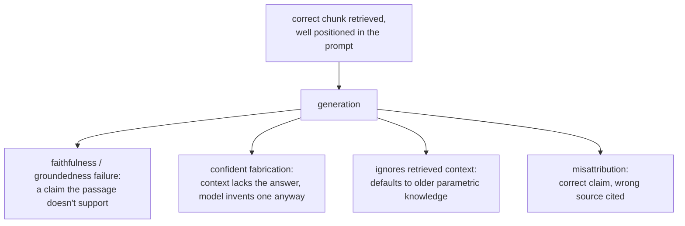

# Leçon 13. Ce que la génération peut encore rater

**Lien avec la mission :** C'est la dernière leçon sur la génération : la récupération (étapes 1 à 6) et la construction du prompt (leçon 12) peuvent toutes deux réussir et la réponse finale peut quand même être fausse, parce que la génération introduit elle-même des modes de défaillance qu'aucune des étapes précédentes ne peut corriger ni même détecter.
**Source primaire :** [Article : "RAGAS: Automated Evaluation of Retrieval Augmented Generation", Es et al., 2023](https://arxiv.org/abs/2309.15217)
**Prérequis :** [Leçon 12](0012-prompt-construction-and-context-budget.md), [Chunk](../GLOSSARY.md)

## Échauffement

1. ▢ Que montre le constat « lost in the middle » à propos d'un chunk techniquement présent dans la fenêtre de contexte ?

Vérifier

Être présent dans la fenêtre de contexte ne garantit pas qu'un modèle l'utilise : l'information près du début ou de la fin d'un long contexte est utilisée bien plus fiablement que celle enfouie au milieu, même quand tout se trouve dans la limite de contexte annoncée.

2. ▢ Quelle est la première étape à vérifier quand on diagnostique un contexte récupéré faux, et pourquoi ?

Vérifier

Le chunking, vérifié en premier parce que si l'information pertinente n'a jamais reçu de représentation cohérente (coupée à cheval sur une frontière, enfouie dans un chunk aux sujets mélangés), aucune étape ultérieure, embedding, index, pondération hybride ou reranking, ne peut récupérer ce qui n'a jamais été exploitable au départ.

## À savoir

### Une récupération correcte ne garantit pas une réponse fidèle

Même avec exactement le bon passage récupéré et placé au début du prompt (les étapes 1 à 7 fonctionnant toutes correctement), le modèle peut encore générer une affirmation que le passage récupéré n'étaye pas réellement, en le contredisant carrément, ou en ajoutant un détail plausible introuvable dans le texte récupéré. C'est une défaillance de l'étape de génération, parfois appelée manque de **fidélité** (faithfulness) ou d'**ancrage** (groundedness) : la preuve était présente et bien positionnée, mais la réponse du modèle n'est pas restée liée à elle.

### Répondre avec assurance quand le contexte ne couvre pas la question

Quand le contexte récupéré ne contient réellement pas la réponse, un résultat légitime serait que le modèle le dise. Au lieu de cela, un modèle peut produire malgré tout une réponse assurée et plausible, fabriquée plutôt que récupérée. C'est sans doute la défaillance de génération la plus coûteuse qu'un système RAG puisse avoir, précisément parce qu'elle ressemble exactement à une bonne réponse : rien dans sa fluidité de surface ne signale qu'elle n'est ancrée dans rien de ce que le système a récupéré.

### Ignorer le contexte récupéré au profit de ce que le modèle « sait » déjà

Le contexte récupéré est généralement censé être traité comme plus actuel ou plus précis que ce que le modèle a absorbé pendant l'entraînement, ce qui est toute la prémisse de la génération augmentée par récupération au départ. Un modèle peut quand même se rabattre sur ses propres connaissances paramétriques, surtout quand l'information récupérée contredit quelque chose que le modèle a vu bien plus souvent pendant l'entraînement. Un document récupéré qui indique qu'une politique est passée à 60 jours, auquel on répond avec l'ancien chiffre de 30 jours, plus couramment vu en préentraînement, est exactement cette défaillance : l'information correcte et actuelle a été récupérée et était disponible, et le modèle a répondu de mémoire.

### Attribuer une affirmation à la mauvaise source

Quand plusieurs passages récupérés sont fournis ensemble, un modèle peut utiliser la bonne information mais citer la mauvaise comme source, en confondant quel chunk étaye réellement quelle affirmation. Cela compte directement dès que le système doit afficher des citations : une citation d'apparence plausible qui pointe vers le mauvais passage est une défaillance à part entière, distincte du fait que l'affirmation sous-jacente soit correcte ou non.

### Vérifier cela, c'est évaluer la génération, pas évaluer la récupération

L'étape 6 a diagnostiqué si la récupération avait trouvé et classé le bon chunk. Rien de cette machinerie ne vérifie si la réponse générée est restée fidèle à ce qui a été récupéré ; c'est une question distincte, que l'on vérifie en comparant chaque affirmation de la réponse générée au contexte récupéré sur lequel elle est censée reposer, couramment avec un prompt de LLM-as-judge construit spécifiquement pour cette comparaison (la conception du LLM-as-judge et la discipline de calibrage que couvre `llm/evals`, appliquées ici à une autre question que celle de savoir si la récupération a réussi). Construire et défendre cette évaluation relève du territoire de `llm/evals`, auquel on renvoie sans le répéter ici ; ce que cette leçon établit, c'est que la question existe tout court, séparément de tout ce que les étapes 1 à 7 ont déjà vérifié.

## Pratique

1. ▢ Le bon chunk a été récupéré et placé près du début du prompt, mais la réponse générée comprend un détail précis qui n'apparaît nulle part dans le texte récupéré. S'agit-il d'un échec de récupération ? De quoi s'agit-il alors ?

Vérifier

Pas un échec de récupération : le bon chunk a été récupéré et bien positionné. C'est une défaillance de fidélité (d'ancrage) à l'étape de génération, où le modèle a ajouté une affirmation que la preuve récupérée n'étaye pas réellement.

2. ▢ Le contexte récupéré ne contient réellement pas la réponse à la question, mais le modèle produit malgré tout une réponse assurée et plausible. Pourquoi est-ce considéré comme le type de défaillance de génération le plus coûteux dans un système RAG ?

Vérifier

Parce qu'elle est indiscernable, en surface, d'une réponse réellement bonne. Une réponse fabriquée mais fluide ne donne aucun signal visible qu'elle n'est pas réellement ancrée dans le contexte récupéré, contrairement à une réponse manifestement cassée ou absurde, ce qui rend bien plus probable qu'on lui fasse confiance et qu'on agisse dessus à tort.

3. ▢ Un document récupéré indique que la politique de retour d'une entreprise est passée à 60 jours, mais la réponse du modèle indique l'ancienne politique de 30 jours. Quelle est la cause probable, et pourquoi importe-t-il que le contexte récupéré soit généralement censé faire autorité ?

Vérifier

Le modèle s'est probablement rabattu sur ses propres connaissances paramétriques, le chiffre plus ancien et plus couramment vu à l'entraînement, au lieu de l'information récupérée, plus actuelle. Cela importe parce que la génération augmentée par récupération existe précisément pour fournir une information plus actuelle ou plus précise que ce que l'entraînement a absorbé ; un modèle qui ignore le contexte récupéré au profit de sa mémoire anéantit toute la prémisse du système.

4. ▢ Comment évalueriez-vous si une réponse générée est réellement fidèle au contexte récupéré, comme une question distincte de celle de savoir si la récupération a trouvé le bon contexte au départ ?

Vérifier

Comparer chaque affirmation de la réponse générée au contexte récupéré sur lequel elle est censée reposer, en vérifiant si le contexte l'étaye réellement, couramment avec un prompt de LLM-as-judge construit spécifiquement pour cette comparaison. C'est une vérification distincte du diagnostic de récupération de l'étape 6, puisqu'elle suppose que le bon contexte a été récupéré et demande seulement si la réponse générée est restée ancrée dedans.

5. ▢ Laquelle de ces affirmations est vraie à propos des défaillances de l'étape de génération dans un système RAG ?

    - a) Elles ne peuvent se produire que lorsque la récupération a déjà échoué à trouver le bon contexte
    - b) Elles peuvent se produire même quand la récupération et la construction du prompt ont toutes deux réussi, puisque la fidélité au contexte récupéré est une propriété distincte que la génération peut encore rater
    - c) Attribuer une affirmation au mauvais document source est la même défaillance que fabriquer une affirmation non étayée
    - d) Un modèle préfère toujours le contexte récupéré à ses propres connaissances paramétriques, puisque c'est la raison pour laquelle la récupération a été ajoutée

Vérifier

**b)** Chaque mode de défaillance de cette leçon supposait une récupération correcte et un bon emplacement, et s'est produit quand même. (a) est fausse : c'est exactement la distinction que trace cette leçon. (c) est fausse : ce sont des défaillances différentes, l'une porte sur la source citée, l'autre sur le fait que l'affirmation soit étayée tout court ; un modèle peut mal attribuer une affirmation par ailleurs correcte et étayée. (d) est fausse : un modèle peut, et parfois le fait, se rabattre sur ses connaissances paramétriques même en contredisant le contexte récupéré, ce qui est exactement la défaillance de l'exemple de politique.

## Exercices en situation réelle

- [ ] Pour un système RAG que vous exploitez ou prévoyez d'exploiter, vérifiez à la main une poignée de réponses générées par rapport à leur contexte récupéré, affirmation par affirmation, et notez si un détail manque de support dans ce qui a réellement été récupéré.
- [ ] Trouvez un cas où le contexte récupéré ne couvrait réellement pas une question, et vérifiez si le système l'a dit ou s'il a fabriqué à la place une réponse plausible.
- [ ] Demain : relisez la mission de cet espace de travail dans `README.md` et confirmez, avec vos propres mots, que vous savez désormais concevoir un pipeline de récupération, diagnostiquer quelle étape est en cause quand il échoue, et nommer ce que la génération elle-même peut encore rater même quand la récupération réussit.

## Pour aller plus loin

- [Article : "RAGAS: Automated Evaluation of Retrieval Augmented Generation", Es et al., 2023](https://arxiv.org/abs/2309.15217)
- [Article : "Lost in the Middle: How Language Models Use Long Contexts", Liu et al., 2023](https://arxiv.org/abs/2307.03172)
- [Ressources](../RESOURCES.md)

---

Ça ne passe pas ? Relisez la source primaire en haut de page, car cette leçon la condense et c'est dans la condensation que la compréhension s'échappe. Consultez le [glossaire](../GLOSSARY.md) pour tout terme qui vous a paru glissant.

Si c'est la leçon elle-même qui n'est pas claire plutôt que la matière, c'est un défaut : [ouvrez une issue](https://github.com/TokenCemetery/teach/issues).
