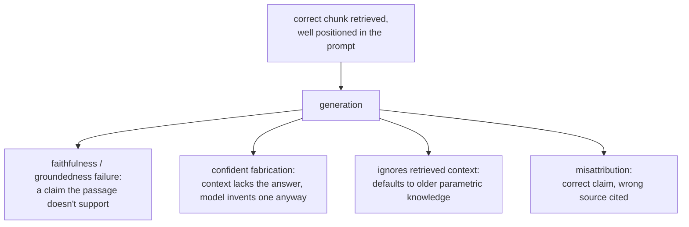

# पाठ 13. Generation अब भी क्या ग़लत करता है

**मिशन से संबंध:** यह generation पर अंतिम पाठ है: retrieval (चरण 1 से 6) और prompt construction (पाठ 12) दोनों सफल हो सकते हैं और अंतिम उत्तर फिर भी ग़लत हो सकता है, क्योंकि generation ख़ुद ऐसी विफलताएँ लाता है जिन्हें पहले का कोई चरण ठीक नहीं कर सकता, पकड़ भी नहीं सकता।
**मुख्य स्रोत:** [पेपर: "RAGAS: Automated Evaluation of Retrieval Augmented Generation", Es et al., 2023](https://arxiv.org/abs/2309.15217)
**पूर्व-आवश्यकताएँ:** [पाठ 12](0012-prompt-construction-and-context-budget.md), [Chunk](../GLOSSARY.md)

## वार्म-अप

1. ▢ "Lost in the middle" की खोज उस chunk के बारे में क्या दिखाती है जो तकनीकी रूप से context window में मौजूद है?

जाँचें

Context window में मौजूद होना इसकी गारंटी नहीं कि model उसे इस्तेमाल करेगा: लंबे context की शुरुआत या अंत के पास की जानकारी बीच में दबी जानकारी से कहीं ज़्यादा भरोसे से इस्तेमाल होती है, तब भी जब सब कुछ बताई गई context सीमा के भीतर हो।

2. ▢ ग़लत retrieved context को diagnose करते समय सबसे पहले कौन-सा चरण जाँचना चाहिए, और क्यों?

जाँचें

Chunking, सबसे पहले इसलिए जाँचा जाता है कि अगर प्रासंगिक जानकारी को कभी सुसंगत प्रतिनिधित्व दिया ही नहीं गया (सीमा के आर-पार बँटी हुई, मिले-जुले विषय वाले chunk में दबी हुई), तो कोई भी बाद का चरण, embedding, index, hybrid weighting या reranking, वह retrieve नहीं कर सकता जो शुरू से इस्तेमाल लायक था ही नहीं।

## यह जानें

### सही retrieval वफ़ादार उत्तर की गारंटी नहीं है

ठीक सही passage retrieve होने और prompt की शुरुआत में रखे जाने के बाद भी (चरण 1 से 7 सब सही चलते हुए), model ऐसा दावा generate कर सकता है जिसे retrieved passage असल में समर्थित नहीं करता, उसे सीधे खंडित करते हुए, या ऐसा विश्वसनीय-सा लगने वाला ब्योरा जोड़ते हुए जो retrieved text में कहीं है ही नहीं। यह generation चरण की विफलता है, जिसे कभी **faithfulness** या **groundedness** की कमी कहा जाता है: सबूत मौजूद था और अच्छी जगह रखा था, पर model का उत्तर उससे बँधा नहीं रहा।

### जब context सवाल को कवर न करे तब भी आत्मविश्वास से उत्तर देना

जब retrieved context में सचमुच उत्तर नहीं होता, तो वैध नतीजा यह होता कि model यही कह दे। इसकी जगह model फिर भी आत्मविश्वासी, विश्वसनीय-सा लगने वाला उत्तर दे सकता है, retrieve किया हुआ नहीं बल्कि गढ़ा हुआ। यह RAG system की शायद सबसे महँगी generation विफलता है, ठीक इसलिए कि वह बिल्कुल अच्छे उत्तर जैसी दिखती है: उसकी सतही प्रवाहशीलता का कोई संकेत नहीं बताता कि वह system के retrieve किए किसी भी चीज़ पर टिकी नहीं है।

### Retrieved context को अनदेखा करके वही कहना जो model पहले से "जानता" है

Retrieved context को आम तौर पर training के दौरान model ने जो सोखा उससे ज़्यादा ताज़ा या ज़्यादा ख़ास माना जाना चाहिए, जो retrieval-augmented generation की पूरी बुनियादी मान्यता ही है। फिर भी model इसकी जगह अपने parametric ज्ञान पर लौट सकता है, ख़ासकर जब retrieved जानकारी उस बात का खंडन करे जो model ने training में कहीं ज़्यादा बार देखी। Retrieved document कहता है कि policy बदलकर 60 दिन हो गई, और उत्तर pretraining के पुराने, ज़्यादा देखे 30-दिन वाले आँकड़े से दिया गया, यह ठीक यही विफलता है: सही, ताज़ा जानकारी retrieve होकर उपलब्ध थी, और model ने उसकी जगह याददाश्त से उत्तर दिया।

### किसी दावे को ग़लत स्रोत का बता देना

जब कई retrieved passages साथ दिए जाते हैं, तो model सही जानकारी इस्तेमाल कर सकता है पर उसके स्रोत के रूप में ग़लत passage को cite कर सकता है, यह गड़बड़ाते हुए कि कौन-सा chunk असल में कौन-सा दावा समर्थित करता है। यह तब सीधे मायने रखता है जब system को citations दिखाने हों: ग़लत passage की ओर इशारा करता विश्वसनीय-सा दिखने वाला citation अपने आप में एक तरह की विफलता है, इससे अलग कि अंतर्निहित दावा भी सही था या नहीं।

### इन्हें जाँचना generation का मूल्यांकन है, retrieval का नहीं

चरण 6 ने diagnose किया कि retrieval को सही chunk मिला और उसे rank किया या नहीं। उस पूरी व्यवस्था में कुछ नहीं जाँचता कि generate किया गया उत्तर retrieve की गई चीज़ों के प्रति वफ़ादार रहा या नहीं; यह अलग सवाल है, जिसे generate किए उत्तर के हर दावे की तुलना उस retrieved context से करके जाँचा जाता है जिस पर उसे टिकना चाहिए, आम तौर पर ख़ास उसी तुलना के लिए बने LLM-as-judge prompt से (वह LLM-as-judge डिज़ाइन और calibration अनुशासन जो `llm/evals` कवर करता है, यहाँ उस सवाल से अलग सवाल पर लगाया गया कि retrieval सफल हुआ या नहीं)। उस मूल्यांकन को बनाना और परखना `llm/evals` का क्षेत्र है, यहाँ दोहराने के बजाय link किया गया; यह पाठ जो स्थापित करता है वह यह है कि वह सवाल अस्तित्व में है ही, चरण 1 से 7 ने जो पहले से जाँचा उससे अलग।

## अभ्यास

1. ▢ सही chunk retrieve हुआ और prompt की शुरुआत के पास रखा गया, पर generate किए गए उत्तर में एक ख़ास ब्योरा है जो retrieved text में कहीं नहीं है। क्या यह retrieval की विफलता है? इसकी जगह यह क्या है?

जाँचें

Retrieval की विफलता नहीं: सही chunk retrieve हुआ और अच्छी जगह रखा गया। यह generation चरण पर faithfulness (groundedness) की विफलता है, जहाँ model ने ऐसा दावा जोड़ा जिसे retrieved सबूत असल में समर्थित नहीं करता।

2. ▢ Retrieved context में सवाल का उत्तर सचमुच नहीं है, पर model फिर भी आत्मविश्वासी, विश्वसनीय-सा लगने वाला उत्तर देता है। इसे RAG system की सबसे महँगी तरह की generation विफलता क्यों माना जाता है?

जाँचें

क्योंकि सतह पर वह सचमुच अच्छे उत्तर से अलग नहीं दिखती। गढ़ा हुआ पर प्रवाहपूर्ण उत्तर कोई दिखने वाला संकेत नहीं देता कि वह retrieved context में असल में टिका नहीं है, साफ़ टूटे या बेतुके जवाब के उलट, जिससे उस पर भरोसा किए जाने और ग़लत ढंग से कार्रवाई किए जाने की संभावना कहीं ज़्यादा होती है।

3. ▢ एक retrieved document कहता है कि कंपनी की return policy बदलकर 60 दिन हो गई, पर model का उत्तर पुरानी 30-दिन की policy बताता है। संभावित कारण क्या है, और यह क्यों मायने रखता है कि retrieved context को आम तौर पर प्रामाणिक माना जाना चाहिए?

जाँचें

Model संभवतः retrieved, ज़्यादा ताज़ा जानकारी की जगह अपने parametric ज्ञान, training के पुराने, ज़्यादा देखे आँकड़े, पर लौट गया। यह इसलिए मायने रखता है कि retrieval-augmented generation ख़ास तौर पर वह जानकारी देने के लिए है जो training में सोखी गई चीज़ से ज़्यादा ताज़ा या ज़्यादा ख़ास हो; जो model retrieved context को अनदेखा कर याददाश्त को तरजीह देता है, वह system की पूरी बुनियादी मान्यता ही बेकार कर देता है।

4. ▢ आप कैसे जाँचेंगे कि generate किया गया उत्तर retrieved context के प्रति असल में वफ़ादार है, उस सवाल से अलग कि retrieval को पहली ही जगह सही context मिला या नहीं?

जाँचें

Generate किए उत्तर के हर दावे की तुलना उस retrieved context से करें जिस पर उसे टिकना चाहिए, यह जाँचते हुए कि context उसे असल में समर्थित करता है या नहीं, आम तौर पर ख़ास उसी तुलना के लिए बने LLM-as-judge prompt से। यह चरण 6 के retrieval diagnosis से अलग जाँच है, क्योंकि वह मानकर चलती है कि सही context retrieve हुआ और सिर्फ़ यह पूछती है कि generate किया गया उत्तर उस पर टिका रहा या नहीं।

5. ▢ RAG system में generation चरण की विफलताओं के बारे में कौन-सा दावा सही है?

    - a) वे सिर्फ़ तब हो सकती हैं जब retrieval पहले ही सही context ढूँढने में विफल हो चुका हो
    - b) वे तब भी हो सकती हैं जब retrieval और prompt construction दोनों सफल रहे हों, क्योंकि retrieved context के प्रति faithfulness एक अलग गुण है जिसे generation अब भी ग़लत कर सकता है
    - c) किसी दावे को ग़लत स्रोत document का बता देना और बिना समर्थन का दावा गढ़ना एक ही विफलता है
    - d) Model हमेशा retrieved context को अपने parametric ज्ञान पर तरजीह देता है, क्योंकि retrieval इसी कारण जोड़ा गया था

जाँचें

**b)** इस पाठ की हर विफलता ने सही retrieval और अच्छी जगह मानी, और फिर भी हुई। (a) ग़लत है: यही वह अंतर है जो यह पाठ खींचता है। (c) ग़लत है: वे अलग विफलताएँ हैं, एक इस बारे में कि कौन-सा स्रोत cite हुआ, दूसरी इस बारे में कि दावा समर्थित है भी या नहीं; model ऐसे दावे को ग़लत स्रोत का बता सकता है जो वैसे सही और समर्थित है। (d) ग़लत है: model कभी-कभी retrieved context का खंडन करते हुए भी parametric ज्ञान पर लौट सकता है और लौटता है, जो ठीक policy वाले उदाहरण की विफलता है।

## असली दुनिया का अभ्यास

- [ ] जो RAG system आप चलाते हैं या चलाने की योजना है, उसके कुछ generate किए उत्तरों को उनके retrieved context से हाथ से, दावे-दर-दावे जाँचें, और नोट करें कि कोई ब्योरा असल में retrieve की गई चीज़ों में समर्थन से रहित है या नहीं।
- [ ] ऐसा मामला ढूँढें जहाँ retrieved context ने सवाल को सचमुच कवर नहीं किया, और जाँचें कि system ने यह कहा या उसकी जगह विश्वसनीय-सा लगने वाला उत्तर गढ़ दिया।
- [ ] कल: `README.md` में इस workspace के मिशन को दोबारा देखें और अपने शब्दों में पुष्टि करें कि अब आप retrieval pipeline डिज़ाइन कर सकते हैं, उसके विफल होने पर diagnose कर सकते हैं कि कौन-सा चरण दोषी है, और बता सकते हैं कि retrieval सफल होने पर भी generation ख़ुद अब भी क्या ग़लत कर सकता है।

## आगे बढ़ने के लिए

- [पेपर: "RAGAS: Automated Evaluation of Retrieval Augmented Generation", Es et al., 2023](https://arxiv.org/abs/2309.15217)
- [पेपर: "Lost in the Middle: How Language Models Use Long Contexts", Liu et al., 2023](https://arxiv.org/abs/2307.03172)
- [संसाधन](../RESOURCES.md)

---

बात नहीं बन रही? ऊपर दिए primary source को दोबारा पढ़ें, क्योंकि यह पाठ उसे संक्षिप्त करता है और समझ संक्षेप में ही रिसती है। जो शब्द फिसलन भरा लगे, उसके लिए [शब्दावली](../GLOSSARY.md) देखें।

अगर दिक़्क़त सामग्री की नहीं बल्कि पाठ की ही है, तो वह एक खोट है: [issue खोलें](https://github.com/TokenCemetery/teach/issues)।
