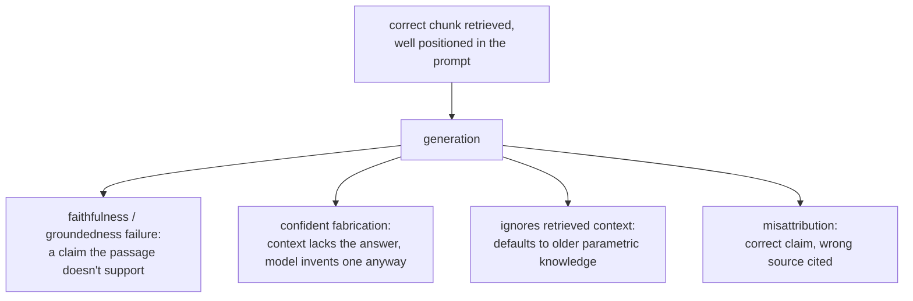

# Lição 13. O que a geração ainda erra

**Ligação com a missão:** Esta é a lição final da missão: a recuperação (etapas 1 a 6) e a construção de prompt (lição 12) podem ambas ter sucesso e a resposta final ainda assim estar errada, porque a própria geração introduz modos de falha que nenhuma das etapas anteriores consegue corrigir nem sequer detectar.
**Fonte principal:** [Artigo científico: "RAGAS: Automated Evaluation of Retrieval Augmented Generation", Es et al., 2023](https://arxiv.org/abs/2309.15217)
**Pré-requisitos:** [Lição 12](0012-prompt-construction-and-context-budget.md), [Chunk](../GLOSSARY.md)

## Aquecimento

1. ▢ O que o achado "lost in the middle" mostra sobre um chunk que está tecnicamente presente na janela de contexto?

Verificação

Estar presente na janela de contexto não garante que o modelo o use: a informação perto do início ou do fim de um contexto longo é usada de forma muito mais confiável do que a informação enterrada no meio, mesmo quando tudo está dentro do limite de contexto declarado.

2. ▢ Qual é a primeira etapa a verificar ao diagnosticar um contexto recuperado errado, e por quê?

Verificação

O chunking, verificado primeiro porque, se a informação relevante nunca recebeu uma representação coerente (dividida por uma fronteira, enterrada em um chunk de assuntos misturados), nenhuma etapa posterior, embedding, índice, ponderação híbrida ou reranking, consegue recuperar aquilo que nunca foi utilizável desde o início.

## Saiba isto

### Uma recuperação correta não garante uma resposta fiel

Mesmo com a passagem exatamente certa recuperada e colocada no início do prompt (etapas 1 a 7 todas funcionando corretamente), o modelo ainda pode gerar uma afirmação que a passagem recuperada de fato não sustenta, contradizendo-a abertamente ou acrescentando um detalhe de aparência plausível que não se encontra em lugar nenhum do texto recuperado. Esta é uma falha da etapa de geração, às vezes chamada de falta de **fidelidade** ou de **groundedness**: a evidência estava presente e bem posicionada, mas a resposta do modelo não permaneceu atrelada a ela.

### Responder com confiança quando o contexto não cobre a pergunta

Quando o contexto recuperado genuinamente não tem a resposta, um desfecho legítimo seria o modelo dizer isso. Em vez disso, um modelo pode produzir mesmo assim uma resposta confiante e de aparência plausível, fabricada e não recuperada. Esta é, possivelmente, a falha de geração mais custosa que um sistema RAG pode ter, justamente porque ela se parece exatamente com uma boa resposta: nada em sua fluência superficial sinaliza que ela não está de fato ancorada em nada do que o sistema recuperou.

### Ignorar o contexto recuperado em favor do que o modelo já "sabe"

O contexto recuperado geralmente deve ser tratado como mais atual ou mais específico do que o que o modelo absorveu durante o treinamento, que é toda a premissa da geração aumentada por recuperação. Mesmo assim, um modelo pode recorrer ao próprio conhecimento paramétrico, especialmente quando a informação recuperada contradiz algo que o modelo viu com muito mais frequência durante o treinamento. Um documento recuperado que informa que uma política mudou para 60 dias, respondido com o valor antigo e mais comumente visto de 30 dias do pré-treinamento, é exatamente essa falha: a informação correta e atual foi recuperada e estava disponível, e o modelo respondeu de memória.

### Atribuir uma afirmação à fonte errada

Quando várias passagens recuperadas são fornecidas juntas, um modelo pode usar a informação certa mas citar a errada como fonte, confundindo qual chunk de fato sustenta qual afirmação. Isso importa diretamente sempre que o sistema precisa mostrar citações: uma citação de aparência plausível que aponta para a passagem errada é um tipo próprio de falha, separado de a afirmação em si estar correta.

### Verificar isso é avaliação da geração, não avaliação da recuperação

A etapa 6 diagnosticou se a recuperação encontrou e ranqueou o chunk certo. Nada dessa maquinaria verifica se a resposta gerada de fato se manteve fiel ao que foi recuperado; essa é uma pergunta distinta, verificada comparando cada afirmação da resposta gerada com o contexto recuperado em que ela deveria se apoiar, comumente com um prompt de LLM-as-judge feito especificamente para essa comparação (a disciplina de design e calibração de LLM-as-judge que `llm/evals` cobre, aplicada aqui a uma pergunta diferente da de a recuperação ter dado certo). Construir e defender essa avaliação é território de `llm/evals`, referenciado em vez de reapresentado aqui; o que esta lição estabelece é que a pergunta existe, separadamente de tudo o que as etapas 1 a 7 já verificaram.

## Prática

1. ▢ O chunk correto foi recuperado e colocado perto do início do prompt, mas a resposta gerada inclui um detalhe específico que não aparece em lugar nenhum do texto recuperado. Isso é uma falha de recuperação? O que é, então?

Verificação

Não é uma falha de recuperação: o chunk correto foi recuperado e bem posicionado. É uma falha de fidelidade (groundedness) na etapa de geração, em que o modelo acrescentou uma afirmação que a evidência recuperada de fato não sustenta.

2. ▢ O contexto recuperado genuinamente não contém a resposta à pergunta, mas o modelo produz mesmo assim uma resposta confiante e de aparência plausível. Por que isso é considerado o tipo mais custoso de falha de geração em um sistema RAG?

Verificação

Porque é indistinguível, na superfície, de uma resposta genuinamente boa. Uma resposta fabricada mas fluente não dá nenhum sinal visível de que não está de fato ancorada no contexto recuperado, ao contrário de uma resposta obviamente quebrada ou sem sentido, o que a torna muito mais provável de ser confiada e usada de forma incorreta.

3. ▢ Um documento recuperado informa que a política de devolução de uma empresa mudou para 60 dias, mas a resposta do modelo informa a antiga política de 30 dias. Qual é a causa provável, e por que importa que o contexto recuperado geralmente deva ser tratado como autoritativo?

Verificação

O modelo provavelmente recorreu ao próprio conhecimento paramétrico, o valor mais antigo e mais comumente visto no treinamento, em vez da informação recuperada, mais atual. Importa porque a geração aumentada por recuperação existe justamente para fornecer informação mais atual ou específica do que a absorvida no treinamento; um modelo que ignora o contexto recuperado em favor da memória anula toda a premissa do sistema.

4. ▢ Como você avaliaria se uma resposta gerada é de fato fiel ao contexto recuperado, como uma pergunta distinta de a recuperação ter encontrado o contexto certo?

Verificação

Comparar cada afirmação da resposta gerada com o contexto recuperado em que ela deveria se apoiar, verificando se o contexto de fato a sustenta, comumente usando um prompt de LLM-as-judge feito especificamente para essa comparação. É uma verificação separada do diagnóstico de recuperação da etapa 6, já que pressupõe que o contexto certo foi recuperado e pergunta apenas se a resposta gerada permaneceu ancorada nele.

5. ▢ Qual afirmação é verdadeira sobre as falhas da etapa de geração em um sistema RAG?

    - a) Elas só podem ocorrer quando a recuperação já falhou em encontrar o contexto certo
    - b) Elas podem ocorrer mesmo quando a recuperação e a construção de prompt tiveram ambas sucesso, já que a fidelidade ao contexto recuperado é uma propriedade separada que a geração ainda pode errar
    - c) Atribuir uma afirmação ao documento-fonte errado é a mesma falha que fabricar uma afirmação sem sustentação
    - d) Um modelo sempre prefere o contexto recuperado ao seu próprio conhecimento paramétrico, já que esse é o motivo pelo qual a recuperação foi adicionada

Verificação

**b)** Todo modo de falha desta lição pressupôs recuperação correta e boa posição, e ainda assim ocorreu. (a) é falsa: é exatamente a distinção que esta lição traça. (c) é falsa: são falhas diferentes, uma sobre qual fonte é citada, a outra sobre se a afirmação é sustentada de algum modo; um modelo pode atribuir incorretamente uma afirmação que, fora isso, é correta e sustentada. (d) é falsa: um modelo pode, e às vezes faz isso, recorrer ao conhecimento paramétrico mesmo contradizendo o contexto recuperado, que é exatamente a falha do exemplo da política.

## Prática no mundo real

- [ ] Para um sistema RAG que você executa ou pretende executar, confira à mão um punhado de respostas geradas contra o contexto recuperado delas, afirmação por afirmação, e anote se algum detalhe não tem sustentação no que foi de fato recuperado.
- [ ] Encontre um caso em que o contexto recuperado genuinamente não cobria uma pergunta e verifique se o sistema disse isso ou fabricou, em vez disso, uma resposta de aparência plausível.
- [ ] Amanhã: revisite a missão deste workspace em `README.md` e confirme, com suas próprias palavras, que agora você consegue projetar um pipeline de recuperação, diagnosticar qual etapa está com defeito quando ele falha e nomear o que a própria geração ainda pode errar mesmo quando a recuperação tem sucesso.

## Para ir além

- [Artigo científico: "RAGAS: Automated Evaluation of Retrieval Augmented Generation", Es et al., 2023](https://arxiv.org/abs/2309.15217)
- [Artigo científico: "Lost in the Middle: How Language Models Use Long Contexts", Liu et al., 2023](https://arxiv.org/abs/2307.03172)
- [Recursos](../RESOURCES.md)

---

Não ficou claro? Releia a fonte principal no topo, já que esta lição a comprime e é na compressão que o entendimento escapa. Consulte o [glossário](../GLOSSARY.md) para qualquer termo que pareceu escorregadio.

Se o problema é a lição em si, e não o material, isso é um defeito: [abra uma issue](https://github.com/TokenCemetery/teach/issues).
