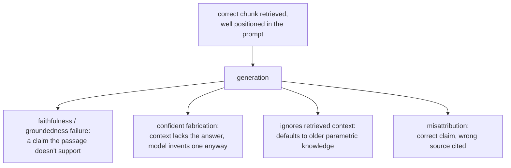

# Урок 13. Что генерация всё ещё делает неверно

**Связь с целью курса:** Это заключительный урок цели курса: и поиск (этапы с 1 по 6), и построение промпта (урок 12) могут удаться, а итоговый ответ всё равно окажется неверным, потому что сама генерация вносит виды сбоев, которые ни один из предыдущих этапов не может ни исправить, ни даже обнаружить.
**Первоисточник:** [Научная статья: "RAGAS: Automated Evaluation of Retrieval Augmented Generation", Es et al., 2023](https://arxiv.org/abs/2309.15217)
**Предварительные требования:** [Урок 12](0012-prompt-construction-and-context-budget.md), [Чанк](../GLOSSARY.md)

## Разминка

1. ▢ Что показывает вывод об эффекте «потерянного в середине» про чанк, формально присутствующий в контекстном окне?

Проверка

Присутствие в контекстном окне не гарантирует, что модель это использует: информация у начала или конца длинного контекста используется заметно надёжнее, чем зарытая в середине, даже если всё укладывается в заявленный предел контекста.

2. ▢ Какой этап проверять первым при диагностике неверного найденного контекста и почему?

Проверка

Чанкинг, его проверяют первым потому, что если нужная информация изначально не получила связного представления (разрезана границей, погребена в чанке со смешанными темами), ни один последующий этап, эмбеддинг, индекс, веса гибридного поиска или реранкинг, не может найти то, что изначально было непригодно.

## Что нужно знать

### Верный поиск не гарантирует достоверный ответ

Даже когда найден в точности верный пассаж и поставлен в начало промпта (этапы с 1 по 7 все работают верно), модель всё равно может сгенерировать утверждение, которое найденный пассаж на самом деле не подтверждает: прямо ему противоречащее или добавляющее правдоподобно звучащую деталь, которой в найденном тексте нет вовсе. Это сбой на этапе генерации, который иногда называют нехваткой **достоверности (faithfulness)** или **обоснованности (groundedness)**: свидетельство было на месте и хорошо расположено, но ответ модели не остался привязан к нему.

### Уверенный ответ, когда контекст не покрывает вопрос

Когда в найденном контексте действительно нет ответа, законным исходом было бы, если бы модель так и сказала. Вместо этого модель всё равно может выдать уверенный, правдоподобно звучащий ответ, выдуманный, а не найденный. Это, пожалуй, самый дорогой сбой генерации, который может быть у RAG-системы, именно потому, что он выглядит точь-в-точь как хороший ответ: ничто в его поверхностной беглости не сигнализирует, что он на самом деле ни на чём из найденного системой не основан.

### Игнорирование найденного контекста в пользу того, что модель уже «знает»

Найденный контекст обычно задуман так, чтобы его считали более актуальным или более конкретным, чем то, что модель усвоила при обучении, и в этом вся предпосылка генерации с дополнением поиском. Модель всё равно может по умолчанию опереться на собственные параметрические знания, особенно когда найденная информация противоречит тому, что модель видела при обучении гораздо чаще. Найденный документ, где сказано, что политика изменилась на 60 дней, а ответ с прежней, чаще виденной в предобучении цифрой в 30 дней, это ровно такой сбой: верная, актуальная информация была найдена и доступна, а модель ответила по памяти.

### Приписывание утверждения не тому источнику

Когда вместе предоставлено несколько найденных пассажей, модель может использовать верную информацию, но сослаться как на источник на неверный пассаж, перепутав, какой чанк на самом деле подтверждает какое утверждение. Это напрямую важно всякий раз, когда системе нужно показывать цитаты: правдоподобно выглядящая цитата, указывающая на неверный пассаж, это отдельный вид сбоя, не зависящий от того, было ли само утверждение верным.

### Проверка этих сбоев это оценка генерации, а не оценка поиска

Этап 6 диагностировал, нашёл ли и поставил ли поиск верный чанк высоко. Ничто из этого механизма не проверяет, остался ли сгенерированный ответ верен найденному; это отдельный вопрос, который проверяют сопоставлением каждого утверждения сгенерированного ответа с найденным контекстом, на котором оно должно держаться, обычно промптом LLM-судьи, построенным именно для такого сопоставления (дисциплина проектирования и калибровки LLM-судьи, которую охватывает `llm/evals`, применённая здесь к другому вопросу, чем то, удался ли поиск). Построение и обоснование такой оценки это территория `llm/evals`, здесь только ссылка без пересказа; этот урок устанавливает, что сам вопрос существует, отдельно от всего, что уже проверили этапы с 1 по 7.

## Практика

1. ▢ Верный чанк найден и поставлен у начала промпта, но в сгенерированном ответе есть конкретная деталь, которой нет нигде в найденном тексте. Это сбой поиска? Чем это является вместо этого?

Проверка

Не сбой поиска: верный чанк был найден и хорошо расположен. Это сбой достоверности (обоснованности) на этапе генерации, где модель добавила утверждение, которое найденное свидетельство на самом деле не подтверждает.

2. ▢ В найденном контексте действительно нет ответа на вопрос, но модель всё равно выдаёт уверенный, правдоподобно звучащий ответ. Почему это считается самым дорогим видом сбоя генерации в RAG-системе?

Проверка

Потому что на поверхности он неотличим от по-настоящему хорошего ответа. Выдуманный, но беглый ответ не даёт видимого сигнала, что он на самом деле не основан на найденном контексте, в отличие от явно сломанного или бессмысленного ответа, и поэтому ему гораздо вероятнее поверят и поступят по нему неверно.

3. ▢ Найденный документ утверждает, что политика возврата компании изменилась на 60 дней, но в ответе модели названа прежняя политика в 30 дней. Какова вероятная причина и почему важно, что найденный контекст обычно задуман как авторитетный?

Проверка

Модель, вероятно, по умолчанию опёрлась на собственные параметрические знания, на прежнюю, чаще виденную при обучении цифру, вместо найденной, более актуальной информации. Это важно потому, что генерация с дополнением поиском существует именно для того, чтобы подавать информацию более актуальную или конкретную, чем усвоенная при обучении; модель, игнорирующая найденный контекст в пользу памяти, сводит на нет всю предпосылку системы.

4. ▢ Как бы вы оценили, действительно ли сгенерированный ответ достоверен относительно найденного контекста, как вопрос, отдельный от того, нашёл ли поиск верный контекст?

Проверка

Сопоставить каждое утверждение сгенерированного ответа с найденным контекстом, на котором оно должно держаться, проверяя, действительно ли контекст его подтверждает, обычно промптом LLM-судьи, построенным именно для такого сопоставления. Это проверка, отдельная от диагностики поиска на этапе 6, поскольку она предполагает, что верный контекст найден, и спрашивает лишь, остался ли сгенерированный ответ привязан к нему.

5. ▢ Какое утверждение верно про сбои этапа генерации в RAG-системе?

    - a) Они могут возникать, только когда поиск уже не нашёл верный контекст
    - b) Они могут возникать, даже когда и поиск, и построение промпта удались, поскольку достоверность найденному контексту это отдельное свойство, в котором генерация всё ещё может ошибиться
    - c) Приписывание утверждения не тому исходному документу это тот же сбой, что выдумывание неподтверждённого утверждения
    - d) Модель всегда предпочитает найденный контекст собственным параметрическим знаниям, поскольку ради этого и добавили поиск

Проверка

**b)** Каждый вид сбоя в этом уроке предполагал верный поиск и хорошее размещение и всё равно происходил. (a) неверно: это как раз то различие, которое проводит этот урок. (c) неверно: это разные сбои, один о том, какой источник процитирован, другой о том, подтверждено ли утверждение вообще; модель может приписать не тому источнику утверждение, которое в остальном верно и подтверждено. (d) неверно: модель может и порой действительно по умолчанию опирается на параметрические знания, даже противореча найденному контексту, что и есть сбой из примера с политикой.

## Практика в реальной работе

- [ ] Для RAG-системы, которую вы запускаете или собираетесь запускать, вручную сверьте горсть сгенерированных ответов с их найденным контекстом, утверждение за утверждением, и отметьте, не лишена ли какая-то деталь опоры в том, что было найдено.
- [ ] Найдите случай, когда найденный контекст действительно не покрывал вопрос, и проверьте, сказала ли об этом система или вместо этого выдумала правдоподобно звучащий ответ.
- [ ] Завтра: вернитесь к цели этой рабочей области в `README.md` и подтвердите своими словами, что теперь умеете спроектировать конвейер поиска, диагностировать, какой этап виноват, когда он сбоит, и назвать, в чём сама генерация всё ещё может ошибиться, даже когда поиск удался.

## Что почитать дальше

- [Научная статья: "RAGAS: Automated Evaluation of Retrieval Augmented Generation", Es et al., 2023](https://arxiv.org/abs/2309.15217)
- [Научная статья: "Lost in the Middle: How Language Models Use Long Contexts", Liu et al., 2023](https://arxiv.org/abs/2307.03172)
- [Ресурсы](../RESOURCES.md)

---

Не доходит? Перечитайте первоисточник в начале: этот урок его сжимает, а при сжатии понимание как раз и теряется. Загляните в [глоссарий](../GLOSSARY.md), если какой-то термин показался скользким.

Если неясен сам урок, а не материал, это дефект: [откройте issue](https://github.com/TokenCemetery/teach/issues).
