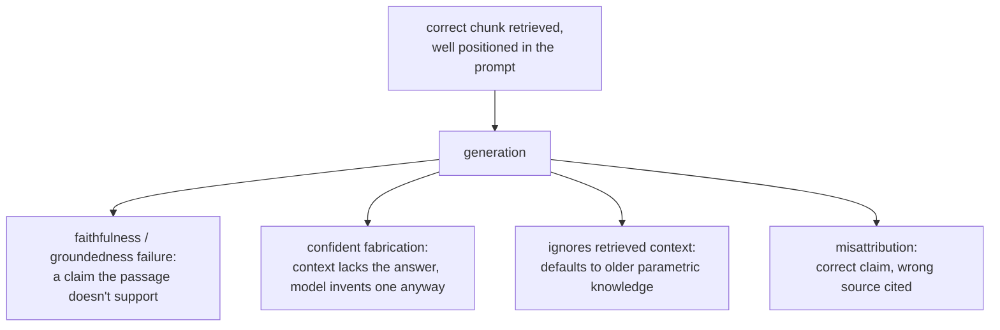

# 第 13 课：生成环节仍会出的错

**使命关联:** 这是关于生成的最后一课：检索（第 1 到 6 阶段）和提示词构造（第 12 课）都可能成功，最终的答案却仍然是错的，因为生成本身会引入一些失败模式，而前面的任何阶段都无法修复，甚至无法察觉。
**主要来源:** [论文：“RAGAS: Automated Evaluation of Retrieval Augmented Generation”，Es 等，2023](https://arxiv.org/abs/2309.15217)
**前置知识:** [第 12 课](0012-prompt-construction-and-context-budget.md)、[文本块](../GLOSSARY.md)

## 热身

1. ▢ “迷失在中间”的发现，对一个在技术上存在于上下文窗口之内的文本块，说明了什么？

检查

存在于上下文窗口之内，并不保证模型会用到它：长上下文开头或结尾附近的信息，比埋在中间的信息被利用得可靠得多，即使一切都在所声明的上下文上限之内。

2. ▢ 诊断错误的检索上下文时，首先要检查的阶段是哪个？为什么？

检查

分块，之所以先查，是因为如果相关信息从一开始就没有得到连贯的表示（被切在边界上，或埋在一个主题混杂的文本块里），那么后面任何阶段，无论是嵌入、索引、混合权重还是重排序，都检索不出一开始就不可用的东西。

## 要点

### 检索正确，并不保证答案忠实

即使检索到了恰好正确的段落，并把它放在提示词的开头（第 1 到 7 阶段全都正常工作），模型仍然可能生成一条检索到的段落并不支持的论断，要么直接与它相矛盾，要么添加一个听起来合理、却在检索到的文本中根本找不到的细节。这是生成阶段的失败，有时被称为缺乏**忠实性**或**有据性**：证据在场，位置也得当，但模型的答案没有始终以它为依据。

### 上下文并未涵盖问题时，仍然自信地作答

当检索到的上下文确实没有答案时，合理的结果应当是模型如实说明。然而，模型仍可能给出一个自信的、听起来合理的答案，那是编造的，而不是检索来的。这可以说是 RAG 系统可能出现的代价最高的生成失败，恰恰因为它看起来与一个好答案毫无区别：它表面上的流畅，没有任何迹象表明它其实并没有以系统检索到的任何东西为依据。

### 忽略检索到的上下文，转而采用模型已经“知道”的内容

检索到的上下文通常本来就应当被视为比模型在训练中吸收的内容更新、更具体，这正是检索增强生成最根本的前提。但模型仍然可能转而默认使用它自己的参数化知识，尤其是当检索到的信息，与模型在训练中见过多得多的某种说法相矛盾时。一份检索到的文档写明政策已改为 60 天，却被用预训练中更常见的旧的 30 天数字来回答，正是这种失败：正确的、最新的信息已被检索到并可以使用，而模型却凭记忆作答。

### 把论断错误地归到了别的来源

当一起提供多个检索到的段落时，模型可能用的是正确的信息，却把错误的段落当作它的出处来引用，搞混了究竟是哪个文本块支持哪条论断。每当系统需要展示引用时，这一点都直接相关：一个看起来合理、却指向错误段落的引用，本身就是一种失败，与底层论断本身是否正确是两回事。

### 检查这些问题属于生成评估，而不是检索评估

第 6 阶段诊断的是检索有没有找到并排好正确的文本块。这套办法都不检查生成的答案是否始终忠实于检索到的内容；那是一个不同的问题，要通过把生成的答案中的每条论断，与它本应依据的检索上下文逐一比对来检查，通常使用专门为这种比对构建的 LLM-as-judge 提示词（即 `llm/evals` 所涵盖的 LLM-as-judge 的设计与校准方法，在这里用于回答一个不同于检索是否成功的问题）。构建并论证这套评估属于 `llm/evals` 的范畴，这里只链接过去，不再重述；本课要确立的是，这个问题本身是存在的，而且与第 1 到 7 阶段已经检查过的一切相互独立。

## 练习

1. ▢ 正确的文本块被检索到了，并放在提示词开头附近，但生成的答案中包含一个在检索到的文本里根本没有出现的具体细节。这是检索失败吗？如果不是，它是什么？

检查

不是检索失败：正确的文本块被检索到了，位置也很好。这是生成阶段的忠实性（有据性）失败，模型添加了一条检索到的证据并不支持的论断。

2. ▢ 检索到的上下文确实不包含问题的答案，但模型仍然给出了一个自信的、听起来合理的答案。为什么这被认为是 RAG 系统中代价最高的一类生成失败？

检查

因为从表面上看，它与一个真正好的答案无法区分。一个编造的、但很流畅的答案，没有任何可见的迹象表明它其实并不以检索到的上下文为依据，不像一个明显出了故障或毫无意义的回复，这使它更有可能被信任，并被错误地据以行动。

3. ▢ 一份检索到的文档写明某公司的退货政策已改为 60 天，但模型的答案却说是旧的 30 天政策。可能的原因是什么？为什么检索到的上下文通常应当被视为权威，这一点很重要？

检查

模型很可能转而默认使用它自己的参数化知识，即训练中见过的、更常见的旧数字，而不是检索到的、更新的信息。这之所以重要，是因为检索增强生成恰恰是为了提供比训练所吸收的内容更新或更具体的信息；一个忽略检索到的上下文、转而凭记忆作答的模型，让整个系统的前提落了空。

4. ▢ 你会如何评估一个生成的答案是否真正忠实于检索到的上下文，把它作为一个有别于检索一开始是否找到了正确上下文的问题？

检查

把生成的答案中的每条论断，与它本应依据的检索上下文逐一比对，检查上下文是否真的支持它，通常使用专门为这种比对构建的 LLM-as-judge 提示词。这与第 6 阶段的检索诊断是分开的检查，因为它假定正确的上下文已经被检索到了，只问生成的答案是否始终以它为依据。

5. ▢ 关于 RAG 系统中生成阶段的失败，下列哪项说法正确？

    - a) 它们只有在检索已经没有找到正确的上下文时才会发生
    - b) 即使检索和提示词构造都成功了，它们也可能发生，因为对检索到的上下文保持忠实，是生成仍可能出错的另一项独立属性
    - c) 把论断错误地归到别的来源文档，与编造一条没有依据的论断是同一种失败
    - d) 模型总是更偏好检索到的上下文，而不是它自己的参数化知识，因为这正是加入检索的原因

检查

**b)** 本课中的每一种失败模式，都是在检索正确、位置良好的前提下仍然发生的。（a）错误：这正是本课所划分的区别。（c）错误：它们是不同的失败，一个是关于引用了哪个来源，另一个是关于这条论断究竟有没有依据；模型可能错误地归属一条原本正确且有依据的论断。（d）错误：模型有时确实会默认使用参数化知识，哪怕它与检索到的上下文相矛盾，这正是那个政策示例中的失败。

## 实战练习

- [ ] 针对你运行或打算运行的 RAG 系统，把少数几个生成的答案逐条论断地对照它们检索到的上下文手工检查，记下是否有任何细节在实际检索到的内容中找不到依据。
- [ ] 找一个检索到的上下文确实没有涵盖某个问题的案例，检查系统是如实说明了，还是转而编造了一个听起来合理的答案。
- [ ] 明天：回头看 `README.md` 中本工作区的使命，并用你自己的话确认，你现在能够设计检索流水线，在它失败时诊断是哪个阶段出了问题，并说出即使检索成功，生成本身仍然可能出什么错。

## 延伸阅读

- [论文：“RAGAS: Automated Evaluation of Retrieval Augmented Generation”，Es 等，2023](https://arxiv.org/abs/2309.15217)
- [论文：“Lost in the Middle: How Language Models Use Long Contexts”，Liu 等，2023](https://arxiv.org/abs/2307.03172)
- [资源](../RESOURCES.md)

---

没学明白？请重读顶部的主要来源，因为本课是对它的压缩，而理解正是在压缩中流失的。如果有哪个术语觉得含糊，可以查看[术语表](../GLOSSARY.md)。

如果问题出在课程本身，而不是学习材料，那就是一个缺陷：[提交 issue](https://github.com/TokenCemetery/teach/issues)。
