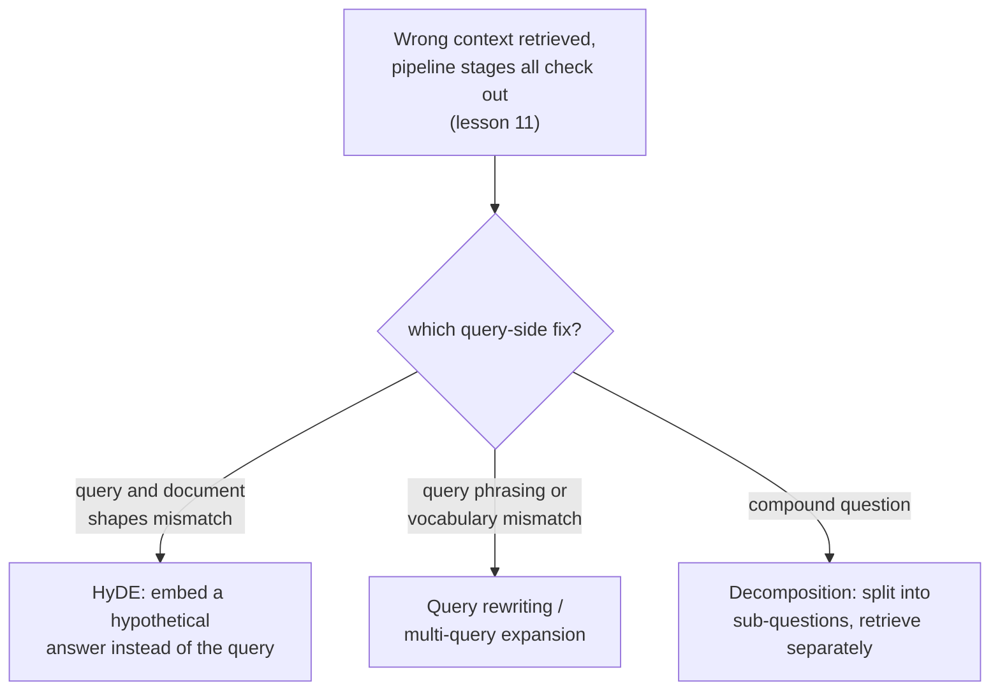

# Lección 14. Transformación del lado de la consulta

**Vínculo con la misión:** La lección 11 dio un procedimiento etapa por etapa para encontrar qué parte de un pipeline de recuperación es la culpable cuando vuelve el contexto equivocado: chunking, embedding, índice, ponderación híbrida, reranking. Nunca se preguntó si el problema era la propia consulta. Esta lección trata de qué hacer cuando todas esas etapas salen limpias y la consulta sigue siendo lo que se interpone entre la necesidad real de un usuario y el contenido real del corpus.
**Fuente principal:** [Paper: "Precise Zero-Shot Dense Retrieval without Relevance Labels" (HyDE), Gao et al., 2022](https://arxiv.org/abs/2212.10496)
**Requisitos previos:** [Lección 11](0011-diagnosing-the-pipeline.md), [Lección 7](0007-reciprocal-rank-fusion.md)

## Calentamiento

1. ▢ ¿Por qué diagnosticar sobre un conjunto pequeño de consultas fallidas conocidas es más fiable que depurar un único fallo anecdótico?

Comprobación

Una sola consulta fallida puede fallar por una razón inusual y aislada que no refleja un problema sistemático del pipeline. Medir la calidad de la recuperación sobre un conjunto representativo de fallos conocidos en cada etapa revela dónde ocurre la mayor caída agregada, en lugar de reaccionar ante el fallo único que alguien notó.

2. ▢ ¿Por qué reciprocal rank fusion combina dos rankings por su posición y no por sus puntuaciones brutas?

Comprobación

Las puntuaciones brutas de un método léxico y las de un método vectorial se calculan en escalas distintas e incomparables; combinarlas directamente dejaría que dominara el método que casualmente produce números mayores, por razones que no tienen nada que ver con la relevancia real. La posición en el ranking es comparable entre ambos métodos sin importar cómo se escalen las puntuaciones subyacentes de cada uno.

## Qué debes saber

### Una consulta y un documento son tipos de texto estructuralmente distintos

La consulta de un usuario suele ser corta, informal y formulada como una pregunta o unas pocas palabras clave; los documentos de un corpus suelen ser largos, formales y formulados como afirmaciones o explicaciones. Generar el embedding de ambos con el mismo modelo y compararlos por similitud asume que esta asimetría no importa, pero una pregunta corta y un pasaje largo que la responde pueden quedar genuinamente lejos en el espacio de embeddings aunque el pasaje sea exactamente lo que la pregunta necesitaba, simplemente porque son textos de formas tan distintas. La **transformación del lado de la consulta** es la solución general: cambiar lo que realmente se convierte en embedding y se busca, en lugar de tocar cualquiera de las etapas del pipeline de la lección 11.

### HyDE: generar el embedding de una respuesta hipotética en lugar de la pregunta

**HyDE (Hypothetical Document Embeddings)** aborda directamente la asimetría entre consulta y documento: dada una consulta, se le pide a un modelo de lenguaje que sigue instrucciones, en zero-shot, que genere un **documento hipotético**, un pasaje imaginado que respondería a la consulta, y ese documento hipotético es lo que realmente se convierte en embedding y se busca en el corpus, no la consulta original. El propio planteamiento del paper es específico sobre por qué esto funciona aunque el documento hipotético sea inventado y pueda contener **detalles factualmente erróneos**: el trabajo del codificador es capturar patrones de relevancia, y su paso de embedding denso actúa como un cuello de botella que filtra los detalles inventados y preserva la similitud temática y de estilo genuina con documentos reales y relevantes. El documento hipotético no tiene que ser verdadero; solo tiene que tener la forma del tipo de pasaje que realmente respondería a la pregunta.

### Reescritura de consultas y expansión de consulta múltiple: cambiar o multiplicar la pregunta, no la respuesta

La **reescritura de consultas** es más directa: un LLM reformula la consulta en bruto del usuario en una consulta de búsqueda más clara y explícita antes de generar su embedding, y resuelve ambigüedades, expande una abreviatura o replantea una pregunta informal con un lenguaje más cercano a cómo es probable que esté redactado el propio corpus. La **expansión de consulta múltiple** va más allá generando varias reformulaciones distintas de la misma pregunta subyacente, recuperando por separado para cada una y fusionando los resultados, a menudo con la misma reciprocal rank fusion que la lección 7 ya cubrió para combinar rankings de distintos métodos de recuperación, ya que aquí los múltiples rankings provienen de múltiples formulaciones de la consulta y no de múltiples métodos. Donde HyDE tiende un puente sobre la asimetría entre consulta y documento, la reescritura y la expansión de consulta múltiple se cubren frente a que una sola formulación de la consulta pase por alto el vocabulario o el enfoque propio del corpus.

### Descomposición: una pregunta compuesta son en realidad varias preguntas disfrazadas de una

Una **pregunta compuesta** pregunta por más de una cosa a la vez ("what's the refund policy, and does it differ for annual subscriptions?"), y un único embedding de toda la pregunta queda, en el mejor de los casos, en algún punto intermedio entre las regiones del corpus que responderían cada parte, cerca de ninguna. La **descomposición de consultas** divide una pregunta compuesta en sus subpreguntas separadas, recupera para cada subpregunta de forma independiente y combina los resultados, de modo que cada parte de la pregunta original tiene su propia oportunidad de caer cerca del pasaje concreto que realmente la responde, en lugar de que todas las partes compitan por estar representadas por un único embedding promediado que no sirve bien a ninguna.

### Diagnosticar la consulta en sí, no solo el pipeline

El procedimiento de la lección 11 pregunta, en orden, si el chunking, el embedding, el índice, la mezcla híbrida y el reranking están cumpliendo cada uno su función. Un fallo del lado de la consulta se ve idéntico desde fuera (se recupera contexto erróneo) pero sobrevive a todas esas comprobaciones: el chunk correcto existe, tiene un embedding razonable, está indexado correctamente y se ordenaría bien con la búsqueda híbrida y el reranking, y aun así la propia consulta, tal como se convirtió en embedding, sigue sin caer cerca de él. Reconocer esto como una sexta posibilidad distinta, en lugar de reajustar una etapa del pipeline que ya es correcta, es lo que la transformación del lado de la consulta existe para arreglar.

## Práctica

1. ▢ Un equipo confirma, con el procedimiento de la lección 11, que el chunk correcto existe, tiene un buen embedding, está bien indexado y se ordenaría alto con la búsqueda híbrida y el reranking. El sistema aun así devuelve el contexto equivocado para una consulta concreta. ¿Qué apunta esto como causa probable?

Pista

Considera qué queda por comprobar una vez confirmadas limpias todas las etapas del pipeline que cubre la lección 11.

Comprobación

La propia consulta, tal como realmente se convirtió en embedding y se buscó, no cae cerca del chunk correcto: un fallo del lado de la consulta y no de una etapa del pipeline. Esta es exactamente la sexta posibilidad que el procedimiento etapa por etapa de la lección 11 no comprueba, ya que todas las etapas que sí comprueba pueden ser genuinamente correctas mientras el embedding de la propia consulta sigue sin acertar.

2. ▢ HyDE genera el embedding de un documento hipotético que puede contener detalles factualmente incorrectos. ¿Por qué esa incorrección no socava su calidad de recuperación?

Comprobación

El paso de embedding denso del codificador actúa como un cuello de botella que filtra los detalles inventados e incorrectos y preserva la similitud temática y de estilo genuina con documentos reales y relevantes; HyDE solo necesita que el documento hipotético tenga la forma de una respuesta real, no que sea factualmente correcto en sí.

3. ▢ Un usuario hace una pregunta compuesta que cubre dos temas sin relación en una sola oración. ¿Por qué generar el embedding de toda la pregunta como un solo vector no sirve bien a ninguno de los dos temas?

Comprobación

Un único embedding de una pregunta compuesta queda en algún punto entre las regiones del corpus que responderían cada parte por separado, cerca de ninguna; descomponer la pregunta en sus subpreguntas separadas y recuperar para cada una de forma independiente da a cada parte su propia oportunidad de caer cerca del pasaje concreto que realmente la responde.

4. ▢ ¿Cómo reutiliza la expansión de consulta múltiple un mecanismo que este espacio de trabajo ya cubrió con otro propósito?

Comprobación

Suele fusionar los resultados de recuperación separados de cada reformulación de la consulta usando reciprocal rank fusion (lección 7), la misma técnica de combinación basada en posiciones que se usó originalmente para combinar un ranking léxico y un ranking vectorial, aplicada aquí en cambio para combinar rankings producidos por múltiples formulaciones de la misma pregunta.

5. ▢ ¿Qué afirmación distingue correctamente a HyDE de la reescritura de consultas y de la expansión de consulta múltiple?

    - a) Las tres técnicas modifican una etapa del pipeline que la lección 11 ya cubre, como el modelo de embeddings o el índice
    - b) HyDE genera el embedding de una respuesta hipotética generada en lugar de la consulta, y tiende un puente sobre la asimetría de forma entre consulta y documento; la reescritura de consultas y la expansión de consulta múltiple reformulan en cambio la propia consulta (o multiplican sus reformulaciones) antes de generar su embedding
    - c) HyDE requiere que el documento hipotético que genera sea factualmente correcto para que la recuperación funcione
    - d) La descomposición de consultas es otro nombre para la expansión de consulta múltiple, sin diferencia relevante

Comprobación

**b)** Esa es la distinción precisa que traza esta lección entre las técnicas. (a) es falsa: todos estos son cambios del lado de la consulta, no modificaciones del chunking, los modelos de embeddings, la indexación ni el reranking. (c) es falsa: el propio planteamiento de HyDE tolera explícitamente detalles factualmente erróneos en el documento hipotético, y confía en que el codificador los filtre. (d) es falsa: la descomposición divide una pregunta compuesta en subpreguntas separadas que se recuperan de forma independiente, mientras que la expansión de consulta múltiple genera varias reformulaciones completas de una misma pregunta.

## Prácticas en el mundo real

- [ ] Para un sistema RAG al que tengas acceso, elige una consulta que devuelva malos resultados y comprueba (con el procedimiento de la lección 11) si todas las etapas del pipeline salen realmente limpias antes de concluir que la culpable es la propia consulta.
- [ ] Prueba a reescribir esa misma consulta de forma más explícita, o a generar a mano una respuesta hipotética al estilo HyDE para ella, y comprueba si alguna de las dos versiones recupera un contexto notablemente mejor.
- [ ] Mañana: lee completa la sección de resultados del paper de HyDE y anota en qué categorías de tareas (búsqueda web, QA, verificación de hechos) encontró que la técnica ayudaba más y menos.

## Para profundizar

- [Paper: "Precise Zero-Shot Dense Retrieval without Relevance Labels" (HyDE), Gao et al., 2022](https://arxiv.org/abs/2212.10496)
- [Recursos](../RESOURCES.md)

---

¿No termina de quedar claro? Vuelve a leer la fuente principal de arriba, ya que esta lección la comprime y en la compresión es donde se escapa la comprensión. Consulta el [glosario](../GLOSSARY.md) por si algún término te resultó resbaladizo.

Si lo poco claro es la propia lección y no el material, eso es un defecto: [abre un issue](https://github.com/TokenCemetery/teach/issues).
