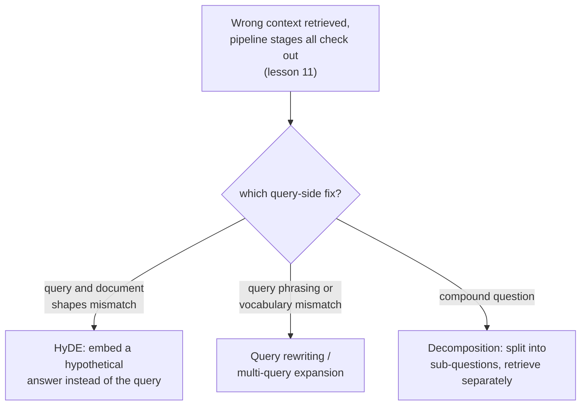

# Leçon 14. Transformation côté requête

**Lien avec la mission :** La leçon 11 a donné une procédure étape par étape pour trouver quelle partie d'un pipeline de récupération est en cause quand le mauvais contexte revient : chunking, embedding, index, pondération hybride, reranking. Elle n'a jamais demandé si la requête elle-même était le problème. Cette leçon explique quoi faire quand chacune de ces étapes s'avère saine et que la requête reste ce qui se dresse entre le besoin réel d'un utilisateur et le contenu réel du corpus.
**Source primaire :** [Article : "Precise Zero-Shot Dense Retrieval without Relevance Labels" (HyDE), Gao et al., 2022](https://arxiv.org/abs/2212.10496)
**Prérequis :** [Leçon 11](0011-diagnosing-the-pipeline.md), [Leçon 7](0007-reciprocal-rank-fusion.md)

## Échauffement

1. ▢ Pourquoi diagnostiquer sur un petit ensemble de requêtes en échec connues est-il plus fiable que de déboguer un seul échec anecdotique ?

Vérifier

Une seule requête en échec peut échouer pour une raison inhabituelle et ponctuelle qui ne reflète pas un problème systémique du pipeline. Mesurer la qualité de la récupération sur un ensemble représentatif d'échecs connus à chaque étape révèle où se produit la plus grosse chute globale, au lieu de réagir à l'échec unique que quelqu'un a remarqué.

2. ▢ Pourquoi la reciprocal rank fusion combine-t-elle deux classements par leur position plutôt que par leurs scores bruts ?

Vérifier

Les scores bruts d'une méthode lexicale et ceux d'une méthode vectorielle sont calculés sur des échelles différentes et incomparables ; les combiner directement laisserait la méthode qui produit les plus grands nombres dominer pour des raisons sans rapport avec la pertinence réelle. La position dans le classement est comparable entre les deux méthodes quelle que soit l'échelle de leurs scores sous-jacents.

## À savoir

### Une requête et un document sont des textes de nature structurellement différente

La requête d'un utilisateur est typiquement courte, informelle, et formulée comme une question ou quelques mots-clés ; les documents d'un corpus sont typiquement longs, formels, et formulés comme des énoncés ou des explications. Calculer l'embedding des deux avec le même modèle et les comparer par similarité suppose que cette asymétrie n'a pas d'importance, mais une question courte et un long passage qui y répond peuvent réellement se trouver loin l'un de l'autre dans l'espace d'embedding, même quand le passage est exactement ce dont la question avait besoin, simplement parce qu'il s'agit de textes de formes si différentes. La **transformation côté requête** est la correction générale : changer ce dont on calcule réellement l'embedding et que l'on cherche, au lieu de toucher à l'une des étapes du pipeline de la leçon 11.

### HyDE : calculer l'embedding d'une réponse hypothétique plutôt que celui de la question

**HyDE (Hypothetical Document Embeddings)** s'attaque directement à l'asymétrie requête-document : pour une requête, on demande en zero-shot à un modèle de langage qui suit les instructions de générer un **document hypothétique**, un passage imaginé qui répondrait à la requête, et c'est ce document hypothétique dont on calcule réellement l'embedding et que l'on cherche dans le corpus, et non la requête d'origine. Le cadrage de l'article lui-même explique précisément pourquoi cela fonctionne alors que le document hypothétique est inventé et peut contenir des **détails factuellement faux** : le rôle de l'encodeur est de capturer des motifs de pertinence, et son étape d'embedding dense agit comme un goulot d'étranglement qui filtre les détails inventés tout en préservant la véritable similarité thématique et stylistique avec des documents réels et pertinents. Le document hypothétique n'a pas à être vrai ; il doit seulement avoir la forme du genre de passage qui répondrait réellement à la question.

### Réécriture de requête et expansion multi-requête : changer ou multiplier la question, pas la réponse

La **réécriture de requête** est plus directe : un LLM reformule la requête brute de l'utilisateur en une requête de recherche plus claire et plus explicite avant le calcul de son embedding, en levant une ambiguïté, en développant une abréviation, ou en reformulant une question informelle dans un langage plus proche de la façon dont le corpus lui-même est vraisemblablement rédigé. L'**expansion multi-requête** va plus loin en générant plusieurs reformulations différentes d'une même question sous-jacente, en récupérant séparément pour chacune, et en fusionnant les résultats, souvent avec la même reciprocal rank fusion que la leçon 7 a déjà couverte pour combiner des classements issus de méthodes de récupération, puisqu'ici les multiples classements viennent de multiples formulations de la requête au lieu de multiples méthodes. Là où HyDE comble l'asymétrie requête-document, la réécriture et l'expansion multi-requête se prémunissent contre le risque qu'une formulation unique de la requête rate le vocabulaire ou le cadrage propre au corpus.

### Décomposition : une question composée, ce sont en réalité plusieurs questions sous un même imperméable

Une **question composée** porte sur plus d'une chose à la fois (« quelle est la politique de remboursement, et diffère-t-elle pour les abonnements annuels ? »), et un embedding unique de toute la question se situe, au mieux, quelque part entre les régions du corpus qui répondraient réellement à chaque partie, proche d'aucune. La **décomposition de requête** découpe une question composée en ses sous-questions distinctes, récupère pour chaque sous-question indépendamment, et combine les résultats, de sorte que chaque partie de la question d'origine a sa propre chance de tomber près du passage précis qui y répond réellement, plutôt que toutes les parties se disputent d'être représentées par un embedding moyen qui n'en sert aucune correctement.

### Diagnostiquer la requête elle-même, pas seulement le pipeline

La procédure de la leçon 11 demande, dans l'ordre, si le chunking, l'embedding, l'index, le mélange hybride et le reranking font chacun leur travail. Un échec côté requête paraît identique de l'extérieur (mauvais contexte récupéré) mais survit à chacune de ces vérifications : le bon chunk existe, a un embedding raisonnable, est correctement indexé et se classerait bien en hybride puis après reranking, et pourtant la requête elle-même, telle qu'on en calcule réellement l'embedding, ne tombe toujours pas près de lui. Reconnaître cela comme une sixième possibilité distincte, plutôt que de dérégler une étape de pipeline déjà correcte, est ce que la transformation côté requête existe pour corriger.

## Pratique

1. ▢ Une équipe confirme, avec la procédure de la leçon 11, que le bon chunk existe, a un bon embedding, est correctement indexé et se classerait haut avec la recherche hybride et le reranking. Le système renvoie quand même le mauvais contexte pour une requête précise. Que retient-on comme cause probable ?

Indice

Réfléchissez à ce qui reste à vérifier une fois confirmées saines toutes les étapes de pipeline que couvre la leçon 11.

Vérifier

La requête elle-même, telle qu'on en calcule réellement l'embedding et qu'on la cherche, ne tombe pas près du bon chunk : un échec côté requête plutôt qu'un échec d'étape du pipeline. C'est exactement la sixième possibilité que la procédure étape par étape de la leçon 11 ne vérifie pas, puisque chaque étape qu'elle vérifie peut réellement être correcte alors que l'embedding de la requête rate quand même.

2. ▢ HyDE calcule l'embedding d'un document hypothétique qui peut contenir des détails factuellement incorrects. Pourquoi cette inexactitude ne compromet-elle pas sa qualité de récupération ?

Vérifier

L'étape d'embedding dense de l'encodeur agit comme un goulot d'étranglement qui filtre les détails inventés et incorrects tout en préservant la véritable similarité thématique et stylistique avec de vrais documents pertinents ; HyDE a seulement besoin que le document hypothétique ait la forme d'une vraie réponse, pas qu'il soit lui-même factuellement correct.

3. ▢ Un utilisateur pose une question composée qui couvre deux sujets sans rapport dans une seule phrase. Pourquoi calculer l'embedding de toute la question comme un seul vecteur ne sert-il aucun des deux sujets correctement ?

Vérifier

Un embedding unique d'une question composée se situe quelque part entre les régions du corpus qui répondraient à chaque partie séparément, proche d'aucune ; décomposer la question en ses sous-questions distinctes et récupérer pour chacune indépendamment donne à chaque partie sa propre chance de tomber près du passage précis qui y répond réellement.

4. ▢ Comment l'expansion multi-requête réutilise-t-elle un mécanisme que cet espace de travail a déjà couvert dans un autre but ?

Vérifier

Elle fusionne couramment les résultats de récupération séparés de chaque reformulation de la requête avec la reciprocal rank fusion (leçon 7), la même technique de combinaison par rangs utilisée à l'origine pour combiner un classement lexical et un classement vectoriel, appliquée ici à la combinaison de classements produits par plusieurs formulations de la même question.

5. ▢ Laquelle de ces affirmations distingue correctement HyDE de la réécriture de requête et de l'expansion multi-requête ?

    - a) Les trois techniques modifient une étape du pipeline déjà couverte par la leçon 11, comme le modèle d'embedding ou l'index
    - b) HyDE calcule l'embedding d'une réponse hypothétique générée au lieu de celui de la requête, ce qui comble l'asymétrie de forme requête-document ; la réécriture de requête et l'expansion multi-requête reformulent (ou multiplient les reformulations de) la requête elle-même avant d'en calculer l'embedding
    - c) HyDE exige que le document hypothétique qu'il génère soit factuellement correct pour que la récupération fonctionne
    - d) La décomposition de requête est un autre nom de l'expansion multi-requête, sans différence significative

Vérifier

**b)** C'est la distinction précise que cette leçon trace entre les techniques. (a) est fausse : toutes sont des changements côté requête, pas des modifications du chunking, des modèles d'embedding, de l'indexation ou du reranking. (c) est fausse : le cadrage de HyDE tolère explicitement des détails factuellement faux dans le document hypothétique, en comptant sur l'encodeur pour les filtrer. (d) est fausse : la décomposition découpe une question composée en sous-questions distinctes récupérées indépendamment, alors que l'expansion multi-requête génère plusieurs reformulations complètes d'une même question.

## Exercices en situation réelle

- [ ] Pour un système RAG auquel vous avez accès, choisissez une requête qui renvoie de mauvais résultats, et vérifiez (avec la procédure de la leçon 11) que chaque étape du pipeline est bien saine avant de conclure que la requête elle-même est en cause.
- [ ] Essayez de réécrire cette même requête de façon plus explicite, ou de générer à la main une réponse hypothétique de style HyDE pour elle, et voyez si l'une ou l'autre version récupère un contexte nettement meilleur.
- [ ] Demain : lisez en entier la section des résultats de l'article sur HyDE, et notez pour quelles catégories de tâches (recherche web, questions-réponses, vérification de faits) il a constaté que la technique aidait le plus et le moins.

## Pour aller plus loin

- [Article : "Precise Zero-Shot Dense Retrieval without Relevance Labels" (HyDE), Gao et al., 2022](https://arxiv.org/abs/2212.10496)
- [Ressources](../RESOURCES.md)

---

Ça ne passe pas ? Relisez la source primaire en haut de page, car cette leçon la condense et c'est dans la condensation que la compréhension s'échappe. Consultez le [glossaire](../GLOSSARY.md) pour tout terme qui vous a paru glissant.

Si c'est la leçon elle-même qui n'est pas claire plutôt que la matière, c'est un défaut : [ouvrez une issue](https://github.com/TokenCemetery/teach/issues).
