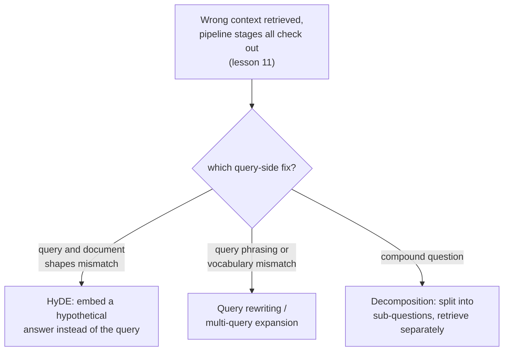

# पाठ 14. Query-Side Transformation

**मिशन से संबंध:** पाठ 11 ने चरण-दर-चरण प्रक्रिया दी कि ग़लत context लौटने पर retrieval pipeline का कौन-सा हिस्सा दोषी है: chunking, embedding, index, hybrid weighting, reranking। उसने कभी नहीं पूछा कि क्या query ख़ुद ही समस्या थी। यह पाठ बताता है कि तब क्या करें जब उन सब चरणों की जाँच साफ़ निकले और query अब भी उपयोगकर्ता की असली ज़रूरत और corpus की असली सामग्री के बीच खड़ी रहे।
**मुख्य स्रोत:** [पेपर: "Precise Zero-Shot Dense Retrieval without Relevance Labels" (HyDE), Gao et al., 2022](https://arxiv.org/abs/2212.10496)
**पूर्व-आवश्यकताएँ:** [पाठ 11](0011-diagnosing-the-pipeline.md), [पाठ 7](0007-reciprocal-rank-fusion.md)

## वार्म-अप

1. ▢ ज्ञात-विफल queries के छोटे सेट पर diagnose करना किसी एक किस्से जैसी विफलता को debug करने से ज़्यादा भरोसेमंद क्यों है?

जाँचें

कोई एक विफल query किसी असामान्य, एक-बारगी कारण से विफल हो सकती है जो व्यवस्थागत pipeline समस्या को नहीं दर्शाता। हर चरण पर ज्ञात विफलताओं के प्रतिनिधि सेट पर retrieval की गुणवत्ता मापना दिखाता है कि कुल मिलाकर सबसे बड़ी गिरावट कहाँ होती है, बजाय उस अकेली विफलता पर प्रतिक्रिया करने के जिसे किसी ने संयोग से नोटिस कर लिया।

2. ▢ Reciprocal rank fusion दो rankings को उनके कच्चे scores की जगह उनकी rank स्थिति से क्यों मिलाता है?

जाँचें

Lexical तरीक़े के कच्चे scores और vector तरीक़े के कच्चे scores अलग, बेमेल पैमानों पर निकलते हैं; उन्हें सीधे मिलाने से जो तरीक़ा संयोग से बड़ी संख्याएँ देता है वह ऐसे कारणों से हावी हो जाता जिनका असली प्रासंगिकता से कोई लेना-देना नहीं। Rank स्थिति दोनों तरीक़ों में तुलनीय है, चाहे हर एक के अंदर के scores का पैमाना कैसा भी हो।

## यह जानें

### Query और document संरचनात्मक रूप से अलग तरह के text हैं

उपयोगकर्ता की query आम तौर पर छोटी, अनौपचारिक होती है और सवाल या कुछ keywords के रूप में लिखी जाती है; corpus के documents आम तौर पर लंबे, औपचारिक होते हैं और कथनों या व्याख्याओं के रूप में लिखे जाते हैं। दोनों को एक ही model से embed करके similarity से तुलना करना मानकर चलता है कि यह असमानता मायने नहीं रखती, पर छोटा सवाल और उसका उत्तर देने वाला लंबा passage embedding space में सचमुच दूर बैठ सकते हैं, भले ही passage ठीक वही हो जो सवाल को चाहिए था, सिर्फ़ इसलिए कि वे text के इतने अलग-अलग आकार के टुकड़े हैं। **Query-side transformation** सामान्य इलाज है: जो असल में embed और search होता है उसे बदलें, पाठ 11 के pipeline चरणों में से किसी को छुए बिना।

### HyDE: सवाल की जगह काल्पनिक उत्तर को embed करें

**HyDE (Hypothetical Document Embeddings)** query-document की असमानता को सीधे संबोधित करता है: query दी हो तो instruction-follow करने वाले language model से, zero-shot, एक **काल्पनिक document** generate करने को कहा जाता है, यानी कल्पित passage जो query का उत्तर देता, और वही काल्पनिक document असल में embed होकर corpus के विरुद्ध search होता है, मूल query नहीं। पेपर का अपना तर्क ठीक बताता है कि यह तब भी क्यों काम करता है जब काल्पनिक document गढ़ा हुआ है और उसमें **तथ्यात्मक रूप से ग़लत ब्योरे** हो सकते हैं: encoder का काम relevance के पैटर्न पकड़ना है, और उसका dense embedding चरण एक bottleneck की तरह गढ़े हुए ब्योरों को छान देता है जबकि असली, प्रासंगिक documents से विषय और शैली की असली समानता बचाए रखता है। काल्पनिक document का सच होना ज़रूरी नहीं; उसे बस उस तरह के passage जैसा आकार भर चाहिए जो असल में सवाल का उत्तर देता।

### Query rewriting और multi-query expansion: सवाल को बदलें या गुणा करें, उत्तर को नहीं

**Query rewriting** ज़्यादा सीधा है: LLM उपयोगकर्ता की कच्ची query को embed होने से पहले ज़्यादा स्पष्ट, ज़्यादा सुस्पष्ट search query में दोबारा गढ़ता है, अस्पष्टता सुलझाते हुए, संक्षिप्त रूप को फैलाते हुए, या अनौपचारिक सवाल को उस भाषा के क़रीब दोबारा कहते हुए जिसमें corpus ख़ुद लिखा होने की संभावना है। **Multi-query expansion** और आगे जाता है: वह एक ही अंतर्निहित सवाल के कई अलग पुनर्कथन generate करता है, हर एक के लिए अलग से retrieve करता है, और नतीजों को मिलाता है, अक्सर उसी reciprocal rank fusion से जो पाठ 7 में retrieval तरीक़ों के आर-पार rankings मिलाने के लिए पहले ही आया था, क्योंकि यहाँ कई rankings कई तरीक़ों से नहीं बल्कि query की कई शब्दावलियों से आती हैं। जहाँ HyDE query-document की असमानता पाटता है, वहाँ rewriting और multi-query expansion इस जोखिम से बचाव करते हैं कि query की कोई एक शब्दावली corpus की अपनी शब्दावली या ढाँचे को चूक जाए।

### Decomposition: मिला-जुला सवाल असल में कई सवाल हैं जो एक लबादे में लिपटे हैं

**मिला-जुला सवाल (compound question)** एक साथ एक से ज़्यादा चीज़ों के बारे में पूछता है ("refund policy क्या है, और क्या वह annual subscriptions के लिए अलग है?"), और पूरे सवाल की एक अकेली embedding, ज़्यादा से ज़्यादा, corpus के उन क्षेत्रों के बीच कहीं बैठती है जो हर हिस्से का उत्तर अलग से देते, किसी के भी पास नहीं। **Query decomposition** मिले-जुले सवाल को उसके अलग उप-सवालों में तोड़ता है, हर उप-सवाल के लिए स्वतंत्र रूप से retrieve करता है, और नतीजे मिलाता है, ताकि मूल सवाल के हर हिस्से को उस ख़ास passage के पास आने का अपना मौक़ा मिले जो असल में उसका उत्तर देता है, बजाय इसके कि सभी हिस्से एक औसत embedding से दर्शाए जाने की होड़ करें जो उनमें से किसी का भला नहीं करती।

### Query को ख़ुद diagnose करना, सिर्फ़ pipeline को नहीं

पाठ 11 की प्रक्रिया क्रम से पूछती है कि chunking, embedding, index, hybrid मिश्रण और reranking, हर एक अपना काम कर रहा है या नहीं। Query-side विफलता बाहर से बिल्कुल एक-जैसी दिखती है (ग़लत context retrieve हुआ) पर उन सब जाँचों से बच निकलती है: सही chunk मौजूद है, ठीक-ठाक embed हुआ है, सही index हुआ है, और hybrid व reranked होकर अच्छा rank करता, फिर भी query ख़ुद, जैसी असल में embed हुई, उसके पास नहीं पहुँचती। इसे एक अलग, छठी संभावना के रूप में पहचानना, बजाय पहले से सही pipeline चरण को दोबारा tune करने के, ठीक वही है जिसे ठीक करने के लिए query-side transformation है।

## अभ्यास

1. ▢ एक टीम पाठ 11 की प्रक्रिया से पुष्टि करती है कि सही chunk मौजूद है, अच्छी तरह embed हुआ है, सही index हुआ है, और hybrid search व reranking में ऊँचा rank करता। फिर भी system किसी ख़ास query के लिए ग़लत context लौटाता है। यह संभावित कारण के रूप में किसे सामने लाता है?

संकेत

विचार करें कि पाठ 11 के हर pipeline चरण के साफ़ पुष्ट हो जाने के बाद जाँचने को क्या बचता है।

जाँचें

Query ख़ुद, जैसी असल में embed और search हुई, सही chunk के पास नहीं पहुँचती, यानी pipeline-चरण की विफलता नहीं बल्कि query-side विफलता। यह ठीक वही छठी संभावना है जिसे पाठ 11 की चरण-दर-चरण प्रक्रिया नहीं जाँचती, क्योंकि जिन चरणों को वह जाँचती है वे सब सचमुच सही हो सकते हैं जबकि query की अपनी embedding फिर भी चूक जाए।

2. ▢ HyDE ऐसे काल्पनिक document को embed करता है जिसमें तथ्यात्मक रूप से ग़लत ब्योरे हो सकते हैं। यह ग़लती उसकी retrieval गुणवत्ता को कमज़ोर क्यों नहीं करती?

जाँचें

Encoder का dense embedding चरण एक bottleneck की तरह गढ़े हुए, ग़लत ब्योरों को छान देता है जबकि असली प्रासंगिक documents से विषय और शैली की असली समानता बचाए रखता है; HyDE को बस इतना चाहिए कि काल्पनिक document असली उत्तर जैसा आकार रखे, ख़ुद तथ्यात्मक रूप से सही होना ज़रूरी नहीं।

3. ▢ एक उपयोगकर्ता एक वाक्य में दो असंबंधित विषयों को कवर करने वाला मिला-जुला सवाल पूछता है। पूरे सवाल को एक vector के रूप में embed करना किसी भी विषय का भला क्यों नहीं करता?

जाँचें

मिले-जुले सवाल की एक अकेली embedding corpus के उन क्षेत्रों के बीच कहीं बैठती है जो हर हिस्से का उत्तर अलग से देते, किसी के भी पास नहीं; सवाल को उसके अलग उप-सवालों में तोड़ना और हर एक के लिए स्वतंत्र रूप से retrieve करना हर हिस्से को उस ख़ास passage के पास आने का अपना मौक़ा देता है जो असल में उसका उत्तर देता है।

4. ▢ Multi-query expansion उस व्यवस्था को कैसे दोबारा इस्तेमाल करता है जो इस workspace में अलग उद्देश्य के लिए पहले ही आ चुकी है?

जाँचें

वह आम तौर पर हर query पुनर्कथन के अलग retrieval नतीजों को reciprocal rank fusion (पाठ 7) से मिलाता है, वही rank-आधारित संयोजन तकनीक जो मूल रूप से lexical ranking और vector ranking को मिलाने के लिए थी, यहाँ एक ही सवाल की कई शब्दावलियों से बनी rankings को मिलाने के लिए लगाई गई।

5. ▢ कौन-सा दावा HyDE को query rewriting और multi-query expansion से सही ढंग से अलग करता है?

    - a) तीनों तकनीकें पाठ 11 में पहले से आए किसी pipeline चरण, जैसे embedding model या index, को बदलती हैं
    - b) HyDE query की जगह generate किया हुआ काल्पनिक उत्तर embed करता है, query-document के आकार की असमानता पाटते हुए; query rewriting और multi-query expansion इसकी जगह query को ही (या उसके पुनर्कथनों को गुणा करके) embed करने से पहले दोबारा गढ़ते हैं
    - c) HyDE को retrieval काम करने के लिए अपने generate किए काल्पनिक document का तथ्यात्मक रूप से सही होना ज़रूरी है
    - d) Query decomposition multi-query expansion का ही दूसरा नाम है, कोई सार्थक अंतर नहीं

जाँचें

**b)** यही वह ठीक अंतर है जो यह पाठ तकनीकों के बीच खींचता है। (a) ग़लत है: ये सब query-side बदलाव हैं, chunking, embedding models, indexing या reranking में बदलाव नहीं। (c) ग़लत है: HyDE का अपना तर्क साफ़ तौर पर काल्पनिक document में तथ्यात्मक रूप से ग़लत ब्योरे सहता है, और encoder पर निर्भर है कि वह उन्हें छान दे। (d) ग़लत है: decomposition एक मिले-जुले सवाल को अलग उप-सवालों में बाँटता है जिन्हें स्वतंत्र रूप से retrieve किया जाता है, जबकि multi-query expansion एक सवाल के कई पूरे पुनर्कथन बनाता है।

## असली दुनिया का अभ्यास

- [ ] जिस RAG system तक आपकी पहुँच है, उसके लिए कोई ऐसी query चुनें जो ख़राब नतीजे देती है, और query को ही दोषी ठहराने से पहले (पाठ 11 की प्रक्रिया से) जाँचें कि हर pipeline चरण असल में साफ़ निकलता है या नहीं।
- [ ] उसी query को ज़्यादा स्पष्ट रूप से दोबारा लिखकर आज़माएँ, या उसके लिए हाथ से HyDE-शैली का काल्पनिक उत्तर बनाएँ, और देखें कि कोई भी रूप उल्लेखनीय रूप से बेहतर context retrieve करता है या नहीं।
- [ ] कल: HyDE पेपर का नतीजों वाला खंड पूरा पढ़ें, और नोट करें कि उसने किन task श्रेणियों (web search, QA, fact verification) में तकनीक को सबसे ज़्यादा और सबसे कम मददगार पाया।

## आगे बढ़ने के लिए

- [पेपर: "Precise Zero-Shot Dense Retrieval without Relevance Labels" (HyDE), Gao et al., 2022](https://arxiv.org/abs/2212.10496)
- [संसाधन](../RESOURCES.md)

---

बात नहीं बन रही? ऊपर दिए primary source को दोबारा पढ़ें, क्योंकि यह पाठ उसे संक्षिप्त करता है और समझ संक्षेप में ही रिसती है। जो शब्द फिसलन भरा लगे, उसके लिए [शब्दावली](../GLOSSARY.md) देखें।

अगर दिक़्क़त सामग्री की नहीं बल्कि पाठ की ही है, तो वह एक खोट है: [issue खोलें](https://github.com/TokenCemetery/teach/issues)।
