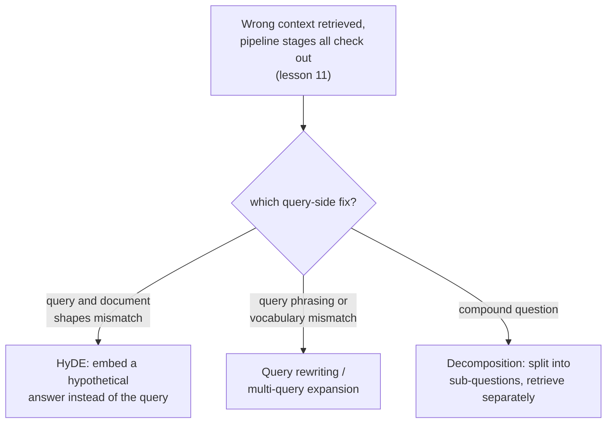

# Lição 14. Transformação do lado da consulta

**Ligação com a missão:** A lição 11 deu um procedimento etapa por etapa para descobrir qual parte de um pipeline de recuperação está com defeito quando volta o contexto errado: chunking, embedding, o índice, ponderação híbrida, reranking. Ela nunca perguntou se o problema era a própria consulta. Esta lição é o que fazer quando cada uma dessas etapas se revela limpa e a consulta ainda é o que se interpõe entre a necessidade real de um usuário e o conteúdo real do corpus.
**Fonte principal:** [Artigo científico: "Precise Zero-Shot Dense Retrieval without Relevance Labels" (HyDE), Gao et al., 2022](https://arxiv.org/abs/2212.10496)
**Pré-requisitos:** [Lição 11](0011-diagnosing-the-pipeline.md), [Lição 7](0007-reciprocal-rank-fusion.md)

## Aquecimento

1. ▢ Por que diagnosticar sobre um pequeno conjunto de consultas que sabidamente falham é mais confiável do que depurar uma única falha anedótica?

Verificação

Uma única consulta que falha pode falhar por um motivo incomum e pontual que não reflete um problema sistêmico do pipeline. Medir a qualidade da recuperação sobre um conjunto representativo de falhas conhecidas em cada etapa revela onde ocorre a maior queda agregada, em vez de reagir a qualquer falha isolada que alguém por acaso notou.

2. ▢ Por que a reciprocal rank fusion combina dois rankings pela posição deles e não pelas pontuações brutas?

Verificação

As pontuações brutas de um método lexical e as de um método vetorial são calculadas em escalas diferentes e incomparáveis; combiná-las diretamente deixaria o método que por acaso produz números maiores dominar por motivos que nada têm a ver com a relevância real. A posição no ranking é comparável entre os dois métodos, independentemente de como as pontuações subjacentes de cada um são escaladas.

## Saiba isto

### Uma consulta e um documento são tipos de texto estruturalmente diferentes

A consulta de um usuário costuma ser curta, informal e formulada como uma pergunta ou algumas palavras-chave; os documentos de um corpus costumam ser longos, formais e formulados como afirmações ou explicações. Gerar o embedding de ambos com o mesmo modelo e compará-los por similaridade pressupõe que essa assimetria não importa, mas uma pergunta curta e uma passagem longa que a responde podem genuinamente ficar distantes no espaço de embeddings mesmo quando a passagem é exatamente o que a pergunta precisava, simplesmente por serem textos de formatos tão diferentes. A **transformação do lado da consulta** é a correção geral: mudar o que de fato recebe embedding e é buscado, em vez de mexer em qualquer uma das etapas do pipeline da lição 11.

### HyDE: gere o embedding de uma resposta hipotética em vez da pergunta

O **HyDE (Hypothetical Document Embeddings)** trata diretamente a assimetria entre consulta e documento: dada uma consulta, pede-se a um modelo de linguagem que segue instruções, em zero-shot, que gere um **documento hipotético**, uma passagem imaginada que responderia à consulta, e é esse documento hipotético que de fato recebe embedding e é buscado no corpus, e não a consulta original. O próprio enquadramento do artigo é específico sobre por que isso funciona mesmo que o documento hipotético seja inventado e possa conter **detalhes factualmente errados**: o trabalho do encoder é capturar padrões de relevância, e sua etapa de embedding denso age como um gargalo que filtra os detalhes inventados enquanto preserva a similaridade temática e estilística genuína com documentos reais e relevantes. O documento hipotético não precisa ser verdadeiro; só precisa ter o formato do tipo de passagem que de fato responderia à pergunta.

### Reescrita de consulta e expansão multiconsulta: mude ou multiplique a pergunta, não a resposta

A **reescrita de consulta** é mais direta: um LLM reformula a consulta bruta do usuário em uma consulta de busca mais clara e explícita antes de ela receber embedding, resolvendo ambiguidade, expandindo uma abreviação ou reformulando uma pergunta informal em uma linguagem mais próxima de como o próprio corpus provavelmente é escrito. A **expansão multiconsulta** vai além, gerando várias reformulações diferentes da mesma pergunta subjacente, recuperando separadamente para cada uma e mesclando os resultados, muitas vezes com a mesma reciprocal rank fusion que a lição 7 já cobriu para combinar rankings de diferentes métodos de recuperação, já que aqui os vários rankings vêm de várias formulações da consulta e não de vários métodos. Onde o HyDE faz a ponte da assimetria entre consulta e documento, a reescrita e a expansão multiconsulta protegem contra qualquer formulação única da consulta perder o vocabulário ou o enquadramento do próprio corpus.

### Decomposição: uma pergunta composta são, na verdade, várias perguntas escondidas sob um sobretudo

Uma **pergunta composta** pergunta sobre mais de uma coisa ao mesmo tempo ("qual é a política de reembolso, e ela difere para assinaturas anuais?"), e um único embedding da pergunta inteira fica, no melhor caso, em algum ponto entre as regiões do corpus que responderiam a cada parte, perto de nenhuma. A **decomposição de consulta** divide uma pergunta composta em suas subperguntas separadas, recupera para cada subpergunta de forma independente e combina os resultados, de modo que cada parte da pergunta original tenha sua própria chance de cair perto da passagem específica que de fato a responde, em vez de todas as partes competirem para ser representadas por um embedding médio que não serve bem a nenhuma delas.

### Diagnosticar a própria consulta, não apenas o pipeline

O procedimento da lição 11 pergunta, em ordem, se o chunking, o embedding, o índice, a mistura híbrida e o reranking estão cada um fazendo seu trabalho. Uma falha do lado da consulta parece idêntica por fora (contexto errado recuperado), mas sobrevive a todas essas verificações: o chunk correto existe, tem um embedding razoável, está indexado corretamente e ranquearia bem no híbrido e no reranking, e ainda assim a própria consulta, como de fato recebeu embedding, não cai perto dele. Reconhecer isso como uma sexta possibilidade distinta, em vez de reajustar uma etapa do pipeline que já estava correta, é o que a transformação do lado da consulta existe para corrigir.

## Prática

1. ▢ Uma equipe confirma, usando o procedimento da lição 11, que o chunk correto existe, tem um bom embedding, está indexado corretamente e ranquearia alto na busca híbrida e no reranking. O sistema ainda devolve o contexto errado para uma consulta específica. O que isso indica como causa provável?

Dica

Considere o que sobra para verificar depois que toda etapa do pipeline coberta pela lição 11 foi confirmada como limpa.

Verificação

A própria consulta, como de fato recebeu embedding e foi buscada, não cai perto do chunk correto, uma falha do lado da consulta e não uma falha de etapa do pipeline. É exatamente a sexta possibilidade que o procedimento etapa por etapa da lição 11 não verifica, já que toda etapa que ele verifica pode estar genuinamente correta enquanto o embedding da própria consulta ainda erra.

2. ▢ O HyDE gera o embedding de um documento hipotético que pode conter detalhes factualmente incorretos. Por que essa incorreção não prejudica sua qualidade de recuperação?

Verificação

A etapa de embedding denso do encoder age como um gargalo que filtra os detalhes inventados e incorretos enquanto preserva a similaridade temática e estilística genuína com documentos reais e relevantes; o HyDE só precisa que o documento hipotético tenha o formato de uma resposta real, não que seja factualmente correto.

3. ▢ Um usuário faz uma pergunta composta que cobre dois assuntos sem relação em uma única frase. Por que gerar o embedding da pergunta inteira como um vetor não serve bem a nenhum dos assuntos?

Verificação

Um único embedding de uma pergunta composta fica em algum ponto entre as regiões do corpus que responderiam a cada parte separadamente, perto de nenhuma; decompor a pergunta em suas subperguntas separadas e recuperar para cada uma de forma independente dá a cada parte sua própria chance de cair perto da passagem específica que de fato a responde.

4. ▢ Como a expansão multiconsulta reaproveita um mecanismo que este workspace já cobriu para outra finalidade?

Verificação

Ela comumente mescla os resultados de recuperação separados de cada reformulação da consulta usando a reciprocal rank fusion (lição 7), a mesma técnica de combinação baseada em posição usada originalmente para combinar um ranking lexical e um ranking vetorial, aplicada aqui para combinar rankings produzidos por várias formulações da mesma pergunta.

5. ▢ Qual afirmação distingue corretamente o HyDE da reescrita de consulta e da expansão multiconsulta?

    - a) As três técnicas modificam uma etapa do pipeline que a lição 11 já cobre, como o modelo de embedding ou o índice
    - b) O HyDE gera o embedding de uma resposta hipotética gerada em vez da consulta, fazendo a ponte da assimetria de formato entre consulta e documento; a reescrita de consulta e a expansão multiconsulta, em vez disso, reformulam (ou multiplicam as reformulações da) a própria consulta antes de gerar o embedding dela
    - c) O HyDE exige que o documento hipotético que ele gera seja factualmente correto para a recuperação funcionar
    - d) A decomposição de consulta é outro nome para a expansão multiconsulta, sem diferença significativa

Verificação

**b)** Essa é a distinção precisa que esta lição traça entre as técnicas. (a) é falsa: todas são mudanças do lado da consulta, e não modificações no chunking, nos modelos de embedding, na indexação ou no reranking. (c) é falsa: o próprio enquadramento do HyDE tolera explicitamente detalhes factualmente errados no documento hipotético, confiando que o encoder os filtre. (d) é falsa: a decomposição divide uma pergunta composta em subperguntas separadas recuperadas de forma independente, enquanto a expansão multiconsulta gera várias reformulações completas de uma pergunta.

## Prática no mundo real

- [ ] Para um sistema RAG ao qual você tem acesso, escolha uma consulta que devolve resultados ruins e verifique (usando o procedimento da lição 11) se toda etapa do pipeline de fato se revela limpa antes de concluir que a própria consulta é a culpada.
- [ ] Tente reescrever essa mesma consulta de forma mais explícita, ou gerar à mão uma resposta hipotética no estilo HyDE para ela, e veja se alguma das versões recupera um contexto visivelmente melhor.
- [ ] Amanhã: leia por inteiro a seção de resultados do artigo do HyDE e anote para quais categorias de tarefa (busca na web, perguntas e respostas, verificação de fatos) ele constatou que a técnica ajudou mais e menos.

## Para ir além

- [Artigo científico: "Precise Zero-Shot Dense Retrieval without Relevance Labels" (HyDE), Gao et al., 2022](https://arxiv.org/abs/2212.10496)
- [Recursos](../RESOURCES.md)

---

Não ficou claro? Releia a fonte principal no topo, já que esta lição a comprime e é na compressão que o entendimento escapa. Consulte o [glossário](../GLOSSARY.md) para qualquer termo que pareceu escorregadio.

Se o problema é a lição em si, e não o material, isso é um defeito: [abra uma issue](https://github.com/TokenCemetery/teach/issues).
