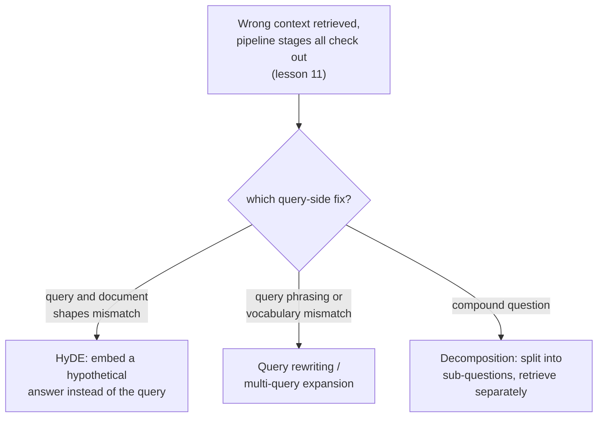

# Урок 14. Преобразование запроса

**Связь с целью курса:** Урок 11 дал поэтапную процедуру поиска той части конвейера поиска, которая виновата, когда возвращается неверный контекст: чанкинг, эмбеддинг, индекс, веса гибридного поиска, реранкинг. Он ни разу не спросил, не в самом ли запросе проблема. Этот урок о том, что делать, когда каждый из этих этапов проверен и чист, а запрос всё равно остаётся тем, что стоит между настоящей потребностью пользователя и настоящим содержимым корпуса.
**Первоисточник:** [Научная статья: "Precise Zero-Shot Dense Retrieval without Relevance Labels" (HyDE), Gao et al., 2022](https://arxiv.org/abs/2212.10496)
**Предварительные требования:** [Урок 11](0011-diagnosing-the-pipeline.md), [Урок 7](0007-reciprocal-rank-fusion.md)

## Разминка

1. ▢ Почему диагностика по небольшому набору заведомо сбойных запросов надёжнее отладки одного анекдотического сбоя?

Проверка

Один сбойный запрос может сбоить по необычной, единичной причине, не отражающей системной проблемы конвейера. Измерение качества поиска по репрезентативному набору известных сбоев на каждом этапе показывает, где происходит наибольшее суммарное падение, а не реакцию на тот единственный сбой, который кто-то случайно заметил.

2. ▢ Почему слияние по взаимным рангам объединяет два рейтинга по их позициям, а не по сырым оценкам?

Проверка

Сырые оценки лексического метода и сырые оценки векторного метода вычисляются на разных, несравнимых шкалах; объединение их напрямую позволило бы доминировать тому методу, который случайно выдаёт большие числа, по причинам, не имеющим отношения к настоящей релевантности. Позиция в рейтинге сопоставима у обоих методов независимо от того, как масштабированы их исходные оценки.

## Что нужно знать

### Запрос и документ это структурно разные виды текста

Запрос пользователя обычно короткий, неформальный и сформулирован как вопрос или несколько ключевых слов; документы корпуса обычно длинные, формальные и сформулированы как утверждения или объяснения. Эмбеддинг обоих одной моделью и сравнение по сходству предполагает, что эта асимметрия не важна, но короткий вопрос и длинный пассаж, отвечающий на него, действительно могут оказаться далеко друг от друга в пространстве эмбеддингов, даже когда пассаж ровно то, что нужно вопросу, просто потому, что это тексты такой разной формы. **Преобразование запроса (query-side transformation)** это общее исправление: менять то, что на самом деле эмбеддится и ищется, не трогая ни один из этапов конвейера из урока 11.

### HyDE: эмбеддить гипотетический ответ вместо вопроса

**HyDE (Hypothetical Document Embeddings)** прямо решает асимметрию запроса и документа: по запросу у следующей инструкциям языковой модели просят, zero-shot, сгенерировать **гипотетический документ**, воображаемый пассаж, который отвечал бы на запрос, и именно этот гипотетический документ эмбеддится и ищется по корпусу, а не исходный запрос. Формулировка самой статьи конкретна в том, почему это работает, хотя гипотетический документ выдуман и может содержать **фактически неверные детали**: задача энкодера улавливать шаблоны релевантности, а его шаг плотного эмбеддинга работает как «бутылочное горлышко», отфильтровывающее выдуманные детали и сохраняющее подлинное тематическое и стилистическое сходство с настоящими релевантными документами. Гипотетический документ не обязан быть правдой; ему нужно лишь иметь форму того пассажа, который действительно ответил бы на вопрос.

### Переписывание запроса и мультизапросное расширение: менять или умножать вопрос, а не ответ

**Переписывание запроса (query rewriting)** более прямолинейно: LLM переформулирует исходный запрос пользователя в более ясный, более явный поисковый запрос до того, как он эмбеддится, снимая неоднозначность, раскрывая аббревиатуру или пересказывая неформальный вопрос языком, более близким к тому, как, вероятно, сформулирован сам корпус. **Мультизапросное расширение (multi-query expansion)** идёт дальше: порождает несколько разных переформулировок одного и того же вопроса, ищет по каждой отдельно и объединяет результаты, часто тем же слиянием по взаимным рангам, о котором уже говорил урок 7 применительно к объединению рейтингов разных методов поиска, поскольку здесь несколько рейтингов получены от нескольких формулировок запроса, а не от нескольких методов. Там, где HyDE наводит мост через асимметрию запроса и документа, переписывание и мультизапросное расширение страхуют от того, что какая-то одна формулировка запроса не попадёт в лексику или подачу самого корпуса.

### Декомпозиция: составной вопрос это по сути несколько вопросов в одном плаще

**Составной вопрос (compound question)** спрашивает о нескольких вещах сразу («какова политика возврата и отличается ли она для годовых подписок?»), и один эмбеддинг всего вопроса оказывается в лучшем случае где-то посередине между областями корпуса, которые отвечали бы на каждую часть, и близок ни к одной. **Декомпозиция запроса (query decomposition)** разбивает составной вопрос на отдельные подвопросы, ищет по каждому независимо и объединяет результаты, так что у каждой части исходного вопроса есть собственный шанс оказаться близко к конкретному пассажу, который на неё действительно отвечает, вместо того чтобы все части соперничали за представление одним усреднённым эмбеддингом, не служащим хорошо ни одной.

### Диагностика самого запроса, а не только конвейера

Процедура урока 11 по порядку спрашивает, делают ли своё дело чанкинг, эмбеддинг, индекс, гибридная смесь и реранкинг. Сбой на стороне запроса снаружи выглядит так же (найден неверный контекст), но переживает каждую из этих проверок: верный чанк существует, эмбеддится разумно, индексируется правильно и хорошо ранжировался бы гибридным поиском и реранкингом, а сам запрос в том виде, в каком он эмбеддится, всё равно не оказывается рядом с ним. Распознать это как отдельную, шестую возможность, а не перенастраивать уже верный этап конвейера, и есть то, ради чего существует преобразование запроса.

## Практика

1. ▢ Команда подтверждает по процедуре урока 11, что верный чанк существует, хорошо заэмбеддён, правильно проиндексирован и высоко ранжировался бы гибридным поиском и реранкингом. Система всё равно возвращает неверный контекст для конкретного запроса. Что это выдвигает как вероятную причину?

Подсказка

Подумайте, что остаётся проверить, когда каждый этап конвейера, который охватывает урок 11, подтверждён как чистый.

Проверка

Сам запрос, в том виде, в каком он эмбеддится и ищется, не оказывается рядом с верным чанком: это сбой на стороне запроса, а не сбой этапа конвейера. Это ровно та шестая возможность, которую поэтапная процедура урока 11 не проверяет, поскольку каждый проверяемый ею этап действительно может быть верен, пока эмбеддинг самого запроса всё равно мажет.

2. ▢ HyDE эмбеддит гипотетический документ, который может содержать фактически неверные детали. Почему эта неверность не подрывает качество поиска?

Проверка

Шаг плотного эмбеддинга в энкодере работает как «бутылочное горлышко», отфильтровывающее выдуманные неверные детали и сохраняющее подлинное тематическое и стилистическое сходство с настоящими релевантными документами; HyDE нужно лишь, чтобы гипотетический документ имел форму настоящего ответа, а не был сам фактически верным.

3. ▢ Пользователь задаёт составной вопрос, охватывающий две не связанные темы в одном предложении. Почему эмбеддинг всего вопроса одним вектором не служит хорошо ни одной теме?

Проверка

Один эмбеддинг составного вопроса оказывается где-то между областями корпуса, которые ответили бы на каждую часть отдельно, и близок ни к одной; разбиение вопроса на отдельные подвопросы и независимый поиск по каждому даёт каждой части собственный шанс оказаться рядом с конкретным пассажем, который на неё действительно отвечает.

4. ▢ Как мультизапросное расширение повторно использует механизм, который эта рабочая область уже разбирала для другой цели?

Проверка

Оно обычно объединяет отдельные результаты поиска по каждой переформулировке запроса слиянием по взаимным рангам (урок 7), той же основанной на рангах техникой, которую изначально использовали для объединения лексического и векторного рейтингов, применённой здесь вместо этого для объединения рейтингов, полученных от нескольких формулировок одного вопроса.

5. ▢ Какое утверждение верно различает HyDE и переписывание запроса с мультизапросным расширением?

    - a) Все три приёма меняют этап конвейера, который уже охватывает урок 11, например модель эмбеддингов или индекс
    - b) HyDE эмбеддит сгенерированный гипотетический ответ вместо запроса, наводя мост через асимметрию формы запроса и документа; переписывание запроса и мультизапросное расширение вместо этого переформулируют (или умножают переформулировки) сам запрос перед его эмбеддингом
    - c) HyDE требует, чтобы генерируемый гипотетический документ был фактически верным, чтобы поиск работал
    - d) Декомпозиция запроса это другое название мультизапросного расширения, без существенной разницы

Проверка

**b)** Это точное различие, которое проводит этот урок между приёмами. (a) неверно: все они это изменения на стороне запроса, а не модификации чанкинга, моделей эмбеддингов, индексации или реранкинга. (c) неверно: формулировка самого HyDE прямо допускает фактически неверные детали в гипотетическом документе, полагаясь на то, что энкодер их отфильтрует. (d) неверно: декомпозиция делит один составной вопрос на отдельные подвопросы, по которым ищут независимо, а мультизапросное расширение порождает несколько полных переформулировок одного вопроса.

## Практика в реальной работе

- [ ] Для RAG-системы, к которой у вас есть доступ, выберите запрос, дающий плохие результаты, и проверьте (по процедуре урока 11), действительно ли каждый этап конвейера чист, прежде чем заключать, что виноват сам запрос.
- [ ] Попробуйте переписать тот же запрос более явно или сгенерировать для него вручную гипотетический ответ в духе HyDE и посмотрите, находит ли какая-то из версий заметно лучший контекст.
- [ ] Завтра: прочитайте целиком раздел с результатами в статье о HyDE и отметьте, каким категориям задач (веб-поиск, вопросы и ответы, проверка фактов) приём помог больше всего и меньше всего.

## Что почитать дальше

- [Научная статья: "Precise Zero-Shot Dense Retrieval without Relevance Labels" (HyDE), Gao et al., 2022](https://arxiv.org/abs/2212.10496)
- [Ресурсы](../RESOURCES.md)

---

Не доходит? Перечитайте первоисточник в начале: этот урок его сжимает, а при сжатии понимание как раз и теряется. Загляните в [глоссарий](../GLOSSARY.md), если какой-то термин показался скользким.

Если неясен сам урок, а не материал, это дефект: [откройте issue](https://github.com/TokenCemetery/teach/issues).
