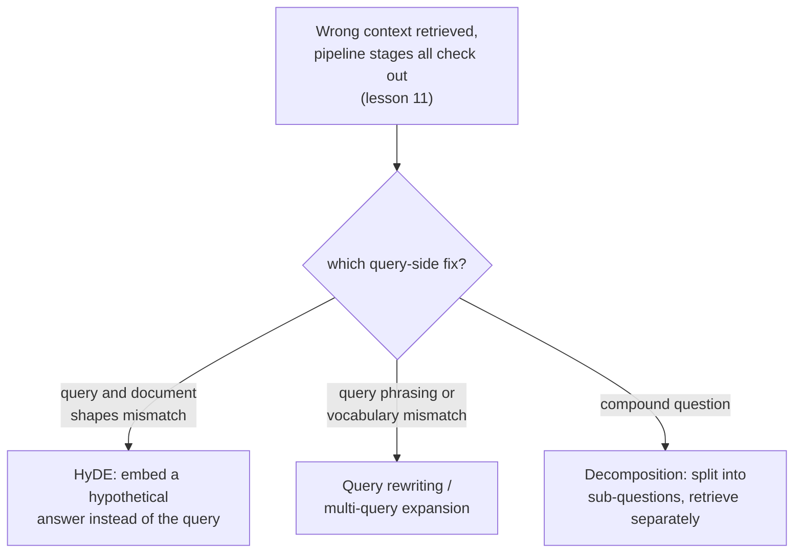

# 第 14 课：查询侧转换

**使命关联:** 第 11 课给出了一套逐阶段的流程，用来在错误的上下文被返回时，找出检索流水线的哪一部分出了问题：分块、嵌入、索引、混合权重、重排序。它从没有问过，问题是否出在查询本身。本课讲的是：当这些阶段逐一检查下来都没有问题，而查询仍然横亘在用户的真实需求与语料库的真实内容之间时，该怎么办。
**主要来源:** [论文：“Precise Zero-Shot Dense Retrieval without Relevance Labels”（HyDE），Gao 等，2022](https://arxiv.org/abs/2212.10496)
**前置知识:** [第 11 课](0011-diagnosing-the-pipeline.md)、[第 7 课](0007-reciprocal-rank-fusion.md)

## 热身

1. ▢ 为什么在一小批已知失败的查询上做诊断，比调试单个孤立的失败更可靠？

检查

单个失败的查询可能因为不寻常的、偶发的原因而失败，并不反映系统性的流水线问题。在每个阶段针对一批有代表性的已知失败案例测量检索质量，可以看出总体上最大的落差出现在哪里，而不是对恰好被某个人注意到的单个失败做出反应。

2. ▢ 倒数排名融合为什么按排名位置，而不是按原始分数来合并两个排名？

检查

词法方法的原始分数和向量方法的原始分数，是在不同的、不可比的尺度上算出来的；直接合并它们，会让恰好产生更大数值的那种方法，因为与实际相关性毫无关系的原因而占据主导。无论两种方法各自的底层分数如何缩放，排名位置在两者之间都是可比的。

## 要点

### 查询和文档，是结构上不同的两类文本

用户的查询通常简短、随意，写成一个问题或几个关键词；语料库中的文档通常很长、很正式，写成陈述或解释。用同一个模型对二者做嵌入，再按相似度比较，是假定这种不对称无关紧要，但一个简短的问题和一段回答它的很长的段落，即使这段话恰恰是问题所需要的，也可能在嵌入空间中真的相距很远，原因仅仅是它们这两段文本的形态差别太大。**查询侧转换**是一般性的修补办法：改变真正被嵌入和搜索的东西，而不是去动第 11 课的任何一个流水线阶段。

### HyDE：嵌入一个假设的答案，而不是问题

**HyDE（Hypothetical Document Embeddings，假设文档嵌入）**直接针对查询与文档的不对称：给定一个查询，让一个能遵循指令的语言模型以零样本方式生成一份**假设文档**，也就是一段设想出来的、能回答该查询的段落，真正被嵌入并拿去语料库中搜索的是这份假设文档，而不是原始查询。论文自己的解释明确说明了，为什么即使假设文档是编造的，可能含有**事实上错误的细节**，这样做仍然有效：编码器的任务是捕捉相关性模式，它的稠密嵌入步骤起着瓶颈的作用，把编造的细节过滤掉，同时保留与真实相关文档在主题和风格上的真正相似。假设文档不必是真的；它只需要在形态上像那种真正能回答该问题的段落。

### 查询改写与多查询扩展：改变或倍增问题，而不是答案

**查询改写**更直接：由 LLM 把用户的原始查询重新表述成更清晰、更明确的搜索查询，再去嵌入，消除歧义、展开缩写，或把随意的提问改写成更接近语料库自身可能措辞的语言。**多查询扩展**则更进一步：为同一个底层问题生成好几种不同的改写，分别检索，再合并结果，通常用的是第 7 课已经讲过的、用于在各检索方法之间合并排名的同一种倒数排名融合，因为这里的多个排名来自同一问题的多种措辞，而不是多种方法。HyDE 弥合的是查询与文档的不对称，而改写和多查询扩展则是对冲这样一种风险：查询的任何单一措辞，都可能错过语料库自身的词汇或表述框架。

### 分解：一个复合问题，其实是裹在同一件风衣里的好几个问题

**复合问题**一次问了不止一件事（“退款政策是什么，年度订阅的政策有不同吗？”），对整个问题做的单个嵌入，充其量落在能分别回答各个部分的语料库区域之间的某个位置，与哪一个都不近。**查询分解**把复合问题拆成各自独立的子问题，对每个子问题分别检索，再合并结果，这样原问题的每个部分都有自己的机会，落到真正回答它的那个具体段落附近，而不是所有部分争着由一个对谁都服务不好的平均嵌入来代表。

### 诊断查询本身，而不只是流水线

第 11 课的流程依次询问：分块、嵌入、索引、混合比例和重排序，是否各自在做好自己的工作。查询侧的失败从外部看起来完全一样（检索到了错误的上下文），却能通过这些检查中的每一项：正确的文本块存在，嵌入合理，索引正确，在混合检索和重排序之后本应排名靠前，但查询本身，按实际嵌入的样子，仍然没有落到它附近。把这识别为一种独立的、第六种可能性，而不是去重新调整一个本来就正确的流水线阶段，正是查询侧转换要解决的事。

## 练习

1. ▢ 某团队用第 11 课的流程确认，正确的文本块存在，嵌入良好，索引正确，在混合检索和重排序下本应排名靠前。系统对某个具体查询仍然返回了错误的上下文。这说明可能的原因是什么？

提示

想一想，第 11 课涵盖的每个流水线阶段都已确认没问题之后，还剩下什么可查。

检查

查询本身，按实际嵌入和搜索的样子，没有落到正确的文本块附近，这是查询侧的失败，而不是流水线阶段的失败。这正是第 11 课逐阶段流程没有检查的第六种可能性，因为它检查的每个阶段都可能确实是正确的，而查询自身的嵌入仍然落空。

2. ▢ HyDE 嵌入的假设文档可能包含事实上不正确的细节。为什么这种不正确并不损害它的检索质量？

检查

编码器的稠密嵌入步骤起着瓶颈的作用，把编造的、不正确的细节过滤掉，同时保留与真实相关文档在主题和风格上的真正相似；HyDE 只需要假设文档在形态上像一个真正的答案，而不需要它在事实上本身是正确的。

3. ▢ 用户用一句话问了一个涵盖两个不相关主题的复合问题。为什么把整个问题嵌入成一个向量，对哪个主题都不好？

检查

复合问题的单个嵌入，落在能分别回答各个部分的语料库区域之间的某个位置，与哪一个都不近；把问题分解成各自独立的子问题，并对每个子问题分别检索，让每个部分都有自己的机会，落到真正回答它的那个具体段落附近。

4. ▢ 多查询扩展是如何把本工作区已经为另一个目的讲过的机制拿来重用的？

检查

它通常用倒数排名融合（第 7 课）来合并每种查询改写各自的检索结果，这与最初用来合并词法排名和向量排名的是同一种基于排名的合并技术，只不过这里用来合并的是同一个问题的多种措辞所产生的排名。

5. ▢ 下列哪项说法正确地区分了 HyDE 与查询改写和多查询扩展？

    - a) 这三种技术都修改了第 11 课已经涵盖的某个流水线阶段，比如嵌入模型或索引
    - b) HyDE 嵌入的是生成的假设答案而不是查询，弥合查询与文档形态上的不对称；查询改写和多查询扩展则是在嵌入之前，重新表述（或倍增改写）查询本身
    - c) HyDE 要求它生成的假设文档在事实上正确，检索才能奏效
    - d) 查询分解是多查询扩展的另一个名字，二者没有实质区别

检查

**b)** 这正是本课对这几种技术所做的精确区分。（a）错误：这些都是查询侧的改动，而不是对分块、嵌入模型、索引或重排序的修改。（c）错误：HyDE 自己的解释明确容忍假设文档中事实上错误的细节，靠编码器把它们过滤掉。（d）错误：分解是把一个复合问题拆成分别独立检索的子问题，而多查询扩展是为一个问题生成好几种完整的改写。

## 实战练习

- [ ] 针对你能访问的某个 RAG 系统，挑一个返回结果不佳的查询，在断定问题出在查询本身之前，先用第 11 课的流程检查每个流水线阶段是否确实都没有问题。
- [ ] 试着把同一个查询改写得更明确，或者手工为它生成一个 HyDE 风格的假设答案，看看其中是否有哪个版本能检索到明显更好的上下文。
- [ ] 明天：通读 HyDE 论文的结果部分，并记下它发现这项技术对哪些任务类别（网页搜索、问答、事实核查）帮助最大、哪些最小。

## 延伸阅读

- [论文：“Precise Zero-Shot Dense Retrieval without Relevance Labels”（HyDE），Gao 等，2022](https://arxiv.org/abs/2212.10496)
- [资源](../RESOURCES.md)

---

没学明白？请重读顶部的主要来源，因为本课是对它的压缩，而理解正是在压缩中流失的。如果有哪个术语觉得含糊，可以查看[术语表](../GLOSSARY.md)。

如果问题出在课程本身，而不是学习材料，那就是一个缺陷：[提交 issue](https://github.com/TokenCemetery/teach/issues)。
