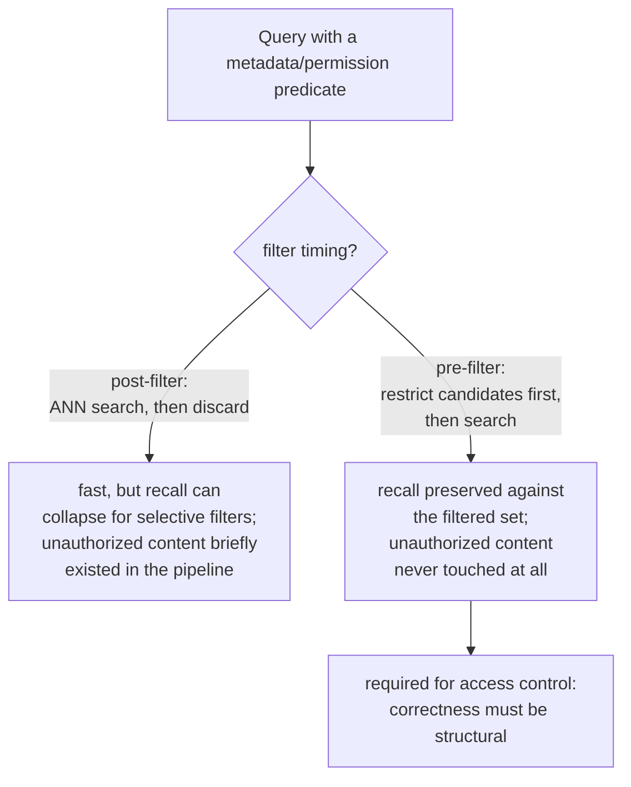

# Lección 15. Filtrado por metadatos y recuperación consciente de permisos

**Vínculo con la misión:** El procedimiento de diagnóstico de la lección 11 trata "se recuperó contexto erróneo" como un problema de relevancia: el chunking, el embedding, el índice, la ponderación híbrida o el reranking hicieron algo mal. Un fallo de permisos produce el mismo síntoma, un chunk que no debía estar en la respuesta, por una razón completamente distinta: el chunk era perfectamente relevante, se recuperó correctamente y simplemente nunca se le permitió verlo al usuario. Esta lección cubre el mecanismo que tiene que impedirlo antes de que el procedimiento de la lección 11 llegue siquiera a tener oportunidad de ejecutarse.
**Fuente principal:** [Paper: "Policy-aware Vector Search: A Vision for Fine Grained Access Control in Vector Databases", Yalamarthi and Pappachan, 2026](https://arxiv.org/abs/2606.19803)
**Requisitos previos:** [Lección 5](0005-pgvector-specifics.md), [Lección 11](0011-diagnosing-the-pipeline.md)

## Calentamiento

1. ▢ ¿Qué te permite combinar pgvector que una operación de búsqueda vectorial pura por sí sola no puede?

Comprobación

Predicados SQL ordinarios y las propias funciones relacionales de Postgres (transacciones, seguridad a nivel de fila, joins) junto con la búsqueda por similitud vectorial, en la misma consulta, en lugar de necesitar un sistema aparte para todo lo que no sea búsqueda pura de vecinos más cercanos.

2. ▢ Una sola consulta fallida puede fallar por una razón aislada que no refleja un problema sistemático del pipeline. ¿Por qué diagnosticar sobre un conjunto pequeño de consultas fallidas conocidas evita esta trampa?

Comprobación

Medir la calidad de la recuperación sobre un conjunto representativo de fallos conocidos revela dónde ocurre la mayor caída agregada y señala una etapa que pierde información de forma sistemática, en lugar de reaccionar ante el fallo único que alguien notó.

## Qué debes saber

### El filtrado por metadatos restringe el conjunto de candidatos a algo más que "el más cercano"

Los chunks reales llevan atributos estructurados además de su texto: un tipo de documento, un departamento, una fecha, un propietario, una etiqueta de sensibilidad. El **filtrado por metadatos** permite que una consulta restrinja la recuperación a los chunks que cumplen un predicado sobre esos atributos ("solo informes del T3", "solo documentos que pertenecen al equipo de este usuario") además de la similitud del vecino más cercano, en lugar de buscar en todo el corpus solo por similitud y esperar que el subconjunto correcto quede casualmente bien ordenado.

### Dónde se ejecuta el filtro respecto de la búsqueda ANN cambia tanto el recall como la corrección

Un filtro de metadatos puede ejecutarse en uno de dos lugares respecto de la búsqueda vectorial. El **posfiltrado** ejecuta primero la búsqueda ANN, sobre todo el índice, y descarta después los resultados que no cumplen el predicado; es rápido, pero un índice aproximado solo escanea un presupuesto acotado de candidatos suponiendo que la mayor parte de lo que encuentra sobrevivirá, así que un predicado selectivo puede descartar la mayor parte de lo que volvió, y dejar muchos menos resultados que los solicitados y arruinar en silencio el recall. El **prefiltrado** restringe el conjunto de candidatos solo a los chunks que cumplen el predicado *antes* de que corra la búsqueda ANN, lo que preserva el recall respecto de ese conjunto filtrado sin importar lo selectivo que sea el predicado, a costa de no aprovechar del todo un índice construido para buscar en todo el espacio vectorial de forma eficiente.

### El control de acceso es el único filtro en el que equivocar el orden es un incidente de seguridad, no de calidad

Que un filtro de metadatos ordinario (rango de fechas, tipo de documento) falle gravemente solo significa peor relevancia, una molestia. Un **filtro de permisos**, que restringe los resultados a lo que el usuario que consulta está realmente autorizado a ver, es distinto en naturaleza: con posfiltrado, el chunk no permitido igualmente se recuperó y existió en el pipeline antes de ser descartado, lo que significa que ya fue tocado, y cualquier error en ese paso de descarte es una divulgación directa de contenido que el usuario nunca debió recibir. Por eso mismo el control de acceso necesita específicamente **prefiltrado** (o una estrategia de aplicación que se comporte de forma equivalente): la corrección de *no mostrar nunca* contenido no autorizado tiene que ser estructural, no un paso de limpieza aplicado a posteriori a resultados que ya lo incluían.

### Un fallo de permisos es silencioso de una forma en que no lo son los otros fallos de la lección 11

Todos los modos de fallo que diagnostica la lección 11 (un pasaje mal dividido en chunks, un embedding desajustado, un índice poco ajustado) producen una respuesta visiblemente errónea o ausente, algo que un usuario o un revisor puede notar y rastrear hasta una etapa. Un fallo de permisos produce una respuesta perfectamente fluida, verosímil y bien formada, construida con contenido que el usuario nunca estuvo autorizado a ver, y nada en la salida parece roto. Nadie se da cuenta hasta que alguien reconoce por casualidad contenido al que no debería haber tenido acceso, y por eso mismo esta clase de error hay que prevenirla de forma estructural, por construcción, en lugar de detectarla después al notar un síntoma como lo hace el procedimiento de diagnóstico de la lección 11 con un fallo de relevancia.

## Práctica

1. ▢ Un equipo aplica un filtro de metadatos de "documentos de este trimestre" con posfiltrado y nota menos resultados de los esperados con un rango de fechas estrecho. ¿Cuál es la causa probable?

Pista

Considera qué suponía el presupuesto de candidatos del índice ANN sobre cuántos resultados sobrevivirían al filtro.

Comprobación

El índice ANN escaneó su presupuesto acotado habitual de candidatos suponiendo que la mayoría de los resultados sobreviviría al filtro, pero un rango de fechas estrecho y selectivo descartó la mayor parte de ellos a posteriori, y dejó muchos menos resultados que los solicitados; es el problema de recall del posfiltrado apareciendo exactamente como se predice para un predicado selectivo.

2. ▢ ¿Por qué el posfiltrado es específicamente inaceptable para un filtro de permisos, aunque pueda ser un compromiso aceptable para un filtro de metadatos ordinario como el tipo de documento?

Comprobación

Con posfiltrado, un chunk que el usuario no está autorizado a ver igualmente se recuperó y existió en el pipeline antes de ser descartado; cualquier error en ese paso de descarte divulga directamente contenido no autorizado. Un filtro de metadatos ordinario que falla gravemente solo cuesta calidad de relevancia, no una garantía de seguridad, así que el mismo compromiso que es solo una molestia para uno es un incidente genuino para el otro.

3. ▢ ¿Por qué no se puede confiar en que el procedimiento de diagnóstico de la lección 11 detecte un fallo de permisos como detecta un fallo de chunking o de embeddings?

Comprobación

Los fallos de la lección 11 producen todos una respuesta visiblemente errónea o ausente que un revisor puede notar y rastrear hasta una etapa. Un fallo de permisos produce una respuesta fluida y bien formada construida con contenido no autorizado, sin que nada en la salida parezca roto; nadie se da cuenta hasta que alguien reconoce por casualidad contenido al que no debería haber tenido acceso, así que hay que prevenirlo de forma estructural y no detectarlo por el síntoma.

4. ▢ ¿Por qué pgvector, como almacén vectorial estándar de este espacio de trabajo, es especialmente adecuado para aplicar el control de acceso correctamente?

Comprobación

Porque permite combinar directamente la búsqueda por similitud vectorial con predicados SQL ordinarios y con las propias funciones relacionales de Postgres, como la seguridad a nivel de fila, en un solo sistema, en lugar de tratar el filtrado y el control de acceso como una preocupación aparte y añadida a posteriori, como hacen algunas bases de datos vectoriales de propósito específico.

5. ▢ ¿Qué afirmación describe correctamente la relación entre prefiltrado, posfiltrado y control de acceso en concreto?

    - a) El prefiltrado y el posfiltrado producen recall y garantías de seguridad idénticos, y difieren solo en comodidad de implementación
    - b) El posfiltrado arriesga un hundimiento del recall con un predicado selectivo y, en los filtros de permisos en concreto, expone contenido no autorizado al pipeline antes de descartarlo; el prefiltrado preserva el recall respecto del conjunto filtrado y nunca deja que el contenido no autorizado entre en el pipeline, y por eso el control de acceso lo requiere específicamente
    - c) Un filtro de metadatos ordinario (como el tipo de documento) y un filtro de permisos tienen las mismas consecuencias si cualquiera de los dos falla
    - d) El procedimiento de diagnóstico de la lección 11 ya cubre los fallos de permisos, ya que producen el mismo síntoma de "contexto erróneo"

Comprobación

**b)** Esa es la distinción precisa que establece esta lección. (a) es falsa: el posfiltrado puede perjudicar gravemente el recall con predicados selectivos y, en el control de acceso en concreto, recupera brevemente contenido que no debería. (c) es falsa: el fallo de un filtro de permisos es un incidente de seguridad, no meramente una regresión de calidad, a diferencia de la mayoría de los filtros de metadatos ordinarios. (d) es falsa: el procedimiento de la lección 11 se construyó para fallos de relevancia visiblemente erróneos, no para una respuesta silenciosamente bien formada construida con contenido no autorizado.

## Prácticas en el mundo real

- [ ] Para un sistema RAG al que tengas acceso, comprueba si aplica algún filtro de metadatos y, de ser así, si se ejecuta antes o después de la búsqueda vectorial.
- [ ] Si el sistema tiene algún requisito de control de acceso o de permisos, comprueba específicamente si con su implementación actual podría recuperarse alguna vez contenido no autorizado (aunque sea temporalmente, antes de ser descartado).
- [ ] Mañana: lee completa la comparación de estrategias de aplicación de la fuente principal y anota qué dicen sus hallazgos preliminares sobre el costo de latencia de garantizar una aplicación correcta frente a una línea base sin filtrar.

## Para profundizar

- [Paper: "Policy-aware Vector Search: A Vision for Fine Grained Access Control in Vector Databases", Yalamarthi and Pappachan, 2026](https://arxiv.org/abs/2606.19803)
- [Repo: pgvector, pgvector](https://github.com/pgvector/pgvector)
- [Recursos](../RESOURCES.md)

---

¿No termina de quedar claro? Vuelve a leer la fuente principal de arriba, ya que esta lección la comprime y en la compresión es donde se escapa la comprensión. Consulta el [glosario](../GLOSSARY.md) por si algún término te resultó resbaladizo.

Si lo poco claro es la propia lección y no el material, eso es un defecto: [abre un issue](https://github.com/TokenCemetery/teach/issues).
