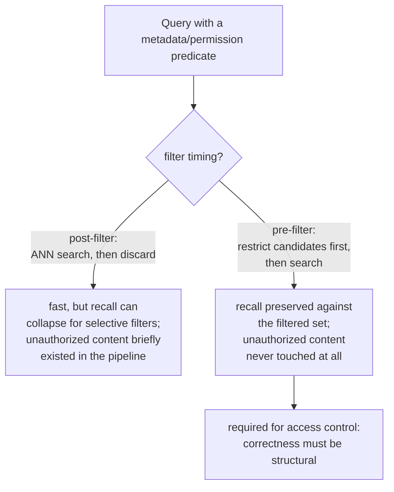

# Leçon 15. Filtrage par métadonnées et récupération respectueuse des permissions

**Lien avec la mission :** La procédure de diagnostic de la leçon 11 traite « contexte récupéré faux » comme un problème de pertinence : le chunking, l'embedding, l'index, la pondération hybride ou le reranking s'est trompé. Une défaillance de permissions produit le symptôme identique, un chunk qui n'aurait pas dû figurer dans la réponse, pour une raison complètement différente : le chunk était parfaitement pertinent, correctement récupéré, et l'utilisateur n'avait simplement jamais le droit de le voir. Cette leçon couvre le mécanisme qui doit l'empêcher avant même que la procédure de la leçon 11 ait la moindre chance de s'exécuter.
**Source primaire :** [Article : "Policy-aware Vector Search: A Vision for Fine Grained Access Control in Vector Databases", Yalamarthi and Pappachan, 2026](https://arxiv.org/abs/2606.19803)
**Prérequis :** [Leçon 5](0005-pgvector-specifics.md), [Leçon 11](0011-diagnosing-the-pipeline.md)

## Échauffement

1. ▢ Que permet pgvector de combiner qu'une pure opération de recherche vectorielle ne peut pas combiner à elle seule ?

Vérifier

Des prédicats SQL ordinaires et les propres fonctionnalités relationnelles de Postgres (transactions, sécurité au niveau des lignes, jointures) avec la recherche de similarité vectorielle, dans la même requête, plutôt que d'avoir besoin d'un système séparé pour tout ce qui n'est pas de la pure recherche de plus proches voisins.

2. ▢ Une seule requête en échec peut échouer pour une raison ponctuelle qui ne reflète pas un problème systémique du pipeline. Pourquoi diagnostiquer sur un petit ensemble de requêtes en échec connues évite-t-il ce piège ?

Vérifier

Mesurer la qualité de la récupération sur un ensemble représentatif d'échecs connus révèle où se produit la plus grosse chute globale, ce qui désigne une étape qui perd systématiquement de l'information plutôt que de réagir à l'échec unique que quelqu'un a remarqué.

## À savoir

### Le filtrage par métadonnées restreint l'ensemble des candidats à plus que le simple « plus proche »

De vrais chunks portent des attributs structurés au-delà de leur texte : un type de document, un service, une date, un propriétaire, une étiquette de sensibilité. Le **filtrage par métadonnées** permet à une requête de restreindre la récupération aux chunks qui satisfont un prédicat portant sur ces attributs (« uniquement les rapports du T3 », « uniquement les documents dont l'équipe de cet utilisateur est propriétaire ») en plus de la similarité du plus proche voisin, plutôt que de chercher dans tout le corpus par la seule similarité en espérant que le bon sous-ensemble se classe haut par hasard.

### L'endroit où le filtre s'exécute par rapport à la recherche ANN change à la fois le recall et la correction

Un filtre de métadonnées peut s'exécuter à deux endroits par rapport à la recherche vectorielle. Le **post-filtrage** exécute d'abord la recherche ANN, sur tout l'index, et rejette après coup les résultats qui échouent au prédicat ; c'est rapide, mais un index approximatif ne balaie qu'un budget borné de candidats en supposant que l'essentiel de ce qu'il trouve survivra, donc un prédicat sélectif peut écarter l'essentiel de ce qui est revenu, ce qui laisse bien moins que le nombre de résultats demandé et ruine discrètement le recall. Le **pré-filtrage** restreint l'ensemble des candidats aux seuls chunks qui satisfont le prédicat *avant* même l'exécution de la recherche ANN, ce qui préserve le recall sur cet ensemble filtré quelle que soit la sélectivité du prédicat, au prix de ne pas exploiter pleinement un index construit pour chercher efficacement dans tout l'espace vectoriel.

### Le contrôle d'accès est le seul filtre où se tromper d'ordre est un incident de sécurité, pas de qualité

Un filtre de métadonnées ordinaire (plage de dates, type de document) qui échoue gravement signifie seulement une moins bonne pertinence, une gêne. Un **filtre de permissions**, qui restreint les résultats à ce que l'utilisateur demandeur est réellement autorisé à voir, est d'une autre nature : avec le post-filtrage, le chunk interdit a quand même été récupéré et a existé dans le pipeline avant d'être écarté, c'est-à-dire qu'il a déjà été touché, et tout bogue dans cette étape de rejet est une divulgation pure et simple d'un contenu que l'utilisateur n'aurait jamais dû recevoir. C'est exactement pourquoi le contrôle d'accès exige précisément un **pré-filtrage** (ou une stratégie d'application des règles qui se comporte de façon équivalente) : la garantie de *ne jamais faire remonter* de contenu non autorisé doit être structurelle, pas une étape de nettoyage appliquée après coup à des résultats qui l'incluaient déjà.

### Une défaillance de permissions est silencieuse d'une façon dont les autres défaillances de la leçon 11 ne le sont pas

Chaque mode de défaillance que la leçon 11 diagnostique (un passage mal découpé en chunks, un embedding mal assorti, un index sous-réglé) produit une réponse visiblement fausse ou manquante, quelque chose qu'un utilisateur ou un relecteur peut remarquer et faire remonter jusqu'à une étape. Une défaillance de permissions produit une réponse parfaitement fluide, plausible et bien formée, construite à partir d'un contenu que l'utilisateur n'avait pas le droit de voir, et rien dans la sortie ne paraît cassé. Personne ne s'en aperçoit tant que quelqu'un ne reconnaît pas par hasard un contenu auquel il n'aurait pas dû avoir accès, ce qui est précisément la raison pour laquelle cette classe de bogues doit être prévenue structurellement, par construction, plutôt que rattrapée plus tard en remarquant un symptôme comme la procédure de diagnostic de la leçon 11 rattrape une défaillance de pertinence.

## Pratique

1. ▢ Une équipe applique un filtre de métadonnées « documents de ce trimestre » avec du post-filtrage, et constate moins de résultats que prévu sur une plage de dates étroite. Quelle est la cause probable ?

Indice

Réfléchissez à ce que le budget de candidats de l'index ANN supposait quant au nombre de résultats qui survivraient au filtre.

Vérifier

L'index ANN a balayé son budget borné habituel de candidats en supposant que la plupart des résultats survivraient au filtre, mais une plage de dates étroite et sélective en a écarté la plupart après coup, laissant bien moins de résultats que demandé ; c'est le problème de recall du post-filtrage qui se manifeste exactement comme prévu pour un prédicat sélectif.

2. ▢ Pourquoi le post-filtrage est-il inacceptable précisément pour un filtre de permissions, alors qu'il peut être un compromis acceptable pour un filtre de métadonnées ordinaire comme le type de document ?

Vérifier

Avec le post-filtrage, un chunk que l'utilisateur n'est pas autorisé à voir a quand même été récupéré et a existé dans le pipeline avant d'être écarté ; tout bogue dans cette étape de rejet divulgue directement un contenu non autorisé. Un filtre de métadonnées ordinaire qui échoue gravement ne coûte que de la qualité de pertinence, pas une garantie de sécurité, donc le même compromis qui n'est qu'une gêne pour l'un est un véritable incident pour l'autre.

3. ▢ Pourquoi ne peut-on pas compter sur la procédure de diagnostic de la leçon 11 pour détecter une défaillance de permissions comme elle détecte une défaillance de chunking ou d'embedding ?

Vérifier

Les défaillances de la leçon 11 produisent toutes une réponse visiblement fausse ou manquante qu'un relecteur peut remarquer et faire remonter jusqu'à une étape. Une défaillance de permissions produit une réponse fluide et bien formée, construite à partir d'un contenu non autorisé, sans que rien dans la sortie paraisse cassé ; personne ne s'en aperçoit tant que quelqu'un ne reconnaît pas par hasard un contenu auquel il n'aurait pas dû avoir accès, donc elle doit être prévenue structurellement plutôt que détectée par un symptôme.

4. ▢ Pourquoi pgvector, en tant que base vectorielle standard de cet espace de travail, est-il particulièrement bien adapté pour appliquer correctement le contrôle d'accès ?

Vérifier

Parce qu'il permet de combiner directement la recherche de similarité vectorielle avec des prédicats SQL ordinaires et les propres fonctionnalités relationnelles de Postgres comme la sécurité au niveau des lignes, dans un seul système, plutôt que de traiter le filtrage et le contrôle d'accès comme une préoccupation séparée et rapportée, comme le font certaines bases vectorielles spécialisées.

5. ▢ Laquelle de ces affirmations décrit correctement la relation entre le pré-filtrage, le post-filtrage et le contrôle d'accès en particulier ?

    - a) Le pré-filtrage et le post-filtrage produisent des garanties de recall et de sécurité identiques, ne différant que par la commodité d'implémentation
    - b) Le post-filtrage risque un effondrement du recall sous un prédicat sélectif et, pour les filtres de permissions en particulier, expose du contenu non autorisé au pipeline avant de l'écarter ; le pré-filtrage préserve le recall sur l'ensemble filtré et ne laisse jamais le contenu non autorisé entrer dans le pipeline, ce qui est la raison pour laquelle le contrôle d'accès l'exige précisément
    - c) Un filtre de métadonnées ordinaire (comme le type de document) et un filtre de permissions ont les mêmes conséquences si l'un ou l'autre échoue
    - d) La procédure de diagnostic de la leçon 11 couvre déjà les défaillances de permissions, puisqu'elles produisent le même symptôme de « mauvais contexte »

Vérifier

**b)** C'est la distinction précise qu'établit cette leçon. (a) est fausse : le post-filtrage peut gravement nuire au recall pour des prédicats sélectifs, et pour le contrôle d'accès en particulier, il récupère brièvement un contenu qu'il ne devrait pas. (c) est fausse : l'échec d'un filtre de permissions est un incident de sécurité, pas seulement une régression de qualité, contrairement à la plupart des filtres de métadonnées ordinaires. (d) est fausse : la procédure de la leçon 11 a été conçue pour des défaillances de pertinence visiblement fausses, pas pour une réponse silencieusement bien formée construite à partir d'un contenu non autorisé.

## Exercices en situation réelle

- [ ] Pour un système RAG auquel vous avez accès, vérifiez s'il applique des filtres de métadonnées, et si oui, s'ils s'exécutent avant ou après la recherche vectorielle.
- [ ] Si le système a une exigence de contrôle d'accès ou de permissions, vérifiez précisément si du contenu non autorisé pourrait jamais être récupéré (même temporairement, avant d'être écarté) avec son implémentation actuelle.
- [ ] Demain : lisez en entier la comparaison des stratégies d'application des règles dans la source primaire, et notez ce que disent ses conclusions préliminaires sur le coût en latence de la garantie d'une application correcte par rapport à une référence sans filtre.

## Pour aller plus loin

- [Article : "Policy-aware Vector Search: A Vision for Fine Grained Access Control in Vector Databases", Yalamarthi and Pappachan, 2026](https://arxiv.org/abs/2606.19803)
- [Dépôt : pgvector, pgvector](https://github.com/pgvector/pgvector)
- [Ressources](../RESOURCES.md)

---

Ça ne passe pas ? Relisez la source primaire en haut de page, car cette leçon la condense et c'est dans la condensation que la compréhension s'échappe. Consultez le [glossaire](../GLOSSARY.md) pour tout terme qui vous a paru glissant.

Si c'est la leçon elle-même qui n'est pas claire plutôt que la matière, c'est un défaut : [ouvrez une issue](https://github.com/TokenCemetery/teach/issues).
