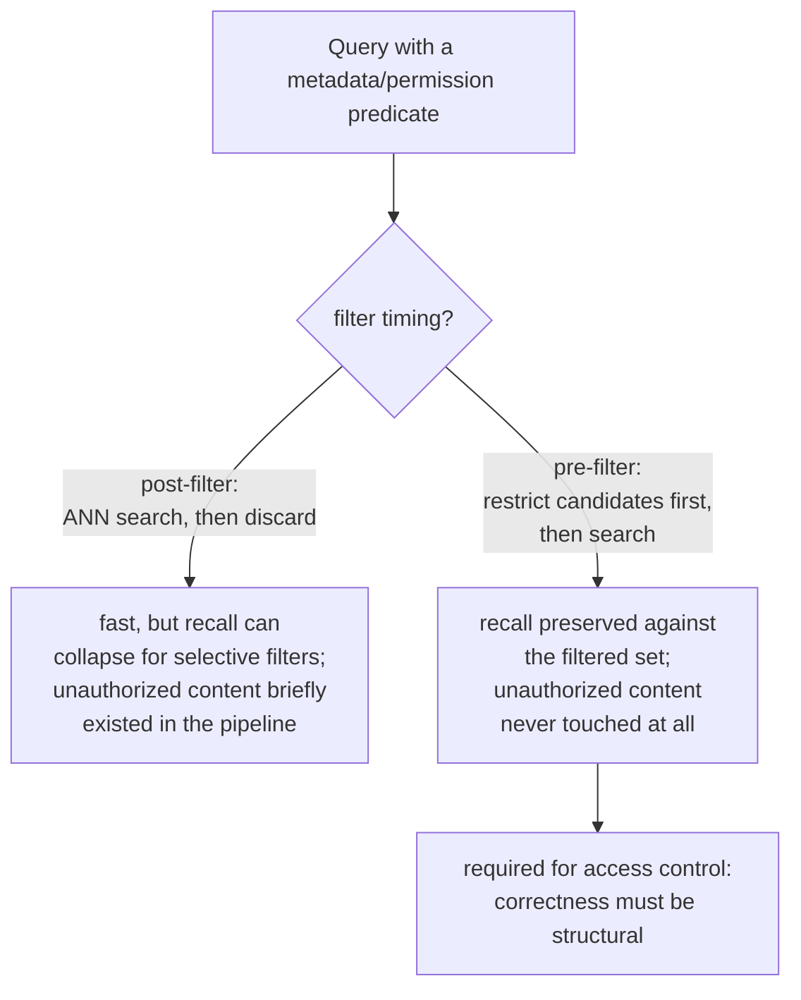

# पाठ 15. Metadata Filtering और Permission-Aware Retrieval

**मिशन से संबंध:** पाठ 11 की diagnosis प्रक्रिया "ग़लत context retrieve हुआ" को relevance की समस्या मानती है: chunking, embedding, index, hybrid weighting या reranking ने कुछ ग़लत किया। Permission की विफलता वही लक्षण पैदा करती है, ऐसा chunk जो उत्तर में नहीं होना चाहिए था, पर बिल्कुल अलग कारण से: chunk पूरी तरह प्रासंगिक था, सही retrieve हुआ, और उपयोगकर्ता को उसे देखने की इजाज़त कभी थी ही नहीं। यह पाठ उस व्यवस्था को कवर करता है जिसे यह रोकना है, इससे पहले कि पाठ 11 की प्रक्रिया को चलने का मौक़ा भी मिले।
**मुख्य स्रोत:** [पेपर: "Policy-aware Vector Search: A Vision for Fine Grained Access Control in Vector Databases", Yalamarthi and Pappachan, 2026](https://arxiv.org/abs/2606.19803)
**पूर्व-आवश्यकताएँ:** [पाठ 5](0005-pgvector-specifics.md), [पाठ 11](0011-diagnosing-the-pipeline.md)

## वार्म-अप

1. ▢ pgvector किस चीज़ को साथ मिलाने देता है जो अकेला शुद्ध vector-search ऑपरेशन नहीं कर सकता?

जाँचें

साधारण SQL predicates और Postgres की अपनी relational सुविधाएँ (transactions, row-level security, joins) को vector similarity search के साथ, एक ही query में, बजाय हर उस चीज़ के लिए अलग system चाहने के जो शुद्ध nearest-neighbor search नहीं है।

2. ▢ कोई एक विफल query किसी एक-बारगी कारण से विफल हो सकती है जो व्यवस्थागत pipeline समस्या को नहीं दर्शाता। ज्ञात-विफल queries के छोटे सेट पर diagnose करना इस जाल से कैसे बचाता है?

जाँचें

ज्ञात विफलताओं के प्रतिनिधि सेट पर retrieval की गुणवत्ता मापना दिखाता है कि कुल मिलाकर सबसे बड़ी गिरावट कहाँ होती है, और उस चरण की ओर इशारा करता है जो व्यवस्थित रूप से जानकारी खो रहा है, बजाय उस अकेली विफलता पर प्रतिक्रिया करने के जिसे किसी ने संयोग से नोटिस कर लिया।

## यह जानें

### Metadata filtering candidate सेट को सिर्फ़ "सबसे नज़दीकी" से ज़्यादा तक सीमित करता है

असली chunks अपने text के अलावा संरचित attributes भी रखते हैं: document का प्रकार, विभाग, तारीख़, मालिक, संवेदनशीलता का tag। **Metadata filtering** query को retrieval इन attributes पर किसी predicate से मेल खाने वाले chunks तक सीमित करने देता है ("सिर्फ़ Q3 की रिपोर्टें", "सिर्फ़ वे documents जो इस उपयोगकर्ता की टीम के हैं"), nearest-neighbor similarity के साथ-साथ, बजाय सिर्फ़ similarity से पूरे corpus में खोजने और उम्मीद करने के कि सही उपसमूह संयोग से ऊँचा rank कर जाए।

### Filter ANN search के सापेक्ष कहाँ चलता है, यह recall और सहीपन दोनों बदलता है

Metadata filter vector search के सापेक्ष दो में से किसी एक जगह चल सकता है। **Post-filtering** पहले पूरे index पर ANN search चलाता है और बाद में उन नतीजों को हटाता है जो predicate में फ़ेल हों; यह तेज़ है, पर approximate index सिर्फ़ सीमित candidate budget स्कैन करता है यह मानकर कि जो मिलेगा उसका ज़्यादातर बचेगा, इसलिए selective predicate ज़्यादातर लौटे नतीजे हटा सकता है, माँगी गई संख्या से कहीं कम नतीजे छोड़ते हुए और चुपचाप recall बिगाड़ते हुए। **Pre-filtering** ANN search चलने से *पहले* ही candidate सेट को सिर्फ़ उन chunks तक सीमित करता है जो predicate पर खरे उतरते हैं, उस filter किए सेट के विरुद्ध recall बचाते हुए, predicate कितना भी selective हो, इस क़ीमत पर कि पूरे vector space में कुशलता से खोजने के लिए बने index का पूरा फ़ायदा नहीं उठाया जाता।

### Access control वह एक filter है जहाँ क्रम ग़लत होना security incident है, गुणवत्ता की चूक नहीं

साधारण metadata filter (तारीख़ का दायरा, document का प्रकार) का बुरी तरह चूकना बस ख़राब relevance है, एक असुविधा। **Permission filter**, यानी नतीजों को उसी तक सीमित करना जो अनुरोध करने वाले उपयोगकर्ता को असल में देखने की अनुमति है, प्रकृति में अलग है: post-filtering में, अस्वीकृत chunk फिर भी retrieve हुआ और हटाए जाने से पहले pipeline में मौजूद रहा, यानी वह पहले ही छू लिया गया, और उस हटाने के चरण में कोई भी bug उस सामग्री का सीधा खुलासा है जो उपयोगकर्ता को कभी मिलनी ही नहीं थी। ठीक इसीलिए access control को ख़ास तौर पर **pre-filtering** (या उसके बराबर बर्ताव करने वाली enforcement रणनीति) चाहिए: अनधिकृत सामग्री को *कभी सामने न लाने* का सहीपन संरचनात्मक होना चाहिए, ऐसे नतीजों पर बाद में लगाई गई सफ़ाई का चरण नहीं जिनमें वह पहले से शामिल थी।

### Permission की विफलता ऐसे चुप रहती है जैसे पाठ 11 की बाक़ी विफलताएँ नहीं

पाठ 11 जिन हर विफलता को diagnose करता है (ख़राब chunk हुआ passage, बेमेल embedding, कम tune किया index) वह साफ़ ग़लत या ग़ायब उत्तर पैदा करती है, जिसे उपयोगकर्ता या समीक्षक नोटिस कर सकता है और किसी चरण तक वापस खोज सकता है। Permission की विफलता बिल्कुल प्रवाहपूर्ण, विश्वसनीय, सही बना उत्तर पैदा करती है, ऐसी सामग्री से जिसे देखने की उपयोगकर्ता को कभी अनुमति नहीं थी, और output में कुछ टूटा नहीं दिखता। तब तक कोई नोटिस नहीं करता जब तक कोई संयोग से ऐसी सामग्री न पहचान ले जिस तक उसकी पहुँच नहीं होनी थी, और ठीक इसीलिए इस तरह के bug को संरचनात्मक रूप से, बनावट से रोकना पड़ता है, बाद में किसी लक्षण को नोटिस करके पकड़ने से नहीं, जैसे पाठ 11 की diagnosis प्रक्रिया relevance की विफलता को पकड़ती है।

## अभ्यास

1. ▢ एक टीम "इस तिमाही के documents" के लिए metadata filter post-filtering से लगाती है, और तंग तारीख़ दायरे पर अपेक्षा से कम नतीजे देखती है। संभावित कारण क्या है?

संकेत

विचार करें कि ANN index के candidate budget ने मान रखा था कि filter के बाद कितने नतीजे बचेंगे।

जाँचें

ANN index ने अपना आम सीमित candidate budget स्कैन किया यह मानकर कि ज़्यादातर नतीजे filter से बच जाएँगे, पर तंग, selective तारीख़ दायरे ने बाद में उनमें से ज़्यादातर हटा दिए, माँगे गए से कहीं कम नतीजे छोड़ते हुए; यह post-filtering की recall की समस्या है जो selective predicate के लिए ठीक अनुमान के अनुसार दिख रही है।

2. ▢ Post-filtering permission filter के लिए ख़ास तौर पर अस्वीकार्य क्यों है, जबकि document के प्रकार जैसे साधारण metadata filter के लिए वह स्वीकार्य trade-off हो सकता है?

जाँचें

Post-filtering में, जिस chunk को देखने की उपयोगकर्ता को अनुमति नहीं है वह फिर भी retrieve हुआ और हटाए जाने से पहले pipeline में मौजूद रहा; उस हटाने के चरण में कोई भी bug अनधिकृत सामग्री का सीधा खुलासा करता है। साधारण metadata filter का बुरी तरह चूकना सिर्फ़ relevance की गुणवत्ता की क़ीमत लेता है, किसी सुरक्षा गारंटी की नहीं, इसलिए वही trade-off एक के लिए महज़ असुविधा है और दूसरे के लिए असली incident।

3. ▢ पाठ 11 की diagnosis प्रक्रिया पर permission की विफलता पकड़ने के लिए वैसे भरोसा क्यों नहीं किया जा सकता जैसे chunking या embedding की विफलता पकड़ने के लिए किया जाता है?

जाँचें

पाठ 11 की विफलताएँ सब साफ़ ग़लत या ग़ायब उत्तर पैदा करती हैं जिसे समीक्षक नोटिस कर सकता है और किसी चरण तक खोज सकता है। Permission की विफलता अनधिकृत सामग्री से बना प्रवाहपूर्ण, सही बना उत्तर पैदा करती है, और output में कुछ टूटा नहीं दिखता; तब तक कोई नोटिस नहीं करता जब तक कोई संयोग से ऐसी सामग्री न पहचान ले जिस तक उसकी पहुँच नहीं होनी थी, इसलिए उसे संरचनात्मक रूप से रोकना पड़ता है, लक्षण से पकड़ना नहीं।

4. ▢ pgvector, इस workspace के मानक vector store के रूप में, access control को सही ढंग से लागू करने के लिए ख़ास तौर पर उपयुक्त क्यों है?

जाँचें

क्योंकि वह vector similarity search को साधारण SQL predicates और Postgres की अपनी relational सुविधाओं, जैसे row-level security, के साथ एक ही system में सीधे मिलाने देता है, बजाय filtering और access control को एक अलग, ऊपर से जोड़ी गई चिंता मानने के, जैसा कुछ विशेष-उद्देश्य वाले vector databases करते हैं।

5. ▢ कौन-सा दावा pre-filtering, post-filtering और ख़ास तौर पर access control के रिश्ते को सही बताता है?

    - a) Pre-filtering और post-filtering एक-जैसी recall और सुरक्षा गारंटियाँ देते हैं, सिर्फ़ implementation की सुविधा में अलग हैं
    - b) Post-filtering selective predicate के तहत recall के ढहने का जोखिम रखता है और, permission filters के लिए ख़ास तौर पर, हटाने से पहले अनधिकृत सामग्री को pipeline के सामने उजागर करता है; pre-filtering filter किए सेट के विरुद्ध recall बचाता है और अनधिकृत सामग्री को pipeline में घुसने ही नहीं देता, इसीलिए access control को ख़ास तौर पर वही चाहिए
    - c) साधारण metadata filter (जैसे document का प्रकार) और permission filter के चूकने के नतीजे एक-जैसे हैं
    - d) पाठ 11 की diagnosis प्रक्रिया permission की विफलताओं को पहले से कवर करती है, क्योंकि वे वही "ग़लत context" लक्षण पैदा करती हैं

जाँचें

**b)** यही वह ठीक अंतर है जो यह पाठ स्थापित करता है। (a) ग़लत है: post-filtering selective predicates के लिए recall को गंभीर नुक़सान पहुँचा सकता है, और ख़ास तौर पर access control के लिए, वह सामग्री थोड़ी देर retrieve करता है जो उसे नहीं करनी चाहिए। (c) ग़लत है: permission filter की विफलता security incident है, सिर्फ़ गुणवत्ता की गिरावट नहीं, ज़्यादातर साधारण metadata filters के उलट। (d) ग़लत है: पाठ 11 की प्रक्रिया साफ़ ग़लत relevance विफलताओं के लिए बनी थी, अनधिकृत सामग्री से चुपचाप सही बने उत्तर के लिए नहीं।

## असली दुनिया का अभ्यास

- [ ] जिस RAG system तक आपकी पहुँच है, उसके लिए जाँचें कि वह कोई metadata filters लगाता है या नहीं, और अगर हाँ, तो वे vector search से पहले चलते हैं या बाद में।
- [ ] अगर system में कोई access-control या permission की ज़रूरत है, तो ख़ास तौर पर जाँचें कि उसके मौजूदा implementation में अनधिकृत सामग्री कभी retrieve हो सकती है या नहीं (हटाए जाने से पहले अस्थायी रूप से भी)।
- [ ] कल: मुख्य स्रोत में enforcement रणनीतियों की तुलना पूरी पढ़ें, और नोट करें कि सही enforcement की गारंटी की latency लागत के बारे में, बिना filter वाले baseline की तुलना में, उसके शुरुआती निष्कर्ष क्या कहते हैं।

## आगे बढ़ने के लिए

- [पेपर: "Policy-aware Vector Search: A Vision for Fine Grained Access Control in Vector Databases", Yalamarthi and Pappachan, 2026](https://arxiv.org/abs/2606.19803)
- [Repo: pgvector, pgvector](https://github.com/pgvector/pgvector)
- [संसाधन](../RESOURCES.md)

---

बात नहीं बन रही? ऊपर दिए primary source को दोबारा पढ़ें, क्योंकि यह पाठ उसे संक्षिप्त करता है और समझ संक्षेप में ही रिसती है। जो शब्द फिसलन भरा लगे, उसके लिए [शब्दावली](../GLOSSARY.md) देखें।

अगर दिक़्क़त सामग्री की नहीं बल्कि पाठ की ही है, तो वह एक खोट है: [issue खोलें](https://github.com/TokenCemetery/teach/issues)।
